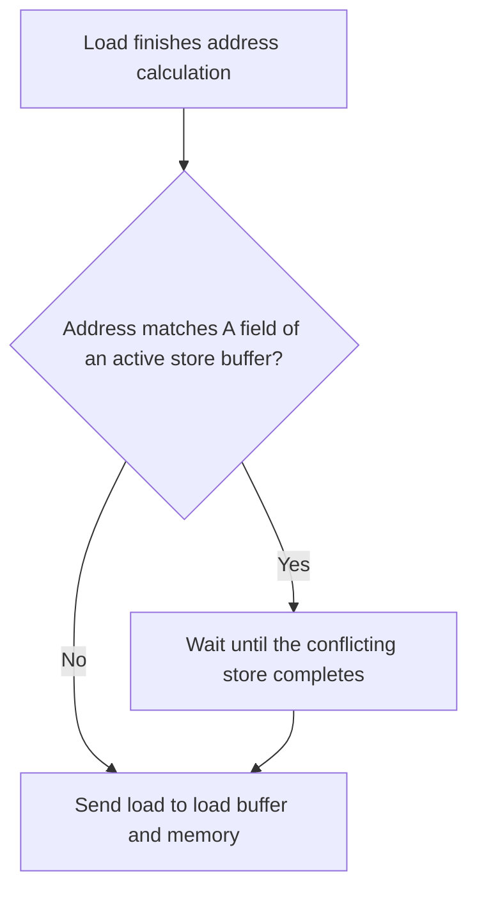

# بخش ۸، جلسه‌ی ۴ از ۱۳: توماسولو در حلقه و ابهام‌زدایی حافظه

این جلسه بخشی از **بخش ۸: موازی‌سازی پویا در سطح دستور** است. زمان مطالعه: حدود نیم ساعت.

**فهرست این جلسه:**

- ۱. باز کردن پویای حلقه
- ۲. عکس کتاب: دو تکرار در جریان
- ۳. مثال سیکلی اسلاید: حلقه با عدم اصابت کش
- ۴. مخاطره‌ها از راه حافظه
- ۵. ابهام‌زدایی آدرس‌ها
- ۶. مزایا، معایب و میراث
- ۷. چرا توماسولو در دهه‌ی ۱۹۹۰ برگشت
- ۸. تمرین‌ها

---

## ۱. باز کردن پویای حلقه

قدرت واقعی تغییر نام در حلقه‌ها دیده می‌شود. حلقه‌ی کتاب که آرایه‌ای را در یک عدد ثابت (F2) ضرب می‌کند:

```asm
Loop:   L.D     F0,0(R1)
        MUL.D   F4,F0,F2
        S.D     F4,0(R1)
        DADDIU  R1,R1,-8
        BNE     R1,R2,Loop      ; branches if R1 != R2
```

اگر پرش «انجام‌شده» پیش‌بینی شود، دستورات تکرار بعدی صادر می‌شوند در حالی که تکرار قبلی هنوز در جریان است. هر دو تکرار از **همان ثبات‌های معماری** (F0 و F4) استفاده می‌کنند، ولی در ایستگاه‌های رزرو **نام‌های متفاوت** می‌گیرند (Load1 و Load2، Mult1 و Mult2). پس انگار سخت‌افزار حلقه را **بدون تغییر کد باز کرده** و ایستگاه‌های رزرو نقش ثبات‌های اضافه‌ی جلسه‌ی ۷-۳ را بازی می‌کنند.

## ۲. عکس کتاب: دو تکرار در جریان

فرض: همه‌ی دستورات دو تکرار صادر شده‌اند، ولی هیچ بارگذاری، ذخیره یا عملیات ممیز شناوری تمام نشده است (دستورات صحیح نادیده گرفته شده و پرش انجام‌شده پیش‌بینی شده).

| دستور | تکرار | صدور | اجرا | نوشتن نتیجه |
|---|---|---|---|---|
| دستور `L.D F0,0(R1)` | 1 | انجام شد | انجام شد | |
| دستور `MUL.D F4,F0,F2` | 1 | انجام شد | | |
| دستور `S.D F4,0(R1)` | 1 | انجام شد | | |
| دستور `L.D F0,0(R1)` | 2 | انجام شد | انجام شد | |
| دستور `MUL.D F4,F0,F2` | 2 | انجام شد | | |
| دستور `S.D F4,0(R1)` | 2 | انجام شد | | |

| نام | Busy | Op | Vj | Vk | Qj | Qk | A |
|---|---|---|---|---|---|---|---|
| بافر Load1 | Yes | Load | | | | | Regs[R1] + 0 |
| بافر Load2 | Yes | Load | | | | | Regs[R1] − 8 |
| ایستگاه Mult1 | Yes | MUL | | Regs[F2] | Load1 | | |
| ایستگاه Mult2 | Yes | MUL | | Regs[F2] | Load2 | | |
| بافر Store1 | Yes | Store | Regs[R1] | | | Mult1 | |
| بافر Store2 | Yes | Store | Regs[R1] − 8 | | | Mult2 | |

| فیلد | F0 | F2 | F4 |
|---|---|---|---|
| مقدار Qi | Load2 | | Mult2 |

- **دو نسخه‌ی F0:** ضرب تکرار اول منتظر Load1 و ضرب تکرار دوم منتظر Load2 است. ثبات F0 فقط آخرین نویسنده (Load2) را می‌شناسد.
- **ذخیره‌ها:** هر ذخیره منتظر ضرب **همان تکرار** است.

کتاب می‌گوید وقتی به این حالت برسیم، اگر ضرب‌ها در چهار سیکل تمام شوند، دو نسخه از حلقه می‌توانند با CPI نزدیک به ۱ اجرا شوند. با تأخیر ضرب ۶ سیکل، تکرارهای بیشتری باید همزمان در جریان باشند تا به حالت پایدار برسیم، یعنی ایستگاه‌های رزرو بیشتر لازم است.

## ۳. مثال سیکلی اسلاید: حلقه با عدم اصابت کش

اسلاید درس همین حلقه را سیکل به سیکل اجرا می‌کند (با نام‌های قدیمی `LD`، `MULTD`، `SD`، `SUBI` و `BNEZ`). فرض‌ها:

- **ضرب:** ۴ سیکل.
- **بارگذاری اول:** ۸ سیکل (عدم اصابت کش). بارگذاری دوم: ۴ سیکل (اصابت).
- **مقدار اولیه‌ی R1:** ۸۰. پس تکرار اول آدرس ۸۰ و تکرار دوم آدرس ۷۲ را دارد.
- **دستورات صحیح:** `SUBI` و `BNEZ` هم یک سیکل صدور می‌گیرند (در سیکل‌های ۴ و ۵).

خلاصه‌ی دو تکرار:

| دستور | تکرار | صدور | اتمام اجرا | نوشتن نتیجه |
|---|---|---|---|---|
| دستور `LD F0,0(R1)` | 1 | 1 | 9 | 10 |
| دستور `MULTD F4,F0,F2` | 1 | 2 | 14 | 15 |
| دستور `SD F4,0(R1)` | 1 | 3 | 18 | 19 |
| دستور `LD F0,0(R1)` | 2 | 6 | 10 | 11 |
| دستور `MULTD F4,F0,F2` | 2 | 7 | 15 | 16 |
| دستور `SD F4,0(R1)` | 2 | 8 | 20 | 21 |

نکته‌هایی که اسلاید روی آن‌ها انگشت می‌گذارد:

- **ثبات F0 هرگز نتیجه‌ی Load1 را نمی‌بیند:** در سیکل ۶، با صدور بارگذاری دوم، فیلد Qi ثبات F0 به Load2 تغییر می‌کند. وقتی Load1 در سیکل ۱۰ نتیجه را پخش می‌کند، فقط Mult1 آن را می‌گیرد، نه ثبات F0.
- **در ایستگاه‌ها نام ثبات نیست:** ایستگاه‌های Mult1 و Mult2 فقط مقدار F2 و نام بافر بارگذاری را دارند، نه نام F0.
- **بارگذاری دوم زودتر تمام می‌شود:** بارگذاری دوم در سیکل ۶ صادر شده ولی چون اصابت دارد، در سیکل ۱۰ تمام می‌شود، یعنی هم‌زمان با بارگذاری اول که ۵ سیکل زودتر صادر شده بود. پردازنده در زمان عدم اصابت کش، کار مفید انجام داده است.
- **ضرب‌ها پشت سر هم:** ضرب اول از سیکل ۱۱ و ضرب دوم از سیکل ۱۲ اجرا می‌شوند (ضرب‌کننده خط لوله‌ای یا دو تایی فرض شده).

## ۴. مخاطره‌ها از راه حافظه

یک بارگذاری و یک ذخیره را می‌توان با خیال راحت خارج از ترتیب اجرا کرد، **به شرط اینکه آدرس‌هایشان متفاوت باشد**. اگر آدرس یکی باشد:

| حالت | جابه‌جایی چه می‌کند |
|---|---|
| بارگذاری قبل از ذخیره است | جابه‌جایی مخاطره‌ی **WAR** می‌سازد: بارگذاری مقدار جدید را می‌خواند |
| ذخیره قبل از بارگذاری است | جابه‌جایی مخاطره‌ی **RAW** می‌سازد: بارگذاری مقدار قدیمی را می‌خواند |
| دو ذخیره به یک آدرس | جابه‌جایی مخاطره‌ی **WAW** می‌سازد: مقدار نهایی غلط است |

فرق اساسی با ثبات‌ها: نام ثبات در دستور ثابت است، ولی آدرس حافظه **در زمان اجرا** حساب می‌شود. پس تشخیص این مخاطره‌ها در سخت‌افزار به آدرس‌های محاسبه‌شده نیاز دارد.

## ۵. ابهام‌زدایی آدرس‌ها

قواعد کتاب:

- **بارگذاری:** فقط وقتی می‌تواند اجرا شود که هیچ ذخیره‌ی **تمام‌نشده‌ای که در ترتیب برنامه قبل از آن است** همان آدرس را نداشته باشد.
- **ذخیره:** باید صبر کند تا هیچ بارگذاری یا ذخیره‌ی **اجرانشده‌ای که قبل از آن است** همان آدرس را نداشته باشد.

برای این بررسی، پردازنده باید آدرس همه‌ی دسترسی‌های حافظه‌ی قبلی را حساب کرده باشد. ساده‌ترین راه (نه لزوماً بهترین): **محاسبه‌ی آدرس مؤثر به ترتیب برنامه**. در واقع فقط ترتیب نسبی ذخیره‌ها با بقیه‌ی دسترسی‌ها لازم است؛ بارگذاری‌ها نسبت به هم می‌توانند آزادانه جابه‌جا شوند.



- **برای بارگذاری:** بعد از محاسبه‌ی آدرس، فیلد A همه‌ی بافرهای ذخیره‌ی فعال بررسی می‌شود. اگر تطبیق داشت، بارگذاری صبر می‌کند تا آن ذخیره تمام شود. بعضی پیاده‌سازی‌ها مقدار را **مستقیماً از ذخیره به بارگذاری** می‌رسانند (Store-to-load forwarding) تا این صبر کوتاه شود.
- **برای ذخیره:** هم بافرهای بارگذاری و هم بافرهای ذخیره بررسی می‌شوند، چون ذخیره نسبت به هیچ‌کدام نمی‌تواند جابه‌جا شود.

جلسه‌ی ۸-۱۰ یک روش پیشرفته‌تر را می‌بیند: **پیش‌بینی هم‌نامی آدرس**، که حدس می‌زند دو دسترسی تداخل ندارند و اجازه‌ی جابه‌جایی قبل از معلوم شدن آدرس را می‌دهد.

## ۶. مزایا، معایب و میراث

جمع‌بندی اسلاید درس و کتاب:

**مزایا:**

- **ثبات‌ها گلوگاه نیستند:** تعداد ایستگاه‌ها بیش از ثبات‌هاست.
- **حذف WAR و WAW** با تغییر نام.
- **باز کردن حلقه در سخت‌افزار.**
- **گذرگاه CDB** نتیجه را همزمان به همه‌ی منتظرها می‌رساند.

**معایب:**

- **پیچیدگی سخت‌افزار:** هر ایستگاه یک بافر **انجمنی** دارد که باید با سرعت بالا کار کند، به‌علاوه‌ی منطق کنترل پیچیده.
- **گلوگاه CDB:** در هر سیکل فقط یک نتیجه می‌تواند پخش شود. می‌توان CDB‌های بیشتری گذاشت، ولی هر CDB باید به همه‌ی ایستگاه‌ها برسد و سخت‌افزار تطبیق برچسب برای هر CDB در هر ایستگاه تکرار می‌شود. (سؤال امتحانی جلسه‌ی بعد درباره‌ی همین گلوگاه است.)

**میراث ماندگار:**

- **زمان‌بندی پویا**
- **تغییر نام ثبات**
- **ابهام‌زدایی بارگذاری و ذخیره**

کتاب نکته‌ی ظریفی هم می‌گوید: روش توماسولو دو تکنیک را ترکیب کرده است: **تغییر نام** ثبات‌های معماری به مجموعه‌ی بزرگ‌تر، و **بافر کردن عملوندهای منبع** از فایل ثبات. بافر کردن عملوند، WAR را وقتی عملوند در ثبات آماده است حل می‌کند. در گمانه‌زنی خواهیم دید که WAR را می‌توان با تغییر نام به‌علاوه‌ی نگه‌داری نتیجه تا وقتی هیچ ارجاعی به نسخه‌ی قبلی ثبات نمانده هم حل کرد.

## ۷. چرا توماسولو در دهه‌ی ۱۹۹۰ برگشت

این روش بعد از IBM 360/91 سال‌ها استفاده نشد، ولی از دهه‌ی ۱۹۹۰ در پردازنده‌های چندصدوری همه‌گیر شد. کتاب سه دلیل می‌گوید:

1. **کش‌ها:** با اینکه الگوریتم قبل از اختراع کش طراحی شده بود، تأخیرهای غیرقابل پیش‌بینی کش یکی از انگیزه‌های اصلی زمان‌بندی پویا شد. اجرای خارج از ترتیب اجازه می‌دهد در زمان عدم اصابت کش، دستورات دیگر اجرا شوند و همه یا بخشی از جریمه پنهان شود. (همان چیزی که در مثال بخش ۳ دیدیم.)
2. **صدور تهاجمی‌تر:** با صدور چندتایی و کدهای سخت‌زمان‌بندی (مثل بیشتر کدهای غیرعددی)، تغییر نام، زمان‌بندی پویا و گمانه‌زنی مهم‌تر شدند.
3. **نرم‌افزار انبوه:** کارایی بالا بدون اینکه کامپایلر کد را برای یک خط لوله‌ی خاص تنظیم کند. در دوران نرم‌افزارهای تجاری آماده، این خیلی ارزشمند است.

نوادگان معروف: پنتیوم پرو و نسل‌های بعدی اینتل، PowerPC، MIPS R10000 و Alpha 21264.

## ۸. تمرین‌ها

<details>
<summary>تمرین ۱: کدام بارگذاری می‌تواند جلو برود</summary>

**صورت:** دنباله‌ی زیر را در نظر بگیر. آدرس‌ها در پرانتز (بعد از محاسبه) آمده‌اند و ذخیره‌ی اول هنوز مقدارش آماده نیست:

```asm
S.D   F4,0(R1)      ; address 1000, value not ready
L.D   F6,0(R2)      ; address 2000
L.D   F8,8(R3)      ; address 1000
```

کدام بارگذاری می‌تواند قبل از ذخیره اجرا شود؟

**جواب:** بارگذاری اول (آدرس ۲۰۰۰) با هیچ ذخیره‌ی فعالی تداخل ندارد و می‌تواند جلو برود. بارگذاری دوم با ذخیره‌ی فعال (۱۰۰۰) تطبیق دارد و باید صبر کند تا ذخیره تمام شود، یا اگر سخت‌افزار ارسال ذخیره به بارگذاری دارد، مقدار را مستقیماً از ذخیره بگیرد.
</details>

<details>
<summary>تمرین ۲: وقتی آدرس معلوم نیست</summary>

**صورت:** چرا محاسبه‌ی آدرس‌ها به ترتیب برنامه انجام می‌شود؟ اگر یک ذخیره‌ی قبلی ثبات پایه‌اش آماده نباشد چه می‌شود؟

**جواب:** وقتی بارگذاری آدرسش را حساب می‌کند، باید آدرس **همه‌ی** ذخیره‌های قبلی معلوم باشد تا بتواند آن‌ها را بررسی کند. محاسبه‌ی به ترتیب این را تضمین می‌کند. اگر ثبات پایه‌ی یک ذخیره‌ی قبلی آماده نباشد، محاسبه‌ی آدرس بارگذاری‌های بعدی هم صبر می‌کند. این محدودیت کارایی را کم می‌کند و دلیل پیدایش پیش‌بینی هم‌نامی آدرس است.
</details>

<details>
<summary>تمرین ۳: ایستگاه‌های کافی</summary>

**صورت:** در حلقه‌ی بخش ۱، ضرب ۶ سیکل و بارگذاری ۲ سیکل طول می‌کشد و در هر سیکل یک دستور صادر می‌شود. برای حالت پایدار حدوداً چند تکرار باید همزمان در جریان باشند؟

**جواب:** هر تکرار ۵ دستور است، پس در حالت پایدار هر ۵ سیکل یک تکرار جدید شروع می‌شود. یک تکرار از صدور بارگذاری تا نوشتن ذخیره حدوداً 1 + 2 + 1 + 6 + 1 + 1 ≈ 12 سیکل در جریان است (صدور، بارگذاری، پخش، ضرب، پخش، ذخیره). پس حدود 12 / 5 ≈ 3 تکرار همزمان. یعنی دست‌کم ۳ بافر بارگذاری، ۳ ایستگاه ضرب و ۳ بافر ذخیره لازم است.
</details>

---

جلسه‌ی قبلی: [الگوریتم توماسولو: جزئیات و مثال سیکل به سیکل](8-3-tomasulo-details-and-example.md)  
جلسه‌ی بعدی: [حل سؤال امتحانی: رقابت روی گذرگاه CDB](8-5-cdb-contention-exam.md)
