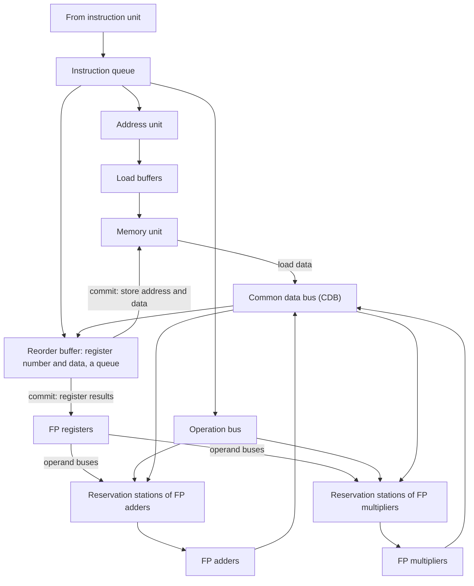

# بخش ۸، جلسه‌ی ۶ از ۱۳: گمانه‌زنی سخت‌افزاری و بافر بازترتیب

این جلسه بخشی از **بخش ۸: موازی‌سازی پویا در سطح دستور** است. زمان مطالعه: حدود نیم ساعت.

**فهرست این جلسه:**

- ۱. چرا پیش‌بینی پرش کافی نیست
- ۲. سه ایده‌ی گمانه‌زنی سخت‌افزاری
- ۳. جدا کردن اجرا از نهایی‌سازی
- ۴. بافر بازترتیب
- ۵. ساختار پردازنده با گمانه‌زنی
- ۶. چهار مرحله‌ی هر دستور
- ۷. مثال: همان کد، این بار با ROB
- ۸. استثنای دقیق
- ۹. تمرین‌ها

---

## ۱. چرا پیش‌بینی پرش کافی نیست

در الگوریتم توماسولو (جلسه‌ی ۸-۲) پیش‌بینی پرش فقط **صدور** را جلو می‌برد: دستورات بعد از پرش صادر می‌شوند، ولی تا پرش حل نشده، **اجرا** نمی‌شوند. چرا؟ برای حفظ رفتار استثنا: اگر دستوری که نباید اجرا می‌شد استثنا بدهد، برنامه خراب می‌شود.

این محدودیت در پردازنده‌های پهن جدی است. کتاب CAQA می‌گوید پردازنده‌ای که در هر سیکل چند دستور صادر می‌کند، ممکن است **در هر سیکل یک پرش** اجرا کند. اگر هر بار تا حل پرش صبر کنیم، دستورات بلوک‌های پایه‌ی مختلف تقریباً روی هم نمی‌افتند. برای ILP بیشتر باید **وابستگی کنترلی** را هم دور بزنیم.

**گمانه‌زنی (Speculation)** یعنی: روی نتیجه‌ی پرش حدس بزن و برنامه را طوری **واکشی، صادر و اجرا** کن که انگار حدس همیشه درست است. اگر غلط بود، اثرش را خنثی کن. فرق ظریف ولی مهم با زمان‌بندی پویا با پیش‌بینی پرش: در آن، دستورات بعد از پرش فقط واکشی و صادر می‌شوند؛ اینجا **اجرا** هم می‌شوند.

## ۲. سه ایده‌ی گمانه‌زنی سخت‌افزاری

گمانه‌زنی سخت‌افزاری سه ایده را ترکیب می‌کند (کتاب و اسلاید درس):

1. **پیش‌بینی پویای پرش:** برای انتخاب دستوراتی که اجرا می‌شوند (جلسه‌های ۷-۸ تا ۷-۱۱).
2. **گمانه‌زنی:** اجرای دستورات قبل از حل وابستگی‌های کنترلی، با توانایی **خنثی کردن** اثر دنباله‌ای که اشتباه حدس زده شده.
3. **زمان‌بندی پویا:** برای زمان‌بندی ترکیب‌های مختلف بلوک‌های پایه (الگوریتم توماسولو).

نتیجه، یک **اجرای جریان داده (Data flow execution)** است: هر عملیات به محض آماده شدن عملوندهایش اجرا می‌شود، روی مسیری که پیش‌بینی پرش انتخاب کرده.

اسلاید درس پردازنده‌هایی را نام می‌برد که الگوریتم توماسولو را با گمانه‌زنی گسترش دادند: PowerPC 603 و 604، MIPS R10000، پنتیوم ۲ تا ۴ و Alpha 21264.

## ۳. جدا کردن اجرا از نهایی‌سازی

برای گمانه‌زنی باید دو چیز را از هم جدا کرد:

- **ارسال نتیجه بین دستورات:** که برای اجرای گمانه‌ای لازم است. استفاده از نتیجه‌ی ارسالی مثل یک **خواندن گمانه‌ای ثبات** است، چون هنوز نمی‌دانیم تولیدکننده درست است یا نه.
- **تکمیل واقعی دستور:** به‌روزرسانی‌هایی که برگشت‌پذیر نیستند، مثل نوشتن در ثبات‌ها یا حافظه یا گرفتن استثنا.

یک مرحله‌ی جدید اضافه می‌شود: **نهایی‌سازی دستور (Instruction commit)**. وقتی دستور دیگر گمانه‌ای نیست، اجازه دارد فایل ثبات یا حافظه را به‌روز کند.

ایده‌ی کلیدی:

> دستورات **خارج از ترتیب اجرا** شوند ولی **به ترتیب نهایی** شوند، و هیچ کار برگشت‌ناپذیری (به‌روزرسانی وضعیت یا گرفتن استثنا) قبل از نهایی‌سازی انجام نشود.

## ۴. بافر بازترتیب

برای نگه‌داری نتیجه‌ی دستوراتی که اجرایشان تمام شده ولی هنوز نهایی نشده‌اند، یک بافر سخت‌افزاری لازم است: **بافر بازترتیب (Reorder buffer یا ROB)**.

- **ثبات‌های اضافه:** ROB مثل ایستگاه‌های رزرو، مجموعه‌ی ثبات‌ها را گسترش می‌دهد و **منبع عملوند** است.
- **فرق با توماسولو:** در توماسولو، وقتی دستوری نتیجه‌اش را می‌نوشت، دستورات بعدی آن را در **فایل ثبات** پیدا می‌کردند. با گمانه‌زنی، فایل ثبات تا نهایی‌سازی به‌روز نمی‌شود. پس در فاصله‌ی بین پایان اجرا و نهایی‌سازی، **ROB** عملوند را می‌دهد.
- **جایگزین بافر ذخیره:** ROB نقش بافرهای ذخیره‌ی توماسولو را هم بازی می‌کند. ذخیره‌ها هنوز دو مرحله دارند، ولی مرحله‌ی دوم (نوشتن در حافظه) در نهایی‌سازی انجام می‌شود.
- **یک صف است:** اسلاید درس تأکید می‌کند که برخلاف ایستگاه‌های رزرو، **ROB یک صف است** (FIFO): دستورات به ترتیب وارد و به ترتیب خارج می‌شوند.

هر خانه‌ی ROB چهار فیلد دارد:

| فیلد | معنی |
|---|---|
| نوع دستور | پرش (بدون مقصد)، ذخیره (مقصد آدرس حافظه)، یا عملیات ثباتی (ALU یا بارگذاری، مقصد ثبات) |
| مقصد | شماره‌ی ثبات (برای ALU و بارگذاری) یا آدرس حافظه (برای ذخیره) |
| مقدار | نتیجه‌ی دستور تا زمان نهایی‌سازی |
| آماده | اجرای دستور تمام شده و مقدار آماده است |

در ایستگاه‌های رزرو هم یک فیلد جدید اضافه می‌شود: **Dest**، یعنی شماره‌ی خانه‌ی ROB که نتیجه‌ی این دستور در آن نوشته می‌شود. حالا برچسب نتیجه‌ها **شماره‌ی خانه‌ی ROB** است، نه شماره‌ی ایستگاه رزرو.

## ۵. ساختار پردازنده با گمانه‌زنی

دو تغییر نسبت به ساختار توماسولو (جلسه‌ی ۸-۲): **اضافه شدن ROB** و **حذف بافرهای ذخیره** که کارشان به ROB رفته است. نتیجه‌ها از CDB به ROB می‌روند، نه مستقیماً به ثبات‌ها. فقط نهایی‌سازی ثبات‌ها و حافظه را می‌نویسد. برای صدور چندگانه، CDB پهن‌تر می‌شود تا در هر سیکل چند نتیجه پخش شود.

## ۶. چهار مرحله‌ی هر دستور

تفاوت‌ها با توماسولو پررنگ شده‌اند:

**۱. صدور (Issue).** دستور را از صف بردار. اگر یک ایستگاه رزرو خالی **و یک خانه‌ی خالی در ROB** هست، صادر کن. عملوندها را اگر در **ثبات‌ها یا ROB** آماده‌اند، به ایستگاه بفرست. **شماره‌ی خانه‌ی ROB** تخصیص‌یافته هم به ایستگاه فرستاده می‌شود تا برچسب نتیجه روی CDB باشد. اگر ایستگاه‌ها یا ROB پر باشند، صدور متوقف می‌شود.

**۲. اجرا (Execute).** اگر عملوندی آماده نیست، CDB را پایش کن (RAW). وقتی هر دو آماده‌اند، اجرا کن. بارگذاری‌ها هنوز دو مرحله دارند. ذخیره در این مرحله فقط ثبات پایه را لازم دارد، چون اجرای آن فقط محاسبه‌ی آدرس است.

**۳. نوشتن نتیجه (Write result).** نتیجه را روی CDB بنویس (با برچسب ROB). از CDB به **ROB** و به ایستگاه‌های منتظر می‌رود. ایستگاه رزرو آزاد می‌شود. برای ذخیره: اگر مقدار آماده است، در فیلد مقدار خانه‌ی ROB ذخیره نوشته می‌شود، وگرنه CDB پایش می‌شود تا مقدار برسد.

**۴. نهایی‌سازی (Commit).** وقتی دستور به **سر ROB** می‌رسد و نتیجه‌اش آماده است. (بعضی پردازنده‌ها به آن «completion» یا «graduation» می‌گویند.) سه حالت:

- **حالت عادی:** ثبات مقصد با نتیجه به‌روز می‌شود و دستور از ROB حذف می‌شود.
- **ذخیره:** به جای ثبات، **حافظه** به‌روز می‌شود.
- **پرش با پیش‌بینی غلط:** گمانه‌زنی اشتباه بوده. **ROB خالی می‌شود** و اجرا از جانشین درست پرش دوباره شروع می‌شود. اگر پیش‌بینی درست بوده، پرش فقط تمام می‌شود.

اگر ROB پر شود، صدور متوقف می‌شود تا خانه‌ای آزاد شود.

## ۷. مثال: همان کد، این بار با ROB

کد جلسه‌ی ۸-۳، با تأخیرهای جمع ۲، ضرب ۶ و تقسیم ۱۲ سیکل. وضعیت وقتی `MUL.D` آماده‌ی **نهایی‌سازی** است:

**بافر بازترتیب:**

| خانه | Busy | دستور | وضعیت | مقصد | مقدار |
|---|---|---|---|---|---|
| خانه‌ی 1 | No | `L.D F6,32(R2)` | Commit | F6 | Mem[32 + Regs[R2]] |
| خانه‌ی 2 | No | `L.D F2,44(R3)` | Commit | F2 | Mem[44 + Regs[R3]] |
| خانه‌ی 3 | Yes | `MUL.D F0,F2,F4` | Write result | F0 | #2 × Regs[F4] |
| خانه‌ی 4 | Yes | `SUB.D F8,F2,F6` | Write result | F8 | #2 − #1 |
| خانه‌ی 5 | Yes | `DIV.D F10,F0,F6` | Execute | F10 | |
| خانه‌ی 6 | Yes | `ADD.D F6,F8,F2` | Write result | F6 | #4 + #2 |

نماد **#X** یعنی فیلد مقدار خانه‌ی X از ROB.

**ایستگاه‌های رزرو** (فقط ایستگاه‌های مشغول):

| نام | Busy | Op | Vj | Vk | Qj | Qk | Dest |
|---|---|---|---|---|---|---|---|
| ایستگاه Mult2 | Yes | DIV.D | | Mem[32 + Regs[R2]] | #3 | | #5 |

**وضعیت ثبات‌ها:**

| فیلد | F0 | F2 | F4 | F6 | F8 | F10 |
|---|---|---|---|---|---|---|
| شماره‌ی ROB | 3 | | | 6 | 4 | 5 |
| مشغول | Yes | No | No | Yes | Yes | Yes |

مقایسه با عکس دوم جلسه‌ی ۸-۳ (همین لحظه در توماسولو بدون گمانه‌زنی):

| دستور | توماسولو | با گمانه‌زنی |
|---|---|---|
| دستور `SUB.D` | تمام شده و F8 را نوشته | نتیجه در ROB، ولی **F8 هنوز نوشته نشده** |
| دستور `ADD.D` | تمام شده و F6 را نوشته | نتیجه در ROB، ولی **F6 هنوز نوشته نشده** |

قاعده: **هیچ دستوری بعد از قدیمی‌ترین دستور تمام‌نشده (اینجا `MUL.D`) نهایی نمی‌شود**. نتیجه‌های `SUB.D` و `ADD.D` آماده‌اند و دستورات دیگر می‌توانند آن‌ها را از ROB بگیرند، ولی ثبات‌های معماری هنوز مقدار قدیمی دارند. `DIV.D` هنوز در حال اجراست، فقط به این دلیل که تأخیرش از `MUL.D` بیشتر است.

دو تفاوت جزئی با اسلاید درس: اسلاید تأخیرها را بارگذاری ۱، جمع ۲، ضرب ۱۰ و تقسیم ۴۰ گرفته و دستور تفریق را `SUB.D F8,F6,F2` با مقدار #1 − #2 نوشته است. شکل جدول‌ها یکی است.

## ۸. استثنای دقیق

این مثال تفاوت اصلی را نشان می‌دهد: پردازنده‌ی با ROB می‌تواند کد را پویا اجرا کند و همزمان **وقفه‌ی دقیق (Precise interrupt)** داشته باشد.

- **با ROB:** اگر `MUL.D` استثنا بدهد، صبر می‌کنیم تا به سر ROB برسد، استثنا را می‌گیریم و بقیه‌ی دستورات منتظر را از ROB پاک می‌کنیم. چون نهایی‌سازی به ترتیب است، وضعیت پردازنده دقیقاً مثل اجرای ترتیبی است: همه‌ی دستورات قبل از `MUL.D` نهایی شده‌اند و هیچ‌کدام از بعدی‌ها نه.
- **بدون ROB (توماسولو):** `SUB.D` و `ADD.D` ممکن است قبل از استثنای `MUL.D` تمام شده باشند و F8 و F6 را بازنویسی کرده باشند. استثنا **غیردقیق** است.

کتاب می‌گوید بعضی طراحان استثنای غیردقیق ممیز شناور را در پردازنده‌های پرسرعت قابل قبول دانسته‌اند (چون برنامه احتمالاً تمام می‌شود)، ولی استثناهایی مثل **خطای صفحه** که برنامه باید بعدشان ادامه یابد، با حالت غیردقیق خیلی سخت مدیریت می‌شوند. ROB همزمان هم گمانه‌زنی و هم استثنای دقیق را فراهم می‌کند.

## ۹. تمرین‌ها

تمرین ۱: کی ADD.D نهایی می‌شود

**صورت:** در مثال بخش ۷، با تأخیرهای کتاب، به ترتیب چه چیزی باید رخ دهد تا `ADD.D` نهایی شود؟

**جواب:** نهایی‌سازی به ترتیب است: اول `MUL.D` (خانه‌ی ۳) نهایی می‌شود، بعد `SUB.D` (خانه‌ی ۴) که آماده است. بعد `DIV.D` (خانه‌ی ۵) که باید اول اجرایش تمام شود (۱۲ سیکل، که بعد از پخش نتیجه‌ی `MUL.D` شروع می‌شود) و نتیجه را بنویسد. فقط بعد از آن `ADD.D` (خانه‌ی ۶) نهایی می‌شود، با اینکه نتیجه‌اش خیلی زودتر آماده بوده.

تمرین ۲: منبع عملوند

**صورت:** فرض کن در وضعیت بخش ۷، دستور جدید `MUL.D F12,F6,F8` صادر شود. عملوندهایش را از کجا می‌گیرد؟

**جواب:** فیلد وضعیت ثبات F6 می‌گوید شماره‌ی ROB آن ۶ است و F8 شماره‌ی ۴. هر دو خانه آماده‌اند (وضعیت Write result). پس مقدارها مستقیماً از **ROB** (#6 و #4) به ایستگاه رزرو کپی می‌شوند و Qj و Qk صفر می‌شوند. اگر از فایل ثبات می‌خواند، مقدارهای قدیمی و غلط را می‌گرفت.

تمرین ۳: اندازه‌ی ROB

**صورت:** یک پردازنده‌ی تک‌صدوری با ROB ده‌خانه‌ای، در حال اجرای یک بارگذاری با عدم اصابت کش ۱۰۰ سیکلی است. چه اتفاقی می‌افتد؟

**جواب:** بارگذاری سر ROB می‌ماند و نهایی نمی‌شود. دستورات بعدی صادر و اجرا می‌شوند تا ROB پر شود (حداکثر ۹ دستور دیگر). بعد صدور متوقف می‌شود و پردازنده تا آمدن داده بیکار می‌ماند. پس ROB کوچک فقط بخش کوچکی از جریمه‌ی عدم اصابت را پنهان می‌کند. به همین دلیل پردازنده‌های امروزی صدها خانه در ROB دارند.

---

جلسه‌ی قبلی: [حل سؤال امتحانی: رقابت روی گذرگاه CDB](8-5-cdb-contention-exam.md)  
جلسه‌ی بعدی: [گمانه‌زنی در حلقه، بازیابی و حافظه](8-7-speculation-loops-recovery.md)
