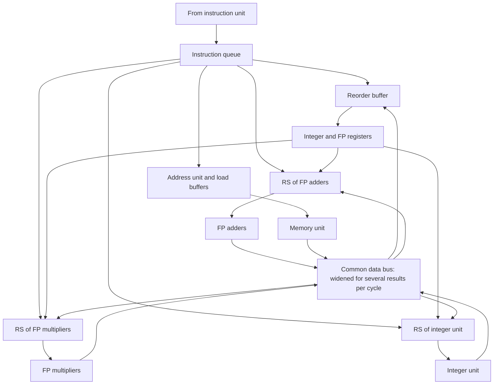

# بخش ۸، جلسه‌ی ۸ از ۱۳: صدور چندگانه‌ی پویا با گمانه‌زنی

این جلسه بخشی از **بخش ۸: موازی‌سازی پویا در سطح دستور** است. زمان مطالعه: حدود نیم ساعت.

**فهرست این جلسه:**

- ۱. ترکیب سه ایده
- ۲. ساختار پردازنده‌ی چندصدوری گمانه‌زن
- ۳. گلوگاه اصلی: منطق صدور
- ۴. راهبرد صدور n دستور در سیکل
- ۵. مثال کتاب: حلقه‌ی صحیح روی پردازنده‌ی دوصدوری
- ۶. بدون گمانه‌زنی
- ۷. با گمانه‌زنی
- ۸. مقایسه و درس‌ها
- ۹. تمرین‌ها

---

## ۱. ترکیب سه ایده

ریزمعماری‌های امروزی سه چیز را با هم دارند: **زمان‌بندی پویا**، **صدور چندگانه** و **گمانه‌زنی**. جلسه‌ی ۷-۱۲ صدور چندگانه‌ی ایستا (VLIW) را دید. اینجا صدور چندگانه را به روش توماسولو با گمانه‌زنی اضافه می‌کنیم.

پردازنده‌ی نمونه‌ی کتاب: یک ابرعددی **دوصدوری** با واحدهای جدا برای صحیح، بارگذاری و ذخیره، و ممیز شناور (ضرب و جمع)، که هر کدام می‌توانند در هر سیکل یک عملیات شروع کنند.

- **صدور به ایستگاه‌ها به ترتیب:** نمی‌خواهیم دستورات را خارج از ترتیب به ایستگاه‌های رزرو بفرستیم، چون معنای برنامه خراب می‌شود.
- **هر ترکیبی از دو دستور:** برای بیشترین سود، پردازنده اجازه می‌دهد هر ترکیبی از دو دستور در یک سیکل صادر شود. سخت‌افزار زمان‌بندی، عملیات را به واحدهای صحیح و ممیز شناور می‌فرستد.
- **صحیح و ممیز شناور با هم:** چون تعامل این دو حیاتی است، روش توماسولو هم به ثبات‌ها و واحدهای صحیح گسترش می‌یابد.

## ۲. ساختار پردازنده‌ی چندصدوری گمانه‌زن



شکل کلی مثل حالت تک‌صدوری با گمانه‌زنی است (جلسه‌ی ۸-۶). ولی چند مسیر داده باید **پهن‌تر** شوند: CDB (برای چند نتیجه در هر سیکل)، گذرگاه‌های عملوند، و از همه مهم‌تر **منطق صدور** که در شکل دیده نمی‌شود.

## ۳. گلوگاه اصلی: منطق صدور

صدور چند دستور در یک سیکل در پردازنده‌ی پویا خیلی پیچیده است، به یک دلیل ساده: **دستورات یک بسته ممکن است به هم وابسته باشند**. جدول‌ها باید برای همه‌ی دستورات بسته **به‌طور موازی** به‌روز شوند، وگرنه یا جدول‌ها غلط می‌شوند یا وابستگی گم می‌شود.

مثال: بسته‌ای شامل یک بارگذاری و یک عملیات ممیز شناور که از نتیجه‌ی آن بارگذاری استفاده می‌کند:

```asm
L.D     F0,0(R1)       ; instruction 1 of the bundle
ADD.D   F4,F0,F2       ; instruction 2, depends on instruction 1
```

در همان سیکل:

- **بارگذاری:** ایستگاه r1 و خانه‌ی b1 در ROB می‌گیرد و منبعش (R1) را عادی بررسی می‌کند. فیلد وضعیت F0 به b1 تغییر می‌کند.
- **عملیات ممیز شناور:** ایستگاه r2 و خانه‌ی b2 می‌گیرد. برای عملوند اولش (F0) **نمی‌تواند** فیلد وضعیت ثبات را بخواند، چون آن هنوز به‌روز نشده (همه در یک سیکل اتفاق می‌افتد). پس منطق صدور باید **خودش** وابستگی داخل بسته را تشخیص دهد و مستقیماً Qj ایستگاه r2 را برابر b1 بگذارد. برای عملوند دوم (F2) که از بسته‌ی قبلی می‌آید، بررسی عادی انجام می‌شود.

و همه‌ی این‌ها **در یک سیکل و موازی**، نه پشت سر هم. در یک ابرعددی، **هر ترکیب ممکن** از دستورات وابسته در یک بسته باید در نظر گرفته شود. تعداد حالت‌ها با **مجذور** تعداد دستورات صدورشده در سیکل رشد می‌کند. کتاب می‌گوید این گام احتمالاً گلوگاه تلاش برای صدور بیش از **چهار دستور در سیکل** است.

دو روش برای پیاده‌سازی:

- **نصف سیکل:** گام تخصیص ایستگاه و به‌روزرسانی جدول‌ها در نیم سیکل انجام شود، پس دو دستور در یک سیکل. این روش به چهار دستور گسترش نمی‌یابد.
- **منطق پهن:** منطق لازم برای رسیدگی همزمان به دو یا چند دستور، با همه‌ی وابستگی‌های ممکن، ساخته شود.

پردازنده‌های چهارصدوری امروزی هر دو را دارند: منطق صدور را هم خط لوله‌ای و هم پهن می‌کنند. ولی نمی‌توان مشکل را فقط با خط لوله حل کرد: دستور وابسته‌ای که در سیکل بعد صادر می‌شود باید اطلاعات به‌روزشده را ببیند.

## ۴. راهبرد صدور n دستور در سیکل

کتاب راهبرد کلی را در سه گام می‌گوید:

1. **پیش‌تخصیص:** برای هر دستوری که ممکن است در بسته‌ی بعدی صادر شود، یک ایستگاه رزرو و یک خانه‌ی ROB رزرو کن. خانه‌های ROB را می‌توان قبل از دانستن نوع دستورات، به ترتیب تخصیص داد. برای ایستگاه‌ها، با محدود کردن تعداد هر نوع در بسته (مثلاً یک ممیز شناور، یک صحیح، یک بارگذاری و یک ذخیره) می‌توان آن‌ها را از قبل رزرو کرد. اگر ایستگاه کافی نبود، بسته **شکسته** می‌شود و فقط بخشی از آن، به ترتیب برنامه، صادر می‌شود.
2. **تحلیل وابستگی‌ها** بین همه‌ی دستورات بسته.
3. **به‌روزرسانی جدول‌ها:** اگر دستوری به دستور قبلی **در همان بسته** وابسته است، از شماره‌ی ROB پیش‌تخصیص‌یافته‌ی آن استفاده کن. وگرنه از جدول‌ها و اطلاعات ROB موجود.

در انتهای خط لوله، باید بتوان **چند دستور را در هر سیکل نهایی کرد**. این ساده‌تر از صدور است، چون دستوراتی که همزمان نهایی می‌شوند همه‌ی وابستگی‌هایشان را حل کرده‌اند. کتاب می‌گوید Intel Core i7 اساساً همین طرح را دارد: تعداد زیادی ایستگاه رزرو، یک ROB و بافرهای بارگذاری و ذخیره که برای کش بدون توقف هم استفاده می‌شوند.

## ۵. مثال کتاب: حلقه‌ی صحیح روی پردازنده‌ی دوصدوری

حلقه‌ای که هر عنصر یک آرایه‌ی صحیح را یکی زیاد می‌کند:

```asm
Loop:   LD      R2,0(R1)        ; R2 = array element
        DADDIU  R2,R2,#1        ; increment R2
        SD      R2,0(R1)        ; store result
        DADDIU  R1,R1,#8        ; increment pointer
        BNE     R2,R3,LOOP      ; branch if not last element
```

فرض‌ها:

- **واحدهای صحیح جدا:** یکی برای محاسبه‌ی آدرس مؤثر، یکی برای عملیات ALU و یکی برای ارزیابی شرط پرش.
- **صدور:** دو دستور از هر نوع در هر سیکل. در جدول‌های کتاب، پرش آخرین دستور بسته‌اش است و دستور بعد از پرش در سیکل بعد صادر می‌شود.
- **نهایی‌سازی:** تا دو دستور در هر سیکل.
- **بارگذاری:** محاسبه‌ی آدرس یک سیکل، دسترسی حافظه یک سیکل، سپس نوشتن روی CDB. عملیات صحیح یک سیکل.

نکته‌ی مهم این حلقه: شرط پرش (`BNE R2,R3`) به **مقدار بارگذاری‌شده** بستگی دارد. پس پرش دیر حل می‌شود.

## ۶. بدون گمانه‌زنی

| تکرار | دستور | صدور | اجرا | دسترسی حافظه | نوشتن CDB | توضیح |
|---|---|---|---|---|---|---|
| تکرار 1 | `LD R2,0(R1)` | 1 | 2 | 3 | 4 | اولین صدور |
| تکرار 1 | `DADDIU R2,R2,#1` | 1 | 5 | | 6 | منتظر بارگذاری |
| تکرار 1 | `SD R2,0(R1)` | 2 | 3 | 7 | | منتظر `DADDIU` |
| تکرار 1 | `DADDIU R1,R1,#8` | 2 | 3 | | 4 | اجرای مستقیم |
| تکرار 1 | `BNE R2,R3,LOOP` | 3 | 7 | | | منتظر `DADDIU` |
| تکرار 2 | `LD R2,0(R1)` | 4 | 8 | 9 | 10 | منتظر پرش |
| تکرار 2 | `DADDIU R2,R2,#1` | 4 | 11 | | 12 | منتظر بارگذاری |
| تکرار 2 | `SD R2,0(R1)` | 5 | 9 | 13 | | منتظر `DADDIU` |
| تکرار 2 | `DADDIU R1,R1,#8` | 5 | 8 | | 9 | منتظر پرش |
| تکرار 2 | `BNE R2,R3,LOOP` | 6 | 13 | | | منتظر `DADDIU` |
| تکرار 3 | `LD R2,0(R1)` | 7 | 14 | 15 | 16 | منتظر پرش |
| تکرار 3 | `DADDIU R2,R2,#1` | 7 | 17 | | 18 | منتظر بارگذاری |
| تکرار 3 | `SD R2,0(R1)` | 8 | 15 | 19 | | منتظر `DADDIU` |
| تکرار 3 | `DADDIU R1,R1,#8` | 8 | 14 | | 15 | منتظر پرش |
| تکرار 3 | `BNE R2,R3,LOOP` | 9 | 19 | | | منتظر `DADDIU` |

- **دستورات بعد از پرش منتظرند:** بارگذاری تکرار دوم در سیکل ۴ صادر شده، ولی تا اجرای پرش تکرار اول (سیکل ۷) نمی‌تواند اجرا شود. پس در سیکل ۸ اجرا می‌شود.
- **زنجیره‌ی طولانی:** پرش به `DADDIU` و آن به بارگذاری وابسته است. هر تکرار حدود **۶ سیکل** طول می‌کشد (پرش‌ها در ۷، ۱۳ و ۱۹).
- **عقب افتادن:** صدور هر ۳ سیکل یک تکرار جلو می‌رود ولی اجرا هر ۶ سیکل. پس بعد از چند تکرار دیگر، ایستگاه‌های رزرو پر می‌شوند و صدور هم متوقف می‌شود.

## ۷. با گمانه‌زنی

| تکرار | دستور | صدور | اجرا | دسترسی حافظه | نوشتن CDB | نهایی‌سازی | توضیح |
|---|---|---|---|---|---|---|---|
| تکرار 1 | `LD R2,0(R1)` | 1 | 2 | 3 | 4 | 5 | اولین صدور |
| تکرار 1 | `DADDIU R2,R2,#1` | 1 | 5 | | 6 | 7 | منتظر بارگذاری |
| تکرار 1 | `SD R2,0(R1)` | 2 | 3 | | | 7 | منتظر `DADDIU` |
| تکرار 1 | `DADDIU R1,R1,#8` | 2 | 3 | | 4 | 8 | نهایی‌سازی به ترتیب |
| تکرار 1 | `BNE R2,R3,LOOP` | 3 | 7 | | | 8 | منتظر `DADDIU` |
| تکرار 2 | `LD R2,0(R1)` | 4 | 5 | 6 | 7 | 9 | بدون تأخیر اجرا |
| تکرار 2 | `DADDIU R2,R2,#1` | 4 | 8 | | 9 | 10 | منتظر بارگذاری |
| تکرار 2 | `SD R2,0(R1)` | 5 | 6 | | | 10 | منتظر `DADDIU` |
| تکرار 2 | `DADDIU R1,R1,#8` | 5 | 6 | | 7 | 11 | نهایی‌سازی به ترتیب |
| تکرار 2 | `BNE R2,R3,LOOP` | 6 | 10 | | | 11 | منتظر `DADDIU` |
| تکرار 3 | `LD R2,0(R1)` | 7 | 8 | 9 | 10 | 12 | زودترین زمان ممکن |
| تکرار 3 | `DADDIU R2,R2,#1` | 7 | 11 | | 12 | 13 | منتظر بارگذاری |
| تکرار 3 | `SD R2,0(R1)` | 8 | 9 | | | 13 | منتظر `DADDIU` |
| تکرار 3 | `DADDIU R1,R1,#8` | 8 | 9 | | 10 | 14 | زودتر اجرا می‌شود |
| تکرار 3 | `BNE R2,R3,LOOP` | 9 | 13 | | | 14 | منتظر `DADDIU` |

- **بارگذاری تکرار دوم منتظر پرش نیست:** در سیکل ۵ اجرا می‌شود، چون گمانه‌ای است. فقط به R1 (از `DADDIU R1` تکرار اول، که در سیکل ۴ پخش شده) نیاز دارد.
- **ذخیره‌ها حافظه را در نهایی‌سازی می‌نویسند:** ستون دسترسی حافظه برای ذخیره‌ها خالی است.
- **نهایی‌سازی به ترتیب:** `DADDIU R1` تکرار اول در سیکل ۴ تمام شده ولی در سیکل ۸ نهایی می‌شود، چون دستورات قبلی‌اش تا ۷ نهایی شده‌اند و در سیکل ۷ هم ظرفیت دو نهایی‌سازی پر شده است.
- **ریتم:** پرش‌ها در ۷، ۱۰ و ۱۳: هر **۳ سیکل** یک تکرار، برابر با سرعت صدور.

## ۸. مقایسه و درس‌ها

| معیار | بدون گمانه‌زنی | با گمانه‌زنی |
|---|---|---|
| اجرای پرش سوم | سیکل 19 | سیکل 13 |
| سیکل در هر تکرار (حالت پایدار) | 6 | 3 |
| آیا اجرا از صدور عقب می‌افتد؟ | بله، و صدور به‌زودی متوقف می‌شود | خیر |

درس‌های کتاب:

- **گمانه‌زنی وقتی پرش‌ها به داده وابسته‌اند** (و دیر حل می‌شوند) خیلی کمک می‌کند. اینجا پرش گلوگاه بود.
- **بهبود بدون گمانه‌زنی محدود است:** اگر پردازنده‌ی بدون گمانه‌زنی اجازه می‌داد بارگذاری‌ها قبل از حل پرش آدرسشان را حساب کنند، فقط یک سیکل در هر تکرار صرفه‌جویی می‌شد، مگر اینکه دسترسی‌های گمانه‌ای به حافظه مجاز باشد.
- **این سود به پیش‌بینی دقیق بستگی دارد:** گمانه‌زنی غلط کارایی را بهتر نمی‌کند. معمولاً بدترش می‌کند و همان‌طور که در جلسه‌ی ۸-۱۰ می‌بینیم، **بهره‌وری انرژی** را به شدت کم می‌کند.

## ۹. تمرین‌ها

<details>
<summary>تمرین ۱: IPC دو جدول</summary>

**صورت:** با فرض حالت پایدار، IPC دو پردازنده‌ی این مثال چقدر است؟

**جواب:** هر تکرار ۵ دستور دارد. بدون گمانه‌زنی، هر ۶ سیکل یک تکرار: IPC = 5 / 6 ≈ 0.83. با گمانه‌زنی، هر ۳ سیکل یک تکرار: IPC = 5 / 3 ≈ 1.67. یعنی گمانه‌زنی سرعت را دو برابر کرده است. حداکثر IPC این پردازنده‌ی دوصدوری ۲ است و گمانه‌زنی آن را به ۸۳٪ حداکثر رسانده.
</details>

<details>
<summary>تمرین ۲: وابستگی داخل بسته</summary>

**صورت:** در سیکل ۱ دو دستور اول صادر می‌شوند. منطق صدور برای دستور `DADDIU R2,R2,#1` عملوندش را از کجا می‌گیرد؟

**جواب:** منبع آن (R2) مقصد بارگذاری **در همین بسته** است. منطق صدور این وابستگی را مستقیماً تشخیص می‌دهد و Qj ایستگاه `DADDIU` را برابر خانه‌ی ROB پیش‌تخصیص‌یافته‌ی بارگذاری می‌گذارد. اگر فیلد وضعیت ثبات R2 را می‌خواند، مقدار قدیمی (یا نویسنده‌ی قدیمی) را می‌دید، چون به‌روزرسانی بارگذاری در همان سیکل انجام می‌شود.
</details>

<details>
<summary>تمرین ۳: پیش‌بینی غلط در آخرین تکرار</summary>

**صورت:** فرض کن تکرار سوم آخرین تکرار است و پرش آن (که انجام‌شده پیش‌بینی شده) در سیکل ۱۳ اجرا می‌شود و معلوم می‌شود انجام‌نشده است. با بازیابی زودهنگام، چه دستوراتی دور ریخته می‌شوند؟

**جواب:** همه‌ی دستورات بعد از این پرش که صادر شده‌اند، یعنی دستورات تکرار چهارم و پنجم (و هر چه بعد از آن). آن‌ها ممکن است اجرا هم شده باشند (مثلاً بارگذاری تکرار چهارم)، ولی چون نهایی نشده‌اند، هیچ ثبات یا خانه‌ی حافظه‌ای را عوض نکرده‌اند. واکشی از دستور بعد از حلقه شروع می‌شود. کار انجام‌شده برای آن دستورات هدر رفته است.
</details>

---

جلسه‌ی قبلی: [گمانه‌زنی در حلقه، بازیابی و حافظه](8-7-speculation-loops-recovery.md)  
جلسه‌ی بعدی: [حل سؤال امتحانی: جدول اجرای توماسولو و گمانه‌زنی](8-9-tomasulo-speculation-exam.md)
