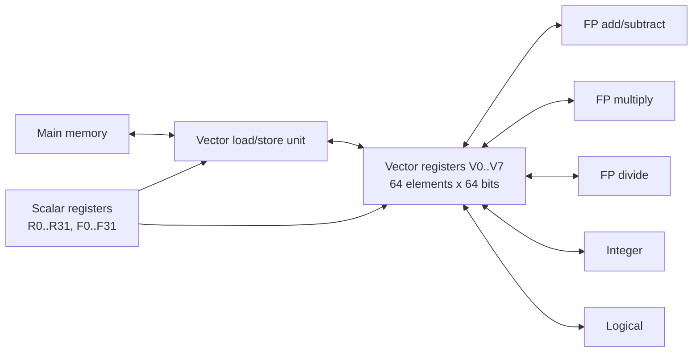

# بخش ۹، جلسه‌ی ۱ از ۱۴: موازی‌سازی سطح داده و معماری برداری VMIPS

این جلسه بخشی از **بخش ۹: موازی‌سازی سطح داده: معماری برداری، SIMD و GPU** است. زمان مطالعه: حدود نیم ساعت.

**فهرست این جلسه:**

- ۱. از ILP تا DLP
- ۲. سه شکل SIMD
- ۳. چرا SIMD مهم است
- ۴. ایده‌ی پایه‌ی معماری برداری
- ۵. ساختار VMIPS
- ۶. دستورهای VMIPS
- ۷. مثال DAXPY: اسکالر در برابر برداری
- ۸. همین مثال در RISC-V و ARM
- ۹. تمرین‌ها

---

## ۱. از ILP تا DLP

در بخش‌های ۷ و ۸ دیدیم که پردازنده با زمان‌بندی ایستا یا پویا، دستورهای مستقل را از دل یک جریان دستور پیدا می‌کند. این کار گران است: برای هر دستور باید وابستگی‌ها چک شود، ثبات‌ها تغییر نام پیدا کنند و نتیجه‌ها به ترتیب ثبت شوند. همه‌ی این سخت‌افزار انرژی می‌خورد.

حالا یک نوع موازی‌سازی دیگر را ببین. در حلقه‌ی زیر:

```c
for (i = 0; i < 64; i++)
    Y[i] = a * X[i] + Y[i];
```

همه‌ی ۶۴ تکرار **یک کار یکسان** را روی **داده‌های متفاوت** انجام می‌دهند و هیچ تکراری به تکرار دیگر وابسته نیست. به این **موازی‌سازی سطح داده (Data-Level Parallelism یا DLP)** می‌گوییم.

سؤال اصلی این بخش: اگر بدانیم یک عمل باید روی ۶۴ داده انجام شود، چرا ۶۴ بار دستور را واکشی، رمزگشایی و چک کنیم؟ کافی است **یک دستور** بگوید «این عمل را روی همه‌ی این داده‌ها انجام بده». این همان ایده‌ی **SIMD** است: یک دستور، چند داده (Single Instruction, Multiple Data).

## ۲. سه شکل SIMD

کتاب CAQA در فصل ۴ سه شکل از SIMD را بررسی می‌کند و این بخش هم همین ترتیب را دنبال می‌کند:

| شکل | ایده | نمونه |
|---|---|---|
| معماری برداری | ثبات‌های بلند، دستور برداری با طول متغیر، دسترسی با گام و پراکنده | سری Cray، NEC SX، و امروز RISC-V V و ARM SVE |
| افزونه‌های SIMD چندرسانه‌ای | ثبات‌های پهن با تعداد عنصر ثابت در کد دستور | دستورهای MMX، SSE، AVX در x86 و NEON در ARM |
| پردازنده‌ی گرافیکی (GPU) | تعداد زیادی نخ سبک روی واحدهای SIMD چندنخنگی | معماری‌های NVIDIA و AMD |

جلسه‌های ۱ تا ۷ درباره‌ی معماری برداری است، چون این معماری کامل‌ترین و تمیزترین شکل SIMD است و دو شکل دیگر را می‌شود با آن مقایسه کرد. جلسه‌های ۸ و ۹ درباره‌ی SIMD چندرسانه‌ای و مدل Roofline است. جلسه‌های ۱۰ تا ۱۳ درباره‌ی GPU است، و جلسه‌ی ۱۴ موازی‌سازی سطح حلقه، باورهای غلط و جمع‌بندی را می‌آورد.

## ۳. چرا SIMD مهم است

اسلاید اول فصل ۴ سه دلیل می‌آورد:

- **برنامه‌های مناسب:** محاسبات علمی ماتریسی و پردازش تصویر و صدا پر از DLP هستند.
- **بهره‌وری انرژی:** برای هر عمل روی داده فقط یک بار دستور واکشی می‌شود، پس SIMD نسبت به MIMD (چند هسته‌ی مستقل) انرژی کمتری مصرف می‌کند. این برای دستگاه‌های همراه مهم است.
- **سادگی برنامه‌نویسی:** برنامه‌نویس می‌تواند همچنان ترتیبی فکر کند. در برنامه‌نویسی چندنخی (بخش ۱۰) باید نگران همگام‌سازی و قفل باشی، اما در SIMD یک حلقه‌ی ساده برداری می‌شود.

کتاب یک پیش‌بینی هم برای x86 می‌کند: هر دو سال دو هسته به تراشه اضافه می‌شود و پهنای SIMD هر چهار سال دو برابر می‌شود. با این فرض، سرعت‌افزایی بالقوه‌ی SIMD در دهه‌ی بعد **دو برابر** سرعت‌افزایی MIMD است. پس فهمیدن SIMD دست‌کم به اندازه‌ی فهمیدن چندهسته‌ای مهم است.

## ۴. ایده‌ی پایه‌ی معماری برداری

معماری برداری سه کار انجام می‌دهد:

- ۱. یک مجموعه از عناصر داده را از حافظه به یک **ثبات برداری** می‌آورد.
- ۲. روی کل ثبات‌ها عمل حسابی انجام می‌دهد.
- ۳. نتیجه را به حافظه برمی‌گرداند.

نکته‌ی کلیدی: ثبات‌های برداری را **کامپایلر** کنترل می‌کند. یک بار بارگذاری برداری ۶۴ عنصر می‌آورد و تأخیر حافظه فقط یک بار برای کل بردار پرداخت می‌شود، نه برای هر عنصر. به همین دلیل معماری برداری تأخیر حافظه را پنهان می‌کند و از پهنای باند حافظه به خوبی استفاده می‌کند.

## ۵. ساختار VMIPS

کتاب یک معماری فرضی به نام **VMIPS** تعریف می‌کند که بخش اسکالر آن همان MIPS است و بخش برداری آن تقریباً از روی Cray-1 ساخته شده است.



اجزای اصلی:

- **ثبات‌های برداری:** هشت ثبات `V0` تا `V7`، هر کدام ۶۴ عنصر ۶۴ بیتی. فایل ثبات برداری دست‌کم ۱۶ درگاه خواندن و ۸ درگاه نوشتن دارد و با دو سوییچ متقاطع (crossbar) به واحدها وصل می‌شود.
- **واحدهای عملیاتی برداری:** پنج واحد (جمع و تفریق ممیز شناور، ضرب، تقسیم، صحیح، منطقی). هر واحد کاملاً خط‌لوله‌ای است و هر سیکل یک عمل جدید شروع می‌کند. واحد کنترل مخاطره‌های ساختاری و داده‌ای را تشخیص می‌دهد.
- **واحد بارگذاری و ذخیره‌ی برداری:** کاملاً خط‌لوله‌ای است و بعد از یک تأخیر اولیه، هر سیکل یک کلمه جابه‌جا می‌کند. این واحد بارگذاری‌های اسکالر را هم انجام می‌دهد.
- **ثبات‌های اسکالر:** همان ۳۲ ثبات صحیح و ۳۲ ثبات ممیز شناور MIPS. این ثبات‌ها هم آدرس شروع بردار را می‌دهند و هم می‌توانند یک ورودی عددی ثابت برای دستور برداری باشند.

علاوه بر این، دو ثبات ویژه هست که در جلسه‌های بعد می‌بینیم: **ثبات طول بردار (VLR)** و **ثبات نقاب برداری (VM)**.

یک نکته‌ی ظریف: ثبات ۶۴ عنصری ۶۴ بیتی را می‌شود ۱۲۸ عنصر ۳۲ بیتی، ۲۵۶ عنصر ۱۶ بیتی یا ۵۱۲ عنصر ۸ بیتی هم دید. به همین دلیل معماری برداری برای برنامه‌های چندرسانه‌ای هم مفید است.

## ۶. دستورهای VMIPS

نام دستورهای برداری همان نام دستورهای MIPS است با پسوند **VV** (دو عملوند برداری) یا **VS** (یک بردار و یک اسکالر). جدول زیر دستورهای ممیز شناور دقت مضاعف را نشان می‌دهد:

| دستور | عملوندها | کار |
|---|---|---|
| دستور `ADDVV.D` | `V1,V2,V3` | جمع عنصر به عنصر `V2` و `V3` در `V1` |
| دستور `ADDVS.D` | `V1,V2,F0` | جمع `F0` با هر عنصر `V2` |
| دستور `SUBVV.D` و `SUBVS.D` و `SUBSV.D` | مثل بالا | تفریق؛ در `SUBSV.D` عدد اسکالر منهای عنصرهاست |
| دستور `MULVV.D` و `MULVS.D` | مثل بالا | ضرب |
| دستور `DIVVV.D` و `DIVVS.D` و `DIVSV.D` | مثل بالا | تقسیم |
| دستور `LV` و `SV` | `V1,R1` و `R1,V1` | بارگذاری و ذخیره‌ی بردار از آدرس `R1` |
| دستور `LVWS` و `SVWS` | `V1,(R1,R2)` | بارگذاری و ذخیره با گام `R2` (آدرس عنصر i برابر `R1 + i*R2`) |
| دستور `LVI` و `SVI` | `V1,(R1+V2)` | بارگذاری و ذخیره‌ی اندیس‌دار (gather و scatter) |
| دستور `CVI` | `V1,R1` | ساخت بردار اندیس `0, R1, 2*R1, ..., 63*R1` |
| دستور `S--VV.D` و `S--VS.D` | `V1,V2` | مقایسه (EQ، NE، GT، LT، GE، LE) و نوشتن نتیجه در ثبات نقاب |
| دستور `POP` | `R1,VM` | شمارش یک‌های ثبات نقاب |
| دستور `CVM` | بدون عملوند | همه‌ی بیت‌های نقاب را یک می‌کند |
| دستور `MTC1` و `MFC1` | `VLR,R1` | نوشتن و خواندن ثبات طول بردار |
| دستور `MVTM` و `MVFM` | `VM,F0` | نوشتن و خواندن ثبات نقاب |

در دستورهای VS، واحد عملیاتی هنگام صدور یک کپی از مقدار اسکالر را می‌گیرد و آن را برای همه‌ی عنصرها به کار می‌برد.

## ۷. مثال DAXPY: اسکالر در برابر برداری

مسئله‌ی **DAXPY** (یعنی Double precision a times X Plus Y) حلقه‌ی درونی محک Linpack است و در کل این بخش از آن استفاده می‌کنیم:

```math
Y = a \times X + Y
```

فرض: طول بردار ۶۴ است و آدرس شروع X و Y در `Rx` و `Ry` است.

نسخه‌ی MIPS:

```asm
        L.D     F0,a          ; load scalar a
        DADDIU  R4,Rx,#512    ; last address to load
Loop:   L.D     F2,0(Rx)      ; load X[i]
        MUL.D   F2,F2,F0      ; a * X[i]
        L.D     F4,0(Ry)      ; load Y[i]
        ADD.D   F4,F4,F2      ; a * X[i] + Y[i]
        S.D     F4,0(Ry)      ; store into Y[i]
        DADDIU  Rx,Rx,#8      ; increment index to X
        DADDIU  Ry,Ry,#8      ; increment index to Y
        DSUBU   R20,R4,Rx     ; compute bound
        BNEZ    R20,Loop      ; check if done
```

نسخه‌ی VMIPS:

```asm
        L.D     F0,a          ; load scalar a
        LV      V1,Rx         ; load vector X
        MULVS.D V2,V1,F0      ; vector-scalar multiply
        LV      V3,Ry         ; load vector Y
        ADDVV.D V4,V2,V3      ; add
        SV      Ry,V4         ; store the result
```

دو تفاوت بزرگ:

- **پهنای باند دستور:** نسخه‌ی MIPS حدود ۹ دستور در هر تکرار دارد، یعنی ۲ + ۹ × ۶۴ = ۵۷۸ دستور (کتاب می‌گوید «تقریباً ۶۰۰»). نسخه‌ی VMIPS فقط **۶ دستور** دارد. دستورهای سربار حلقه (افزایش اندیس، مقایسه، پرش) که تقریباً نصف حلقه‌ی MIPS هستند، در نسخه‌ی برداری اصلاً وجود ندارند.
- **توقف خط لوله:** در MIPS هر `ADD.D` منتظر `MUL.D` می‌ماند و هر `S.D` منتظر `ADD.D`. در VMIPS هر دستور برداری فقط برای **عنصر اول** منتظر می‌ماند و بقیه‌ی عنصرها پشت سر هم جریان پیدا می‌کنند. پس توقف‌ها به جای یک بار برای هر عنصر، یک بار برای هر دستور برداری رخ می‌دهند؛ یعنی حدود ۶۴ برابر کمتر. به این ارسال عنصر به عنصر **زنجیره‌سازی (chaining)** می‌گویند و جلسه‌ی بعد آن را دقیق می‌بینیم.

باز کردن حلقه یا خط‌لوله‌سازی نرم‌افزاری (بخش ۷) می‌تواند توقف‌های MIPS را کم کند، اما اختلاف بزرگ در تعداد دستور را نمی‌تواند جبران کند.

وقتی کامپایلر برای یک حلقه دستور برداری تولید می‌کند و برنامه بیشتر وقتش را در حالت برداری می‌گذراند، می‌گوییم کد **برداری شده (vectorized)** است. شرط برداری شدن این است که حلقه **وابستگی بین تکرارها (loop-carried dependence)** نداشته باشد. این مفهوم را در جلسه‌ی ۵ از بخش ۷ دیدیم و در جلسه‌ی ۱۴ دوباره به آن برمی‌گردیم.

> **اختلاف کتاب و اسلاید:** در متن کتاب دستور ذخیره‌ی MIPS به شکل `S.D F4,9(Ry)` چاپ شده که غلط تایپی است و باید `0(Ry)` باشد. همچنین ترتیب عملوند `SV` در کتاب گاهی `SV V4,Ry` و در جدول دستورها `SV R1,V1` است. اسلایدها شکل `SV Ry,V4` را به کار می‌برند. معنی هر دو یکی است: بردار `V4` در آدرس `Ry` ذخیره می‌شود. در این بخش همه‌جا شکل جدول و اسلاید را به کار می‌بریم: اول آدرس، بعد ثبات برداری.

## ۸. همین مثال در RISC-V و ARM

ویرایش ششم کتاب CAQA به جای VMIPS از **RV64V** استفاده می‌کند که افزونه‌ی برداری RISC-V است. نسخه‌ی DAXPY در RV64V تقریباً این شکل را دارد (از حافظه نقل شده، نحو دقیق را با کتاب ویرایش ۶ چک کن):

```asm
        vsetdcfg 4*FP64       # enable 4 DP FP vector registers
        fld      f0,a         # load scalar a
        vld      v0,x5        # load vector X
        vmul     v1,v0,f0     # vector-scalar multiply
        vld      v2,x6        # load vector Y
        vadd     v3,v1,v2     # vector-vector add
        vst      v3,x6        # store the sum
        vdisable              # disable vector regs
```

دو تفاوت مفهومی RV64V با VMIPS:

- **نوع‌دهی پویای ثبات:** در RV64V نوع و پهنای عنصر در دستور نیست؛ دستور `vsetdcfg` مشخص می‌کند هر ثبات برداری چه نوعی دارد. پس فقط یک `vadd` داریم، نه `ADDVV.D` و `ADDVS.D` جدا.
- **سی و دو ثبات برداری** به جای هشت.

افزونه‌ی **RISC-V V** که نسخه‌ی ۱.۰ آن تصویب شده، نحو کمی متفاوتی دارد: دستور `vsetvli` طول و نوع را تنظیم می‌کند و دستورهایی مثل `vle64.v` و `vfmacc.vf` به کار می‌روند. در ARM هم دو نوع هست: **NEON** که ثبات‌های ثابت ۱۲۸ بیتی دارد و از نوع SIMD چندرسانه‌ای است، و **SVE** که طول ثبات آن در پیاده‌سازی بین ۱۲۸ تا ۲۰۴۸ بیت انتخاب می‌شود و برنامه از طول واقعی خبر ندارد، یعنی ایده‌ی آن به معماری برداری نزدیک است. این دو را در جلسه‌ی ۸ مقایسه می‌کنیم.

## ۹. تمرین‌ها

<details><summary>تمرین ۱: شمارش دستورها</summary>

**صورت:** برای DAXPY با ۶۴ عنصر، تعداد دستورهای اجراشده در MIPS و VMIPS را دقیق بشمار. نسبت آن‌ها چقدر است؟

**جواب:** در MIPS دو دستور قبل از حلقه داریم و حلقه ۹ دستور دارد که ۶۴ بار اجرا می‌شود: 2 + 9 × 64 = 578 دستور. در VMIPS شش دستور داریم. نسبت 578 / 6 ≈ 96 است. یعنی واکشی و رمزگشایی حدود ۹۶ برابر کمتر شده است.
</details>

<details><summary>تمرین ۲: نسخه‌ی برداری یک حلقه‌ی ساده</summary>

**صورت:** حلقه‌ی `for (i=0;i<64;i++) Z[i] = (X[i] + Y[i]) * s;` را با دستورهای VMIPS بنویس. آدرس‌ها در `Rx`، `Ry`، `Rz` و `s` در `F0` است.

**جواب:**

```asm
        LV      V1,Rx
        LV      V2,Ry
        ADDVV.D V3,V1,V2
        MULVS.D V4,V3,F0
        SV      Rz,V4
```

پنج دستور برداری کافی است.
</details>

<details><summary>تمرین ۳: نماهای مختلف یک ثبات</summary>

**صورت:** یک ثبات برداری VMIPS چند عنصر ۱۶ بیتی را نگه می‌دارد؟ چرا این خاصیت برای پردازش تصویر مهم است؟

**جواب:** ثبات ۶۴ × ۶۴ = ۴۰۹۶ بیت دارد، پس 4096 / 16 = 256 عنصر ۱۶ بیتی. در پردازش تصویر هر مؤلفه‌ی رنگ معمولاً ۸ بیت است، پس یک دستور می‌تواند روی ۵۱۲ مؤلفه کار کند. داده‌های کوچک‌تر یعنی موازی‌سازی بیشتر با همان سخت‌افزار.
</details>

<details><summary>تمرین ۴: کدام حلقه برداری می‌شود</summary>

**صورت:** کدام یک از این دو حلقه را می‌شود مستقیم برداری کرد؟
الف) `for (i=0;i<64;i++) A[i] = B[i] + C[i];`
ب) `for (i=1;i<64;i++) A[i] = A[i-1] + C[i];`

**جواب:** حلقه‌ی الف برداری می‌شود، چون هیچ تکراری به تکرار دیگر وابسته نیست. حلقه‌ی ب وابستگی بین تکرارها دارد: هر `A[i]` به `A[i-1]` نیاز دارد که در تکرار قبل تولید شده است. این یک بازگشت است و مستقیم برداری نمی‌شود.
</details>

---

جلسه‌ی بعدی: [زمان اجرای برداری: کاروان، زنجیره‌سازی و چایم](9-2-convoys-chaining-chimes.md)
