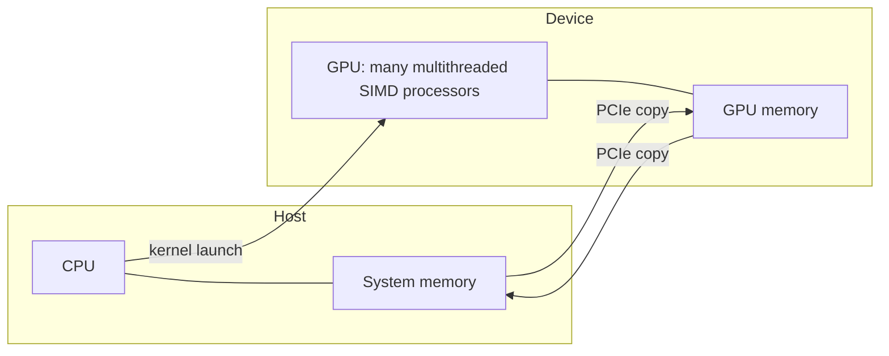
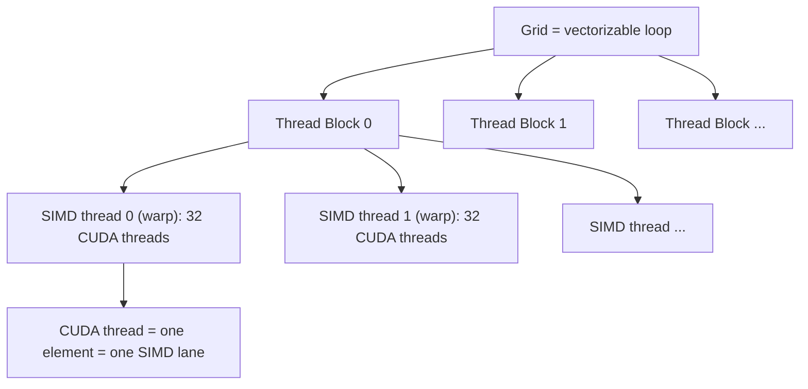

# بخش ۹، جلسه‌ی ۱۰ از ۱۴: مدل برنامه‌نویسی GPU و CUDA

این جلسه بخشی از **بخش ۹: موازی‌سازی سطح داده: معماری برداری، SIMD و GPU** است. زمان مطالعه: حدود نیم ساعت.

**فهرست این جلسه:**

- ۱. پردازنده‌ی گرافیکی از کجا آمد
- ۲. اجرای ناهمگن: میزبان و دستگاه
- ۳. زبان CUDA و ایده‌ی SIMT
- ۴. چند جزئیات زبان
- ۵. مثال DAXPY در CUDA
- ۶. شبکه، بلوک نخ و نخ CUDA
- ۷. مثال ۸۱۹۲ عنصری
- ۸. واژه‌نامه‌ی GPU: نام توصیفی و نام رسمی
- ۹. بهره‌وری در برابر کارایی
- ۱۰. تمرین‌ها

---

## ۱. پردازنده‌ی گرافیکی از کجا آمد

با چند صد دلار هر کسی می‌تواند یک **پردازنده‌ی گرافیکی (GPU)** با صدها واحد ممیز شناور موازی بخرد. وقتی این توان با یک زبان برنامه‌نویسی ساده ترکیب شد، علاقه به **محاسبات روی GPU** شکوفا شد.

نکته‌ی مهم کتاب: GPU و CPU از یک جد مشترک نیامده‌اند. جد اصلی GPU **شتاب‌دهنده‌های گرافیکی** هستند و انجام خوب گرافیک دلیل وجود GPU است. پردازنده‌ی گرافیکی نمی‌تواند وظیفه‌ی گرافیکی‌اش را رها کند. پس سؤال درست برای معمار این است:

> با سخت‌افزاری که برای گرافیک خوب سرمایه‌گذاری شده، چطور می‌شود کارایی طیف وسیع‌تری از برنامه‌ها را بهتر کرد؟

این جلسه فقط درباره‌ی استفاده‌ی GPU برای **محاسبه** است. چون واژه‌ها و سخت‌افزار GPU با معماری برداری و SIMD خیلی فرق دارد، اول مدل برنامه‌نویسی را می‌بینیم و بعد (جلسه‌ی ۱۱) سخت‌افزار را.

## ۲. اجرای ناهمگن: میزبان و دستگاه

مدل اجرا **ناهمگن (heterogeneous)** است:

- **میزبان (host):** پردازنده‌ی سیستم (CPU) و حافظه‌ی اصلی.
- **دستگاه (device):** پردازنده‌ی گرافیکی و حافظه‌ی خودش.



چالش برنامه‌نویس GPU فقط کارایی خوب روی GPU نیست. باید **زمان‌بندی محاسبه** بین CPU و GPU و **انتقال داده** بین حافظه‌ی سیستم و حافظه‌ی GPU را هم هماهنگ کند. علاوه بر این، GPU تقریباً همه‌ی انواع موازی‌سازی را دارد: چندنخنگی، MIMD، SIMD و حتی ILP.

## ۳. زبان CUDA و ایده‌ی SIMT

شرکت NVIDIA یک زبان شبیه C به نام **CUDA** (Compute Unified Device Architecture) ساخت. زبان CUDA برای میزبان کد C و C++ و برای دستگاه یک گویش از C و C++ تولید می‌کند (حرف D در CUDA از device است). زبان مشابه و مستقل از فروشنده **OpenCL** است.

ایده‌ی محوری: همه‌ی شکل‌های موازی‌سازی را زیر یک مفهوم جمع کن: **نخ CUDA (CUDA Thread)**. این پایین‌ترین سطح موازی‌سازی است. کامپایلر و سخت‌افزار هزاران نخ CUDA را کنار هم می‌گذارند تا از چندنخنگی، MIMD، SIMD و ILP درون GPU استفاده کنند.

به همین دلیل NVIDIA این مدل را **SIMT** می‌نامد: یک دستور، چند نخ (Single Instruction, Multiple Thread). در عمل نخ‌ها **در گروه‌های ۳۲ تایی** اجرا می‌شوند.

> **اختلاف کتاب با اصطلاح رایج:** متن کتاب در یک جا می‌گوید «این نخ‌ها در گروه‌های ۳۲ تایی به نام Thread Block اجرا می‌شوند». این دقیق نیست: گروه ۳۲ تایی اسمش **warp** (در اصطلاح کتاب: نخ دستورهای SIMD) است. بلوک نخ می‌تواند صدها نخ داشته باشد (در مثال کتاب ۵۱۲). جدول اصطلاحات خود کتاب هم همین را می‌گوید.

## ۴. چند جزئیات زبان

- **مشخص کردن محل اجرای تابع:** کلمه‌های `__device__` یا `__global__` برای تابع‌های GPU و `__host__` برای تابع‌های پردازنده‌ی سیستم.
- **متغیرها:** متغیرهای تعریف‌شده در تابع‌های `__device__` و `__global__` در حافظه‌ی GPU قرار می‌گیرند که همه‌ی پردازنده‌های SIMD به آن دسترسی دارند.
- **فراخوانی تابع GPU:** با نحو گسترش‌یافته‌ی `name<<<dimGrid, dimBlock>>>(...)`. پارامتر `dimGrid` ابعاد کد را برحسب بلوک و `dimBlock` ابعاد بلوک را برحسب نخ مشخص می‌کند.
- **شناسه‌ها:** متغیر `blockIdx` شماره‌ی بلوک، `threadIdx` شماره‌ی نخ درون بلوک و `blockDim` تعداد نخ‌های هر بلوک است.

## ۵. مثال DAXPY در CUDA

نسخه‌ی C معمولی:

```c
// Invoke DAXPY
daxpy(n, 2.0, x, y);

// DAXPY in C
void daxpy(int n, double a, double *x, double *y)
{
    for (int i = 0; i < n; ++i)
        y[i] = a * x[i] + y[i];
}
```

نسخه‌ی CUDA: n نخ می‌سازیم، یکی برای هر عنصر، با ۲۵۶ نخ در هر بلوک:

```c
// Invoke DAXPY with 256 threads per Thread Block
__host__
int nblocks = (n + 255) / 256;
daxpy<<<nblocks, 256>>>(n, 2.0, x, y);

// DAXPY in CUDA
__global__
void daxpy(int n, double a, double *x, double *y)
{
    int i = blockIdx.x * blockDim.x + threadIdx.x;
    if (i < n) y[i] = a * x[i] + y[i];
}
```

قدم به قدم:

- **تعداد بلوک:** عبارت `(n + 255) / 256` همان سقف n/256 است. اگر n = 1000 باشد، ۴ بلوک داریم (۱۰۲۴ نخ).
- **اندیس عنصر:** هر نخ اندیس خود را از شماره‌ی بلوک، اندازه‌ی بلوک و شماره‌ی نخ حساب می‌کند.
- **شرط مرزی:** عبارت `if (i < n)` نخ‌های اضافه‌ی بلوک آخر را غیرفعال می‌کند. این همان کار **قطعه‌بندی** است: در معماری برداری ثبات VLR طول قطعه‌ی آخر را تنظیم می‌کرد و اینجا شرط و نقاب همان کار را می‌کنند.

> **اختلاف کتاب و استاندارد CUDA:** کتاب تابع هسته را با `__device__` تعریف کرده است. در CUDA واقعی، تابعی که از میزبان با `<<<...>>>` صدا زده می‌شود باید `__global__` باشد؛ `__device__` برای تابع‌هایی است که فقط از کد GPU صدا زده می‌شوند. همچنین `__host__` قبل از یک دستور انتساب در CUDA معنی ندارد و کتاب فقط برای نشان دادن «این بخش روی میزبان است» آن را نوشته است.

یک برنامه‌ی کامل میزبان هم باید حافظه‌ی GPU بگیرد و داده را منتقل کند. شکل معمول آن (از مستندات عمومی CUDA، نه از کتاب):

```c
double *dx, *dy;
cudaMalloc(&dx, n * sizeof(double));
cudaMalloc(&dy, n * sizeof(double));
cudaMemcpy(dx, x, n * sizeof(double), cudaMemcpyHostToDevice);
cudaMemcpy(dy, y, n * sizeof(double), cudaMemcpyHostToDevice);
daxpy<<<(n + 255) / 256, 256>>>(n, 2.0, dx, dy);
cudaMemcpy(y, dy, n * sizeof(double), cudaMemcpyDeviceToHost);
cudaFree(dx); cudaFree(dy);
```

با مدل Roofline (جلسه‌ی ۹) ببین: DAXPY برای هر عنصر ۲۴ بایت دسترسی دارد، اما اینجا ۲۴ بایت دیگر هم باید از روی PCIe برود و برگردد. اگر داده فقط برای همین یک محاسبه به GPU می‌رود، انتقال ممکن است از خود محاسبه گران‌تر باشد.

**الگوی کلی موازی‌سازی:** نسخه‌ی C یک حلقه دارد که تکرارهایش مستقل‌اند. هر تکرار به یک نخ مستقل تبدیل می‌شود. همان شرطی که کامپایلر برداری‌ساز لازم دارد (نبود وابستگی بین تکرارها) اینجا هم لازم است. چون هر نخ یک عنصر را می‌نویسد، **نیازی به همگام‌سازی** بین نخ‌ها نیست.

## ۶. شبکه، بلوک نخ و نخ CUDA



- **شبکه (Grid):** کدی که روی GPU اجرا می‌شود و از مجموعه‌ای از بلوک‌های نخ ساخته شده است. معادل یک **حلقه‌ی برداری‌پذیر**.
- **بلوک نخ (Thread Block):** معادل **بدنه‌ی حلقه‌ی برداری بعد از قطعه‌بندی**. هر بلوک روی یک پردازنده‌ی SIMD اجرا می‌شود.
- **نخ دستورهای SIMD (warp):** یک نخ معمولی که فقط دستورهای SIMD دارد و ۳۲ عنصر را با هم پردازش می‌کند.
- **نخ CUDA:** یک برش عمودی از نخ دستورهای SIMD: یک عنصر که روی یک خط SIMD اجرا می‌شود.

قانون‌های مهم:

- **مدیریت سخت‌افزاری:** سخت‌افزار GPU اجرای موازی و مدیریت نخ‌ها را انجام می‌دهد، نه برنامه یا سیستم‌عامل.
- **استقلال بلوک‌ها:** CUDA می‌خواهد بلوک‌ها مستقل و **با هر ترتیبی** قابل اجرا باشند. بلوک‌های مختلف مستقیم با هم ارتباط ندارند، ولی با **عمل‌های اتمی** روی حافظه‌ی سراسری می‌توانند هماهنگ شوند. این قانون زمان‌بندی سخت‌افزار را ساده می‌کند و اجازه می‌دهد همان برنامه روی GPU با ۲ یا ۱۵ پردازنده‌ی SIMD اجرا شود.
- **ارتباط درون بلوک:** فقط نخ‌های یک بلوک از طریق **حافظه‌ی محلی** با هم ارتباط دارند و با `bar.sync` همگام می‌شوند.

## ۷. مثال ۸۱۹۲ عنصری

کتاب در کل بخش GPU از این مثال استفاده می‌کند: ضرب عنصر به عنصر دو بردار ۸۱۹۲ عنصری، `A[i] = B[i] * C[i]`.

- **شبکه:** کل کار روی ۸۱۹۲ عنصر.
- **بلوک‌های نخ:** هر بلوک حداکثر ۵۱۲ عنصر، پس 8192 / 512 = **۱۶ بلوک**.
- **نخ‌های SIMD:** هر دستور SIMD روی ۳۲ عنصر کار می‌کند، پس هر بلوک 512 / 32 = **۱۶ نخ SIMD** دارد.

```text
Grid (8192 elements)
 +-- Thread Block 0   (elements 0 .. 511)
 |     +-- SIMD Thread 0   A[0..31]    = B[0..31]    * C[0..31]
 |     +-- SIMD Thread 1   A[32..63]   = B[32..63]   * C[32..63]
 |     ...
 |     +-- SIMD Thread 15  A[480..511] = B[480..511] * C[480..511]
 +-- Thread Block 1   (elements 512 .. 1023)
 ...
 +-- Thread Block 15  (elements 7680 .. 8191)
       +-- SIMD Thread 0   A[7680..7711]
       ...
       +-- SIMD Thread 15  A[8160..8191]
```

بلوک نخ مشابه یک حلقه‌ی برداری قطعه‌بندی‌شده با **طول بردار ۳۲** است. زمان‌بند بلوک (سخت‌افزاری) بلوک‌ها را به پردازنده‌های SIMD می‌دهد و زمان‌بند نخ SIMD در هر پردازنده انتخاب می‌کند در هر سیکل کدام نخ SIMD اجرا شود. حداکثر تعداد نخ SIMD همزمان در هر بلوک در نسل Tesla برابر ۱۶ و در نسل Fermi برابر ۳۲ است.

## ۸. واژه‌نامه‌ی GPU: نام توصیفی و نام رسمی

یکی از موانع فهم GPU، **واژه‌های عجیب و گاهی گمراه‌کننده** است. کتاب برای نرم‌افزار از واژه‌های CUDA و برای سخت‌افزار از نام‌های توصیفی استفاده می‌کند و بعد آن‌ها را به نام رسمی وصل می‌کند:

| نام توصیفی کتاب | نزدیک‌ترین مفهوم بیرون از GPU | نام رسمی NVIDIA | نام AMD یا OpenCL |
|---|---|---|---|
| حلقه‌ی برداری‌پذیر | حلقه‌ی برداری‌پذیر | واژه‌ی Grid | واژه‌ی NDRange یا index range |
| بدنه‌ی حلقه‌ی برداری | بدنه‌ی حلقه‌ی قطعه‌بندی‌شده | واژه‌ی Thread Block | واژه‌ی work group |
| دنباله‌ی عمل‌های یک خط SIMD | یک تکرار حلقه‌ی اسکالر | واژه‌ی CUDA Thread | واژه‌ی work item |
| نخ دستورهای SIMD | نخ دستورهای برداری | واژه‌ی Warp | واژه‌ی wavefront |
| دستور SIMD | دستور برداری | دستور PTX | دستور AMDIL |
| پردازنده‌ی SIMD چندنخی | پردازنده‌ی برداری چندنخی | واژه‌ی Streaming Multiprocessor | واژه‌ی compute unit |
| زمان‌بند بلوک نخ | پردازنده‌ی اسکالر (کنترل) | واژه‌ی GigaThread Engine | واژه‌ی Ultra-Threaded Dispatch Engine |
| زمان‌بند نخ SIMD | زمان‌بند نخ در CPU چندنخی | واژه‌ی Warp Scheduler | واژه‌ی Work Group Scheduler |
| خط SIMD | خط برداری | واژه‌ی Thread Processor | واژه‌ی processing element |
| حافظه‌ی GPU | حافظه‌ی اصلی | واژه‌ی Global Memory | واژه‌ی Global Memory |
| حافظه‌ی خصوصی | پشته یا حافظه‌ی محلی نخ | واژه‌ی Local Memory | واژه‌ی Private Memory |
| حافظه‌ی محلی | حافظه‌ی محلی | واژه‌ی Shared Memory | واژه‌ی Local Memory یا Group Memory |
| ثبات‌های خط SIMD | ثبات‌های خط برداری | واژه‌ی Thread Processor Registers | واژه‌ی Registers |

**دام اصطلاحی:** آنچه NVIDIA «Local Memory» می‌نامد در واقع حافظه‌ی **خصوصی** هر نخ در DRAM است، و آنچه NVIDIA «Shared Memory» می‌نامد همان حافظه‌ی **محلی** روی تراشه‌ی هر پردازنده‌ی SIMD است. کتاب از نام‌های OpenCL استفاده می‌کند. در امتحان، نام مورد استفاده را مشخص کن.

**دام دوم:** «نخ CUDA» با نخ POSIX خیلی فرق دارد. از نخ CUDA نمی‌شود هر فراخوانی سیستمی دلخواه انجام داد. نخ CUDA فقط یک برش عمودی از یک نخ SIMD است.

## ۹. بهره‌وری در برابر کارایی

خیلی از مفاهیم سخت‌افزاری GPU در CUDA پنهان‌اند. از نظر بهره‌وری برنامه‌نویس این خوب است، اما بیشتر برنامه‌نویس‌ها برای **کارایی** سراغ GPU می‌روند. برنامه‌نویس کارایی باید سخت‌افزار را در ذهن داشته باشد:

- **گروه‌های ۳۲ تایی:** نخ‌های یک warp باید در جریان کنترل با هم بمانند (جلسه‌ی ۱۲، واگرایی).
- **نخ‌های بسیار زیاد:** باید خیلی بیشتر از تعداد خط‌ها نخ ساخت تا تأخیر DRAM پنهان شود.
- **آدرس‌های نزدیک:** نخ‌های کنار هم باید به آدرس‌های کنار هم دسترسی داشته باشند تا حافظه کارایی مورد انتظار را بدهد (جلسه‌ی ۱۱، ادغام آدرس).

مثل خیلی از سیستم‌های موازی، CUDA یک مصالحه دارد: **توابع ذاتی (intrinsics)** که کنترل صریح سخت‌افزار را به برنامه‌نویس می‌دهند. این همان جنگ کلاسیک «بهره‌وری در برابر کارایی» در محاسبات موازی است.

## ۱۰. تمرین‌ها

<details><summary>تمرین ۱: تعداد بلوک و نخ</summary>

**صورت:** برای n = 100000 و ۲۵۶ نخ در هر بلوک، چند بلوک و چند warp ساخته می‌شود؟ چند نخ کاری انجام نمی‌دهند؟

**جواب:** تعداد بلوک (100000 + 255) / 256 = 391 (با تقسیم صحیح). تعداد کل نخ 391 × 256 = 100096، پس ۹۶ نخ شرط `i < n` را ندارند. هر بلوک 256 / 32 = 8 warp دارد، پس کل 3128 warp.
</details>

<details><summary>تمرین ۲: نوشتن یک هسته</summary>

**صورت:** هسته‌ی CUDA برای `C[i] = A[i] + B[i]` با n عنصر و فراخوانی آن با ۱۲۸ نخ در هر بلوک را بنویس.

**جواب:**

```c
__global__ void vadd(int n, const float *A, const float *B, float *C)
{
    int i = blockIdx.x * blockDim.x + threadIdx.x;
    if (i < n) C[i] = A[i] + B[i];
}
// host
vadd<<<(n + 127) / 128, 128>>>(n, dA, dB, dC);
```
</details>

<details><summary>تمرین ۳: چرا بلوک‌ها باید مستقل باشند</summary>

**صورت:** فرض کن بلوک ۵ منتظر بماند تا بلوک ۶ یک پرچم را در حافظه‌ی سراسری یک کند. چرا این برنامه ممکن است هرگز تمام نشود؟

**جواب:** CUDA هیچ ترتیب یا همزمانی برای بلوک‌ها تضمین نمی‌کند. اگر GPU فقط جا برای یک بلوک در لحظه داشته باشد و بلوک ۵ اول اجرا شود، بلوک ۶ هرگز شروع نمی‌شود چون بلوک ۵ تمام نمی‌شود. بن‌بست رخ می‌دهد.
</details>

<details><summary>تمرین ۴: هزینه‌ی انتقال</summary>

**صورت:** برای DAXPY با n = 10⁸ عنصر دقت مضاعف، اگر پهنای باند PCIe برابر ۶ GB/s در هر جهت و پهنای باند حافظه‌ی GPU برابر ۱۵۰ GB/s باشد، زمان انتقال و زمان محاسبه را مقایسه کن.

**جواب:** انتقال به GPU: x و y یعنی 1.6 × 10⁹ بایت، حدود 0.27 ثانیه. برگشت y: 0.8 × 10⁹ بایت، حدود 0.13 ثانیه. محاسبه روی GPU محدود به حافظه است: 2.4 × 10⁹ بایت در 150 GB/s یعنی 0.016 ثانیه. انتقال حدود ۲۵ برابر محاسبه است. پس DAXPY تنها ارزش انتقال به GPU را ندارد، مگر اینکه داده از قبل روی GPU باشد.
</details>

---

جلسه‌ی قبلی: [مدل Roofline](9-9-roofline-model.md)  
جلسه‌ی بعدی: [سخت‌افزار GPU و مجموعه‌ی دستور PTX](9-11-gpu-hardware-and-ptx.md)
