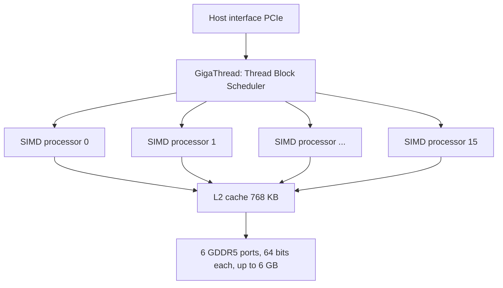
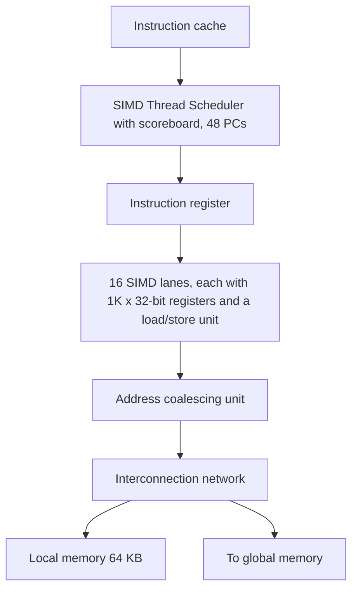

# بخش ۹، جلسه‌ی ۱۱ از ۱۴: سخت‌افزار GPU و مجموعه‌ی دستور PTX

این جلسه بخشی از **بخش ۹: موازی‌سازی سطح داده: معماری برداری، SIMD و GPU** است. زمان مطالعه: حدود نیم ساعت.

**فهرست این جلسه:**

- ۱. شباهت‌ها و تفاوت‌های کلی با معماری برداری
- ۲. پردازنده‌ی گرافیکی یک چندپردازنده است
- ۳. دو سطح زمان‌بند سخت‌افزاری
- ۴. پردازنده‌ی SIMD چندنخی از درون
- ۵. خط‌ها و چایم دو سیکلی
- ۶. فایل ثبات بزرگ
- ۷. مجموعه‌ی دستور PTX
- ۸. کد PTX برای DAXPY
- ۹. همه‌ی دسترسی‌ها جمع‌آوری و پخش‌اند: ادغام آدرس
- ۱۰. تمرین‌ها

---

## ۱. شباهت‌ها و تفاوت‌های کلی با معماری برداری

اسلاید درس این خلاصه را می‌دهد:

| شباهت با ماشین برداری | تفاوت با ماشین برداری |
|---|---|
| مناسب مسئله‌های موازی سطح داده | پردازنده‌ی اسکالر نزدیک ندارد |
| انتقال جمع‌آوری و پخش | با چندنخنگی تأخیر حافظه را پنهان می‌کند |
| ثبات‌های نقاب | به جای چند واحد عمیقاً خط‌لوله‌ای، تعداد زیادی واحد عملیاتی دارد |
| فایل ثبات بزرگ (حتی بزرگ‌تر از ماشین برداری) | بعضی کارها را در زمان اجرا با سخت‌افزار انجام می‌دهد که ماشین برداری در زمان کامپایل با نرم‌افزار انجام می‌دهد |

در هر دو، کد کارا لازم دارد که برنامه‌نویس **بر حسب گروه‌های عمل SIMD** فکر کند.

## ۲. پردازنده‌ی گرافیکی یک چندپردازنده است

سخت‌افزار GPU مجموعه‌ای از **پردازنده‌های SIMD چندنخی (multithreaded SIMD processor)** است که یک شبکه از بلوک‌های نخ را اجرا می‌کنند. یعنی **پردازنده‌ی گرافیکی یک چندپردازنده است** که هسته‌هایش پردازنده‌ی SIMD چندنخی‌اند. هر پردازنده‌ی SIMD یک پردازنده‌ی کامل با PC های جدا است.

اولین چهار پیاده‌سازی معماری Fermi، 7، 11، 14 یا 15 پردازنده‌ی SIMD داشتند. برای اینکه برنامه روی مدل‌های مختلف بدون تغییر اجرا شود (**مقیاس‌پذیری شفاف**)، زمان‌بند بلوک نخ بلوک‌ها را به هر تعداد پردازنده‌ای که موجود است می‌دهد.



این شکل ساده‌شده‌ی نقشه‌ی تراشه‌ی Fermi GTX 480 با ۱۶ پردازنده‌ی SIMD است. نسخه‌ی تجاری GTX 480 پانزده تای آن را فعال دارد.

## ۳. دو سطح زمان‌بند سخت‌افزاری

پردازنده‌ی گرافیکی دو سطح زمان‌بند سخت‌افزاری دارد:

- ۱. **زمان‌بند بلوک نخ (Thread Block Scheduler):** بلوک‌ها را به پردازنده‌های SIMD می‌دهد. تعداد بلوک‌های لازم برای حلقه را تعیین می‌کند و تا پایان حلقه بلوک تخصیص می‌دهد. مطمئن می‌شود بلوک‌ها به پردازنده‌ای بروند که حافظه‌ی محلی‌اش داده‌ی مربوط را دارد. در مثال ۸۱۹۲ عنصری، ۱۶ بلوک را می‌فرستد. این زمان‌بند کمی شبیه **پردازنده‌ی کنترل** در معماری برداری است.
- ۲. **زمان‌بند نخ SIMD (SIMD Thread Scheduler):** درون هر پردازنده‌ی SIMD انتخاب می‌کند کدام نخ دستورهای SIMD اجرا شود.

زمان‌بند نخ SIMD یک **جدول امتیاز (scoreboard)** دارد (همان مفهوم بخش ۸ جلسه‌ی ۱) که تا **۴۸ نخ SIMD** را دنبال می‌کند و می‌داند دستور بعدی کدام نخ آماده است. چرا جدول امتیاز لازم است؟ چون دستورهای حافظه به خاطر تداخل بانک و دلایل دیگر تعداد سیکل غیرقابل پیش‌بینی دارند.

چون نخ‌های SIMD طبق تعریف مستقل‌اند، زمان‌بند هر نخ آماده‌ای را برمی‌دارد و لازم نیست به دستور بعدی همان نخ بچسبد:

```text
time   SIMD thread   instruction   (operands ready?)
 1        8             11            ld.global.f64   ready
 2        1             42            ld.global.f64   ready
 3        3             95            shl.s32         ready
 4        8             12            ld.global.f64   ready
 5        3             96            add.s32         ready
 6        1             43            mul.f64         ready
```

این دقیقاً **چندنخنگی ریزدانه** است که در بخش ۸ جلسه‌ی ۱۲ دیدیم، با این تفاوت که هر «دستور» یک دستور SIMD روی ۳۲ عنصر است. فرض معماران GPU: برنامه‌ها آن‌قدر نخ SIMD دارند که چندنخنگی هم تأخیر DRAM را پنهان می‌کند و هم بهره‌برداری را بالا می‌برد. برای احتیاط، Fermi یک کش L2 هم دارد.

## ۴. پردازنده‌ی SIMD چندنخی از درون



اجزای اصلی (شکل ساده‌شده‌ی کتاب):

- **زمان‌بند نخ SIMD** با جدولی از ۴۸ PC.
- **ثبات دستور** که یک دستور را همزمان به همه‌ی خط‌ها پخش می‌کند.
- **شانزده خط SIMD** که هر کدام بخشی از فایل ثبات (1K × 32 بیت) و یک واحد بارگذاری و ذخیره دارد.
- **واحد ادغام آدرس** و شبکه‌ی ارتباطی به حافظه‌ی محلی ۶۴ کیلوبایتی و حافظه‌ی سراسری.

تفاوت با پردازنده‌ی برداری: پردازنده‌ی SIMD **تعداد زیادی واحد موازی** دارد، به جای چند واحد عمیقاً خط‌لوله‌ای. به همین دلیل کتاب آن را «پردازنده‌ی SIMD» می‌نامد، نه «پردازنده‌ی برداری».

## ۵. خط‌ها و چایم دو سیکلی

دستورهای نخ SIMD **۳۲ عنصر پهنا** دارند. در Fermi هر نخ ۳۲ تایی روی **۱۶ خط فیزیکی** نگاشت می‌شود، پس هر دستور SIMD **دو سیکل** طول می‌کشد. هر نخ SIMD به صورت قفل‌گام (lock step) اجرا می‌شود و فقط در شروع زمان‌بندی می‌شود.

اگر پردازنده‌ی SIMD را مثل یک پردازنده‌ی برداری ببینیم:

```math
\text{lanes} = 16,\quad \text{vector length} = 32,\quad \text{chime} = \frac{32}{16} = 2 \text{ cycles}
```

مقایسه: پردازنده‌ی برداری ممکن است ۲ تا ۸ خط و طول بردار مثلاً ۳۲ داشته باشد، یعنی چایم ۴ تا ۱۶ سیکل. پردازنده‌ی SIMD با ۸ یا ۱۶ خط چایم ۲ یا ۴ سیکل دارد (Fermi دو و Tesla چهار). یعنی GPU **پهن و کم‌عمق** است.

## ۶. فایل ثبات بزرگ

در مثال ضرب برداری، هر پردازنده‌ی SIMD باید ۳۲ عنصر از دو بردار را در ثبات بارگذاری کند، ضرب کند و نتیجه را ذخیره کند. برای نگه داشتن این‌ها، پردازنده‌ی SIMD **۳۲۷۶۸ ثبات ۳۲ بیتی** دارد.

- **تقسیم بین خط‌ها:** مثل پردازنده‌ی برداری، ثبات‌ها منطقاً بین خط‌های SIMD تقسیم می‌شوند. با ۱۶ خط، هر خط 32768 / 16 = **۲۰۴۸ ثبات** دارد.
- **سقف هر نخ SIMD:** حداکثر **۶۴ ثبات**. پس می‌شود هر نخ SIMD را دارای تا ۶۴ ثبات برداری با ۳۲ عنصر ۳۲ بیتی دانست، یا (چون دقت مضاعف از دو ثبات ۳۲ بیتی کنار هم استفاده می‌کند) ۳۲ ثبات برداری با ۳۲ عنصر ۶۴ بیتی.
- **سهم هر نخ CUDA:** هر نخ CUDA یک عنصر از هر ثبات برداری را می‌گیرد. چون ۳۲ عنصر یک نخ SIMD روی ۱۶ خط اجرا می‌شوند، نخ‌های CUDA یک بلوک با هم می‌توانند تا نیمی از ۲۰۴۸ ثبات هر خط را استفاده کنند.
- **تخصیص پویا:** وقتی نخ SIMD ساخته می‌شود، مجموعه‌ای از ثبات‌های فیزیکی به آن داده می‌شود و وقتی تمام شد آزاد می‌شود. پس تعداد نخ‌های همزمان به تعداد ثبات مصرفی هر نخ بستگی دارد.
- **پیاده‌سازی:** GPU به جای ساختن ثبات با درگاه‌های خواندن و نوشتن زیاد برای هر بیت، از ساختارهای حافظه‌ی ساده‌تر استفاده می‌کند و آن‌ها را **بانک‌بندی** می‌کند تا پهنای باند کافی داشته باشد، درست مثل پردازنده‌ی برداری.

مقایسه با VMIPS: هشت ثبات × ۶۴ عنصر = ۵۱۲ عنصر. یک نخ SIMD در GPU تا ۶۴ ثبات × ۳۲ عنصر = ۲۰۴۸ عنصر. این ثبات‌های اضافه برای **چندنخنگی** لازم‌اند: حالت همه‌ی نخ‌های فعال باید همزمان در فایل ثبات باشد.

## ۷. مجموعه‌ی دستور PTX

برخلاف بیشتر پردازنده‌های سیستم، هدف کامپایلرهای NVIDIA یک **انتزاع از مجموعه‌ی دستور سخت‌افزاری** است: **PTX** (Parallel Thread Execution). مجموعه‌ی دستور سخت‌افزاری واقعی از برنامه‌نویس پنهان است.

- **پایداری و سازگاری:** PTX یک مجموعه‌ی دستور ثابت برای کامپایلرها و سازگاری بین نسل‌های GPU فراهم می‌کند.
- **دید یک نخ:** دستورهای PTX عمل روی **یک نخ CUDA** را توصیف می‌کنند. معمولاً یک به یک به دستور سخت‌افزاری نگاشت می‌شوند، اما ممکن است یک دستور PTX به چند دستور ماشین تبدیل شود یا برعکس.
- **ثبات‌های مجازی:** کامپایلر تعیین می‌کند هر نخ SIMD چند ثبات برداری فیزیکی لازم دارد و یک بهینه‌ساز فضای ثبات را بین نخ‌ها تقسیم می‌کند. همین بهینه‌ساز کد مرده را حذف می‌کند، دستورها را ترکیب می‌کند و جاهایی را که پرش‌ها ممکن است واگرا یا همگرا شوند پیدا می‌کند.
- **مقایسه با x86:** x86 هم دستورها را به یک شکل داخلی (ریزدستور) ترجمه می‌کند، اما این ترجمه در **سخت‌افزار و در زمان اجرا** است. ترجمه‌ی PTX در **نرم‌افزار و در زمان بارگذاری** انجام می‌شود.

قالب دستور:

```text
opcode.type d, a, b, c;
```

که d مقصد و a، b و c مبدأ هستند. نوع‌ها:

| نوع | مشخص‌کننده |
|---|---|
| بیت‌های بدون نوع ۸ تا ۶۴ | مقدار `.b8, .b16, .b32, .b64` |
| صحیح بدون علامت ۸ تا ۶۴ | مقدار `.u8, .u16, .u32, .u64` |
| صحیح علامت‌دار ۸ تا ۶۴ | مقدار `.s8, .s16, .s32, .s64` |
| ممیز شناور ۱۶ تا ۶۴ | مقدار `.f16, .f32, .f64` |

خلاصه‌ی گروه‌های دستور:

| گروه | نمونه‌ها |
|---|---|
| حسابی | دستورهای `add`، `sub`، `mul`، `mad` (ضرب و جمع)، `div`، `rem`، `abs`، `neg`، `min`، `max`، `setp` (مقایسه و تنظیم گزاره)، `mov`، `selp` (انتخاب با گزاره)، `cvt` (تبدیل نوع) |
| توابع ویژه | دستورهای `rcp` (معکوس)، `sqrt`، `rsqrt`، `sin`، `cos`، `lg2`، `ex2` |
| منطقی | دستورهای `and`، `or`، `xor`، `not`، `cnot`، `shl`، `shr` |
| دسترسی حافظه | دستورهای `ld.space.type` و `st.space.type` با فضای `.global`، `.shared`، `.local`، `.const`؛ دستور `tex` و عمل‌های اتمی `atom` |
| جریان کنترل | دستورهای `@p bra` (پرش شرطی)، `call`، `ret`، `bar.sync` (همگام‌سازی سد بین نخ‌های یک بلوک)، `exit` |

همه‌ی دستورها می‌توانند با **ثبات‌های گزاره‌ی یک بیتی** مشروط شوند که با `setp` تنظیم می‌شوند. گذاشتن گزاره جلوی `bra` پرش شرطی می‌سازد. ثبات‌های مجازی `R0, R1, ...` برای مقدارهای ۳۲ بیتی و `RD0, RD1, ...` برای ۶۴ بیتی هستند.

## ۸. کد PTX برای DAXPY

یک تکرار حلقه‌ی DAXPY (یعنی کار یک نخ CUDA):

```asm
shl.u32       R8, blockIdx, 9    ; Thread Block ID * Block size (512 or 2^9)
add.u32       R8, R8, threadIdx  ; R8 = i = my CUDA Thread ID
shl.u32       R8, R8, 3          ; byte offset
ld.global.f64 RD0, [X+R8]        ; RD0 = X[i]
ld.global.f64 RD2, [Y+R8]        ; RD2 = Y[i]
mul.f64       RD0, RD0, RD4      ; Product in RD0 = RD0 * RD4 (scalar a)
add.f64       RD0, RD0, RD2      ; Sum in RD0 = RD0 + RD2 (Y[i])
st.global.f64 [Y+R8], RD0        ; Y[i] = sum (X[i]*a + Y[i])
```

- **سه دستور اول** آفست بایتی یکتای عنصر را در R8 حساب می‌کنند.
- **پنج دستور بعد** دو عملوند را بارگذاری، ضرب و جمع می‌کنند و نتیجه را ذخیره می‌کنند.
- **بدون افزایش اندیس و پرش:** مدل CUDA به هر تکرار یک نخ می‌دهد و هر نخ شماره‌ی یکتای خودش را دارد، پس ۸۱۹۲ نخ CUDA ساخته می‌شود و کد هیچ دستور افزایش یا پرش حلقه ندارد. کد PTX مربوط به `if (i < n)` را در جلسه‌ی بعد می‌بینیم.

> **اختلاف کتاب با خودش:** کد CUDA جلسه‌ی قبل ۲۵۶ نخ در هر بلوک داشت، اما این کد PTX با `shl.u32 R8, blockIdx, 9` اندازه‌ی بلوک را ۵۱۲ فرض کرده است (مثال ۸۱۹۲ عنصری). برای ۲۵۶ نخ باید شیفت ۸ باشد. همچنین اسلاید درس دستور سوم (`shl.u32 R8, R8, 3`) را ندارد و بعضی نوع‌ها را `s32` نوشته است. نسخه‌ی کتاب کامل‌تر است، چون بدون ضرب در ۸، آفست بایتی غلط می‌شود.

## ۹. همه‌ی دسترسی‌ها جمع‌آوری و پخش‌اند: ادغام آدرس

برخلاف معماری برداری، GPU دستورهای جدا برای انتقال پیوسته، با گام و جمع‌آوری و پخش ندارد. **همه‌ی انتقال‌های داده جمع‌آوری و پخش‌اند:** هر خط SIMD آدرس خودش را می‌فرستد.

برای بازگرداندن کارایی انتقال پیوسته، GPU سخت‌افزار ویژه‌ی **ادغام آدرس (address coalescing)** دارد:

- **تشخیص:** این سخت‌افزار تشخیص می‌دهد که خط‌های یک نخ SIMD با هم آدرس‌های پشت سر هم می‌فرستند.
- **درخواست بلوکی:** بعد به واحد رابط حافظه می‌گوید یک انتقال بلوکی ۳۲ کلمه‌ی پیوسته درخواست کند.
- **مسئولیت برنامه‌نویس:** برنامه‌نویس GPU باید مطمئن شود نخ‌های CUDA کنار هم، همزمان به آدرس‌های نزدیک دسترسی دارند که در یک یا چند بلوک حافظه یا کش ادغام شوند. مثال DAXPY ما این کار را می‌کند: نخ i به X[i] دسترسی دارد.

```text
coalesced:     thread t reads X[base + t]        -> 1 block request for 32 threads
strided:       thread t reads X[base + 32*t]     -> up to 32 separate requests
random:        thread t reads X[idx[t]]          -> up to 32 separate requests
```

این همان دلیلی است که کتاب می‌گوید: هر چند مدل CUDA شبیه MIMD به نظر می‌رسد، نوشتن کد کارای GPU لازم دارد برنامه‌نویس **بر حسب عمل‌های SIMD** فکر کند. در معماری برداری، دسترسی گام واحد **صریح** است (دستور `LV`)؛ در GPU **ضمنی** است و به رفتار نخ‌ها بستگی دارد.

## ۱۰. تمرین‌ها

<details><summary>تمرین ۱: تعداد نخ همزمان با ثبات</summary>

**صورت:** پردازنده‌ی SIMD با ۳۲۷۶۸ ثبات ۳۲ بیتی داریم. اگر هر نخ CUDA ۴۰ ثبات استفاده کند، حداکثر چند نخ SIMD (warp) می‌توانند همزمان فعال باشند؟ اگر ۲۰ ثبات استفاده کند چطور؟ سقف سخت‌افزاری ۴۸ نخ SIMD است.

**جواب:** هر warp ۳۲ نخ دارد. با ۴۰ ثبات: 32 × 40 = 1280 ثبات برای هر warp، پس 32768 / 1280 = 25.6 یعنی ۲۵ warp. با ۲۰ ثبات: 640 ثبات برای هر warp، پس 51.2؛ اما سقف ۴۸ است، پس ۴۸ warp. ثبات کمتر یعنی نخ بیشتر و پنهان‌سازی بهتر تأخیر.
</details>

<details><summary>تمرین ۲: پنهان کردن تأخیر</summary>

**صورت:** فرض کن هر warp بعد از هر ۴ دستور SIMD (هر کدام ۲ سیکل) یک بارگذاری با تأخیر ۴۰۰ سیکل دارد. حداقل چند warp لازم است تا پردازنده هرگز بیکار نماند؟

**جواب:** هر warp قبل از توقف 4 × 2 = 8 سیکل کار مفید دارد و بعد ۴۰۰ سیکل منتظر است. برای پر کردن ۴۰۰ سیکل با کار بقیه‌ی warp ها: 400 / 8 = 50 warp دیگر، یعنی حدود ۵۱ warp. این بیشتر از سقف ۴۸ است، پس پردازنده کمی بیکار می‌ماند. این همان دلیل کش L2 در Fermi است.
</details>

<details><summary>تمرین ۳: کد PTX یک هسته</summary>

**صورت:** کد PTX برای `C[i] = A[i] + B[i]` با عددهای ۳۲ بیتی ممیز شناور و بلوک ۲۵۶ نخی بنویس.

**جواب:**

```asm
shl.u32       R8, blockIdx, 8     ; block ID * 256
add.u32       R8, R8, threadIdx   ; i
shl.u32       R8, R8, 2           ; byte offset (4 bytes per float)
ld.global.f32 R0, [A+R8]
ld.global.f32 R1, [B+R8]
add.f32       R2, R0, R1
st.global.f32 [C+R8], R2
```
</details>

<details><summary>تمرین ۴: دسترسی ادغام‌نشده</summary>

**صورت:** در هسته‌ی ترانهاده‌ی ماتریس `B[j][i] = A[i][j]` با نخ i روی اندیس j، کدام دسترسی ادغام می‌شود و کدام نه؟ یک راه حل پیشنهاد کن.

**جواب:** اگر نخ‌های کنار هم j متوالی داشته باشند، خواندن `A[i][j]` (سطری در C) ادغام می‌شود، اما نوشتن `B[j][i]` با گام یک سطر است و ادغام نمی‌شود. راه رایج: یک کاشی (tile) از A را با دسترسی ادغام‌شده در حافظه‌ی محلی (Shared Memory) بارگذاری کن، بعد از `bar.sync` ترانهاده‌ی آن را با دسترسی ادغام‌شده در B بنویس.
</details>

---

جلسه‌ی قبلی: [مدل برنامه‌نویسی GPU و CUDA](9-10-gpu-programming-model.md)  
جلسه‌ی بعدی: [پرش شرطی، حافظه‌های GPU و نوآوری‌های Fermi](9-12-gpu-branches-memory-fermi.md)
