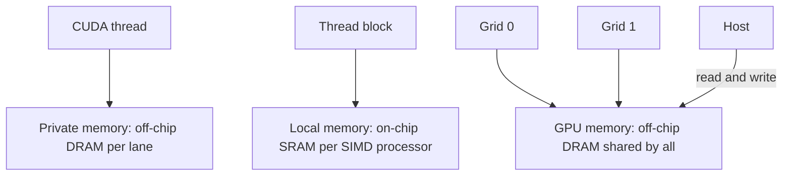

# بخش ۹، جلسه‌ی ۱۲ از ۱۴: پرش شرطی، حافظه‌های GPU و نوآوری‌های Fermi

این جلسه بخشی از **بخش ۹: موازی‌سازی سطح داده: معماری برداری، SIMD و GPU** است. زمان مطالعه: حدود نیم ساعت.

**فهرست این جلسه:**

- ۱. شرط در GPU: همان نقاب، با سخت‌افزار بیشتر
- ۲. ابزارها: گزاره، نقاب داخلی، پشته و نشانگر
- ۳. مثال IF-THEN-ELSE در PTX
- ۴. بازده واگرایی
- ۵. بهینه‌سازی شاخه‌های یکسان
- ۶. توهم «هر نخ PC خودش را دارد»
- ۷. ساختار حافظه‌ی GPU
- ۸. کش در GPU: فیلتر پهنای باند
- ۹. نوآوری‌های Fermi
- ۱۰. تمرین‌ها

---

## ۱. شرط در GPU: همان نقاب، با سخت‌افزار بیشتر

در جلسه‌ی ۵ دیدیم معماری برداری شرط داخل حلقه را با **ثبات نقاب** اجرا می‌کند و کامپایلر نقاب را صریحاً مدیریت می‌کند. پردازنده‌ی گرافیکی همین ایده را دارد، با این تفاوت که بیشتر کار را **سخت‌افزار** انجام می‌دهد:

- **معماری برداری:** سازوکار عمدتاً در نرم‌افزار، با پشتیبانی سخت‌افزاری محدود.
- **پردازنده‌ی گرافیکی:** ثبات‌های گزاره‌ی صریح، به اضافه‌ی نقاب‌های داخلی، پشته‌ی همگام‌سازی پرش و نشانگرهای دستور.

## ۲. ابزارها: گزاره، نقاب داخلی، پشته و نشانگر

در سطح PTX، جریان کنترل یک نخ CUDA با دستورهای `bra`، `call`، `ret` و `exit` و با **گزاره‌ی یک بیتی برای هر خط** توصیف می‌شود. اسمبلر PTX گراف پرش را تحلیل و آن را به سریع‌ترین دنباله‌ی دستور سخت‌افزاری تبدیل می‌کند.

در سطح سخت‌افزار:

- **پشته‌ی همگام‌سازی پرش (branch synchronization stack):** هر نخ SIMD پشته‌ی خودش را دارد. هر مدخل پشته یک شناسه، یک آدرس دستور هدف و یک **نقاب نخ‌های فعال** دارد.
- **دستورها و نشانگرهای ویژه:** دستورهایی که مدخل را در پشته می‌گذارند (push)، و نشانگرهایی که مدخل را برمی‌دارند (pop) و با نقاب آن مدخل به آدرس هدف می‌پرند.
- **گزاره‌ی هر خط:** دستورهای سخت‌افزاری هم برای هر خط فعال یا غیرفعال می‌شوند.

اسمبلر PTX معمولاً یک IF-THEN-ELSE ساده‌ی سطح بیرونی را **فقط با دستورهای گزاره‌دار** و بدون پرش GPU پیاده می‌کند. جریان کنترل پیچیده‌تر ترکیبی از گزاره و پرش با پشته است. وقتی بعضی خط‌ها می‌پرند و بقیه نمی‌پرند، NVIDIA می‌گوید پرش **واگرا (diverge)** شده است.

حلقه‌ها هم همین‌طور: اسمبلر پرش به ابتدای حلقه را با دستورهای ویژه‌ی پشته ترکیب می‌کند تا خط‌هایی که زودتر از حلقه بیرون می‌روند غیرفعال شوند و وقتی همه‌ی خط‌ها حلقه را تمام کردند، دوباره **همگرا (converge)** شوند. پرش و فراخوانی اندیس‌دار (مثل switch) هم مدخل پشته می‌گذارند.

## ۳. مثال IF-THEN-ELSE در PTX

کد C (همان مثال جلسه‌ی ۵ با یک ELSE):

```c
if (X[i] != 0)
    X[i] = X[i] - Y[i];
else
    X[i] = Z[i];
```

کد PTX (R8 آفست بایتی نخ را دارد). نشانگرهای `*Push`، `*Comp` و `*Pop` را اسمبلر اضافه می‌کند:

```asm
        ld.global.f64  RD0, [X+R8]    ; RD0 = X[i]
        setp.neq.s32   P1, RD0, #0    ; P1 is predicate register 1
        @!P1, bra      ELSE1, *Push   ; push old mask, set new mask bits
                                      ; if P1 false, go to ELSE1
        ld.global.f64  RD2, [Y+R8]    ; RD2 = Y[i]
        sub.f64        RD0, RD0, RD2  ; difference in RD0
        st.global.f64  [X+R8], RD0    ; X[i] = RD0
        @P1, bra       ENDIF1, *Comp  ; complement mask bits
                                      ; if P1 true, go to ENDIF1
ELSE1:  ld.global.f64  RD0, [Z+R8]    ; RD0 = Z[i]
        st.global.f64  [X+R8], RD0    ; X[i] = RD0
ENDIF1: <next instruction>, *Pop      ; pop to restore old mask
```

آنچه سخت‌افزار انجام می‌دهد:

- ۱. دستور `setp` شرط را برای هر خط ارزیابی می‌کند.
- ۲. نشانگر `*Push` نقاب فعلی را در پشته می‌گذارد و نقاب جدید را بر اساس شرط تنظیم می‌کند: فقط خط‌هایی که X[i] صفر نیست فعال می‌مانند.
- ۳. دستورهای THEN برای همه‌ی خط‌ها پخش می‌شوند، اما فقط خط‌های فعال عمل را انجام می‌دهند و نتیجه را ذخیره می‌کنند.
- ۴. نشانگر `*Comp` بیت‌های نقاب را **معکوس** می‌کند: حالا خط‌هایی که بیکار بودند فعال می‌شوند.
- ۵. دستورهای ELSE برای خط‌های تازه فعال اجرا می‌شوند.
- ۶. نشانگر `*Pop` نقاب قبلی را از پشته برمی‌گرداند و همه‌ی خط‌ها دوباره همگرا می‌شوند.

> **نکته‌ی کوچک:** کد کتاب و اسلاید مقایسه را با `setp.neq.s32` روی یک مقدار ۶۴ بیتی ممیز شناور نوشته است. در PTX واقعی برای عدد ممیز شناور باید نوع `.f64` به کار رود (مثلاً `setp.ne.f64` یا `setp.neu.f64`). این برای فهم سازوکار مهم نیست.

مقایسه با VMIPS (جلسه‌ی ۵): آنجا ما خودمان با `MVFM` و `MVTM` نقاب را ذخیره و بازیابی کردیم. کتاب می‌گوید کامپایلر برداری هم می‌تواند همین ترفندها را با نقاب انجام دهد، اما با دستورهای اسکالر برای ذخیره، معکوس کردن و بازیابی نقاب. پس **اجرای شرطی جایی است که GPU در زمان اجرا با سخت‌افزار انجام می‌دهد آنچه معماری برداری در زمان کامپایل با نرم‌افزار انجام می‌دهد.**

## ۴. بازده واگرایی

همه‌ی دستورهای THEN و ELSE توسط پردازنده‌ی SIMD اجرا می‌شوند؛ فقط بعضی خط‌ها برای هر بخش فعال‌اند. پس:

- **دو مسیر با طول برابر:** هر خط فقط در نیمی از سیکل‌ها کار مفید دارد، یعنی بازده **۵۰٪**.
- **دو سطح IF تودرتو:** بازده **۲۵٪**.
- **سه سطح:** بازده **۱۲.۵٪**، و همین‌طور تا آخر.

```math
\text{efficiency} = \frac{1}{2^{d}} \quad \text{for } d \text{ nested levels of equal-length divergent paths}
```

این بدترین حالت است: فرض شده هر سطح واقعاً واگرا شود و مسیرها طول برابر داشته باشند. حالت مشابه در پردازنده‌ی برداری این است که فقط چند بیت نقاب یک باشند.

**یک اندازه‌گیری واقعی:** یک محاسبه‌ی مقدار ویژه با شرط‌های عمیقاً تودرتو، در اندازه‌گیری نشان داد که حدود **۸۲٪** صدورها بین ۲۹ تا ۳۲ بیت از ۳۲ بیت نقاب را یک دارند. یعنی GPU این کد را خیلی بهتر از آنچه انتظار می‌رود اجرا می‌کند، چون شاخه‌ها کم واگرا می‌شوند.

**قطعه‌بندی رایگان:** همین سازوکار مسئله‌ی قطعه‌بندی را هم حل می‌کند. شرط `if (i < n)` در DAXPY برای نخ‌های اضافه‌ی بلوک آخر نقاب را صفر می‌کند. در معماری برداری باید `n % MVL` حساب و در VLR گذاشته می‌شد؛ در GPU حلقه فقط تا رسیدن همه‌ی خط‌ها به مرز تکرار می‌شود.

## ۵. بهینه‌سازی شاخه‌های یکسان

اگر **همه‌ی** بیت‌های نقاب یک باشند، پرش انتهای THEN از روی دستورهای ELSE می‌پرد. اگر همه صفر باشند، پرش شرطی از روی THEN می‌پرد. شاخه‌های **هم‌رأی (unanimous)** که همه‌ی خط‌ها یک مسیر را می‌روند، رایج‌اند: مثلاً شرط روی یک پارامتر که برای همه‌ی خط‌ها یکسان است، یا بررسی خطایی که به ندرت رخ می‌دهد.

این یک بهینه‌سازی است که GPU در **زمان اجرا** دارد ولی معماری برداری در **زمان کامپایل** ندارد: پرش از روی بخشی که هیچ خطی آن را اجرا نمی‌کند.

## ۶. توهم «هر نخ PC خودش را دارد»

این انعطاف باعث می‌شود به نظر برسد هر عنصر PC خودش را دارد. به همین دلیل اسم «نخ CUDA» انتخاب شده است. اما:

- **کندترین حالت:** فقط یک خط SIMD در هر دو سیکل نتیجه ذخیره می‌کند و بقیه بیکارند.
- **قانون اصلی:** در هر سیکل، تنها انتخاب یک خط SIMD این است که دستور PTX مشخص‌شده را اجرا کند یا بیکار باشد. **دو خط نمی‌توانند همزمان دو دستور متفاوت اجرا کنند.**

کتاب یک تشبیه خوب دارد: نوشتن برنامه‌ای که خط‌های SIMD را در حالت کاملاً مستقل (MIMD) به کار می‌گیرد، مثل نوشتن برنامه‌ای است که فضای آدرس مجازی خیلی بزرگ‌تر از حافظه‌ی فیزیکی مصرف می‌کند. هر دو درست کار می‌کنند، اما ممکن است آن‌قدر کند باشند که برنامه‌نویس راضی نباشد. این انعطاف در مرحله‌ی اول توسعه‌ی برنامه مفید است، اما برنامه‌نویس تازه‌کار را به کارایی ضعیف می‌کشاند.

## ۷. ساختار حافظه‌ی GPU



سه نوع حافظه (با نام‌های توصیفی کتاب):

| حافظه | محل | دسترسی | کاربرد |
|---|---|---|---|
| حافظه‌ی خصوصی | بخشی از DRAM بیرون تراشه برای هر خط SIMD | فقط همان خط (نخ CUDA) | قاب پشته، ثبات‌های سرریز (spill)، متغیرهای خصوصی که در ثبات جا نمی‌شوند |
| حافظه‌ی محلی | حافظه‌ی روی تراشه‌ی هر پردازنده‌ی SIMD | نخ‌های یک بلوک | ارتباط بین نخ‌های بلوک؛ هنگام ساخت بلوک تخصیص و هنگام پایان آن آزاد می‌شود |
| حافظه‌ی GPU | حافظه‌ی DRAM بیرون تراشه | همه‌ی پردازنده‌ها و همه‌ی شبکه‌ها؛ میزبان هم می‌تواند بخواند و بنویسد | داده‌ی اصلی برنامه |

حافظه‌ی محلی و حافظه‌ی خصوصی برای میزبان قابل دسترسی نیستند. مثال ضرب برداری ما فقط از حافظه‌ی GPU استفاده کرد. پردازنده‌های گرافیکی جدید حافظه‌ی خصوصی را در L1 و L2 کش می‌کنند تا سرریز ثبات و فراخوانی تابع سریع‌تر شود.

یادت باشد: «Local Memory» در اصطلاح NVIDIA همان حافظه‌ی **خصوصی** است و «Shared Memory» در اصطلاح NVIDIA همان حافظه‌ی **محلی** کتاب.

## ۸. کش در GPU: فیلتر پهنای باند

فلسفه‌ی سنتی GPU با CPU فرق دارد:

- **پردازنده‌ی سیستم:** کش‌های بزرگ چندسطحی که سعی می‌کنند کل مجموعه‌ی کاری برنامه را نگه دارند.
- **پردازنده‌ی گرافیکی:** کش‌های **جریانی (streaming)** کوچک‌تر و تکیه بر چندنخنگی گسترده برای پنهان کردن تأخیر طولانی DRAM، چون مجموعه‌ی کاری ممکن است صدها مگابایت باشد. مساحتی که CPU برای کش صرف می‌کند، GPU صرف واحدهای محاسباتی و ثبات‌های زیاد برای حالت نخ‌ها می‌کند.
- **پردازنده‌ی برداری:** بارگذاری و ذخیره‌ی برداری تأخیر را روی تعداد زیادی عنصر سرشکن می‌کند: تأخیر یک بار پرداخت می‌شود و بقیه‌ی دسترسی‌ها خط‌لوله‌ای‌اند.

با این حال، GPU ها و پردازنده‌های برداری جدید کش اضافه کرده‌اند. در Fermi، کش‌ها یا **فیلتر پهنای باند** (کاهش تقاضا از حافظه‌ی GPU) هستند یا **شتاب‌دهنده** برای معدود متغیرهایی که تأخیرشان با چندنخنگی پنهان نمی‌شود: قاب پشته، فراخوانی تابع و سرریز ثبات. کش انرژی هم صرفه‌جویی می‌کند، چون دسترسی روی تراشه خیلی کم‌مصرف‌تر از دسترسی به چند تراشه‌ی DRAM بیرونی است.

دو سازوکار دیگر برای پهنای باند:

- **ادغام درخواست‌ها:** دستورهای انتقال PTX درخواست‌های نخ‌های یک نخ SIMD را وقتی در یک بلوک هستند، در یک درخواست بلوکی ادغام می‌کنند (جلسه‌ی قبل). این محدودیت شبیه رهنمودهای برنامه‌نویسی CPU برای فعال کردن پیش‌واکشی سخت‌افزاری است.
- **گروه‌بندی در کنترل‌کننده‌ی حافظه:** کنترل‌کننده درخواست‌ها را نگه می‌دارد و درخواست‌های به یک صفحه‌ی باز DRAM را با هم می‌فرستد (جلسه‌ی ۱۳).

## ۹. نوآوری‌های Fermi

**زمان‌بند دوگانه:** هر پردازنده‌ی SIMD در Fermi **دو زمان‌بند نخ SIMD** و دو واحد توزیع دستور دارد. زمان‌بند دوگانه دو نخ SIMD را انتخاب می‌کند و از هر کدام یک دستور به یکی از این گروه‌ها می‌فرستد: دو مجموعه‌ی ۱۶ خطی SIMD، ۱۶ واحد بارگذاری و ذخیره، یا ۴ واحد تابع ویژه (SFU، برای جذر، معکوس، سینوس و کسینوس). پس **دو نخ SIMD در هر دو سیکل** زمان‌بندی می‌شوند. چون نخ‌ها مستقل‌اند، نیازی به بررسی وابستگی داده نیست. این شبیه یک پردازنده‌ی برداری چندنخی است که از دو نخ مستقل دستور برداری صادر می‌کند، یعنی Fermi حتی از **ILP** هم استفاده می‌کند.

```text
time   scheduler 0                    scheduler 1
 1     SIMD thread 8,  instr 11       SIMD thread 9,  instr 11
 2     SIMD thread 2,  instr 42       SIMD thread 3,  instr 33
 3     SIMD thread 14, instr 95       SIMD thread 15, instr 95
 4     SIMD thread 8,  instr 12       SIMD thread 9,  instr 12
 5     SIMD thread 14, instr 96       SIMD thread 3,  instr 34
 6     SIMD thread 2,  instr 43       SIMD thread 15, instr 96
```

هر خط SIMD یک واحد ممیز شناور خط‌لوله‌ای، یک واحد صحیح خط‌لوله‌ای، منطق توزیع دستور و عملوند و یک صف برای نتیجه‌ها دارد.

نوآوری‌های دیگر که Fermi را به پردازنده‌های معمولی نزدیک کرد:

- **دقت مضاعف سریع:** سرعت دقت مضاعف حدود نصف تک‌دقت شد (در نسل Tesla حدود یک دهم بود). اوج دقت مضاعف از ۷۸ GFLOP/s به **۵۱۵ GFLOP/s** (با ضرب و جمع ترکیبی) رسید.
- **کش برای حافظه‌ی GPU:** یک کش داده‌ی L1 و یک کش دستور L1 برای هر پردازنده‌ی SIMD، و یک کش L2 مشترک **۷۶۸ کیلوبایتی**. کش L1 با حافظه‌ی محلی یک SRAM ۶۴ کیلوبایتی مشترک دارد: یا ۱۶ کیلوبایت L1 و ۴۸ کیلوبایت حافظه‌ی محلی، یا ۴۸ و ۱۶.
- **آدرس ۶۴ بیتی و فضای آدرس یکپارچه** برای همه‌ی حافظه‌های GPU، که اشاره‌گرهای C و C++ را خیلی ساده‌تر می‌کند.
- **کد تصحیح خطا (ECC)** برای حافظه و ثبات‌ها، که در مراکز داده لازم است.
- **تعویض متن سریع‌تر:** کمتر از ۲۵ میکروثانیه، حدود ۱۰ برابر سریع‌تر از نسل قبل.
- **دستورهای اتمی سریع‌تر:** ۵ تا ۲۰ برابر سریع‌تر، با یک واحد سخت‌افزاری ویژه کنار کش L2 (نه درون پردازنده‌های SIMD).

**سلسله‌مراتب وارونه:** در GTX 480 مجموع فایل ثبات **۲ مگابایت** است، مجموع کش‌های L1 بین ۰.۲۵ تا ۰.۷۵ مگابایت، و کش L2 فقط **۰.۷۵ مگابایت**. یعنی حافظه‌ی نزدیک‌تر بزرگ‌تر است. این برعکس CPU است.

## ۱۰. تمرین‌ها

<details><summary>تمرین ۱: بازده با مسیرهای نابرابر</summary>

**صورت:** در یک IF-THEN-ELSE، بخش THEN ۱۰ دستور و بخش ELSE ۲ دستور دارد. اگر نیمی از خط‌ها THEN و نیمی ELSE را بروند، بازده چقدر است؟ اگر همه THEN را بروند چطور؟

**جواب:** حالت واگرا: هر دو بخش اجرا می‌شوند، یعنی ۱۲ دستور. کار مفید: نیمی از خط‌ها ۱۰ دستور و نیمی ۲ دستور، یعنی میانگین ۶ دستور برای هر خط. بازده 6 / 12 = 50٪. حالت هم‌رأی: فقط THEN اجرا می‌شود و ELSE پرش می‌خورد، بازده ۱۰۰٪.
</details>

<details><summary>تمرین ۲: حلقه با طول متفاوت</summary>

**صورت:** هر نخ CUDA یک حلقه‌ی `while` با تعداد تکرار متفاوت دارد. در یک warp تعداد تکرارها بین ۱ تا ۳۲ به طور یکنواخت پخش شده است (هر خط یک عدد متفاوت). بازده چقدر است؟

**جواب:** warp تا تمام شدن طولانی‌ترین نخ (۳۲ تکرار) ادامه می‌دهد. کار مفید مجموع 1 + 2 + ... + 32 = 528 تکرار-خط است. کل ظرفیت 32 × 32 = 1024. بازده 528 / 1024 ≈ 52٪.
</details>

<details><summary>تمرین ۳: پیکربندی L1 و حافظه‌ی محلی</summary>

**صورت:** یک هسته ۴۰ کیلوبایت حافظه‌ی محلی برای هر بلوک می‌خواهد. کدام پیکربندی Fermi را باید انتخاب کرد و چند بلوک می‌تواند همزمان روی یک پردازنده‌ی SIMD باشد؟

**جواب:** فقط پیکربندی ۴۸ کیلوبایت حافظه‌ی محلی و ۱۶ کیلوبایت L1 جای ۴۰ کیلوبایت را دارد. فقط یک بلوک همزمان جا می‌شود (دو بلوک ۸۰ کیلوبایت لازم دارند). این ممکن است تعداد warp های همزمان را کم کند و پنهان‌سازی تأخیر را ضعیف کند.
</details>

<details><summary>تمرین ۴: نقاب در ماشین برداری و GPU</summary>

**صورت:** سه تفاوت مدیریت شرط در VMIPS و GPU را نام ببر.

**جواب:** الف) در VMIPS نقاب جزو حالت معماری است و کامپایلر صریحاً آن را می‌سازد و ذخیره و بازیابی می‌کند؛ در GPU نقاب داخلی و نامرئی است و سخت‌افزار با پشته و نشانگرها آن را مدیریت می‌کند. ب) GPU در زمان اجرا وقتی همه‌ی بیت‌ها یکسان‌اند از بخش بی‌استفاده می‌پرد؛ کامپایلر برداری این را در زمان کامپایل نمی‌داند. ج) GPU شرط‌های تودرتو، حلقه‌ها و فراخوانی تابع را هم با همین پشته پشتیبانی می‌کند و قطعه‌بندی را هم با همین نقاب انجام می‌دهد.
</details>

---

جلسه‌ی قبلی: [سخت‌افزار GPU و مجموعه‌ی دستور PTX](9-11-gpu-hardware-and-ptx.md)  
جلسه‌ی بعدی: [مقایسه‌ی برداری، SIMD و GPU و سیستم‌های واقعی](9-13-comparisons-and-real-systems.md)
