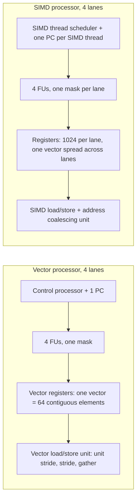

# بخش ۹، جلسه‌ی ۱۳ از ۱۴: مقایسه‌ی برداری، SIMD و GPU و سیستم‌های واقعی

این جلسه بخشی از **بخش ۹: موازی‌سازی سطح داده: معماری برداری، SIMD و GPU** است. زمان مطالعه: حدود نیم ساعت.

**فهرست این جلسه:**

- ۱. معادل GPU برای هر مفهوم برداری
- ۲. چهار تفاوت عمیق ماشین برداری و GPU
- ۳. چندهسته‌ای با SIMD در برابر GPU
- ۴. مسائل مشترک: انرژی، کند و پهن
- ۵. مسائل مشترک: حافظه‌ی بانکی و GDRAM
- ۶. مسائل مشترک: گام و عدم اصابت TLB
- ۷. پردازنده‌ی گرافیکی همراه در برابر سرور: Tegra 2 و GTX 480
- ۸. مقایسه‌ی Core i7 و GTX 280: مشخصات
- ۹. نتیجه‌ی ۱۴ هسته و پنج دلیل
- ۱۰. تمرین‌ها

---

## ۱. معادل GPU برای هر مفهوم برداری

حالا که درون هر دو معماری را دیده‌ایم، می‌توانیم آن‌ها را دقیق مقایسه کنیم. جدول کتاب (شکل ۴.۲۱):

| مفهوم برداری | نزدیک‌ترین مفهوم GPU | توضیح |
|---|---|---|
| حلقه‌ی برداری | واژه‌ی Grid | مفهوم مشابه |
| چایم | ندارد | دستور PTX در Fermi دو سیکل و در Tesla چهار سیکل طول می‌کشد، پس چایم کوتاه است |
| دستور برداری | دستور PTX | دستور PTX یک نخ SIMD به همه‌ی خط‌ها پخش می‌شود |
| جمع‌آوری و پخش | دستورهای `ld.global` و `st.global` | همه‌ی دسترسی‌ها جمع‌آوری و پخش‌اند؛ واحد ادغام کارایی گام واحد را برمی‌گرداند |
| ثبات نقاب | ثبات گزاره و نقاب داخلی | نقاب برداری جزو حالت معماری است؛ نقاب GPU داخلی است و سخت‌افزار آن را پویا مدیریت می‌کند |
| پردازنده‌ی برداری | پردازنده‌ی SIMD چندنخی | پردازنده‌ی SIMD خط‌های زیاد و چند سیکل برای هر بردار دارد؛ پردازنده‌ی برداری خط کم و سیکل زیاد؛ SIMD چندنخی است و برداری معمولاً نیست |
| پردازنده‌ی کنترل | زمان‌بند بلوک نخ | زمان‌بند بلوک نزدیک‌ترین است، اما GPU عمل اسکالر-برداری و دستور انتقال با گام واحد یا گام ندارد |
| پردازنده‌ی اسکالر | پردازنده‌ی سیستم | به دلیل نبود حافظه‌ی مشترک و تأخیر هزاران سیکلی PCIe، به ندرت نقش پردازنده‌ی اسکالر را دارد |
| خط برداری | خط SIMD | هر دو اساساً واحد عملیاتی با ثبات‌اند |
| ثبات برداری | ثبات‌های خط SIMD | معادل یک ثبات برداری، همان ثبات در همه‌ی ۳۲ خط است؛ حداکثر ۶۴ ثبات |
| حافظه‌ی اصلی | حافظه‌ی GPU | حافظه‌ی GPU در برابر حافظه‌ی سیستم |

با این دید، **GTX 480 یک ماشین ۱۵ هسته‌ای با پشتیبانی سخت‌افزاری چندنخنگی است که هر هسته ۱۶ خط دارد**. بزرگ‌ترین تفاوت، **چندنخنگی** است که برای GPU اساسی است و در بیشتر پردازنده‌های برداری نیست.



## ۲. چهار تفاوت عمیق ماشین برداری و GPU

**تفاوت ۱: پنهان کردن تأخیر حافظه.**

- **ماشین برداری:** تأخیر را روی همه‌ی عنصرهای بردار سرشکن می‌کند. دسترسی عمیقاً خط‌لوله‌ای است، پس تأخیر یک بار برای هر بارگذاری یا ذخیره پرداخت می‌شود. بارگذاری برداری مثل یک **انتقال بلوکی** بین حافظه و ثبات است.
- **پردازنده‌ی گرافیکی:** تأخیر را با **چندنخنگی** پنهان می‌کند. بعضی پژوهشگران چندنخنگی را به معماری برداری اضافه می‌کنند تا از هر دو بهره ببرند.

**تفاوت ۲: دسترسی حافظه.** در ماشین برداری دستورهای گام واحد و با گام **صریح** هستند. در GPU همه‌چیز جمع‌آوری و پخش است و گام واحد **ضمنی** است و به واحد ادغام و رفتار برنامه‌نویس بستگی دارد. چون نخ‌های CUDA آدرس خودشان را تولید می‌کنند، دسترسی با گام و جمع‌آوری و پخش هم در هر دو معماری ممکن است.

**تفاوت ۳: شرط و قطعه‌بندی.** هر دو از نقاب استفاده می‌کنند و هر دو برای مسیرهای بی‌نتیجه هم زمان یا فضا صرف می‌کنند. کامپایلر برداری نقاب را **صریح** مدیریت می‌کند؛ GPU با نشانگرها و پشته‌ی داخلی **ضمنی**. سازوکار GPU قطعه‌بندی را هم به سادگی حل می‌کند: در دور آخر بعضی خط‌ها خاموش می‌شوند.

**تفاوت ۴: پردازنده‌ی کنترل و پردازنده‌ی اسکالر.**

- **پردازنده‌ی کنترل** در ماشین برداری عمل را به همه‌ی خط‌ها پخش می‌کند، مقدار اسکالر را برای عمل‌های VS پخش می‌کند و آدرس‌ها را برای دسترسی گام واحد و با گام خودکار افزایش می‌دهد. پردازنده‌ی گرافیکی این را ندارد: سازوکارهای زمان اجرای GPU که آدرس می‌سازند و بعد کشف می‌کنند که آدرس‌ها کنار هم‌اند، احتمالاً **انرژی بیشتری** از یک پردازنده‌ی کنترل مصرف می‌کنند.
- **پردازنده‌ی اسکالر** در ماشین برداری کارهای اسکالر را انجام می‌دهد. نزدیک‌ترین معادل در GPU پردازنده‌ی سیستم است، اما فضای آدرس جدا و PCIe یعنی هزاران سیکل سربار. پس گاهی سریع‌تر است که GPU همه‌ی خط‌ها جز یکی را خاموش کند و کار اسکالر را روی یک خط انجام دهد، که از یک پردازنده‌ی اسکالر ساده کندتر و پرمصرف‌تر است.

## ۳. چندهسته‌ای با SIMD در برابر GPU

| ویژگی | چندهسته‌ای با SIMD | پردازنده‌ی گرافیکی |
|---|---|---|
| تعداد پردازنده‌ی SIMD | ۴ تا ۸ | ۸ تا ۱۶ |
| خط SIMD در هر پردازنده | ۲ تا ۴ | ۸ تا ۱۶ |
| پشتیبانی سخت‌افزاری از نخ SIMD | ۲ تا ۴ | ۱۶ تا ۳۲ |
| نسبت کارایی تک‌دقت به دقت مضاعف | ۲ به ۱ | ۲ به ۱ |
| بزرگ‌ترین کش | ۸ مگابایت | ۰.۷۵ مگابایت |
| اندازه‌ی آدرس | ۶۴ بیت | ۶۴ بیت |
| اندازه‌ی حافظه‌ی اصلی | ۸ تا ۲۵۶ گیگابایت | ۴ تا ۶ گیگابایت |
| حفاظت حافظه در سطح صفحه | دارد | دارد |
| صفحه‌بندی درخواستی (demand paging) | دارد | ندارد |
| پردازنده‌ی اسکالر و SIMD یکپارچه | بله | خیر |
| همدوسی کش (cache coherence) | دارد | ندارد |

جمع‌بندی کتاب: **GPU در واقع یک پردازنده‌ی SIMD چندنخی است**، فقط با پردازنده‌ی بیشتر، خط بیشتر در هر پردازنده و سخت‌افزار چندنخنگی بیشتر. کش کمتری دارد و کش‌هایش با پردازنده‌ی اسکالر دور همدوس نیستند. یک تفاوت معماری مهم دیگر: SIMD چندرسانه‌ای (در زمان کتاب) جمع‌آوری و پخش ندارد، و بخش ۸ همین جلسه نشان می‌دهد که این کمبود بزرگی است.

## ۴. مسائل مشترک: انرژی، کند و پهن

مزیت بنیادی انرژی در معماری‌های DLP از معادله‌ی انرژی بخش ۱ می‌آید:

```math
P_{dynamic} \propto C \times V^2 \times f
```

با فرض DLP کافی، اگر فرکانس را نصف و منابع اجرا را دو برابر کنیم، کارایی همان می‌ماند: دو برابر خط در ماشین برداری، ثبات و ALU دو برابر پهن در SIMD چندرسانه‌ای، یا دو برابر خط SIMD در GPU. اگر همراه با فرکانس، **ولتاژ** را هم پایین بیاوریم، انرژی و توان را با همان کارایی اوج کم می‌کنیم. به همین دلیل پردازنده‌های DLP فرکانس کمتری از پردازنده‌های سیستم دارند.

دو مزیت دیگر:

- **کنترل ساده:** در مقایسه با پردازنده‌ی خارج از ترتیب، کنترل برای همه‌ی خط‌ها یکسان است و منطق صدور چندگانه و گمانه‌زنی لازم نیست.
- **خاموش کردن آسان:** هر دستور برداری هنگام صدور صریحاً همه‌ی منابعی را که برای چند سیکل لازم دارد مشخص می‌کند، پس خاموش کردن بخش‌های بی‌استفاده‌ی تراشه ساده‌تر است.

## ۵. مسائل مشترک: حافظه‌ی بانکی و GDRAM

جلسه‌ی ۵ اهمیت پهنای باند حافظه را برای ماشین برداری دید. پردازنده‌ی گرافیکی هم به پهنای باند زیادی نیاز دارد و از تراشه‌های ویژه به نام **GDRAM** (DRAM گرافیکی) استفاده می‌کند:

- **پهنای باند بیشتر، ظرفیت کمتر** از DRAM معمولی.
- **لحیم مستقیم روی برد** کنار GPU به جای ماژول DIMM. ماژول DIMM ظرفیت بیشتر و امکان ارتقا می‌دهد، GDRAM نه. ظرفیت محدود (حدود ۴ گیگابایت در ۲۰۱۱) با هدف حل مسئله‌های بزرگ‌تر در تضاد است.
- **ساختار داخلی:** معمولاً ۴ تا ۸ بانک، تعداد سطر توان دو (معمولاً ۱۶۳۸۴) و تعداد بیت در سطر توان دو (معمولاً ۸۱۹۲).

تقاضای محاسبه و گرافیک با هم تعداد زیادی درخواست **بی‌ارتباط** می‌سازد که به کارایی حافظه آسیب می‌زند. کنترل‌کننده‌ی حافظه‌ی GPU برای هر بانک GDRAM **صف جدا** نگه می‌دارد و صبر می‌کند تا ترافیک کافی برای باز کردن یک سطر جمع شود و بعد همه‌ی داده‌های درخواستی را یک‌جا منتقل می‌کند. این تأخیر پهنای باند را بالا می‌برد اما تأخیر را بیشتر می‌کند؛ کنترل‌کننده باید مطمئن شود هیچ واحدی گرسنه نماند.

## ۶. مسائل مشترک: گام و عدم اصابت TLB

یک مشکل دسترسی با گام، تعامل آن با **TLB** حافظه‌ی مجازی است (GPU ها هم TLB دارند). بسته به سازمان TLB و اندازه‌ی آرایه، ممکن است **برای هر دسترسی به یک عنصر یک عدم اصابت TLB** رخ دهد! مثلاً با صفحه‌ی ۴ کیلوبایتی و گام ۸۰۰۰ بایت، هر عنصر در یک صفحه‌ی جدا است و اگر بردار ۶۴ عنصری باشد و TLB کمتر از ۶۴ مدخل داشته باشد، برای بارگذاری‌های پشت سر هم هیچ اصابتی نداریم.

## ۷. پردازنده‌ی گرافیکی همراه در برابر سرور: Tegra 2 و GTX 480

| ویژگی | پردازنده‌ی NVIDIA Tegra 2 | پردازنده‌ی NVIDIA Fermi GTX 480 |
|---|---|---|
| بازار | گوشی و دستگاه همراه | رومیزی و سرور |
| پردازنده‌ی سیستم | دو هسته‌ی ARM Cortex-A9 | ندارد |
| رابط سیستم | ندارد | گذرگاه PCI Express 2.0 x16، شش گیگابایت بر ثانیه در هر جهت |
| فرکانس | تا ۱ گیگاهرتز | ۱.۴ گیگاهرتز |
| پردازنده‌ی SIMD | ندارد | ۱۵ |
| خط SIMD در هر پردازنده | ندارد | ۳۲ |
| رابط حافظه | حافظه‌ی ۳۲ بیتی LP-DDR2 یا DDR2 | حافظه‌ی ۳۸۴ بیتی GDDR5 |
| پهنای باند حافظه | ۲.۷ گیگابایت بر ثانیه | ۱۷۷ گیگابایت بر ثانیه |
| ظرفیت حافظه | ۱ گیگابایت | ۱.۵ گیگابایت |
| تعداد ترانزیستور | ۲۴۲ میلیون | ۳۰۳۰ میلیون |
| فناوری | فرایند ۴۰ نانومتری TSMC | فرایند ۴۰ نانومتری TSMC |
| مساحت | ۵۷ میلی‌متر مربع | ۵۲۰ میلی‌متر مربع |
| توان | ۱.۵ وات | ۱۶۷ وات |

نکته‌ها:

- **پردازنده‌ی Tegra 2** (پلتفرم مرجع اندروید، در گوشی LG Optimus 2X) پردازنده‌ی سیستم و GPU را روی **یک تراشه با یک حافظه‌ی فیزیکی** دارد. هسته‌های Cortex-A9 خارج از ترتیب با صدور دوگانه هستند. پردازنده‌ی گرافیکی آن شتاب‌دهنده‌ی سایه‌زنی پیکسل و رأس و گرافیک سه‌بعدی دارد، اما **امکانات محاسباتی لازم برای CUDA یا OpenCL را ندارد**.
- **پردازنده‌ی GTX 480** اولین پیاده‌سازی Fermi است. تراشه ۱۶ پردازنده‌ی SIMD دارد اما برای بهبود بازده تولید فقط ۱۵ تا باید سالم باشند. مسیر GDDR5 برابر 6 × 64 = 384 بیت است و با ۱.۸۴ گیگاهرتز و انتقال روی هر دو لبه، ۱۷۷ گیگابایت بر ثانیه می‌دهد. کل ماژول با حافظه، فن و تنظیم‌کننده‌ها ۲۵۰ وات است.
- **هدف صنعت (در زمان کتاب):** کیفیت گرافیکی فیلمی مثل Avatar در زمان واقعی روی GPU سرور در ۲۰۱۵ و روی GPU همراه در ۲۰۲۰.

## ۸. مقایسه‌ی Core i7 و GTX 280: مشخصات

پژوهشگران Intel (لی و همکاران، ۲۰۱۰) یک Core i7 چهارهسته‌ای با SIMD را با نسل قبل GPU یعنی Tesla GTX 280 مقایسه کردند:

| ویژگی | پردازنده‌ی Core i7-960 | پردازنده‌ی GTX 280 | پردازنده‌ی GTX 480 | نسبت 280 به i7 |
|---|---|---|---|---|
| تعداد هسته یا SM | ۴ | ۳۰ | ۱۵ | ۷.۵ |
| فرکانس (گیگاهرتز) | ۳.۲ | ۱.۳ | ۱.۴ | ۰.۴۱ |
| توان تراشه (وات) | ۱۳۰ | ۱۳۰ | ۱۶۷ | ۱.۰ |
| ترانزیستور | ۷۰۰ میلیون | ۱۴۰۰ میلیون | ۳۰۳۰ میلیون | ۲.۰ |
| پهنای باند حافظه (GB/s) | ۳۲ | ۱۴۱ | ۱۷۷ | ۴.۴ |
| پهنای SIMD تک‌دقت | ۴ | ۸ | ۳۲ | ۲.۰ |
| پهنای SIMD دقت مضاعف | ۲ | ۱ | ۱۶ | ۰.۵ |
| اوج SIMD تک‌دقت (GFLOP/s) | ۱۰۲ | ۳۱۱ تا ۹۳۳ | ۵۱۵ یا ۱۳۴۴ | ۳.۰ تا ۹.۱ |
| اوج SIMD دقت مضاعف (GFLOP/s) | ۵۱ | ۷۸ | ۵۱۵ | ۱.۵ |

عدد ۹۳۳ برای GTX 280 فقط در حالت نادر صدور همزمان ضرب و جمع ترکیبی و یک ضرب است؛ عدد معقول‌تر ۶۲۲ برای ضرب و جمع ترکیبی است. پهنای باندهای این جدول پهنای باند پایه‌های DRAM است و از Roofline که با محک اندازه‌گیری می‌شود بیشتر است.

**مدل Roofline دو سیستم:** Core i7 920 با اوج دقت مضاعف ۴۲.۶۶، اوج تک‌دقت ۸۵.۳۳ و پهنای باند ۱۶.۴. پردازنده‌ی GTX 280 با اوج دقت مضاعف ۷۸، اوج تک‌دقت ۶۲۴ و پهنای باند ۱۲۷. نقطه‌ی شکست دقت مضاعف GTX 280 برابر **۰.۶** و Core i7 برابر **۲.۶** است. برای تک‌دقت، نقطه‌ی شکست GTX 280 خیلی به راست می‌رود (حدود ۴.۹) چون اوج تک‌دقت خیلی بالاتر است.

## ۹. نتیجه‌ی ۱۴ هسته و پنج دلیل

| هسته | کاربرد | مشخصه | نسبت GTX 280 به i7 |
|---|---|---|---|
| هسته‌ی SGEMM | جبر خطی | محدود به محاسبه بعد از کاشی‌بندی | ۳.۹ |
| هسته‌ی MC (مونت‌کارلو) | مالی محاسباتی | محدود به محاسبه (دقت مضاعف) | ۱.۸ |
| هسته‌ی Conv (کانولوشن) | تحلیل تصویر | محدود به محاسبه | ۲.۸ |
| هسته‌ی FFT | پردازش سیگنال | محاسبه یا پهنای باند، بسته به اندازه | ۳.۰ |
| هسته‌ی SAXPY | ضرب داخلی | محدود به پهنای باند برای بردار بزرگ | ۵.۳ |
| هسته‌ی LBM | شبیه‌سازی سیال | محدود به پهنای باند | ۵.۰ |
| هسته‌ی Solv | فیزیک جسم صلب | جمع‌آوری و پخش، محدود به همگام‌سازی | ۰.۵ |
| هسته‌ی SpMV | حل‌کننده‌ی خلوت | جمع‌آوری، محدود به پهنای باند | ۱.۹ |
| هسته‌ی GJK | تشخیص برخورد | جمع‌آوری و پخش، محدود به محاسبه | ۱۵.۲ |
| هسته‌ی Sort | پایگاه داده | جمع‌آوری و پخش، محدود به محاسبه | ۰.۸ |
| هسته‌ی RC (ray casting) | رندر حجمی | جمع‌آوری، مجموعه‌ی کاری بزرگ | ۱.۶ |
| هسته‌ی Search | پایگاه داده | محاسبه برای درخت کوچک، پهنای باند برای درخت بزرگ | ۱.۸ |
| هسته‌ی Hist | تحلیل تصویر | محدود به کاهش و همگام‌سازی | ۱.۷ |
| هسته‌ی Bilat | فیلتر تصویر | توابع ماورایی | ۵.۷ |

مشخصات خام GTX 280 از ۲.۵ برابر کندتر (فرکانس) تا ۷.۵ برابر سریع‌تر (تعداد هسته) است، اما نتیجه‌ها از ۲ برابر کندتر (Solv) تا ۱۵.۲ برابر سریع‌تر (GJK) هستند. پژوهشگران پنج دلیل یافتند:

- ۱. **پهنای باند حافظه:** GPU پهنای باند ۴.۴ برابر دارد. هسته‌های LBM و SAXPY با ۵.۰ و ۵.۳ برابر، مجموعه‌ی کاری صدها مگابایتی دارند که در کش i7 جا نمی‌شود (روی SAXPY عمداً بلوک‌بندی نکردند). شیب Roofline کارایی را توضیح می‌دهد. هسته‌ی SpMV هم مجموعه‌ی کاری بزرگ دارد اما فقط ۱.۹ برابر است، چون دقت مضاعف GTX 280 فقط ۱.۵ برابر i7 است.
- ۲. **پهنای باند محاسبه:** پنج هسته‌ی محدود به محاسبه (SGEMM، Conv، FFT، MC، Bilat) به ترتیب ۳.۹، ۲.۸، ۳.۰، ۱.۸ و ۵.۷ برابر هستند. سه تای اول تک‌دقت‌اند و تک‌دقت GTX 280 سه تا شش برابر سریع‌تر است. هسته‌ی MC دقت مضاعف است، پس فقط ۱.۸. هسته‌ی Bilat از توابع ماورایی استفاده می‌کند که GTX 280 مستقیم پشتیبانی می‌کند (دستورهای sin و cos و ex2 در جلسه‌ی ۱۱)، در حالی که i7 دو سوم زمانش را صرف محاسبه‌ی آن‌ها می‌کند. درس: **سخت‌افزار برای عمل‌هایی که در بار کاری هست ارزش دارد.**
- ۳. **مزیت کش:** RC فقط ۱.۶ برابر است چون بلوک‌بندی کش i7 را از محدودیت پهنای باند نجات می‌دهد. در Search اگر درخت در کش جا شود، i7 دو برابر سریع‌تر است؛ در درخت بزرگ GTX 280 برنده است (کل: ۱.۸). هسته‌ی Sort روی SIMD با الگوریتم split نوشته می‌شود که دستورهای خیلی بیشتری از مرتب‌سازی اسکالر دارد، پس GTX 280 فقط ۰.۸ برابر است. بلوک‌بندی به SGEMM، FFT و SpMV روی i7 هم کمک می‌کند. این تأکید دوباره‌ای بر **اهمیت بلوک‌بندی** (بخش ۶) است.
- ۴. **جمع‌آوری و پخش:** SIMD چندرسانه‌ای اگر داده در حافظه پراکنده باشد کمکی نمی‌کند؛ کارایی بهینه فقط با داده‌ی هم‌تراز روی مرز ۱۶ بایت است. پس GJK از SIMD روی i7 سودی نمی‌برد. پردازنده‌ی گرافیکی جمع‌آوری و پخش دارد، واحد ادغام دسترسی‌های یک سطر DRAM را ترکیب می‌کند و کنترل‌کننده دسترسی‌های یک صفحه را دسته می‌کند. نتیجه: **۱۵.۲ برابر**، بیشتر از هر پارامتر فیزیکی جدول.
- ۵. **همگام‌سازی:** در Hist به‌روزرسانی‌های اتمی ۲۸٪ زمان i7 را می‌گیرند، پس GTX 280 فقط ۱.۷ برابر است. هسته‌ی Solv دسته‌ای از قیدهای مستقل را با محاسبه‌ی کم و بعد یک سد همگام‌سازی حل می‌کند. پردازنده‌ی i7 از دستورهای اتمی و **مدل سازگاری حافظه** سود می‌برد؛ GTX 280 بدون آن مدل باید بعضی دسته‌ها را از پردازنده‌ی سیستم راه‌اندازی کند، پس ۰.۵ برابر است.

نکته‌ی جالب کتاب: تقریباً همه‌ی ضعف‌هایی که این هسته‌ها در Tesla نشان دادند، در Fermi برطرف شده بود: دقت مضاعف سریع‌تر، عمل‌های اتمی سریع‌تر و کش. همچنین ۶ هسته از ۱۴ با جمع‌آوری و پخش کاراتر روی i7 از SIMD بهتر استفاده می‌کردند، و این همان امکانی است که معماری برداری دهه‌ها قبل داشت.

## ۱۰. تمرین‌ها

<details><summary>تمرین ۱: نقطه‌ی شکست تک‌دقت</summary>

**صورت:** نقطه‌ی شکست تک‌دقت Core i7 920 و GTX 280 را حساب کن. هسته‌ای با شدت حسابی ۱ روی هر کدام چه کارایی تک‌دقتی دارد؟

**جواب:** نقطه‌ی شکست i7: 85.33 / 16.4 ≈ 5.2 و GTX 280: 624 / 127 ≈ 4.9. با شدت ۱ هر دو محدود به حافظه‌اند: i7 حداکثر 16.4 و GTX 280 حداکثر 127 GFLOP/s، یعنی نسبت حدود ۷.۷.
</details>

<details><summary>تمرین ۲: توضیح نسبت SAXPY</summary>

**صورت:** چرا نسبت SAXPY (۵.۳) از نسبت پهنای باند جدول (۴.۴) بیشتر است؟

**جواب:** پهنای باند جدول پهنای باند پایه‌های DRAM است. پهنای باند قابل دستیابی (محک) برای i7 حدود ۱۶.۴ و برای GTX 280 حدود ۱۲۷ است، با نسبت حدود ۷.۷. نتیجه‌ی SAXPY (۱۶.۸ در برابر ۸۸.۸ گیگابایت بر ثانیه) بین این دو نسبت است. یعنی بازده واقعی سیستم حافظه در دو معماری متفاوت است.
</details>

<details><summary>تمرین ۳: انرژی Tegra 2 و GTX 480</summary>

**صورت:** نسبت پهنای باند حافظه به توان را برای Tegra 2 و GTX 480 حساب کن.

**جواب:** Tegra 2: 2.7 / 1.5 = 1.8 گیگابایت بر ثانیه به ازای هر وات. برای GTX 480: 177 / 167 ≈ 1.06. پس با وجود پهنای باند ۶۵ برابری، GTX 480 در این معیار بازده کمتری دارد.
</details>

<details><summary>تمرین ۴: عدم اصابت TLB با گام</summary>

**صورت:** ستون یک ماتریس 1024 × 1024 دقت مضاعف (سطری) را با صفحه‌ی ۴ کیلوبایتی و TLB با ۳۲ مدخل بارگذاری می‌کنیم. در بارگذاری اولیه‌ی ۶۴ عنصر چند عدم اصابت TLB داریم؟ اگر ستون بعدی را بارگذاری کنیم چطور؟

**جواب:** گام 1024 × 8 = 8192 بایت، یعنی هر عنصر در یک صفحه‌ی جدا. ۶۴ عنصر یعنی ۶۴ صفحه و ۶۴ عدم اصابت. برای ستون بعدی همان ۶۴ صفحه لازم است، اما TLB فقط ۳۲ مدخل دارد و با جایگزینی LRU همه‌ی مدخل‌های لازم بیرون رانده شده‌اند، پس باز ۶۴ عدم اصابت. راه‌حل: صفحه‌ی بزرگ یا ترانهادن یا بلوک‌بندی.
</details>

---

جلسه‌ی قبلی: [پرش شرطی، حافظه‌های GPU و نوآوری‌های Fermi](9-12-gpu-branches-memory-fermi.md)  
جلسه‌ی بعدی: [موازی‌سازی سطح حلقه، باورهای غلط، جمع‌بندی و واژه‌نامه](9-14-loop-parallelism-fallacies-glossary.md)
