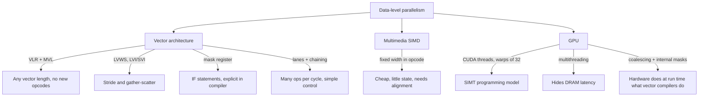

# بخش ۹، جلسه‌ی ۱۴ از ۱۴: موازی‌سازی سطح حلقه، باورهای غلط، جمع‌بندی و واژه‌نامه

این جلسه بخشی از **بخش ۹: موازی‌سازی سطح داده: معماری برداری، SIMD و GPU** است. زمان مطالعه: حدود نیم ساعت.

**فهرست این جلسه:**

- ۱. موازی‌سازی سطح حلقه: یادآوری
- ۲. مثال‌های اسلاید
- ۳. حذف وابستگی کاذب با تغییر نام
- ۴. کاهش (reduction): ضرب داخلی
- ۵. کاهش در سخت‌افزار برداری
- ۶. آزمایش عملی: شرکت‌پذیری و برداری‌سازی کاهش
- ۷. باورهای غلط و دام‌ها
- ۸. سخن پایانی کتاب و آنچه بعد از آن رخ داد
- ۹. جمع‌بندی بخش
- ۱۰. واژه‌نامه
- ۱۱. تمرین‌های مروری

---

## ۱. موازی‌سازی سطح حلقه: یادآوری

بخش ۴.۵ کتاب درباره‌ی پیدا کردن و افزایش **موازی‌سازی سطح حلقه** است. بیشتر این بخش را در بخش ۷ (جلسه‌ی ۵، تحلیل وابستگی) با جزئیات دیدیم: وابستگی بین تکرارها، آزمون GCD، اندیس آفین و محدودیت تحلیل اشاره‌گرها. اینجا فقط نکته‌هایی را مرور می‌کنیم که مخصوص DLP است.

حلقه‌ها سرچشمه‌ی خیلی از انواع موازی‌سازی‌اند. پیدا کردن و دستکاری موازی‌سازی سطح حلقه برای **DLP و TLP** (بخش ۱۰) و برای روش‌های تهاجمی ILP ایستا مثل VLIW حیاتی است. این تحلیل معمولاً در سطح کد منبع انجام می‌شود، چون کامپایلر آنجا حلقه، آرایه و متغیر شمارنده را راحت تشخیص می‌دهد.

**شرط برداری شدن:** حلقه نباید **وابستگی بین تکرارها (loop-carried dependence)** داشته باشد، یا اگر دارد، باید بشود آن را با تبدیل حذف کرد. همین شرط برای CUDA هم لازم است، چون هر تکرار به یک نخ مستقل تبدیل می‌شود.

## ۲. مثال‌های اسلاید

**مثال ۱:** بدون وابستگی بین تکرارها. وابستگی روی i فقط یک متغیر استقرایی است که به راحتی حذف می‌شود.

```c
for (i = 999; i >= 0; i = i - 1)
    x[i] = x[i] + s;
```

**مثال ۲:** وابستگی دوری بین تکرارها. دستور S1 مقدار A[i+1] را برای تکرار بعد تولید می‌کند و S2 مقدار B[i+1] را. این حلقه موازی نیست.

```c
for (i = 0; i < 100; i = i + 1) {
    A[i+1] = A[i] + C[i];    /* S1 */
    B[i+1] = B[i] + A[i+1];  /* S2 */
}
```

**مثال ۳:** S1 از مقداری استفاده می‌کند که S2 در تکرار قبل تولید کرده است، اما وابستگی **دوری نیست**. پس با جابه‌جایی می‌شود حلقه را موازی کرد:

```c
for (i = 0; i < 100; i = i + 1) {
    A[i] = A[i] + B[i];      /* S1 */
    B[i+1] = C[i] + D[i];    /* S2 */
}
/* transformed: */
A[0] = A[0] + B[0];
for (i = 0; i < 99; i = i + 1) {
    B[i+1] = C[i] + D[i];
    A[i+1] = A[i+1] + B[i+1];
}
B[100] = C[99] + D[99];
```

در نسخه‌ی جدید وابستگی دیگر بین تکرارها نیست و درون یک تکرار است.

**مثال ۴:** وابستگی فقط درون تکرار (A[i] از S1 به S2). حلقه موازی است.

```c
for (i = 0; i < 100; i = i + 1) {
    A[i] = B[i] + C[i];
    D[i] = A[i] * E[i];
}
```

**مثال ۵:** یک **بازگشت (recurrence)** با فاصله‌ی وابستگی ۱. موازی نیست.

```c
for (i = 1; i < 100; i = i + 1)
    Y[i] = Y[i-1] + Y[i];
```

**آزمون GCD** (جلسه‌ی ۷-۵): اگر ذخیره در `a × i + b` و بارگذاری از `c × i + d` باشد، وجود وابستگی لازم دارد که `GCD(c, a)` عدد `d - b` را بشمارد. مثال اسلاید: `X[2*i+3] = X[2*i] * 5.0` با a = 2، b = 3، c = 2، d = 0. مقدار GCD برابر ۲ است و 0 - 3 = -3 بر ۲ بخش‌پذیر نیست، پس وابستگی وجود ندارد.

## ۳. حذف وابستگی کاذب با تغییر نام

مثال کتاب:

```c
for (i = 0; i < 100; i = i + 1) {
    Y[i] = X[i] / c;   /* S1 */
    X[i] = X[i] + c;   /* S2 */
    Z[i] = Y[i] + c;   /* S3 */
    Y[i] = c - Y[i];   /* S4 */
}
```

وابستگی‌ها:

- **وابستگی واقعی** از S1 به S3 و از S1 به S4 به خاطر Y[i]. این‌ها بین تکرارها نیستند، پس مانع موازی بودن حلقه نمی‌شوند، فقط S3 و S4 باید منتظر S1 بمانند.
- **ضدوابستگی** از S1 به S2 به خاطر X[i].
- **ضدوابستگی** از S3 به S4 به خاطر Y[i].
- **وابستگی خروجی** از S1 به S4 به خاطر Y[i].

نسخه‌ی تغییر نام‌یافته:

```c
for (i = 0; i < 100; i = i + 1) {
    T[i]  = X[i] / c;  /* Y renamed to T to remove output dependence */
    X1[i] = X[i] + c;  /* X renamed to X1 to remove antidependence */
    Z[i]  = T[i] + c;  /* Y renamed to T to remove antidependence */
    Y[i]  = c - T[i];
}
```

بعد از حلقه، متغیر X به X1 تغییر نام داده شده است؛ کامپایلر در کد بعدی نام X را با X1 جایگزین می‌کند. اینجا تغییر نام کپی واقعی لازم ندارد، اما در حالت‌های دیگر ممکن است لازم باشد. این همان ایده‌ی تغییر نام ثبات در بخش ۸ است، این بار در سطح آرایه.

## ۴. کاهش (reduction): ضرب داخلی

یکی از مهم‌ترین شکل‌های محاسبه‌ی وابسته، بازگشت است. **ضرب داخلی** یک نمونه‌ی کامل است:

```c
for (i = 9999; i >= 0; i = i - 1)
    sum = sum + x[i] * y[i];
```

این حلقه به خاطر `sum` وابستگی بین تکرارها دارد. اما می‌شود آن را به دو حلقه تبدیل کرد.

**قدم ۱: گسترش اسکالر (scalar expansion).** متغیر اسکالر `sum` به یک بردار تبدیل می‌شود و حلقه کاملاً موازی می‌شود:

```c
for (i = 9999; i >= 0; i = i - 1)
    sum[i] = x[i] * y[i];
```

**قدم ۲: کاهش.** عنصرهای بردار جمع می‌شوند:

```c
for (i = 9999; i >= 0; i = i - 1)
    finalsum = finalsum + sum[i];
```

این حلقه موازی نیست، اما ساختار خاصی به نام **کاهش (reduction)** دارد. کاهش در جبر خطی رایج است و در بخش ۱۰ می‌بینیم که بخش اصلی **MapReduce** در مراکز داده‌ی بزرگ هم هست. هر تابعی می‌تواند عملگر کاهش باشد؛ نمونه‌های رایج max و min هستند.

**کاهش روی ۱۰ پردازنده:** هر پردازنده p (از ۰ تا ۹) هزار عنصر را جمع می‌زند:

```c
for (i = 999; i >= 0; i = i - 1)
    finalsum[p] = finalsum[p] + sum[i + 1000*p];
```

این حلقه کاملاً موازی است. بعد یک حلقه‌ی اسکالر ساده ده مجموع جزئی را جمع می‌زند. همین روش در پردازنده‌های برداری و SIMD هم به کار می‌رود.

**هشدار مهم:** این تبدیل به **شرکت‌پذیری جمع** تکیه دارد. حساب کامپیوتر شرکت‌پذیر نیست: حساب صحیح به خاطر محدوده‌ی محدود و حساب ممیز شناور به خاطر محدوده و دقت. پس این بازسازی گاهی نتیجه‌ی متفاوتی می‌دهد، هرچند به ندرت. به همین دلیل بیشتر کامپایلرها بهینه‌سازی‌های متکی بر شرکت‌پذیری را فقط با **اجازه‌ی صریح** انجام می‌دهند.

## ۵. کاهش در سخت‌افزار برداری

بعضی معماری‌های برداری و SIMD سخت‌افزار ویژه‌ای برای کاهش دارند تا قدم کاهش سریع‌تر از حالت اسکالر انجام شود. حتی بدون سخت‌افزار ویژه، کاهش یک ثبات ۶۴ عنصری را می‌شود با **نصف کردن بازگشتی** انجام داد: نیمه‌ی بالا را با نیمه‌ی پایین جمع کن، بعد دوباره، تا یک عنصر بماند.

```text
64 partial sums  ->  add upper 32 to lower 32  ->  32 sums
32 sums          ->  add upper 16 to lower 16  ->  16 sums
...
2 sums           ->  1 sum
6 steps = log2(64), instead of 63 dependent scalar adds
```

در VMIPS یک راه پیاده‌سازی این است که نیمه‌ی بالا را با یک ذخیره و بارگذاری برداری (یا یک دستور جابه‌جایی عنصر، اگر باشد) به ابتدای یک ثبات دیگر ببریم، VLR را نصف کنیم و `ADDVV.D` بزنیم. در CUDA همین الگو با حافظه‌ی محلی (Shared Memory) و `bar.sync` بین مرحله‌ها پیاده می‌شود: در هر مرحله نیمی از نخ‌ها جمع می‌زنند و نیمی بیکار می‌شوند، که یک نمونه‌ی خوب از کاهش بازده با نقاب است.

## ۶. آزمایش عملی: شرکت‌پذیری و برداری‌سازی کاهش

ضرب داخلی تک‌دقت روی آرایه‌ی ۴۰۹۶ عنصری (در کش)، ۲۰۰ هزار بار، روی همان سرور Xeon:

```c
float x[N], y[N];
__attribute__((noinline))
float dot(int n, const float *x, const float *y) {
    float sum = 0.0f;
    for (int i = 0; i < n; i++)
        sum = sum + x[i] * y[i];
    return sum;
}
/* in main: x[i] = 1.0f / (i + 1); y[i] = 1.0f;
   for (r = 0; r < REP; r++) { s += dot(N, x, y);
                               __asm__ volatile("" ::: "memory"); } */
```

سد `asm volatile` و چاپ s لازم است تا کامپایلر حلقه‌ی تکرار را حذف نکند. اولین نسخه‌ی این آزمایش بدون آن زمان صفر نشان داد.

| گزینه‌ی کامپایل | زمان (ثانیه) | نتیجه‌ی ضرب داخلی |
|---|---|---|
| گزینه‌ی `-O3 -march=native` | ۰.۴۹ | 8.89510822 |
| گزینه‌ی `-O3 -march=native -ffast-math` | ۰.۰۶۲ | 8.8951025 |
| مقدار دقیق (دقت مضاعف در پایتون) | ندارد | 8.8951039 |

دو مشاهده:

- **بدون `-ffast-math`** کامپایلر حلقه را برداری نمی‌کند، با اینکه AVX2 در دسترس است. دلیل: برداری کردن یعنی هشت مجموع جزئی و جمع آن‌ها در آخر، یعنی تغییر ترتیب جمع‌ها، و استاندارد C این را برای ممیز شناور اجازه نمی‌دهد. حلقه به یک زنجیره‌ی وابسته‌ی جمع‌ها محدود است (همان مسئله‌ی جلسه‌ی ۷-۳).
- **با `-ffast-math`** کامپایلر اجازه‌ی استفاده از شرکت‌پذیری را دارد، حلقه را برداری می‌کند و حدود **۸ برابر** سریع‌تر می‌شود. اما نتیجه در رقم‌های آخر **عوض می‌شود**. اینجا نتیجه‌ی جدید حتی کمی به مقدار دقیق نزدیک‌تر است، اما این تضمینی نیست.

این دقیقاً همان «اجازه‌ی صریح» است که کتاب می‌گوید. گزینه‌ی دقیق‌تر `-fassociative-math` فقط همین اجازه را می‌دهد.

## ۷. باورهای غلط و دام‌ها

**باور غلط: GPU ها از اینکه هم‌پردازنده (coprocessor) هستند ضرر می‌کنند.** جدایی حافظه‌ی اصلی و حافظه‌ی GPU معایبی دارد، اما فاصله از CPU مزیت هم دارد. مجموعه‌ی دستور PTX تا حدی به خاطر ماهیت دستگاه ورودی و خروجی بودن GPU وجود دارد. این لایه‌ی غیرمستقیم بین کامپایلر و سخت‌افزار به معماران GPU انعطاف خیلی بیشتری می‌دهد: می‌توانند نوآوری را آزمایشی اضافه کنند و اگر ناامیدکننده بود در نسل بعد حذف کنند. معمار پردازنده‌ی سیستم چنین آزادی ندارد، چون کد ماشین دودویی توزیع شده یعنی هر ویژگی جدید باید در همه‌ی نسل‌های آینده پشتیبانی شود. نمونه: Fermi مجموعه‌ی دستور سخت‌افزاری را به شدت عوض کرد (از حافظه‌محور مثل x86 به ثبات‌محور مثل MIPS، و آدرس ۶۴ بیتی)، بدون اینکه پشته‌ی نرم‌افزاری NVIDIA مختل شود.

**دام: تمرکز روی کارایی اوج برداری و نادیده گرفتن سربار راه‌اندازی.** در جلسه‌ی ۴ دیدیم: CYBER 205 با ۱۵۸ سیکل راه‌اندازی برای DAXPY.

**دام: افزایش کارایی برداری بدون افزایش متناسب کارایی اسکالر.** در جلسه‌ی ۴ دیدیم: Stardent-1500 در برابر MIPS M/120-5. امروز همین خطر به شکل افزایش تعداد خط‌ها بدون بهبود اسکالر تکرار می‌شود.

**باور غلط: بدون پهنای باند حافظه هم می‌شود کارایی برداری خوب گرفت.** DAXPY برای هر عمل ممیز شناور **۱.۵ دسترسی حافظه** لازم دارد (سه دسترسی برای دو FLOP) و این نسبت در خیلی از کدهای علمی معمول است. حتی اگر عمل‌های ممیز شناور هیچ زمانی نمی‌گرفتند، Cray-1 نمی‌توانست کارایی این دنباله را بالا ببرد، چون محدود به حافظه است. کارایی Cray-1 روی Linpack وقتی جهش کرد که کامپایلر با **بلوک‌بندی** محاسبه را طوری تغییر داد که مقدارها در ثبات‌های برداری بمانند. این کار تعداد دسترسی به ازای هر FLOP را کم کرد و کارایی را **نزدیک دو برابر** کرد. این همان درس مدل Roofline است.

**باور غلط: در GPU اگر کارایی حافظه کافی نیست، فقط نخ بیشتر اضافه کن.** GPU با تعداد زیادی نخ CUDA تأخیر حافظه را پنهان می‌کند. اما اگر دسترسی‌ها پراکنده باشند یا بین نخ‌ها همبستگی نداشته باشند، سیستم حافظه برای پاسخ به هر درخواست به تدریج کندتر می‌شود و سرانجام حتی تعداد زیادی نخ هم تأخیر را پنهان نمی‌کند. برای اینکه راهبرد «نخ بیشتر» کار کند، نه فقط نخ زیاد لازم است، بلکه خود نخ‌ها باید از نظر **محلی بودن دسترسی** خوش‌رفتار باشند (ادغام آدرس، جلسه‌ی ۱۱).

## ۸. سخن پایانی کتاب و آنچه بعد از آن رخ داد

**پیش‌بینی کتاب (۲۰۱۱):** DLP برای دستگاه‌های همراه (صدا، تصویر، بازی) اهمیت بیشتری پیدا می‌کند. با مدل برنامه‌نویسی ساده‌تر از TLP و بهره‌وری انرژی بهتر، یک **رنسانس DLP** در دهه‌ی بعد قابل پیش‌بینی است. پردازنده‌های سیستم ویژگی‌های بیشتری از GPU می‌گیرند و برعکس. بزرگ‌ترین تفاوت کارایی، آدرس‌دهی جمع‌آوری و پخش است و انتظار می‌رود ایده‌های بیشتری از معماری برداری به SIMD اضافه شود.

کتاب چهار کمبود GPU را نام می‌برد که انتظار داشت حل شوند:

- **قابلیت مجازی‌سازی:** برای حضور در ابر.
- **حافظه‌ی نسبتاً کوچک:** مسئله‌های بزرگ‌تر حافظه‌ی بیشتری می‌خواهند و چالش، حفظ پهنای باند بالا با ظرفیت بیشتر است.
- **ورودی و خروجی مستقیم به حافظه‌ی GPU:** امروز داده باید از دستگاه به حافظه‌ی سیستم و بعد به حافظه‌ی GPU برود. قانون امدال هشدار می‌دهد.
- **حافظه‌ی فیزیکی یکپارچه:** یک حافظه‌ی فیزیکی برای سیستم و GPU، مثل GPU های ارزان گوشی و لپ‌تاپ. معماری AMD Fusion و پروژه‌ی Denver در NVIDIA (ترکیب پردازنده‌ی ARM و GPU در یک فضای آدرس) گام‌های اول بودند.

**آنچه بعد رخ داد (از دانش عمومی، نه از کتاب؛ برای جزئیات منبع به‌روز ببین):** GPU های مرکز داده امروز مجازی‌سازی سخت‌افزاری دارند؛ حافظه‌ی HBM ظرفیت و پهنای باند را خیلی بالا برده است؛ فناوری‌هایی برای انتقال مستقیم بین ذخیره‌ساز یا شبکه و حافظه‌ی GPU آمده است؛ و تراشه‌هایی که CPU و GPU را با حافظه‌ی همدوس یا یکپارچه ترکیب می‌کنند (مثل سری Apple M و ترکیب Grace و Hopper در NVIDIA) رایج شده‌اند. در سمت CPU هم AVX-512، ARM SVE و RISC-V V دقیقاً همان ایده‌های برداری (نقاب، جمع‌آوری و پخش، طول مستقل) را آوردند. پیش‌بینی کتاب تا حد زیادی درست درآمد.

## ۹. جمع‌بندی بخش



| موضوع | معماری برداری | SIMD چندرسانه‌ای | پردازنده‌ی گرافیکی |
|---|---|---|---|
| طول بردار | متغیر با VLR؛ MVL ضمنی | ثابت در opcode | ۳۲ (warp)؛ قطعه‌بندی با نقاب |
| دسترسی با گام | دستور صریح | ندارد (در زمان کتاب) | ضمنی؛ هر خط آدرس خود را دارد |
| جمع‌آوری و پخش | دستور صریح | ندارد (AVX2 و AVX-512 بعداً آوردند) | همه‌ی دسترسی‌ها؛ با ادغام آدرس |
| شرط | ثبات نقاب صریح | معمولاً ندارد | گزاره و نقاب داخلی با پشته |
| پنهان کردن تأخیر | خط‌لوله‌ی عمیق، یک تأخیر برای کل بردار | کش | چندنخنگی گسترده |
| کنترل | پردازنده‌ی کنترل و اسکالر نزدیک | هسته‌ی CPU | زمان‌بند بلوک؛ CPU دور با PCIe |
| مدل کارایی | چایم، `T_n`، `R∞`، `N1/2`، Roofline | مدل Roofline | مدل Roofline، بازده واگرایی |

پیام‌های اصلی:

- **یک دستور، چند داده:** کاهش واکشی و رمزگشایی و کنترل ساده، پس انرژی کمتر.
- **پهنای باند حافظه تعیین‌کننده است:** با Roofline قبل از اضافه کردن خط، محل هسته روی سقف را پیدا کن.
- **معماری برداری کلی‌تر از SIMD چندرسانه‌ای است:** VLR، گام، جمع‌آوری و پخش و نقاب.
- **پردازنده‌ی گرافیکی یک پردازنده‌ی SIMD چندنخی است:** با واژه‌های عجیب؛ زیر پوستش همان ایده‌های برداری به اضافه‌ی چندنخنگی.
- **وابستگی بین تکرارها و شرکت‌پذیری:** کامپایلر فقط وقتی برداری می‌کند که مطمئن باشد. برنامه‌نویس با راهنما (`restrict`، دستورهای کامپایلر، `-ffast-math`) کمک می‌کند.

## ۱۰. واژه‌نامه

| اصطلاح فارسی | اصطلاح انگلیسی | توضیح کوتاه |
|---|---|---|
| موازی‌سازی سطح داده | data-level parallelism | یک عمل روی داده‌های زیاد و مستقل |
| ثبات برداری | vector register | ثبات با تعداد زیادی عنصر (۶۴ در VMIPS) |
| کاروان | convoy | دستورهای برداری که با هم اجرا می‌شوند |
| چایم | chime | زمان اجرای یک کاروان |
| زنجیره‌سازی | chaining | شروع دستور وابسته با رسیدن هر عنصر |
| زمان راه‌اندازی | start-up time | تأخیر تا بیرون آمدن عنصر اول |
| خط | lane | یک خط لوله از هر واحد به اضافه‌ی بخشی از فایل ثبات |
| گروه عنصر | element group | عنصرهایی که با هم در خط‌ها حرکت می‌کنند |
| ثبات طول بردار | vector-length register (VLR) | طول عمل برداری فعلی |
| حداکثر طول بردار | maximum vector length (MVL) | طول ثبات‌های برداری |
| قطعه‌بندی | strip mining | تقسیم حلقه به قطعه‌های حداکثر MVL |
| ثبات نقاب | vector-mask register | بیت فعال یا غیرفعال برای هر عنصر |
| تبدیل IF | if conversion | تبدیل شرط به کد خطی با اجرای مشروط |
| بانک حافظه | memory bank | بخش مستقل حافظه با آدرس‌دهی جدا |
| گام | stride | فاصله‌ی عنصرهای کنار هم بردار در حافظه |
| تداخل بانک | bank conflict | برخورد دو دسترسی به یک بانک مشغول |
| جمع‌آوری و پخش | gather-scatter | بارگذاری و ذخیره با بردار اندیس |
| شدت حسابی | arithmetic intensity | تعداد FLOP به ازای هر بایت حافظه‌ی اصلی |
| نقطه‌ی شکست | ridge point | محل برخورد سقف شیبدار و صاف در Roofline |
| میزبان و دستگاه | host and device | پردازنده‌ی سیستم و GPU |
| نخ CUDA | CUDA thread | یک عنصر روی یک خط SIMD |
| نخ دستورهای SIMD | warp | گروه ۳۲ نخ CUDA که با هم اجرا می‌شوند |
| بلوک نخ | thread block | بدنه‌ی حلقه‌ی برداری روی یک پردازنده‌ی SIMD |
| شبکه | grid | کل حلقه‌ی برداری‌پذیر روی GPU |
| پردازنده‌ی SIMD چندنخی | streaming multiprocessor | هسته‌ی GPU |
| ادغام آدرس | address coalescing | تبدیل آدرس‌های نزدیک خط‌ها به یک دسترسی بلوکی |
| واگرایی | divergence | رفتن خط‌های یک warp به مسیرهای متفاوت |
| پشته‌ی همگام‌سازی پرش | branch synchronization stack | نگهداری نقاب‌ها برای شرط تودرتو |
| حافظه‌ی محلی | local memory (NVIDIA: shared memory) | حافظه‌ی روی تراشه‌ی مشترک نخ‌های یک بلوک |
| حافظه‌ی خصوصی | private memory (NVIDIA: local memory) | بخش DRAM خصوصی هر نخ |
| گسترش اسکالر | scalar expansion | تبدیل متغیر اسکالر به آرایه برای حذف وابستگی |
| کاهش | reduction | ترکیب عنصرهای یک بردار با یک عملگر شرکت‌پذیر |

## ۱۱. تمرین‌های مروری

<details><summary>تمرین ۱: موازی بودن حلقه</summary>

**صورت:** آیا این حلقه موازی است؟ اگر نه، آن را تبدیل کن.

```c
for (i = 0; i < 100; i++) {
    A[i] = B[i] + 1;       /* S1 */
    B[i+1] = A[i] * 2;     /* S2 */
}
```

**جواب:** S2 مقدار B[i+1] را می‌نویسد که S1 در تکرار بعد می‌خواند، و S2 به A[i] از S1 همان تکرار نیاز دارد. پس زنجیره‌ی B[i] → A[i] → B[i+1] → A[i+1] یک دور بین تکرارها است و حلقه موازی نیست. این یک بازگشت است: B[i+1] = 2 × (B[i] + 1). تبدیل ساده‌ای مثل مثال ۳ ندارد. فرم بسته‌ی ریاضی را می‌شود پیدا کرد، اما کامپایلر معمولاً این کار را نمی‌کند.
</details>

<details><summary>تمرین ۲: آزمون GCD</summary>

**صورت:** برای `for (i...) A[4*i+1] = A[6*i+2] + 1;` آزمون GCD چه می‌گوید؟

**جواب:** ذخیره a = 4، b = 1 و بارگذاری c = 6، d = 2. مقدار GCD(4, 6) = 2 و d - b = 1. عدد ۱ بر ۲ بخش‌پذیر نیست، پس وابستگی وجود ندارد. یادت باشد آزمون GCD فقط عدم وجود را ثابت می‌کند؛ اگر بخش‌پذیر بود، ممکن بود وابستگی باشد یا نباشد.
</details>

<details><summary>تمرین ۳: کاهش max</summary>

**صورت:** بیشینه‌ی یک آرایه‌ی ۴۰۹۶ عنصری را با ثبات‌های برداری ۶۴ عنصری چطور حساب می‌کنی؟ چند قدم وابسته دارد؟ آیا مشکل شرکت‌پذیری دارد؟

**جواب:** ۶۴ مجموع جزئی (اینجا بیشینه‌ی جزئی) نگه دار: 4096 / 64 = 64 بارگذاری و ۶۳ دستور max برداری (یا ۶۴ با مقدار اولیه). بعد کاهش بازگشتی روی یک ثبات در log2(64) = 6 قدم. عملگر max روی ممیز شناور شرکت‌پذیر و جابه‌جایی‌پذیر است (جز در موارد NaN)، پس برخلاف جمع، نتیجه عوض نمی‌شود.
</details>

<details><summary>تمرین ۴: انتخاب معماری</summary>

**صورت:** برای هر هسته بگو کدام معماری مزیت دارد و چرا: الف) ضرب ماتریس چگال بزرگ. ب) جستجو در درخت کوچکی که در کش جا می‌شود. ج) ضرب ماتریس خلوت در بردار با ماتریس چند گیگابایتی.

**جواب:** الف) GPU یا پردازنده‌ی برداری با کارایی اوج بالا؛ هسته محدود به محاسبه است (شدت حسابی زیاد). ب) پردازنده‌ی چندهسته‌ای با کش بزرگ (نتیجه‌ی Search در جلسه‌ی ۱۳: درخت کوچک روی i7 دو برابر سریع‌تر بود). ج) محدود به پهنای باند و نیازمند جمع‌آوری؛ GPU یا ماشین برداری با پهنای باند زیاد، به شرط اینکه ماتریس در حافظه‌ی GPU جا شود.
</details>

<details><summary>تمرین ۵: سؤال جامع</summary>

**صورت:** یک پردازنده‌ی برداری با ۸ خط، MVL = 64، `T_loop = 15` و `T_start = 30` داریم و هر کاروان با ۸ خط 64 / 8 = 8 سیکل چایم دارد. برنامه‌ی DAXPY با n = 640 چند سیکل طول می‌کشد؟ چند درصد زمان سربار است؟

**جواب:** ده قطعه. هر قطعه 15 + 30 = 45 سیکل سربار و ۳ کاروان × ۸ سیکل = 24 سیکل کار. کل 10 × (45 + 24) = 690 سیکل. سربار 450 / 690 ≈ 65٪. با خط بیشتر، سهم سربار بیشتر شده است: این همان هشدار جلسه‌ی ۳ است که خط بیشتر بردار بلندتر و سربار کمتر می‌خواهد.
</details>

---

جلسه‌ی قبلی: [مقایسه‌ی برداری، SIMD و GPU و سیستم‌های واقعی](9-13-comparisons-and-real-systems.md)

بخش بعدی: بخش ۱۰، موازی‌سازی سطح نخ: چندپردازنده‌ای، انسجام کش، همگام‌سازی و سازگاری حافظه
