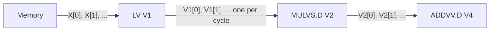

# بخش ۹، جلسه‌ی ۲ از ۱۴: زمان اجرای برداری: کاروان، زنجیره‌سازی و چایم

این جلسه بخشی از **بخش ۹: موازی‌سازی سطح داده: معماری برداری، SIMD و GPU** است. زمان مطالعه: حدود نیم ساعت.

**فهرست این جلسه:**

- ۱. سه عامل زمان اجرا
- ۲. نرخ شروع و زمان یک دستور برداری
- ۳. کاروان (convoy)
- ۴. زنجیره‌سازی (chaining)
- ۵. چایم (chime)
- ۶. مثال DAXPY به کاروان‌ها
- ۷. زمان راه‌اندازی
- ۸. یک مدل دقیق‌تر: چایم به اضافه‌ی راه‌اندازی
- ۹. تمرین‌ها

---

## ۱. سه عامل زمان اجرا

زمان اجرای یک دنباله از دستورهای برداری به سه عامل بستگی دارد:

- ۱. **طول بردارهای عملوند:** هر چه بردار بلندتر، کار بیشتر.
- ۲. **مخاطره‌های ساختاری** بین دستورها: مثلاً اگر فقط یک واحد بارگذاری داریم، دو `LV` نمی‌توانند همزمان اجرا شوند.
- ۳. **وابستگی‌های داده‌ای** بین دستورها.

## ۲. نرخ شروع و زمان یک دستور برداری

**نرخ شروع (initiation rate)** یعنی واحد برداری با چه سرعتی عملوند جدید می‌گیرد و نتیجه‌ی جدید تولید می‌کند. در VMIPS پایه، هر واحد فقط **یک خط (lane)** دارد و هر سیکل یک عنصر را پردازش می‌کند. پس زمان یک دستور برداری تقریباً برابر طول بردار است:

```math
T_{\text{one vector instruction}} \approx n \text{ cycles}
```

پردازنده‌های برداری امروزی چند خط موازی دارند و در هر سیکل دو یا چند نتیجه تولید می‌کنند. این را در جلسه‌ی بعد می‌بینیم.

## ۳. کاروان (convoy)

برای تخمین ساده‌ی زمان، کتاب مفهوم **کاروان (convoy)** را تعریف می‌کند:

> کاروان مجموعه‌ای از دستورهای برداری است که می‌توانند با هم اجرا شوند.

شرط‌ها:

- **مخاطره‌ی ساختاری ممنوع:** دستورهای یک کاروان نباید به یک واحد مشترک نیاز داشته باشند. اگر داشته باشند، باید در کاروان‌های جدا قرار بگیرند.
- **فرض ساده‌کننده:** یک کاروان باید کاملاً تمام شود تا کاروان بعدی (و هر دستور اسکالر بعدی) شروع شود.

شاید فکر کنی دستورهایی که وابستگی RAW دارند هم باید در کاروان‌های جدا باشند. اما **زنجیره‌سازی** اجازه می‌دهد آن‌ها در یک کاروان باشند.

## ۴. زنجیره‌سازی (chaining)

زنجیره‌سازی یعنی یک دستور برداری به محض آماده شدن **هر عنصر** از عملوند منبعش شروع به کار کند، نه بعد از آماده شدن کل بردار. نتیجه‌ی عنصر اول از واحد اول مستقیم به واحد دوم فرستاده می‌شود. این همان ایده‌ی پیش‌فرستی (forwarding) در خط لوله‌ی اسکالر است، اما برای عنصرهای بردار.



پیاده‌سازی معمول: پردازنده اجازه می‌دهد یک ثبات برداری **همزمان خوانده و نوشته شود**، البته عنصرهای متفاوت آن.

دو نسل زنجیره‌سازی:

- **زنجیره‌سازی اولیه:** دقیقاً مثل پیش‌فرستی اسکالر کار می‌کرد و زمان‌بندی دستور مبدأ و مقصد را محدود می‌کرد.
- **زنجیره‌سازی انعطاف‌پذیر (flexible chaining):** یک دستور برداری می‌تواند به تقریباً هر دستور برداری فعال دیگری زنجیر شود، به شرط اینکه مخاطره‌ی ساختاری پیش نیاید. همه‌ی معماری‌های برداری مدرن این را دارند و ما هم آن را فرض می‌کنیم.

## ۵. چایم (chime)

برای تبدیل کاروان به زمان، واحدی به نام **چایم (chime)** تعریف می‌شود:

> یک چایم زمان اجرای یک کاروان است.

پس دنباله‌ای با m کاروان در m چایم اجرا می‌شود. برای بردار به طول n در VMIPS:

```math
T \approx m \times n \text{ cycles}
```

این تقریب چند سربار را نادیده می‌گیرد:

- **محدودیت صدور:** بیشتر پردازنده‌های برداری در هر سیکل فقط یک دستور برداری صادر می‌کنند. پس شروع دستورهای یک کاروان چند سیکل طول می‌کشد. چون طول بردار معمولاً خیلی بیشتر از تعداد دستورهای کاروان است، این سربار کوچک است.
- **زمان راه‌اندازی:** سربار مهم‌تر که در بخش ۷ همین جلسه می‌بینیم.

به همین دلیل اندازه‌گیری با چایم برای بردارهای **بلند** دقیق‌تر است تا بردارهای کوتاه. کتاب عمداً به جای «سیکل به ازای نتیجه» از چایم استفاده می‌کند تا یادمان بماند که بعضی سربارها حذف شده‌اند.

## ۶. مثال DAXPY به کاروان‌ها

دنباله‌ی زیر را با یک نسخه از هر واحد برداری به کاروان تقسیم کن:

```asm
        LV      V1,Rx         ; load vector X
        MULVS.D V2,V1,F0      ; vector-scalar multiply
        LV      V3,Ry         ; load vector Y
        ADDVV.D V4,V2,V3      ; add two vectors
        SV      Ry,V4         ; store the sum
```

استدلال قدم به قدم:

- کاروان اول با `LV` اول شروع می‌شود. دستور `MULVS.D` به `LV` اول وابسته است، اما با زنجیره‌سازی در همان کاروان می‌ماند.
- دستور `LV` دوم با `LV` اول روی واحد بارگذاری **مخاطره‌ی ساختاری** دارد، پس به کاروان دوم می‌رود. دستور `ADDVV.D` با زنجیره‌سازی کنار آن می‌نشیند.
- دستور `SV` با `LV` کاروان دوم روی همان واحد حافظه مخاطره‌ی ساختاری دارد، پس کاروان سوم.

| کاروان | دستورها |
|---|---|
| کاروان ۱ | دستور `LV` و `MULVS.D` |
| کاروان ۲ | دستور `LV` و `ADDVV.D` |
| کاروان ۳ | دستور `SV` |

نتیجه:

- **سه چایم.** برای ۶۴ عنصر حدود 3 × 64 = 192 سیکل.
- **دو عمل ممیز شناور به ازای هر نتیجه** (یک ضرب و یک جمع). پس تعداد سیکل به ازای هر FLOP برابر است با:

```math
\frac{3 \text{ chimes}}{2 \text{ FLOPs}} = 1.5 \text{ cycles per FLOP}
```

مشاهده‌ی مهم: گلوگاه این کد **واحد حافظه** است. سه دستور حافظه داریم و فقط یک واحد حافظه، پس کمتر از سه چایم ممکن نیست، حتی با بی‌نهایت واحد حسابی.

## ۷. زمان راه‌اندازی

مهم‌ترین سرباری که مدل چایم نادیده می‌گیرد، **زمان راه‌اندازی (start-up time)** است. این زمان عمدتاً همان عمق خط لوله‌ی واحد برداری است: از لحظه‌ی شروع تا بیرون آمدن عنصر اول. برای VMIPS همان عددهای Cray-1 را فرض می‌کنیم:

| واحد | زمان راه‌اندازی (سیکل) |
|---|---|
| جمع ممیز شناور | ۶ |
| ضرب ممیز شناور | ۷ |
| تقسیم ممیز شناور | ۲۰ |
| بارگذاری برداری | ۱۲ |

پردازنده‌های جدیدتر تأخیرهای بیشتری دارند، مخصوصاً برای بارگذاری برداری. در خیلی از پردازنده‌ها راه‌اندازی بارگذاری و ذخیره بیش از ۱۰۰ سیکل است.

## ۸. یک مدل دقیق‌تر: چایم به اضافه‌ی راه‌اندازی

با فرض «کاروان بعدی فقط بعد از تمام شدن کاروان قبلی شروع می‌شود»، زمان هر کاروان برابر است با مجموع زمان‌های راه‌اندازی دستورهای زنجیرشده‌ی آن به اضافه‌ی طول بردار. چرا مجموع؟ چون در زنجیره، عنصر اول باید از همه‌ی خط لوله‌ها پشت سر هم عبور کند.

برای DAXPY با n = 64:

| کاروان | راه‌اندازی | زمان کاروان |
|---|---|---|
| کاروان ۱ | بارگذاری ۱۲ و ضرب ۷ | 12 + 7 + 64 = 83 |
| کاروان ۲ | بارگذاری ۱۲ و جمع ۶ | 12 + 6 + 64 = 82 |
| کاروان ۳ | ذخیره ۱۲ | 12 + 64 = 76 |
| جمع | ۴۹ | ۲۴۱ |

پس زمان واقعی حدود 241 سیکل است، نه 192. یعنی حدود ۲۵٪ بیشتر از تخمین چایم. برای بردار ۸ عنصری این اختلاف خیلی بزرگ‌تر است: 3 × 8 = 24 در برابر 24 + 49 = 73. همین است که می‌گوییم چایم برای بردارهای بلند دقیق است.

در جلسه‌ی ۴ این مدل را کامل می‌کنیم: سربار حلقه‌ی قطعه‌بندی را اضافه می‌کنیم و معیارهای R∞ و N1/2 را می‌بینیم.

```mermaid
gantt
    title DAXPY convoys without overlap, n = 64
    dateFormat X
    axisFormat %s
    section Convoy 1
    LV start-up 12 : c1a, 0, 12s
    MUL start-up 7 : c1b, after c1a, 7s
    64 elements : c1c, after c1b, 64s
    section Convoy 2
    LV start-up 12 : c2a, after c1c, 12s
    ADD start-up 6 : c2b, after c2a, 6s
    64 elements : c2c, after c2b, 64s
    section Convoy 3
    SV start-up 12 : c3a, after c2c, 12s
    64 elements : c3b, after c3a, 64s
```



## ۹. تمرین‌ها

<details><summary>تمرین ۱: کاروان‌بندی یک دنباله</summary>

**صورت:** دنباله‌ی زیر را به کاروان تقسیم کن (یک نسخه از هر واحد، زنجیره‌سازی انعطاف‌پذیر). چند چایم لازم است؟

```asm
        LV      V1,Rx
        LV      V2,Ry
        MULVV.D V3,V1,V2
        ADDVS.D V4,V3,F0
        SV      Rz,V4
```

**جواب:** کاروان ۱: `LV V1`. کاروان ۲: `LV V2` و `MULVV.D` و `ADDVS.D` (ضرب به V2 زنجیر می‌شود و جمع به ضرب، و واحدها متفاوت‌اند). کاروان ۳: `SV`. پس سه چایم. باز هم سه دستور حافظه گلوگاه است.
</details>

<details><summary>تمرین ۲: مخاطره‌ی ساختاری روی واحد حسابی</summary>

**صورت:** دنباله‌ی `LV V1,Rx` ، `MULVS.D V2,V1,F0` ، `MULVS.D V3,V1,F2` ، `ADDVV.D V4,V2,V3` ، `SV Ry,V4` چند چایم است؟

**جواب:** کاروان ۱: `LV` و `MULVS.D` اول. دستور `MULVS.D` دوم به همان واحد ضرب نیاز دارد، پس کاروان ۲: `MULVS.D` دوم و `ADDVV.D` (جمع به ضرب دوم زنجیر می‌شود و `V2` هم آماده است). دستور `SV` با هیچ دستور کاروان ۲ تداخل ساختاری ندارد و به جمع زنجیر می‌شود، پس می‌تواند در کاروان ۲ باشد. نتیجه: دو چایم.
</details>

<details><summary>تمرین ۳: زمان با راه‌اندازی</summary>

**صورت:** با جدول زمان راه‌اندازی، زمان دنباله‌ی تمرین ۱ را برای n = 64 حساب کن (کاروان‌ها همپوشانی ندارند).

**جواب:** کاروان ۱: 12 + 64 = 76. کاروان ۲: 12 + 7 + 6 + 64 = 89. کاروان ۳: 12 + 64 = 76. جمع: 241 سیکل. تخمین چایم 192 بود.
</details>

<details><summary>تمرین ۴: چرا چایم برای بردار کوتاه بد است</summary>

**صورت:** برای DAXPY نسبت «زمان با راه‌اندازی» به «تخمین چایم» را برای n = 8 و n = 64 حساب کن.

**جواب:** برای n = 8: زمان 49 + 24 = 73 و چایم 24، نسبت حدود 3. برای n = 64: زمان 241 و چایم 192، نسبت حدود 1.26. هر چه بردار بلندتر، سهم راه‌اندازی کمتر.
</details>

---

جلسه‌ی قبلی: [موازی‌سازی سطح داده و معماری برداری VMIPS](9-1-dlp-and-vmips.md)  
جلسه‌ی بعدی: [خط‌های موازی، ثبات طول بردار و قطعه‌بندی](9-3-lanes-vlr-strip-mining.md)
