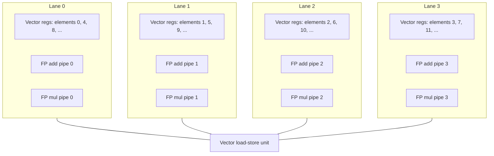

# بخش ۹، جلسه‌ی ۳ از ۱۴: خط‌های موازی، ثبات طول بردار و قطعه‌بندی

این جلسه بخشی از **بخش ۹: موازی‌سازی سطح داده: معماری برداری، SIMD و GPU** است. زمان مطالعه: حدود نیم ساعت.

**فهرست این جلسه:**

- ۱. هفت سؤال برای بهبود معماری برداری
- ۲. خط‌های موازی: بیش از یک عنصر در هر سیکل
- ۳. ساختار یک واحد برداری چهارخطه
- ۴. مزیت خط‌ها برای انرژی و طراحی
- ۵. ثبات طول بردار
- ۶. قطعه‌بندی (strip mining)
- ۷. کد قطعه‌بندی‌شده در VMIPS
- ۸. همین ایده در RV64V و RISC-V V
- ۹. تمرین‌ها

---

## ۱. هفت سؤال برای بهبود معماری برداری

کتاب بعد از مدل پایه، هفت سؤال می‌پرسد که جواب هر کدام یک بهینه‌سازی است. این جلسه و دو جلسه‌ی بعد به ترتیب به آن‌ها جواب می‌دهند:

| سؤال | راه‌حل | جلسه |
|---|---|---|
| چطور بیش از یک عنصر در هر سیکل؟ | خط‌های موازی | همین جلسه |
| بردارهایی که طولشان ۶۴ نیست؟ | ثبات طول بردار و قطعه‌بندی | همین جلسه |
| دستور IF داخل حلقه؟ | ثبات نقاب | جلسه‌ی ۵ |
| حافظه چه باید بدهد؟ | بانک‌های حافظه | جلسه‌ی ۵ |
| ماتریس‌های چندبعدی؟ | دسترسی با گام | جلسه‌ی ۶ |
| ماتریس‌های خلوت؟ | جمع‌آوری و پخش (gather-scatter) | جلسه‌ی ۶ |
| برنامه‌نویسی کامپیوتر برداری؟ | گفت‌وگوی کامپایلر و برنامه‌نویس | جلسه‌ی ۶ |

## ۲. خط‌های موازی: بیش از یک عنصر در هر سیکل

یک مزیت بزرگ دستور برداری: یک دستور کوتاه، کار موازی زیادی را به سخت‌افزار تحویل می‌دهد. یک دستور ممکن است ده‌ها عمل مستقل داشته باشد، اما به اندازه‌ی یک دستور اسکالر بیت دارد. سخت‌افزار می‌تواند این عمل‌ها را به سه شکل اجرا کند:

- با یک واحد عمیقاً خط‌لوله‌ای (مثل VMIPS پایه)،
- با آرایه‌ای از واحدهای موازی،
- یا با ترکیب این دو.

یک ویژگی کلیدی مجموعه‌ی دستور VMIPS این است: در همه‌ی دستورهای حسابی برداری، **عنصر N از یک ثبات فقط با عنصر N از ثبات‌های دیگر** عمل می‌کند. این ویژگی ساختن واحد موازی را خیلی ساده می‌کند. پس می‌توانیم واحد را به چند **خط (lane)** تقسیم کنیم، درست مثل اتوبانی که با اضافه کردن خط، ظرفیتش بیشتر می‌شود.

با چهار خط جمع، دستور `ADDVV.D` روی ۶۴ عنصر در هر سیکل چهار جمع انجام می‌دهد:

```text
One lane:                         Four lanes:
cycle 1: A[0]+B[0]                cycle 1: A[0..3]+B[0..3]
cycle 2: A[1]+B[1]                cycle 2: A[4..7]+B[4..7]
...                               ...
cycle 64: A[63]+B[63]             cycle 16: A[60..63]+B[60..63]
```

مجموعه‌ی عنصرهایی که با هم در خط‌ها حرکت می‌کنند، **گروه عنصر (element group)** نام دارد. با چهار خط، زمان یک چایم از ۶۴ سیکل به **۱۶ سیکل** می‌رسد.

```math
\text{chime} = \frac{n}{\text{number of lanes}} \text{ cycles}
```

یک هشدار: برای اینکه خط‌های بیشتر مفید باشند، هم برنامه و هم معماری باید بردارهای بلند داشته باشند. وگرنه دستورها آن‌قدر سریع تمام می‌شوند که **پهنای باند صدور دستور** گلوگاه می‌شود و دوباره به روش‌های ILP (بخش ۸) نیاز پیدا می‌کنیم تا دستور برداری کافی برسد.

## ۳. ساختار یک واحد برداری چهارخطه



جزئیات مهم:

- **تقسیم فایل ثبات:** هر خط یک بخش از فایل ثبات برداری را دارد. خط ۰ عنصرهای ۰، ۴، ۸ و ... از **همه‌ی** ثبات‌ها را نگه می‌دارد.
- **یک خط لوله از هر واحد در هر خط:** هر واحد حسابی برداری چهار خط لوله دارد که با هم یک دستور را کامل می‌کنند.
- **بدون ارتباط بین خط‌ها:** چون عنصر اول همه‌ی ثبات‌ها در خط اول است، عملوندهای مبدأ و مقصد عنصر اول همیشه در همان خط هستند. خط لوله‌ی محلی آن خط کار را بدون ارتباط با خط‌های دیگر انجام می‌دهد. دسترسی به حافظه هم فقط سیم‌کشی درون خط می‌خواهد.
- **درگاه‌های کمتر:** هر بخش فایل ثبات فقط به اندازه‌ی خط لوله‌های محلی خودش درگاه لازم دارد.
- **پخش مقدار اسکالر:** برای دستورهای VS، پردازنده‌ی اسکالر (پردازنده‌ی کنترل) مقدار اسکالر را به همه‌ی خط‌ها پخش می‌کند.

همین حذف ارتباط بین خط‌ها توضیح می‌دهد چرا کامپیوترهای برداری می‌توانند تا **۶۴ عمل در هر سیکل** انجام دهند: دو واحد حسابی و دو واحد بارگذاری و ذخیره در ۱۶ خط.

## ۴. مزیت خط‌ها برای انرژی و طراحی

اضافه کردن خط یک روش محبوب است چون:

- **کنترل پیچیده‌تر نمی‌شود:** کنترل همه‌ی خط‌ها یکسان است. برخلاف ابرعددی، منطق تشخیص وابستگی بین دستورهای همزمان لازم نیست، چون عنصرهای یک بردار ذاتاً مستقل‌اند.
- **کد ماشین عوض نمی‌شود:** همان برنامه روی پردازنده‌ی با ۱، ۲، ۴ یا ۱۶ خط اجرا می‌شود.
- **مبادله‌ی مساحت، فرکانس، ولتاژ و انرژی:** اگر فرکانس را نصف کنیم و تعداد خط‌ها را دو برابر، کارایی بالقوه همان می‌ماند. با فرکانس کمتر می‌شود ولتاژ را هم کم کرد و چون توان پویا با مجذور ولتاژ متناسب است، انرژی کم می‌شود. این ایده‌ی «کند و پهن» را در جلسه‌ی ۱۳ دوباره می‌بینیم.

## ۵. ثبات طول بردار

طول طبیعی بردار در VMIPS برابر ۶۴ است، اما برنامه‌ی واقعی به ندرت دقیقاً ۶۴ عنصر دارد. مثلاً:

```c
for (i = 0; i < n; i = i + 1)
    Y[i] = a * X[i] + Y[i];
```

مقدار n ممکن است تا زمان اجرا معلوم نباشد، یا پارامتر یک تابع باشد و در هر فراخوانی عوض شود.

راه‌حل: **ثبات طول بردار (Vector-Length Register یا VLR)**. این ثبات طول هر عمل برداری را کنترل می‌کند، از جمله بارگذاری و ذخیره. اگر VLR برابر 10 باشد، دستور `ADDVV.D` فقط ۱۰ عنصر اول را جمع می‌کند.

محدودیت: مقدار VLR نمی‌تواند بیشتر از طول ثبات‌های برداری باشد. این حد را **حداکثر طول بردار (Maximum Vector Length یا MVL)** می‌نامیم. در VMIPS مقدار MVL برابر ۶۴ است.

یک مزیت مهم MVL: طول ثبات‌های برداری می‌تواند در نسل‌های بعد بیشتر شود **بدون تغییر مجموعه‌ی دستور**. در جلسه‌ی ۸ می‌بینیم که SIMD چندرسانه‌ای معادل MVL ندارد و برای همین هر بار که طول بردار زیاد می‌شود، مجموعه‌ی دستور عوض می‌شود (MMX، بعد SSE، بعد AVX).

## ۶. قطعه‌بندی (strip mining)

اگر n بیشتر از MVL باشد چه؟ روش **قطعه‌بندی (strip mining)**: کد را طوری تولید کن که هر عمل برداری روی حداکثر MVL عنصر انجام شود. نسخه‌ی C آن از کتاب و اسلاید:

```c
low = 0;
VL = (n % MVL);                       /* find odd-size piece using modulo */
for (j = 0; j <= (n / MVL); j = j + 1) {   /* outer loop */
    for (i = low; i < (low + VL); i = i + 1) /* runs for length VL */
        Y[i] = a * X[i] + Y[i];       /* main operation */
    low = low + VL;                   /* start of next vector */
    VL = MVL;                         /* reset the length to MVL */
}
```

ایده: قطعه‌ی اول طول `n % MVL` دارد (قطعه‌ی ناقص) و همه‌ی قطعه‌های بعدی طول MVL دارند. حلقه‌ی درونی با طول VL برداری می‌شود. ثبات VLR در دو جا تنظیم می‌شود: یک بار قبل از حلقه با `n % MVL` و یک بار در پایان هر دور با MVL.

```text
j:        0          1            2               ...   n/MVL
range:  0..m-1    m..m+MVL-1   m+MVL..m+2MVL-1   ...   n-MVL..n-1
length:   m          MVL          MVL            ...   MVL
(m = n % MVL)
```

یک ریزه‌کاری: اگر n مضرب MVL باشد، m صفر می‌شود و دور اول حلقه با طول صفر اجرا می‌شود. این درست کار می‌کند، اما یک دور سربار بی‌فایده دارد.

## ۷. کد قطعه‌بندی‌شده در VMIPS

کد زیر DAXPY را برای n دلخواه انجام می‌دهد. فرض: n در `R5` است و n بزرگ‌تر از صفر است.

```asm
        L.D     F0,a           ; load scalar a
        ANDI    R1,R5,#63      ; R1 = n % 64 (length of first piece)
        DSUBU   R6,R5,R1       ; R6 = elements left after first piece
        MTC1    VLR,R1         ; VLR = n % 64
Loop:   LV      V1,Rx          ; load X (VL elements)
        MULVS.D V2,V1,F0       ; a * X
        LV      V3,Ry          ; load Y
        ADDVV.D V4,V2,V3       ; a * X + Y
        SV      Ry,V4          ; store Y
        DSLL    R2,R1,#3       ; bytes done = VL * 8
        DADDU   Rx,Rx,R2       ; advance X pointer
        DADDU   Ry,Ry,R2       ; advance Y pointer
        BEQZ    R6,Done        ; nothing left
        DADDIU  R1,R0,#64      ; next pieces are full
        MTC1    VLR,R1         ; VLR = 64
        DADDIU  R6,R6,#-64     ; 64 fewer elements left
        J       Loop
Done:
```

هر دور این حلقه پنج دستور برداری و چند دستور اسکالر دارد. دستورهای اسکالر سربار **قطعه‌بندی** هستند. در عمل این دستورهای اسکالر تا حدی با دستورهای برداری همپوشانی دارند. در جلسه‌ی بعد این سربار را با پارامتر `T_loop` مدل می‌کنیم.

## ۸. همین ایده در RV64V و RISC-V V

در RV64V (ویرایش ۶ کتاب) دستور `setvl` کار قطعه‌بندی را ساده‌تر می‌کند: این دستور مقدار `min(MVL, n)` را در ثبات طول می‌گذارد و همان را برمی‌گرداند. پس قطعه‌ی ناقص به جای اول، **آخر** می‌آید و کد دیگر لازم نیست MVL را بداند. شکل کلی (از حافظه نقل شده، نحو دقیق را با کتاب ویرایش ۶ چک کن):

```asm
        vsetdcfg 2*FP64      # enable 2 DP FP vector registers
        fld     f0,a         # load scalar a
loop:   setvl   t0,a0        # vl = t0 = min(mvl, n)
        vld     v0,x5        # load vector X
        slli    t1,t0,3      # t1 = vl * 8 (bytes)
        add     x5,x5,t1     # advance X pointer
        vmul    v0,v0,f0     # a * X
        vld     v1,x6        # load vector Y
        vadd    v1,v0,v1     # a * X + Y
        sub     a0,a0,t0     # n -= vl
        vst     v1,x6        # store Y
        add     x6,x6,t1     # advance Y pointer
        bnez    a0,loop      # repeat if n != 0
        vdisable             # disable vector regs
```

در RISC-V V نسخه‌ی ۱.۰ همین الگو با `vsetvli t0, a0, e64, m1` انجام می‌شود. در ARM SVE به جای ثبات طول از **ثبات‌های گزاره (predicate)** و دستور `whilelt` استفاده می‌شود: در دور آخر عنصرهای اضافه با گزاره خاموش می‌شوند. هر سه روش یک هدف دارند: کد برای هر n و هر طول سخت‌افزاری درست کار کند.

این سبک را **مستقل از طول بردار (vector-length agnostic)** می‌گویند: همان فایل اجرایی روی پیاده‌سازی با بردار ۱۲۸ بیتی و ۵۱۲ بیتی درست اجرا می‌شود و روی دومی سریع‌تر است.

## ۹. تمرین‌ها

<details><summary>تمرین ۱: تعداد سیکل با خط‌ها</summary>

**صورت:** دنباله‌ی DAXPY سه چایم دارد. برای n = 64 با ۱، ۲، ۴ و ۸ خط، تخمین چایم چند سیکل است؟ فرض کن واحد حافظه هم به همان نسبت پهن شده است.

**جواب:** چایم برابر 64 / lanes است. پس به ترتیب 3 × 64 = 192، 3 × 32 = 96، 3 × 16 = 48 و 3 × 8 = 24 سیکل. توجه کن که زمان راه‌اندازی با خط‌ها کم نمی‌شود، پس سهم آن با خط بیشتر بزرگ‌تر می‌شود.
</details>

<details><summary>تمرین ۲: قطعه‌ها برای n = 200</summary>

**صورت:** با MVL = 64 و n = 200، قطعه‌بندی کتاب چند قطعه با چه طول‌هایی می‌سازد؟ روش RV64V چطور؟

**جواب:** روش کتاب: m = 200 % 64 = 8، پس قطعه‌ها 8، 64، 64، 64 هستند (چهار قطعه). روش RV64V با `setvl`: قطعه‌ها 64، 64، 64، 8 هستند. تعداد قطعه در هر دو چهار است و فقط جای قطعه‌ی ناقص فرق می‌کند.
</details>

<details><summary>تمرین ۳: عنصر ۳۷ در کدام خط</summary>

**صورت:** در واحد چهارخطه، عنصر ۳۷ یک ثبات در کدام خط است؟ در کدام گروه عنصر پردازش می‌شود؟

**جواب:** خط 37 mod 4 = 1. گروه عنصر شماره‌ی 37 / 4 = 9 (با شروع از صفر)، یعنی دهمین سیکل اجرای دستور.
</details>

<details><summary>تمرین ۴: نصف فرکانس، دو برابر خط</summary>

**صورت:** پردازنده‌ی A با ۴ خط در ۲ گیگاهرتز و پردازنده‌ی B با ۸ خط در ۱ گیگاهرتز را برای بردارهای بلند مقایسه کن. اگر B با ولتاژ ۰.۸ برابر کار کند، انرژی دینامیک آن نسبت به A چقدر است؟ تعداد کل سوییچ‌ها را برای کار یکسان برابر فرض کن.

**جواب:** هر دو در هر نانوثانیه ۸ عنصر پردازش می‌کنند، پس کارایی یکسان است. انرژی دینامیک با C × V² متناسب است و تعداد سوییچ برابر است، پس انرژی B حدود 0.8² = 0.64 انرژی A است. یعنی ۳۶٪ صرفه‌جویی با همان کارایی.
</details>

---

جلسه‌ی قبلی: [زمان اجرای برداری: کاروان، زنجیره‌سازی و چایم](9-2-convoys-chaining-chimes.md)  
جلسه‌ی بعدی: [مدل دقیق کارایی برداری: R∞، N1/2 و Nv](9-4-vector-performance-model.md)
