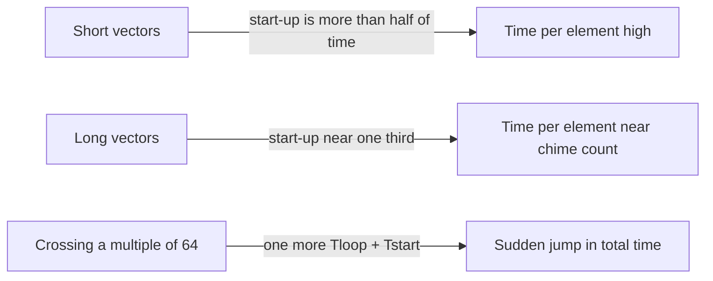

# بخش ۹، جلسه‌ی ۴ از ۱۴: مدل دقیق کارایی برداری: R∞، N1/2 و Nv

این جلسه بخشی از **بخش ۹: موازی‌سازی سطح داده: معماری برداری، SIMD و GPU** است. زمان مطالعه: حدود نیم ساعت.

**فهرست این جلسه:**

- ۱. دو جزء زمان یک حلقه‌ی قطعه‌بندی‌شده
- ۲. فرمول زمان اجرا
- ۳. مثال: A = B × s با ۲۰۰ عنصر
- ۴. کارایی اوج DAXPY
- ۵. کارایی پایدار روی Linpack
- ۶. معیار N1/2
- ۷. معیار Nv
- ۸. دو دام تاریخی: راه‌اندازی طولانی و اسکالر کند
- ۹. تمرین‌ها

---

## ۱. دو جزء زمان یک حلقه‌ی قطعه‌بندی‌شده

این جلسه از پیوست G کتاب CAQA (پردازنده‌های برداری با عمق بیشتر) است. جلسه‌ی ۲ مدل چایم و زمان راه‌اندازی را دید و جلسه‌ی ۳ قطعه‌بندی را. حالا این‌ها را در یک فرمول جمع می‌کنیم.

زمان یک حلقه‌ی قطعه‌بندی‌شده که از چند کاروان ساخته شده، دو جزء دارد:

- ۱. **تعداد کاروان‌ها** که تعداد چایم‌ها را تعیین می‌کند. این را `T_chime` می‌نامیم: زمان اجرا بر حسب چایم برای هر عنصر.
- ۲. **سربار هر قطعه:** شامل `T_loop` (هزینه‌ی کد اسکالر قطعه‌بندی هر بلوک) و `T_start` (مجموع زمان راه‌اندازی کاروان‌ها در هر قطعه).

یک سربار ثابت هم برای شروع اولین دنباله‌ی برداری هست که در پردازنده‌های جدید کوچک است و نادیده‌اش می‌گیریم.

## ۲. فرمول زمان اجرا

برای بردار به طول n:

```math
T_n = \left\lceil \frac{n}{MVL} \right\rceil \times (T_{loop} + T_{start}) + n \times T_{chime}
```

معنی هر جمله:

- **تعداد قطعه‌ها** ضرب در سربار هر قطعه.
- **تعداد عنصرها** ضرب در تعداد چایم‌ها (چون هر چایم برای هر عنصر یک سیکل است).

مقدار `T_loop` برای VMIPS از اندازه‌گیری‌های Cray-1 برابر **۱۵** گرفته می‌شود. شاید کم به نظر برسد، چون در هر دور باید آدرس‌ها و گام‌ها تنظیم شوند، شمارنده‌ها زیاد شوند و پرش انجام شود. اما در عمل این دستورهای اسکالر تا حد زیادی با دستورهای برداری همپوشانی دارند.

مقدارهای `T_start`، `T_loop` و `T_chime` به کامپایلر و پردازنده بستگی دارند. تخصیص ثبات و زمان‌بندی دستورها هم روی محتوای کاروان‌ها و هم روی سربار راه‌اندازی اثر می‌گذارد.

## ۳. مثال: A = B × s با ۲۰۰ عنصر

**صورت (پیوست G):** زمان اجرای `A = B × s` روی VMIPS برای بردار ۲۰۰ عنصری چقدر است؟ آدرس‌ها در `Ra` و `Rb` و مقدار s در `Fs` است.

**کد:** چون 200 mod 64 = 8، قطعه‌ی اول ۸ عنصر دارد و بقیه ۶۴ عنصر. آدرس‌ها بعد از قطعه‌ی اول 8 × 8 = 64 بایت و بعد از قطعه‌های بعدی 8 × 64 = 512 بایت جلو می‌روند.

```asm
        DADDUI  R2,R0,#1600    ; total # bytes in vector
        DADDU   R2,R2,Ra       ; address of the end of A vector
        DADDUI  R1,R0,#8       ; loads length of 1st segment
        MTC1    VLR,R1         ; load vector length in VLR
        DADDUI  R1,R0,#64      ; length in bytes of 1st segment
        DADDUI  R3,R0,#64      ; vector length of other segments
Loop:   LV      V1,Rb          ; load B
        MULVS.D V2,V1,Fs       ; vector * scalar
        SV      Ra,V2          ; store A
        DADDU   Ra,Ra,R1       ; address of next segment of A
        DADDU   Rb,Rb,R1       ; address of next segment of B
        DADDUI  R1,R0,#512     ; load byte offset next segment
        MTC1    VLR,R3         ; set length to 64 elements
        DSUBU   R4,R2,Ra       ; at the end of A?
        BNEZ    R4,Loop        ; if not, go back
```

**حل:** سه دستور برداری به هم وابسته‌اند. اما `SV` و `LV` هر دو به واحد حافظه نیاز دارند، و فرض این مثال این است که کاروان‌ها همپوشانی ندارند. کتاب این سه را در سه کاروان می‌گذارد، پس `T_chime = 3`.

```math
T_{200} = 4 \times (15 + T_{start}) + 200 \times 3 = 660 + 4 \times T_{start}
```

مقدار `T_start` مجموع راه‌اندازی‌هاست: بارگذاری ۱۲، ضرب ۷ و ذخیره ۱۲:

```math
T_{start} = 12 + 7 + 12 = 31 \quad\Rightarrow\quad T_{200} = 660 + 124 = 784
```

زمان هر عنصر با همه‌ی سربارها 784 / 200 ≈ **3.9 سیکل** است، در حالی که تخمین چایم **۳** بود.

> **نکته‌ی تطبیق با جلسه‌ی ۲:** با زنجیره‌سازی، `LV` و `MULVS.D` می‌توانند در یک کاروان باشند و `SV` در کاروان دوم. پس چایم ۲ هم قابل دفاع است. کتاب در این مثال محافظه‌کارانه سه کاروان می‌گیرد. در سؤال امتحان، فرض‌ها را صریح بنویس.



کتاب نمودار زمان هر عنصر بر حسب طول بردار را هم نشان می‌دهد. برای بردارهای کوتاه، سربار بیش از نصف زمان است و برای بردارهای بلند حدود یک سوم. هر بار که طول از مضرب ۶۴ عبور می‌کند، یک قطعه‌ی دیگر اضافه می‌شود و زمان ناگهان به اندازه‌ی `T_loop + T_start` بالا می‌رود.

## ۴. کارایی اوج DAXPY

حلقه‌ی درونی DAXPY با زنجیره‌سازی:

| کاروان | دستورها |
|---|---|
| کاروان ۱ | دستور `LV V1,Rx` و `MULVS.D V2,V1,F0` |
| کاروان ۲ | دستور `LV V3,Ry` و `ADDVV.D V4,V2,V3` |
| کاروان ۳ | دستور `SV Ry,V4` |

پس `T_chime = 3`. اگر فقط چایم را ببینیم، پردازنده‌ی ۵۰۰ مگاهرتزی با ۲ FLOP در هر تکرار باید با نرخ 2/3 × 500 ≈ 333 MFLOPS کار کند.

حالا سربار را اضافه کن. با فرض بدون همپوشانی کاروان‌ها:

```math
T_{start} = 12 + 7 + 12 + 6 + 12 = 49
```

```math
T_n = \left\lceil \frac{n}{64} \right\rceil \times (15 + 49) + 3n \le (n + 64) + 3n = 4n + 64
```

برای بردار بی‌نهایت، تعداد سیکل هر تکرار به ۴ میل می‌کند. پس **کارایی بردار بی‌نهایت** که با `R∞` نشان داده می‌شود:

```math
R_\infty = \frac{\text{operations per iteration} \times \text{clock rate}}{\lim_{n\to\infty} T_n / n} = \frac{2 \times 500 \text{ MHz}}{4} = 250 \text{ MFLOPS}
```

کارایی بدون سربار راه‌اندازی (333) حدود ۱.۳۳ برابر این عدد است. بخش اصلی اختلاف، راه‌اندازی هر بلوک ۶۴ عنصری است (۴۹ سیکل در برابر ۱۵ سیکل سربار حلقه).

## ۵. کارایی پایدار روی Linpack

محک Linpack حذف گاوسی روی ماتریس 100 × 100 است. طول بردارها از ۹۹ تا ۱ کم می‌شود و برداری به طول k دقیقاً k بار استفاده می‌شود. پس میانگین وزنی طول بردار:

```math
\bar{n} = \frac{\sum_{i=1}^{99} i^2}{\sum_{i=1}^{99} i} = 66.3
```

با n = 66 دو قطعه داریم:

```math
T_{66} = 2 \times (15 + 49) + 66 \times 3 = 128 + 198 = 326
```

```math
R_{66} = \frac{2 \times 66 \times 500}{326} \approx 202 \text{ MFLOPS}
```

کارایی اوج بدون سربار (333) حدود **۱.۶۴ برابر** این عدد است. در واقعیت وضع بدتر است: Linpack بخشی دارد که برداری نمی‌شود. این بخش کمتر از ۲۰٪ زمان قبل از برداری‌سازی است، اما با کمتر از یک دهم سرعت اجرا می‌شود. قانون امدال می‌گوید کارایی کل خیلی کمتر از تحلیل حلقه‌ی درونی خواهد بود.

## ۶. معیار N1/2

چون طول بردار اثر زیادی دارد، سه معیار وابسته به طول رایج است:

| معیار | تعریف | چه چیزی را می‌سنجد |
|---|---|---|
| مقدار `R∞` | نرخ MFLOPS روی بردار بی‌نهایت | کارایی اوج با سربار قطعه‌بندی |
| مقدار `N1/2` | طول برداری که نصف `R∞` را می‌دهد | اثر سربار |
| مقدار `Nv` | طول برداری که حالت برداری از اسکالر سریع‌تر می‌شود | سربار و سرعت نسبی اسکالر |

**مثال: `N1/2` برای DAXPY روی VMIPS با ۵۰۰ مگاهرتز.** نصف `R∞` یعنی 125 MFLOPS:

```math
125 = \frac{2 \times N_{1/2}}{T_{N_{1/2}}} \times 500 \quad\Rightarrow\quad T_{N_{1/2}} = 8 \times N_{1/2}
```

با فرض `N1/2 < 64` فقط یک قطعه داریم، پس `T = 64 + 3n`:

```math
64 + 3 N_{1/2} = 8 N_{1/2} \quad\Rightarrow\quad N_{1/2} = 12.8 \approx 13
```

یعنی برداری به طول ۱۳ تقریباً نصف کارایی اوج را می‌دهد.

## ۷. معیار Nv

**مثال: برای چه طولی حالت برداری از اسکالر سریع‌تر است؟** زمان یک تکرار در حالت اسکالر تقریباً 10 + 12 + 12 + 7 + 6 + 12 = 59 سیکل است (۱۰ برای سربار حلقه، و بقیه تأخیر بارگذاری X، بارگذاری Y، ضرب، جمع و ذخیره). با `Nv < 64`:

```math
64 + 3 N_v = 59 N_v \quad\Rightarrow\quad N_v = \frac{64}{56} \approx 1.14 \Rightarrow N_v = 2
```

حالت برداری برای بردارهای **دو عنصری یا بیشتر** سریع‌تر است. این عدد به طرز تعجب‌آوری کوچک است و دلیلش این است که اسکالر VMIPS در این مدل هیچ همپوشانی ندارد.

## ۸. دو دام تاریخی: راه‌اندازی طولانی و اسکالر کند

**دام اول: تمرکز روی کارایی اوج و نادیده گرفتن راه‌اندازی.** پردازنده‌های برداری حافظه به حافظه‌ی اولیه مثل TI ASC و CDC STAR-100 زمان راه‌اندازی طولانی داشتند. برای بعضی مسئله‌ها بردار باید بیش از ۱۰۰ عنصر می‌داشت تا کد برداری از اسکالر سریع‌تر شود. در CYBER 205 (از نسل STAR-100) سربار راه‌اندازی DAXPY برابر **۱۵۸ سیکل** بود. اگر فرکانس Cray-1 و CYBER 205 برابر بود، Cray-1 تا طول ۶۴ سریع‌تر بود. چون Cray-1 فرکانس بالاتری هم داشت (با اینکه قدیمی‌تر بود)، نقطه‌ی برابری بالای طول ۱۰۰ بود.

**دام دوم: افزایش کارایی برداری بدون افزایش کارایی اسکالر.** خیلی از پردازنده‌های برداری اولیه واحد اسکالر کندی داشتند. سیمور کری (طراح Cray) اینجا قاعده را عوض کرد و اسکالر سریع ساخت. کارایی اسکالر خوب سربار (مثل قطعه‌بندی) را کم می‌کند و اثر قانون امدال را کاهش می‌دهد.

| پردازنده | کمترین نرخ (MFLOPS) | بیشترین نرخ | میانگین همساز ۲۴ حلقه |
|---|---|---|---|
| ماشین MIPS M/120-5 | ۰.۸۰ | ۳.۸۹ | ۱.۸۵ |
| ماشین Stardent-1500 | ۰.۴۱ | ۱۰.۰۸ | ۱.۷۲ |

این جدول محک Livermore Fortran Kernels است. هر دو ماشین تراشه‌ی MIPS R2000 با ۱۶.۷ مگاهرتز دارند. ماشین Stardent برای عملیات اسکالر ممیز شناور هم از واحد برداری استفاده می‌کند و کارایی اسکالرش حدود نصف است (ستون کمترین نرخ). روی حلقه‌ی بسیار برداری‌پذیر ۲.۵ برابر سریع‌تر است (ستون بیشترین نرخ)، اما میانگین همساز روی همه‌ی ۲۴ حلقه کمتر است. امروز همین خطر به شکل «اضافه کردن خط بیشتر بدون بهبود اسکالر» تکرار می‌شود.

## ۹. تمرین‌ها

<details><summary>تمرین ۱: زمان DAXPY برای n = 1000</summary>

**صورت:** با `T_loop = 15` و `T_start = 49` و `T_chime = 3`، زمان DAXPY را برای n = 1000 و کارایی را با ۵۰۰ مگاهرتز حساب کن.

**جواب:** تعداد قطعه‌ها ⌈1000/64⌉ = 16. پس T = 16 × 64 + 3000 = 4024 سیکل. کارایی: 2 × 1000 × 500 / 4024 ≈ 248.5 MFLOPS که نزدیک `R∞ = 250` است.
</details>

<details><summary>تمرین ۲: اثر همپوشانی کاروان‌ها</summary>

**صورت:** فرض کن سخت‌افزار اجازه دهد کاروان‌ها همپوشانی داشته باشند و فقط راه‌اندازی کاروان اول دیده شود، یعنی `T_start = 12 + 7 = 19`. مقدار `R∞` چقدر می‌شود؟

**جواب:** هر قطعه 15 + 19 = 34 سیکل سربار دارد، یعنی به ازای هر عنصر 34/64 ≈ 0.53. سیکل هر تکرار 3.53 و `R∞ = 2 × 500 / 3.53 ≈ 283 MFLOPS`. پیوست G این بهبود را با جزئیات بیشتر بررسی می‌کند.
</details>

<details><summary>تمرین ۳: معیار N1/2 با سربار کمتر</summary>

**صورت:** اگر `T_start` از ۴۹ به ۱۹ برسد ولی `T_loop = 15` بماند، `N1/2` چقدر می‌شود؟ از مقدار `R∞` تمرین ۲ استفاده کن.

**جواب:** نصف `R∞` حدود 141.6 MFLOPS است. پس 2n × 500 / (34 + 3n) = 141.6، یعنی 1000n = 141.6 × (34 + 3n). نتیجه 575n ≈ 4815 و n ≈ 8.4، پس `N1/2 ≈ 9`. سربار کمتر یعنی بردار کوتاه‌تر هم به کارایی خوب می‌رسد.
</details>

<details><summary>تمرین ۴: قانون امدال روی Linpack</summary>

**صورت:** فرض کن ۸۰٪ زمان اسکالر Linpack برداری شود و ۵ برابر سریع‌تر شود و ۲۰٪ بقیه همان سرعت را داشته باشد. سرعت‌افزایی کل چقدر است؟

**جواب:** 1 / (0.2 + 0.8/5) = 1 / 0.36 ≈ 2.78. با اینکه بخش برداری ۵ برابر شده، کل برنامه کمتر از ۳ برابر سریع شده است. این همان دلیل اهمیت اسکالر سریع است.
</details>

---

جلسه‌ی قبلی: [خط‌های موازی، ثبات طول بردار و قطعه‌بندی](9-3-lanes-vlr-strip-mining.md)  
جلسه‌ی بعدی: [ثبات نقاب و بانک‌های حافظه](9-5-masks-and-memory-banks.md)
