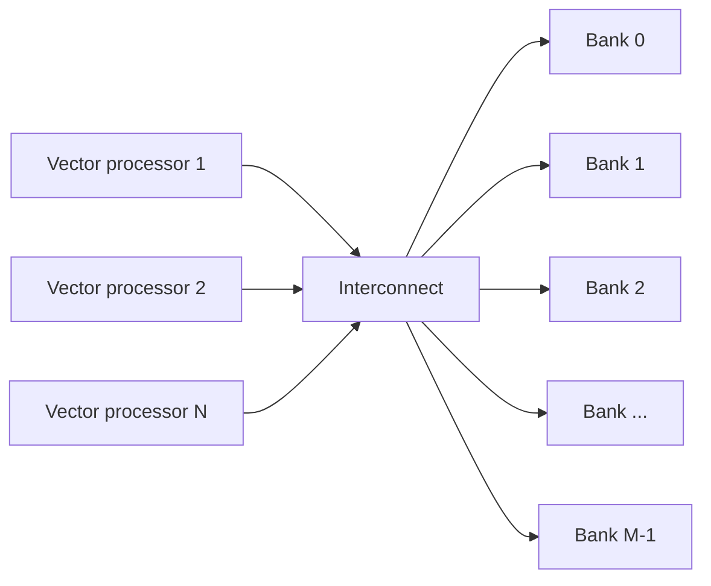

# بخش ۹، جلسه‌ی ۵ از ۱۴: ثبات نقاب و بانک‌های حافظه

این جلسه بخشی از **بخش ۹: موازی‌سازی سطح داده: معماری برداری، SIMD و GPU** است. زمان مطالعه: حدود نیم ساعت.

**فهرست این جلسه:**

- ۱. چرا شرط داخل حلقه مشکل است
- ۲. ثبات نقاب برداری
- ۳. مثال کتاب: تفریق شرطی
- ۴. حالت IF و ELSE
- ۵. هزینه‌ی نقاب
- ۶. فشرده‌سازی با نقاب
- ۷. واحد بارگذاری و ذخیره: راه‌اندازی و نرخ
- ۸. چرا بانک‌های مستقل، نه فقط درهم‌سازی
- ۹. مثال Cray T932
- ۱۰. تمرین‌ها

---

## ۱. چرا شرط داخل حلقه مشکل است

قانون امدال می‌گوید برنامه‌ای که فقط بخشی از آن برداری می‌شود، سرعت‌افزایی کمی می‌گیرد. دو دلیل اصلی پایین بودن سطح برداری‌سازی:

- **دستور IF داخل حلقه:** شرط یک وابستگی کنترلی ایجاد می‌کند.
- **ماتریس خلوت (sparse):** که در جلسه‌ی بعد می‌بینیم.

این حلقه را ببین:

```c
for (i = 0; i < 64; i = i + 1)
    if (X[i] != 0)
        X[i] = X[i] - Y[i];
```

با روش‌هایی که تا حالا دیدیم برداری نمی‌شود، چون بدنه فقط برای بعضی i ها اجرا می‌شود. اما اگر بتوانیم تفریق را **فقط برای عنصرهایی که X[i] صفر نیست** انجام دهیم، برداری می‌شود.

## ۲. ثبات نقاب برداری

راه‌حل رایج **کنترل با نقاب برداری (vector-mask control)** است. ثبات نقاب یک بردار بولی است، یک بیت برای هر عنصر. وقتی نقاب فعال است:

- **عنصرهایی که بیت نقابشان یک است** تحت تأثیر دستور برداری قرار می‌گیرند.
- **عنصرهایی که بیت نقابشان صفر است** در ثبات مقصد دست‌نخورده می‌مانند.
- **پاک کردن نقاب** با دستور `CVM` همه‌ی بیت‌ها را یک می‌کند، یعنی دستورهای بعدی روی همه‌ی عنصرها کار می‌کنند.

این دقیقاً همان ایده‌ی **دستورهای مشروط** است که در بخش ۷ (جلسه‌ی ۷، پیش‌گزاره‌سازی) دیدیم، فقط برای هر عنصر بردار.

## ۳. مثال کتاب: تفریق شرطی

با فرض اینکه آدرس X و Y در `Rx` و `Ry` است:

```asm
        LV      V1,Rx          ; load vector X into V1
        LV      V2,Ry          ; load vector Y
        L.D     F0,#0          ; load FP zero into F0
        SNEVS.D V1,F0          ; sets VM(i) to 1 if V1(i) != F0
        SUBVV.D V1,V1,V2       ; subtract under vector mask
        SV      Rx,V1          ; store the result in X
```

دستور `SNEVS.D` (Set if Not Equal, Vector-Scalar) هر عنصر V1 را با صفر مقایسه می‌کند و نتیجه را در ثبات نقاب می‌نویسد. بعد `SUBVV.D` فقط برای عنصرهای با بیت یک اجرا می‌شود. چون عنصرهای با بیت صفر در V1 دست‌نخورده می‌مانند، ذخیره‌ی کل V1 درست است: آن عنصرها همان مقدار قبلی X هستند.

کامپایلرنویس‌ها به تبدیل یک IF به کد خطی با اجرای مشروط، **تبدیل IF (if conversion)** می‌گویند.

> **نکته:** در کد کتاب `L.D F0,#0` آمده است. در MIPS واقعی `L.D` عملوند فوری ندارد. این یک نحو ساده‌شده است؛ در عمل صفر را از حافظه می‌خوانیم یا با `MTC1` از `R0` می‌سازیم.

## ۴. حالت IF و ELSE

حلقه‌ی کامل‌تر اسلایدهای GPU (که در جلسه‌ی ۱۲ دوباره می‌بینیم):

```c
for (i = 0; i < 64; i = i + 1)
    if (X[i] != 0) X[i] = X[i] - Y[i];
    else           X[i] = Z[i];
```

در VMIPS دستور مستقیم برای «معکوس کردن نقاب» نداریم. یک راه ساده این است که اول نقاب ELSE را حساب کنیم و نگه داریم، چون بعد از اجرای بخش THEN، ثبات V1 دیگر مقدار اصلی X را ندارد و نمی‌شود دوباره روی آن مقایسه کرد. دستور `MVFM` نقاب را در یک ثبات ممیز شناور کپی می‌کند و `MVTM` آن را برمی‌گرداند:

```asm
        LV      V1,Rx          ; X
        LV      V2,Ry          ; Y
        LV      V3,Rz          ; Z
        SEQVS.D V1,F0          ; VM = (X == 0), computed first
        MVFM    F2,VM          ; save ELSE mask
        CVM
        SNEVS.D V1,F0          ; VM = (X != 0)
        SUBVV.D V1,V1,V2       ; THEN: X - Y under mask
        MVTM    VM,F2          ; restore ELSE mask
        ADDVS.D V1,V3,F0       ; ELSE: V1 = Z + 0 under mask
        CVM
        SV      Rx,V1          ; store X
```

فرض: نقاب ۶۴ بیتی در یک ثبات ممیز شناور ۶۴ بیتی جا می‌شود و F0 برابر صفر است. این مثال نشان می‌دهد که در معماری برداری **کامپایلر** باید نقاب‌ها را صریح مدیریت کند. در GPU همین کار را سخت‌افزار با پشته‌ی نقاب انجام می‌دهد.

## ۵. هزینه‌ی نقاب

نقاب مجانی نیست:

- **زمان ثابت:** دستور برداری با نقاب همان زمان را می‌گیرد، حتی برای عنصرهایی که بیت نقابشان صفر است. سخت‌افزار برای هر عنصر وقت صرف می‌کند.
- **کاهش نرخ GFLOPS:** اگر نصف بیت‌ها صفر باشند، نصف عمل‌ها هدر می‌روند. اسلاید درس صریح می‌گوید: «نرخ GFLOPS کم می‌شود».

با این حال، حذف پرش و وابستگی کنترلی باعث می‌شود حتی با تعداد زیادی صفر در نقاب، حالت برداری از حالت اسکالر خیلی سریع‌تر باشد.

**تفاوت با GPU:** پردازنده‌ی برداری ثبات نقاب را جزو **حالت معماری** قرار می‌دهد و کامپایلر صریحاً آن را دستکاری می‌کند. پردازنده‌ی گرافیکی همان اثر را با ثبات‌های نقاب **داخلی** و نامرئی برای نرم‌افزار می‌گیرد. در هر دو حالت، زمان صرف عنصرهای غیرفعال هم می‌شود.

## ۶. فشرده‌سازی با نقاب

وقتی تعداد کمی از بیت‌های نقاب یک است، روش دیگری بهتر است: عنصرهای فعال را **فشرده** کن و فقط روی آن‌ها کار کن. پیوست G روش زیر را می‌آورد:

- ۱. با مقایسه نقاب را بساز.
- ۲. با `POP` تعداد یک‌ها را بشمار و در VLR بگذار.
- ۳. با `CVI` تحت نقاب، بردار اندیس عنصرهای فعال را بساز (در پیوست G، این دستور تحت نقاب فقط برای عنصرهای فعال اندیس تولید می‌کند و آن‌ها را پشت سر هم می‌گذارد).
- ۴. با بارگذاری اندیس‌دار (`LVI`) فقط عنصرهای فعال را بیاور، عمل را انجام بده و با `SVI` برگردان.

این روش وقتی ارزش دارد که هزینه‌ی دسترسی اندیس‌دار کمتر از هزینه‌ی کار روی همه‌ی عنصرها باشد، یعنی وقتی نسبت عنصرهای فعال کم است.

## ۷. واحد بارگذاری و ذخیره: راه‌اندازی و نرخ

رفتار واحد حافظه‌ی برداری خیلی پیچیده‌تر از واحدهای حسابی است:

- **زمان راه‌اندازی:** زمان رسیدن اولین کلمه از حافظه به ثبات. در بیشتر پردازنده‌ها بالای ۱۰۰ سیکل است؛ برای VMIPS همان ۱۲ سیکل Cray-1 را فرض می‌کنیم. کامپیوترهای برداری جدیدتر از کش برای کاهش این تأخیر استفاده می‌کنند.
- **نرخ شروع:** اگر بقیه‌ی بردار بدون توقف برسد، نرخ برابر نرخ رسیدن کلمه‌هاست. اما برخلاف واحدهای حسابی، این نرخ لزوماً یک کلمه در هر سیکل نیست، چون **توقف بانک حافظه** می‌تواند آن را کم کند.

برای نگه داشتن نرخ یک کلمه در هر سیکل، حافظه باید بتواند این مقدار داده تولید یا قبول کند. راه معمول: پخش دسترسی‌ها بین **چندین بانک مستقل حافظه**.

از دید بالاتر، واحد بارگذاری برداری نقشی شبیه **واحد پیش‌واکشی (prefetch)** در پردازنده‌های اسکالر دارد (بخش ۶): هر دو تلاش می‌کنند با فرستادن جریانی از داده، پهنای باند را تأمین کنند.

## ۸. چرا بانک‌های مستقل، نه فقط درهم‌سازی

در بخش ۶ حافظه‌ی **درهم‌سازی‌شده (interleaved)** را دیدیم که کلمه‌های پشت سر هم را بین بانک‌ها پخش می‌کند. پردازنده‌های برداری **بانک‌های با آدرس‌دهی مستقل** می‌خواهند، به سه دلیل:

- ۱. **چند دسترسی در هر سیکل:** خیلی از کامپیوترهای برداری در هر سیکل چند بارگذاری یا ذخیره دارند و زمان سیکل بانک حافظه چند برابر زمان سیکل پردازنده است. پس چند بانک لازم است و آدرس هر بانک باید مستقل کنترل شود.
- ۲. **دسترسی غیرپشت‌سرهم:** بیشتر پردازنده‌های برداری بارگذاری با گام و اندیس‌دار دارند. اینجا درهم‌سازی ساده کافی نیست و آدرس‌دهی مستقل بانک لازم است.
- ۳. **چندپردازنده با حافظه‌ی مشترک:** هر پردازنده جریان آدرس مستقل خودش را دارد.



## ۹. مثال Cray T932

**صورت:** بزرگ‌ترین پیکربندی Cray T90 یعنی Cray T932 دارای ۳۲ پردازنده است و هر پردازنده در هر سیکل ۴ بارگذاری و ۲ ذخیره تولید می‌کند. سیکل پردازنده 2.167 نانوثانیه و سیکل SRAM حافظه 15 نانوثانیه است. حداقل چند بانک حافظه لازم است تا همه‌ی پردازنده‌ها با پهنای باند کامل کار کنند؟

**حل:**

- **دسترسی در هر سیکل:** 32 × (4 + 2) = 192.
- **زمان اشغال هر بانک:** 15 / 2.167 = 6.92 که به **۷ سیکل** گرد می‌شود.
- **تعداد بانک:** در هر سیکل ۱۹۲ بانک جدید لازم داریم و هر بانک ۷ سیکل مشغول می‌ماند:

```math
192 \times 7 = 1344 \text{ banks}
```

ماشین Cray T932 در واقع **۱۰۲۴ بانک** داشت، پس مدل‌های اولیه نمی‌توانستند پهنای باند کامل را همزمان به همه‌ی پردازنده‌ها بدهند. ارتقای بعدی SRAM های ناهمگام ۱۵ نانوثانیه‌ای را با SRAM های همگام خط‌لوله‌ای جایگزین کرد که زمان سیکل حافظه را بیش از نصف کم کرد و پهنای باند کافی شد.

استدلال کلی این مثال همان **قانون لیتل** است: تعداد درخواست در جریان برابر نرخ ضرب در زمان سرویس است.

```math
\text{banks needed} \ge \text{accesses per cycle} \times \text{bank busy time}
```

## ۱۰. تمرین‌ها

<details><summary>تمرین ۱: نقاب برای شرط بزرگ‌تر از</summary>

**صورت:** حلقه‌ی `for (i=0;i<64;i++) if (A[i] > s) A[i] = A[i] * 2;` را با VMIPS بنویس. مقدار s در `F0` و عدد ۲ در `F2` است.

**جواب:**

```asm
        LV      V1,Ra
        SGTVS.D V1,F0          ; VM(i) = (A[i] > s)
        MULVS.D V1,V1,F2       ; double under mask
        CVM
        SV      Ra,V1
```
</details>

<details><summary>تمرین ۲: کارایی مؤثر با نقاب</summary>

**صورت:** در تمرین ۱ اگر فقط ۲۵٪ عنصرها شرط را داشته باشند، چند درصد عمل‌های ضرب مفید است؟ اگر کد اسکالر هر تکرار ۱۰ سیکل و کد برداری کل ۶۴ عنصر را در ۱۰۰ سیکل اجرا کند، کدام سریع‌تر است؟

**جواب:** فقط ۲۵٪ ضرب‌ها مفیدند. اما زمان اسکالر 64 × 10 = 640 سیکل است (حتی اگر شاخه‌ی بدون کار را ارزان‌تر فرض کنیم، پرش و بارگذاری و مقایسه برای همه‌ی عنصرها لازم است) و زمان برداری 100 سیکل. حالت برداری با وجود هدررفت، حدود ۶ برابر سریع‌تر است.
</details>

<details><summary>تمرین ۳: بانک برای یک پردازنده</summary>

**صورت:** یک پردازنده‌ی برداری در هر سیکل ۲ بارگذاری و ۱ ذخیره دارد. سیکل پردازنده ۱ نانوثانیه و سیکل بانک ۱۰ نانوثانیه است. حداقل چند بانک لازم است؟

**جواب:** 3 × 10 = 30 بانک. در عمل توان دو انتخاب می‌شود، یعنی ۳۲ بانک.
</details>

<details><summary>تمرین ۴: نسخه‌ی ارتقایافته‌ی T932</summary>

**صورت:** اگر سیکل SRAM به ۷ نانوثانیه برسد، آیا ۱۰۲۴ بانک برای Cray T932 کافی است؟

**جواب:** 7 / 2.167 = 3.23 که به ۴ سیکل گرد می‌شود. پس 192 × 4 = 768 بانک لازم است که کمتر از ۱۰۲۴ است. کافی است.
</details>

---

جلسه‌ی قبلی: [مدل دقیق کارایی برداری: R∞، N1/2 و Nv](9-4-vector-performance-model.md)  
جلسه‌ی بعدی: [گام، تداخل بانک، جمع‌آوری و پخش، و برنامه‌نویسی برداری](9-6-stride-gather-scatter-programming.md)
