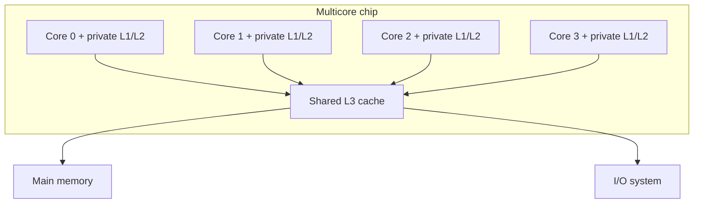
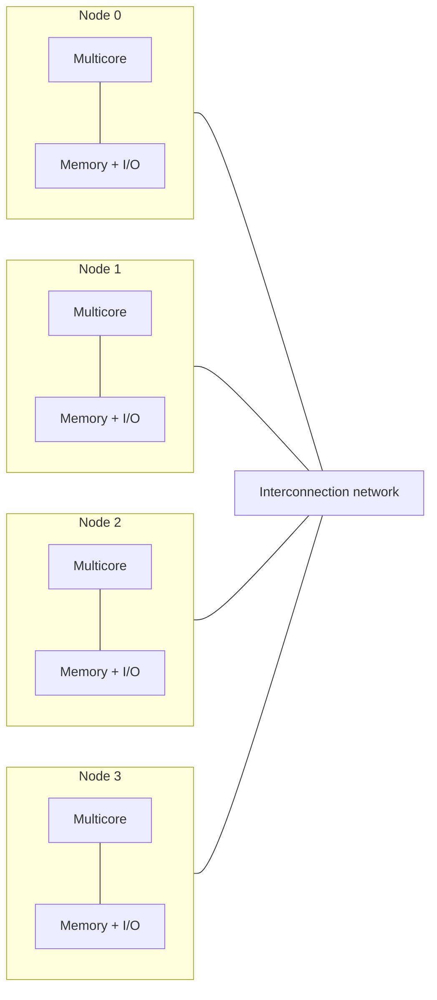

# بخش ۱۰، جلسه‌ی ۱ از ۱۸: موازی‌سازی سطح نخ و انواع چندپردازنده

این جلسه بخشی از **بخش ۱۰: موازی‌سازی سطح نخ: چندپردازنده‌ها، انسجام کش، همگام‌سازی، سازگاری حافظه و WSC** است. زمان مطالعه: حدود نیم ساعت.

**فهرست این جلسه:**

- ۱. چرا چندپردازنده
- ۲. دسته‌بندی فلین
- ۳. چندپردازنده چیست
- ۴. نخ و اندازه‌ی دانه
- ۵. دو سازمان حافظه: SMP و DSM
- ۶. حافظه‌ی مشترک در برابر ارسال پیام
- ۷. نقشه‌ی این بخش
- ۸. تمرین‌ها

---

## ۱. چرا چندپردازنده

در بخش ۸ دیدیم که پیدا کردن ILP بیشتر بسیار گران است. بین سال‌های ۲۰۰۰ تا ۲۰۰۵ طراحان تلاش کردند ILP بیشتری استخراج کنند، اما **توان و مساحت سیلیکون سریع‌تر از کارایی** رشد کرد. کتاب CAQA شش دلیل برای اهمیت روزافزون چندپردازنده‌ها می‌آورد:

- **ناکارایی ILP:** غیر از ILP، تنها راه عمومی و مقیاس‌پذیری که می‌شناسیم تا کارایی سریع‌تر از خود فناوری رشد کند، چندپردازندگی است.
- **سرورهای پیشرفته:** محاسبات ابری و نرم‌افزار به عنوان سرویس (SaaS) مهم‌تر شده‌اند.
- **برنامه‌های داده‌محور:** حجم عظیم داده در اینترنت.
- **کارایی رومیزی کمتر مهم است:** کارهای سنگین یا کارایی فعلی کافی است یا در ابر انجام می‌شود.
- **فهم بهتر استفاده از چندپردازنده:** مخصوصاً در سرورها که موازی‌سازی طبیعی زیادی دارند (داده‌ی بزرگ، کدهای علمی، درخواست‌های مستقل).
- **تکثیر طراحی:** طراحی یک هسته و تکرار آن ارزان‌تر از طراحی یک پردازنده‌ی بسیار پیچیده است.

## ۲. دسته‌بندی فلین

دسته‌بندی کلاسیک فلین (Flynn) بر اساس تعداد جریان دستور و جریان داده است:

| دسته | جریان دستور | جریان داده | نمونه |
|---|---|---|---|
| دسته‌ی SISD | یک | یک | پردازنده‌ی تک‌هسته‌ای (حتی ابرعددی) |
| دسته‌ی SIMD | یک | چند | معماری برداری، SIMD چندرسانه‌ای، GPU (بخش ۹) |
| دسته‌ی MISD | چند | یک | نمونه‌ی تجاری مهمی ندارد |
| دسته‌ی MIMD | چند | چند | چندهسته‌ای، چندپردازنده، خوشه |

**موازی‌سازی سطح نخ (Thread-Level Parallelism یا TLP)** یعنی وجود **چند شمارنده‌ی برنامه (PC)**. پس TLP عمدتاً با MIMD بهره‌برداری می‌شود. بخش ۹ درباره‌ی SIMD بود و این بخش درباره‌ی MIMD است.

## ۳. چندپردازنده چیست

تعریف کتاب:

> **چندپردازنده (multiprocessor)** کامپیوتری است با پردازنده‌های **به هم پیوسته‌ی محکم (tightly coupled)** که هماهنگی و استفاده از آن‌ها معمولاً با **یک سیستم‌عامل** کنترل می‌شود و از طریق یک **فضای آدرس مشترک** حافظه را به اشتراک می‌گذارند.

دو مدل نرم‌افزاری روی چندپردازنده اجرا می‌شود:

- **پردازش موازی (parallel processing):** مجموعه‌ای از نخ‌های به هم پیوسته که روی **یک کار** همکاری می‌کنند.
- **موازی‌سازی سطح درخواست (request-level parallelism):** اجرای چند فرایند نسبتاً مستقل از یک یا چند کاربر. یک برنامه‌ی واحد (مثلاً پایگاه داده‌ای که به پرس‌وجوها جواب می‌دهد) یا چند برنامه‌ی مستقل که به آن **چندبرنامگی (multiprogramming)** می‌گویند.

اندازه‌ی چندپردازنده‌های این بخش از دو پردازنده تا چند ده پردازنده است. **چندهسته‌ای (multicore)** یعنی چند هسته روی یک تراشه؛ چندپردازنده‌ی چندتراشه‌ای از چند تراشه‌ی چندهسته‌ای ساخته می‌شود. کتاب تمرکز را روی ۲ تا ۳۲ پردازنده می‌گذارد، چون این بازه از نظر تعداد و فروش غالب است.

در جلسه‌ی ۱۵ به بعد سراغ **کامپیوترهای در مقیاس انبار (WSC)** می‌رویم: ده‌ها هزار سرور که با شبکه به هم وصل‌اند. چندنخنگی (بخش ۸ جلسه‌ی ۱۲) هم در این بخش دوباره ظاهر می‌شود، چون بیشتر چندهسته‌ای‌ها آن را دارند.

## ۴. نخ و اندازه‌ی دانه

برای استفاده از n پردازنده، معمولاً دست‌کم **n نخ یا فرایند** لازم داریم. نخ‌ها را برنامه‌نویس مشخص می‌کند، یا سیستم‌عامل از درخواست‌های مستقل می‌سازد، یا یک کامپایلر موازی از تکرارهای یک حلقه تولید می‌کند.

**اندازه‌ی دانه (grain size)** یعنی مقدار محاسبه‌ای که به هر نخ داده می‌شود. تفاوت کیفی مهم با ILP:

- **در ILP** موازی‌سازی را سخت‌افزار یا کامپایلر در سطح دستور پیدا می‌کند.
- **در TLP** موازی‌سازی را نرم‌افزار یا برنامه‌نویس در سطح بالا مشخص می‌کند و هر نخ صدها تا میلیون‌ها دستور دارد.

نخ‌ها می‌توانند برای DLP هم استفاده شوند، اما سربار آن‌ها بیشتر از SIMD یا GPU است. پس اندازه‌ی دانه باید به اندازه‌ی کافی بزرگ باشد. برداری که GPU در چند سیکل پردازش می‌کند، اگر بین چند نخ MIMD تقسیم شود، ممکن است سربار ساخت و همگام‌سازی نخ‌ها از خود کار بیشتر شود.

## ۵. دو سازمان حافظه: SMP و DSM

چندپردازنده‌های حافظه‌مشترک بر اساس **سازمان حافظه** دو دسته‌اند.

**دسته‌ی اول: چندپردازنده‌ی متقارن (Symmetric Multiprocessor یا SMP)**، که حافظه‌ی متمرکز مشترک هم نامیده می‌شود:

- **تعداد کم هسته:** معمولاً هشت یا کمتر.
- **یک حافظه‌ی متمرکز** که همه‌ی پردازنده‌ها با **تأخیر یکسان** به آن دسترسی دارند؛ پس به آن **UMA** (uniform memory access) هم می‌گویند.
- **همه‌ی چندهسته‌ای‌های تک‌تراشه SMP هستند:** معمولاً یک سطح کش مشترک (مثلاً L3) و یک یا چند سطح کش خصوصی برای هر هسته دارند.

**دسته‌ی دوم: حافظه‌ی مشترک توزیع‌شده (Distributed Shared Memory یا DSM):**

- **حافظه بین گره‌ها پخش می‌شود:** برای تعداد پردازنده‌ی بیشتر لازم است، وگرنه حافظه‌ی متمرکز پهنای باند کافی نمی‌دهد یا تأخیرش زیاد می‌شود.
- **تأخیر غیریکسان:** دسترسی به حافظه‌ی محلی سریع‌تر از حافظه‌ی گره‌های دیگر است؛ پس به آن **NUMA** (nonuniform memory access) می‌گویند.
- **شبکه‌ی ارتباطی:** گره‌ها با سوییچ یا شبکه‌های چندگامی (مثل توری چندبعدی) به هم وصل‌اند.
- **امروز حتی دو تراشه هم DSM است:** هر تراشه‌ی چندهسته‌ای کنترل‌کننده‌ی حافظه‌ی خودش را دارد، پس هر سیستم با بیش از یک تراشه (سوکت) حافظه‌ی توزیع‌شده دارد.

مزیت DSM: پخش حافظه هم پهنای باند را بالا می‌برد و هم تأخیر حافظه‌ی محلی را کم می‌کند. عیب DSM: ارتباط داده بین پردازنده‌ها پیچیده‌تر است و نرم‌افزار باید برای استفاده از پهنای باند بیشتر، داده را محلی نگه دارد.

## ۶. حافظه‌ی مشترک در برابر ارسال پیام

در هر دو معماری SMP و DSM، ارتباط بین نخ‌ها از طریق **فضای آدرس مشترک** است: هر پردازنده (با مجوز درست) می‌تواند به هر خانه‌ی حافظه ارجاع دهد. واژه‌ی «حافظه‌ی مشترک» یعنی **فضای آدرس** مشترک است، نه لزوماً یک حافظه‌ی فیزیکی واحد.

در برابر، در **خوشه‌ها (cluster)** و WSC ها هر کامپیوتر حافظه‌ی خودش را دارد و پردازنده‌ی دیگر بدون کمک نرم‌افزار در هر دو طرف به آن دسترسی ندارد. آنجا از **ارسال پیام (message passing)** استفاده می‌شود.

| ویژگی | حافظه‌ی مشترک (SMP و DSM) | ارسال پیام (خوشه و WSC) |
|---|---|---|
| فضای آدرس | یکی برای همه | جدا برای هر گره |
| ارتباط | خواندن و نوشتن متغیر مشترک | ارسال و دریافت صریح پیام |
| سیستم‌عامل | یکی | یکی برای هر گره |
| مشکل اصلی سخت‌افزار | انسجام کش و سازگاری حافظه | شبکه و پروتکل نرم‌افزاری |
| مقیاس معمول | دو تا چند ده پردازنده | صدها تا ده‌ها هزار سرور |

## ۷. نقشه‌ی این بخش

| جلسه | موضوع |
|---|---|
| جلسه‌ی ۲ | چالش‌های پردازش موازی: قانون امدال و تأخیر ارتباط |
| جلسه‌های ۳ تا ۶ | انسجام کش در SMP: مسئله، پروتکل‌های جاسوسی، MSI، MESI و گسترش‌ها |
| جلسه‌ی ۷ | کارایی SMP: اشتراک واقعی و کاذب، بارهای کاری تجاری و سیستم‌عامل |
| جلسه‌های ۸ و ۹ | پروتکل‌های مبتنی بر دایرکتوری در DSM |
| جلسه‌های ۱۰ تا ۱۲ | همگام‌سازی: دستورهای اتمی، قفل، سد |
| جلسه‌ی ۱۳ | مدل‌های سازگاری حافظه |
| جلسه‌ی ۱۴ | مسائل مشترک، چندهسته‌ای‌های واقعی، باورهای غلط |
| جلسه‌های ۱۵ تا ۱۸ | کامپیوترهای در مقیاس انبار و محاسبات ابری |

## ۸. تمرین‌ها

تمرین ۱: دسته‌بندی

**صورت:** هر سیستم را در دسته‌بندی فلین و در یکی از دسته‌های SMP، DSM یا خوشه قرار بده: الف) لپ‌تاپ با پردازنده‌ی ۸ هسته‌ای. ب) سرور با دو سوکت و هر سوکت ۳۲ هسته. ج) ۱۰۰۰ سرور که با اترنت به هم وصل‌اند.

**جواب:** هر سه MIMD هستند. الف) SMP، چون یک تراشه با حافظه‌ی متمرکز است. ب) DSM یا NUMA، چون هر سوکت حافظه‌ی محلی خودش را دارد ولی فضای آدرس مشترک است. ج) خوشه با ارسال پیام، نه چندپردازنده‌ی حافظه‌مشترک.

تمرین ۲: اندازه‌ی دانه

**صورت:** ساخت و همگام‌سازی یک نخ ۲۰ میکروثانیه سربار دارد. جمع دو بردار ۱۰۰۰ عنصری روی یک هسته ۱ میکروثانیه طول می‌کشد. تقسیم این کار بین ۴ نخ ارزش دارد؟ اگر بردار ۱۰ میلیون عنصری باشد چطور؟

**جواب:** برای ۱۰۰۰ عنصر، کار کل ۱ میکروثانیه است و سربار ۲۰ میکروثانیه، پس موازی‌سازی زمان را بیشتر می‌کند؛ این کار مناسب SIMD است. برای ۱۰ میلیون عنصر، کار حدود ۱۰ میلی‌ثانیه است؛ با ۴ نخ حدود 2.5 میلی‌ثانیه به اضافه‌ی ۲۰ میکروثانیه، پس سرعت‌افزایی نزدیک ۴ (اگر پهنای باند حافظه اجازه دهد).

تمرین ۳: حافظه‌ی مشترک یعنی چه

**صورت:** یک دانشجو می‌گوید «DSM حافظه‌ی مشترک ندارد چون حافظه بین گره‌ها پخش شده است». درست است؟

**جواب:** نه. در DSM حافظه از نظر **فیزیکی** توزیع شده، اما **فضای آدرس** مشترک است و هر پردازنده با دستور معمولی بارگذاری و ذخیره به هر خانه‌ای دسترسی دارد؛ فقط تأخیر دسترسی به حافظه‌ی دور بیشتر است.

---

جلسه‌ی بعدی: [چالش‌های پردازش موازی](10-2-parallel-processing-challenges.md)
