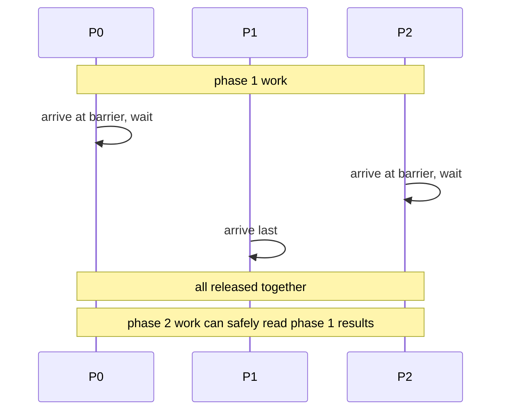
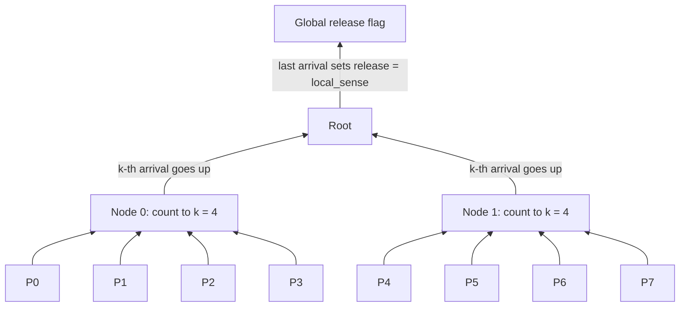

# بخش ۱۰، جلسه‌ی ۱۲ از ۱۸: سد همگام‌سازی

این جلسه بخشی از **بخش ۱۰: موازی‌سازی سطح نخ: چندپردازنده‌ها، انسجام کش، همگام‌سازی، سازگاری حافظه و WSC** است. زمان مطالعه: حدود نیم ساعت.

**فهرست این جلسه:**

- ۱. سد چیست
- ۲. سد ساده با دو قفل
- ۳. مشکل استفاده‌ی دوباره در حلقه
- ۴. سد با برگرداندن جهت (sense-reversing)
- ۵. هزینه‌ی سد روی گذرگاه
- ۶. سد با واکشی و افزایش
- ۷. سد درختی (combining tree)
- ۸. آزمایش عملی: سد چرخشی و سد سیستم‌عامل
- ۹. جمع‌بندی هزینه‌ها
- ۱۰. تمرین‌ها

---

## ۱. سد چیست

**سد (barrier)** یک عمل همگام‌سازی رایج در برنامه‌های با حلقه‌ی موازی است. سد همه‌ی فرایندها را مجبور می‌کند صبر کنند تا **همه** به سد برسند و بعد همه را آزاد می‌کند.



کاربرد معمول: محاسبه‌ی مرحله‌ای، مثل شبیه‌سازی که در هر گام زمانی هر نخ بخشی از شبکه را به‌روز می‌کند و گام بعد به نتیجه‌ی همه‌ی نخ‌ها نیاز دارد.

## ۲. سد ساده با دو قفل

پیاده‌سازی معمول با دو قفل چرخشی: یکی برای محافظت از **شمارنده‌ای** که تعداد رسیده‌ها را می‌شمارد، و یکی برای **نگه داشتن** فرایندها تا آخرین نفر برسد. علامت `spin(condition)` یعنی بچرخ تا شرط برقرار شود. متغیر `total` تعداد فرایندهاست:

```c
lock(counterlock);            /* ensure update atomic */
if (count == 0) release = 0;  /* first => reset release */
count = count + 1;            /* count arrivals */
unlock(counterlock);          /* release lock */
if (count == total) {         /* all arrived */
    count = 0;                /* reset counter */
    release = 1;              /* release processes */
}
else {                        /* more to come */
    spin(release == 1);       /* wait for arrivals */
}
```

## ۳. مشکل استفاده‌ی دوباره در حلقه

در عمل سد معمولاً **درون یک حلقه** استفاده می‌شود: فرایندها بعد از آزاد شدن کاری انجام می‌دهند و دوباره به **همان سد** می‌رسند. یک سناریوی خطرناک:

- ۱. یکی از فرایندها هنوز از سد بیرون نرفته است (در `spin` مانده است؛ مثلاً سیستم‌عامل فرایند دیگری را زمان‌بندی کرده و او هنوز تغییر release را ندیده است).
- ۲. یک فرایند سریع از دور بعد جلو می‌زند و **دوباره** به سد می‌رسد، قبل از اینکه فرایند کند بیرون برود.
- ۳. فرایند سریع، چون اولین رسیده‌ی دور جدید است، `release = 0` می‌کند.
- ۴. فرایند کند که هنوز منتظر `release == 1` بود، حالا **برای همیشه** گیر می‌کند.
- ۵. چون فرایند کند هرگز به دور جدید نمی‌رسد، count هرگز به total نمی‌رسد و **همه** در دور بعد منتظر می‌مانند: بن‌بست.

نکته‌ی مهم: **برنامه‌نویس هیچ اشتباهی نکرده است.** پیاده‌ساز سد فرضی درباره‌ی پیشرفت فرایندها کرده که نمی‌شود کرد. یک راه‌حل بدیهی: فرایندها را هنگام **خروج** هم بشمار و اجازه نده کسی دوباره وارد شود تا همه از دور قبل بیرون رفته باشند. اما این تأخیر و رقابت را خیلی بیشتر می‌کند.

## ۴. سد با برگرداندن جهت (sense-reversing)

راه‌حل بهتر: یک متغیر خصوصی برای هر فرایند به نام `local_sense` (با مقدار اولیه‌ی ۱ در کتاب). در هر دور، مقدار آزادسازی **یک در میان** عوض می‌شود:

```c
local_sense = !local_sense;   /* toggle local_sense */
lock(counterlock);            /* ensure update atomic */
count = count + 1;            /* count arrivals */
if (count == total) {         /* all arrived */
    count = 0;                /* reset counter */
    release = local_sense;    /* release processes */
}
unlock(counterlock);          /* unlock */
spin(release == local_sense); /* wait for signal */
```

چرا درست است؟ فرایند سریعی که به نمونه‌ی بعدی سد می‌رسد، release را **ریست نمی‌کند**؛ فقط منتظر **مقدار مخالف** می‌ماند. پس فرایند کند که منتظر مقدار قبلی است، هنوز آن را در release می‌بیند و بیرون می‌رود. این نسخه با خیال راحت قابل استفاده است، اما کارایی‌اش هنوز ممکن است بد باشد.

## ۵. هزینه‌ی سد روی گذرگاه

**صورت (پیوست I):** ۱۰ پردازنده روی گذرگاه همزمان به سد برمی‌رسند. هر تراکنش ۱۰۰ سیکل، گذرگاه منصف. قفل با LL و SC. چند تراکنش برای اینکه همه برسند، آزاد شوند و بیرون بروند؟

جدول تراکنش‌های فرایند i‌ام:

| رویداد | تعداد برای فرایند i | خط برنامه | توضیح |
|---|---|---|---|
| دستور LL روی counterlock | i | قفل counterlock | همه برای قفل تلاش می‌کنند |
| دستور SC | i | قفل counterlock | همه برای قفل تلاش می‌کنند |
| خواندن count | ۱ | افزایش count | فرایند موفق |
| دستور LL دوباره | i - 1 | قفل counterlock | فرایندهای ناموفق دوباره تلاش می‌کنند |
| نوشتن count | ۱ | افزایش count | عدم اصابت برای دسترسی انحصاری |
| نوشتن counterlock | ۱ | آزاد کردن قفل | عدم اصابت برای گرفتن قفل |
| خواندن release | ۲ | چرخش | یک بار در ابتدا و یک بار وقتی سرانجام نوشته می‌شود |

جمع برای فرایند i: 3i + 4. آخرین فرایند یکی کمتر دارد (خواندن release در کش خودش اصابت است). برای n فرایند:

```math
\left(\sum_{i=1}^{n} (3i + 4)\right) - 1 = \frac{3n^2 + 11n}{2} - 1
```

برای ۱۰ فرایند: **۲۰۴ تراکنش** یعنی **۲۰۴۰۰ سیکل**. یعنی سد تقریباً **دو برابر** دنباله‌ی ۱۰ قفل و آزادسازی جلسه‌ی قبل (۱۲۰۰۰ سیکل) طول می‌کشد.

دو منبع رقابت در سد:

- **مرحله‌ی جمع شدن (gather):** به‌روزرسانی اتمی count دسترسی **انحصاری** لازم دارد و سریال‌سازی زیادی ایجاد می‌کند. این جدی‌تر است.
- **مرحله‌ی آزادسازی (release):** همه باید پرچم release را بخوانند؛ این فقط رقابت **خواندن** است.

## ۶. سد با واکشی و افزایش

با یک دستور سخت‌افزاری **واکشی و افزایش** (جلسه‌ی ۱۰) که مقدار افزایش‌یافته را برمی‌گرداند، دیگر قفل جداگانه برای شمارنده لازم نیست:

```c
local_sense = !local_sense;   /* toggle local_sense */
fetch_and_increment(count);   /* atomic update */
if (count == total) {         /* all arrived */
    count = 0;                /* reset counter */
    release = local_sense;    /* release processes */
}
else {                        /* more to come */
    spin(release == local_sense); /* wait for signal */
}
```

هزینه برای n پردازنده: n عمل واکشی و افزایش، n عدم اصابت برای دسترسی به count، و n عدم اصابت برای release:

```math
3n \text{ transactions} \quad\Rightarrow\quad n = 10: 30 \text{ transactions} = 3000 \text{ cycles}
```

یعنی **خطی** و نزدیک ۷ برابر سریع‌تر از سد با قفل، مشابه قفل صف‌دار.

## ۷. سد درختی (combining tree)

ایده: درخواست‌ها را به صورت **درختی و محلی ترکیب کن.** یک درخت k‌تایی از پیش ساخته می‌شود (در عمل k = 4 خوب کار می‌کند). هر گره درخت شمارنده و قفل خودش را دارد، پس حداکثر k فرایند روی هر گره رقابت می‌کنند:



- **رسیدن:** وقتی k‌امین فرایند به یک گره می‌رسد، به گره پدر می‌رود و شمارنده‌ی آنجا را زیاد می‌کند.
- **ریشه:** وقتی شمارنده‌ی ریشه به k می‌رسد، پرچم release تنظیم می‌شود.
- **ریست:** شمارنده‌ی هر گره را آخرین فرایندی که به آن می‌رسد صفر می‌کند.
- **برگرداندن جهت:** مثل سد ساده، برای جلوگیری از مسابقه.
- **آزادسازی درختی:** می‌شود از همان درخت برای آزادسازی هم استفاده کرد تا رقابت خواندن پرچم هم کم شود.

بعضی ابررایانه‌های موازی (مثل T3D و CM-5) پشتیبانی سخت‌افزاری برای سد داشتند، اما ماشین‌های جدیدتر به کتابخانه‌های نرم‌افزاری تکیه می‌کنند. واکشی و افزایش در هر گره درخت هم سریال‌سازی را بیشتر کم می‌کند.

## ۸. آزمایش عملی: سد چرخشی و سد سیستم‌عامل

یک سد با برگرداندن جهت و واکشی و افزایش در C (با دستورهای اتمی gcc)، روی همان سرور دوهسته‌ای:

```c
#define T 2
volatile int count = 0, release = 0;
void barrier(int *local_sense) {
    *local_sense = !*local_sense;                       /* toggle */
    if (__atomic_add_fetch(&count, 1, __ATOMIC_ACQ_REL) == T) {
        count = 0;                                      /* last one resets */
        __atomic_store_n(&release, *local_sense, __ATOMIC_RELEASE);
    } else {
        while (__atomic_load_n(&release, __ATOMIC_ACQUIRE) != *local_sense) ;
    }
}
```

هر نخ در هر دور شماره‌ی دورش را می‌نویسد، از سد عبور می‌کند و بررسی می‌کند که نخ دیگر هم همین دور را نوشته باشد؛ این بررسی در ۲ میلیون سد هیچ خطایی نشان نداد.

| نوع سد | زمان هر سد |
|---|---|
| سد چرخشی بالا (دو نخ روی دو هسته) | حدود ۳۰ نانوثانیه |
| تابع `pthread_barrier_wait` کتابخانه | حدود ۲۰۰۰۰ نانوثانیه |

سد کتابخانه حدود **۷۰۰ برابر** کندتر است، چون نخ منتظر را **می‌خواباند** و سیستم‌عامل باید آن را بیدار کند (فراخوانی سیستمی و زمان‌بندی). سد چرخشی فقط چند انتقال بلوک کش بین دو هسته است. اما سد چرخشی پردازنده را هنگام انتظار مشغول نگه می‌دارد؛ اگر تعداد نخ‌ها بیشتر از هسته‌ها باشد یا انتظارها طولانی باشند، فاجعه است. کتابخانه‌های واقعی (مثل OpenMP) معمولاً مدتی می‌چرخند و بعد می‌خوابند.

## ۹. جمع‌بندی هزینه‌ها

برای n پردازنده روی گذرگاه با تراکنش ۱۰۰ سیکلی (پیوست I):

| روش | تعداد تراکنش | برای ۱۰ پردازنده |
|---|---|---|
| قفل چرخشی با LL و SC (n بار گرفتن و آزاد کردن) | n² + 2n | ۱۲۰ تراکنش، ۱۲۰۰۰ سیکل |
| قفل صف‌دار | 3n - 1 | ۲۹ تراکنش، ۲۹۰۰ سیکل |
| سد با برگرداندن جهت و قفل چرخشی | (3n² + 11n)/2 - 1 | ۲۰۴ تراکنش، ۲۰۴۰۰ سیکل |
| سد با واکشی و افزایش | 3n | ۳۰ تراکنش، ۳۰۰۰ سیکل |

وقتی رقابت کم است، **تأخیر** یک عمل همگام‌سازی مهم است؛ وقتی رقابت زیاد است، **سریال‌سازی** غالب می‌شود. ترکیب مشکلات همگام‌سازی با تأخیر طولانی حافظه و عدم توازن بار توضیح می‌دهد چرا استفاده‌ی کارا از چندپردازنده‌های بزرگ این‌قدر سخت است.

## ۱۰. تمرین‌ها

<details><summary>تمرین ۱: هزینه‌ی سد برای ۴ پردازنده</summary>

**صورت:** سد با برگرداندن جهت و قفل چرخشی و سد با واکشی و افزایش را برای ۴ پردازنده مقایسه کن.

**جواب:** اولی: (3 × 16 + 44)/2 - 1 = 46 - 1 = 45 تراکنش. دومی: 3 × 4 = 12 تراکنش. نسبت حدود ۳.۸.
</details>

<details><summary>تمرین ۲: بن‌بست سد ساده</summary>

**صورت:** در سد ساده‌ی بخش ۲ با دو فرایند، یک زمان‌بندی دقیق بنویس که به بن‌بست برسد.

**جواب:** دور ۱: P0 می‌رسد (count = 1) و می‌چرخد. پردازنده‌ی P1 می‌رسد (count = 2)، count را صفر و release را ۱ می‌کند و بیرون می‌رود. قبل از اینکه P0 مقدار جدید release را ببیند، سیستم‌عامل P0 را کنار می‌گذارد. پردازنده‌ی P1 کار دور ۲ را انجام می‌دهد و به سد می‌رسد: چون count == 0، release = 0 می‌کند و count = 1 و می‌چرخد. حالا P0 برمی‌گردد و release را ۰ می‌بیند و در دور ۱ گیر می‌کند. پردازنده‌ی P1 هم منتظر نفر دوم دور ۲ است. هر دو برای همیشه منتظرند.
</details>

<details><summary>تمرین ۳: چرا آخرین فرایند یکی کمتر</summary>

**صورت:** در جدول بخش ۵، چرا آخرین فرایندی که به سد می‌رسد یک تراکنش کمتر دارد؟

**جواب:** آخرین فرایند خودش release را می‌نویسد، پس بلوک release در کش خودش در حالت M است؛ خواندن release توسط او اصابت است و فقط یکی از دو خواندن release (به جای دو تراکنش) لازم است. در واقع در کد بخش ۴، چرخش او بلافاصله با اصابت تمام می‌شود.
</details>

<details><summary>تمرین ۴: عمق درخت</summary>

**صورت:** با ۶۴ پردازنده و k = 4، سد درختی چند سطح دارد؟ در هر گره حداکثر چند فرایند رقابت می‌کنند؟

**جواب:** 4³ = 64، پس سه سطح (۱۶ گره برگ، ۴ گره میانی، ۱ ریشه). در هر گره حداکثر ۴ رقیب، در حالی که در سد مسطح ۶۴ رقیب روی یک شمارنده بود.
</details>

---

جلسه‌ی قبلی: [قفل چرخشی و انسجام](10-11-spin-locks.md)  
جلسه‌ی بعدی: [مدل‌های سازگاری حافظه](10-13-memory-consistency.md)
