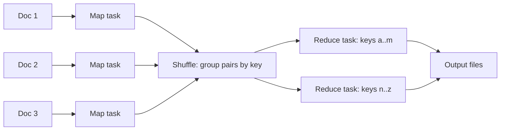

# بخش ۱۰، جلسه‌ی ۱۵ از ۱۸: کامپیوتر در مقیاس انبار: مقدمه و مدل برنامه‌نویسی

این جلسه بخشی از **بخش ۱۰: موازی‌سازی سطح نخ: چندپردازنده‌ها، انسجام کش، همگام‌سازی، سازگاری حافظه و WSC** است. زمان مطالعه: حدود نیم ساعت.

**فهرست این جلسه:**

- ۱. کامپیوتر در مقیاس انبار چیست
- ۲. هدف‌های مشترک با معماری سرور
- ۳. ویژگی‌های خاص WSC
- ۴. مثال کتاب: دسترس‌پذیری بدون افزونگی نرم‌افزاری
- ۵. تفاوت با خوشه‌ی HPC و مرکز داده‌ی معمولی
- ۶. مدل برنامه‌نویسی: MapReduce
- ۷. آزمایش عملی: شمارش کلمه‌ها
- ۸. نرم‌افزار زیرساخت: تکثیر و سازگاری نهایی
- ۹. تغییرپذیری بار و مثال SPECpower
- ۱۰. تمرین‌ها

---

## ۱. کامپیوتر در مقیاس انبار چیست

**کامپیوتر در مقیاس انبار (Warehouse-Scale Computer یا WSC)** پایه‌ی سرویس‌های اینترنتی است که هر روز استفاده می‌کنیم: جستجو، شبکه‌های اجتماعی، نقشه‌ی آنلاین، اشتراک ویدیو، خرید آنلاین، ایمیل و غیره. شاید شبیه یک مرکز داده‌ی بزرگ به نظر برسد، اما معماری و بهره‌برداری آن خیلی فرق دارد.

- **مثل یک ماشین غول‌پیکر** رفتار می‌کند.
- **هزینه:** حدود ۱۵۰ میلیون دلار برای ساختمان، زیرساخت برق و سرمایش، سرورها و تجهیزات شبکه.
- **اندازه:** ۵۰ هزار تا ۱۰۰ هزار سرور.
- **محاسبات ابری** (جلسه‌ی ۱۷) آن را برای هر کسی با یک کارت اعتباری در دسترس کرده است.

این فصل کتاب بر اساس کتاب «مرکز داده به عنوان یک کامپیوتر» از Barroso و Hölzle (گوگل)، نوشته‌ها و سخنرانی‌های James Hamilton (Amazon) و گزارش «بالای ابرها» از دانشگاه برکلی است. کتاب می‌گوید معمار WSC وارث سیمور کری است: این بار هدف فناوری اطلاعات برای کل جهان است، نه محاسبات پرکارایی برای دانشمندان.

اسلاید درس، نوع موازی‌سازی را مشخص می‌کند: WSC از **موازی‌سازی سطح درخواست (request-level parallelism)** و **موازی‌سازی سطح داده** روی داده‌های ذخیره‌شده استفاده می‌کند.

## ۲. هدف‌های مشترک با معماری سرور

| هدف | توضیح |
|---|---|
| هزینه بر کارایی | کار انجام‌شده به ازای هر دلار حیاتی است؛ کاهش ۱۰٪ هزینه‌ی سرمایه‌ای یعنی ۱۵ میلیون دلار صرفه‌جویی |
| بهره‌وری انرژی | هزینه‌ی توزیع برق و سرمایش تابع توان مصرفی است: قبل از مصرف باید توزیع کافی داشت و هر گرمایی که تولید شود باید بیرون برده شود. پس کار به ازای هر ژول حیاتی است |
| اتکاپذیری با افزونگی | سرویس باید دست‌کم ۹۹.۹۹٪ دسترس‌پذیر باشد (کمتر از یک ساعت قطعی در سال). معمار WSC به جای سخت‌افزار گران، از سرورهای ارزان زیاد با افزونگی مدیریت‌شده با نرم‌افزار استفاده می‌کند. فراتر از «چهار نُه» چند WSC لازم است |
| ورودی و خروجی شبکه | هم برای ارتباط با عموم و هم برای سازگار نگه داشتن داده بین چند WSC |
| بار تعاملی و دسته‌ای | علاوه بر سرویس‌های تعاملی، برنامه‌های دسته‌ای عظیم مثل ساخت نمایه‌ی جستجو با MapReduce |

## ۳. ویژگی‌های خاص WSC

- **موازی‌سازی فراوان:** معمار سرور نگران است برنامه‌ها موازی‌سازی کافی داشته باشند؛ معمار WSC چنین نگرانی ندارد. برنامه‌های دسته‌ای میلیاردها داده‌ی مستقل دارند (مثل صفحه‌های وب)؛ سرویس‌های تعاملی (SaaS) میلیون‌ها کاربر مستقل دارند. خواندن و نوشتن‌ها به ندرت به هم وابسته‌اند (جستجو یک نمایه‌ی فقط‌خواندنی دارد و ایمیل‌ها مستقل‌اند)، پس همگام‌سازی کم لازم است. به این **موازی‌سازی سطح درخواست** می‌گویند.
- **هزینه‌ی بهره‌برداری مهم است:** معمار سرور معمولاً هزینه‌ی بهره‌برداری را در برابر هزینه‌ی خرید ناچیز می‌داند. ساختمان و زیرساخت WSC در ۱۰ سال یا بیشتر استهلاک می‌شود، و **انرژی، توزیع برق و سرمایش بیش از ۳۰٪ هزینه‌ی ۱۰ ساله** است.
- **مقیاس، فرصت‌ها و مشکلاتش:** با خرید ۵۰ هزار سرور تخفیف حجمی می‌گیری؛ همین اقتصاد مقیاس به محاسبات ابری انجامید. روی دیگر سکه: **خرابی**. حتی اگر میانگین زمان تا خرابی هر سرور ۲۵ سال (۲۰۰ هزار ساعت) باشد، با ۵۰ هزار سرور باید برای حدود **۵ خرابی سرور در روز** طراحی کرد. اگر هر سرور ۴ دیسک با نرخ خرابی سالانه‌ی ۴٪ داشته باشد، حدود **یک خرابی دیسک در ساعت** رخ می‌دهد.

رویدادهای سال اول یک خوشه‌ی جدید با ۲۴۰۰ سرور (گوگل):

| تعداد تقریبی در سال اول | علت | پیامد |
|---|---|---|
| یک یا دو | قطعی برق شهر | کل WSC بی‌برق می‌شود؛ اگر UPS و ژنراتورها کار کنند (حدود ۹۹٪) پایین نمی‌آید |
| چهار | ارتقای خوشه | قطعی برنامه‌ریزی‌شده؛ به ازای هر قطعی برنامه‌ریزی‌نشده حدود ۹ قطعی برنامه‌ریزی‌شده |
| هزار رویداد در پنج دسته | خرابی دیسک، دیسک کند، حافظه‌ی خراب، پیکربندی غلط، ماشین ناپایدار | نرخ خرابی سالانه‌ی دیسک ۲ تا ۱۰٪؛ دیسک کند ۱۰ تا ۲۰ برابر کندتر؛ یک خطای تصحیح‌ناپذیر DRAM در سال؛ پیکربندی غلط حدود ۳۰٪ اختلال‌ها؛ ۱٪ سرورها بیش از یک بار در هفته ری‌استارت |
| پنج هزار | خرابی سرورهای منفرد | ری‌استارت که معمولاً حدود ۵ دقیقه طول می‌کشد |

## ۴. مثال کتاب: دسترس‌پذیری بدون افزونگی نرم‌افزاری

**صورت:** دسترس‌پذیری یک سرویس روی این ۲۴۰۰ سرور چقدر است، اگر سرویس هیچ خرابی سخت‌افزاری یا نرم‌افزاری را تحمل نکند؟ ری‌استارت نرم‌افزار ۵ دقیقه و تعمیر سخت‌افزار ۱ ساعت طول می‌کشد.

**حل:** محافظه‌کارانه کمترین عدد هر دسته را می‌گیریم و ۱۰۰۰ قطعی را مساوی بین چهار جزء تقسیم می‌کنیم (۲۵۰ برای هر کدام). دیسک‌های کند را نادیده می‌گیریم (کارایی را کم می‌کنند نه دسترس‌پذیری را) و قطعی برق شهر را هم، چون UPS حدود ۹۹٪ آن‌ها را پنهان می‌کند. چهار ارتقا و سه دسته‌ی سخت‌افزاری (دیسک، حافظه، پیکربندی) یک ساعت، و ماشین‌های ناپایدار و ۵۰۰۰ خرابی سرور پنج دقیقه:

```math
\text{Hours of outage} = (4 + 250 + 250 + 250) \times 1 + (250 + 5000) \times \frac{5}{60} = 754 + 438 = 1192
```

```math
\text{Availability} = \frac{8760 - 1192}{8760} = \frac{7568}{8760} \approx 86\%
```

یعنی بدون افزونگی نرم‌افزاری که این قطعی‌ها را پنهان کند، سرویس به طور متوسط **یک روز در هفته** پایین است: **صفر نُه** دسترس‌پذیری!

## ۵. تفاوت با خوشه‌ی HPC و مرکز داده‌ی معمولی

پیش‌زمینه‌ی WSC، **خوشه‌ها (cluster)** هستند: کامپیوترهای مستقل که با شبکه‌ی محلی استاندارد و سوییچ‌های آماده به هم وصل‌اند. برای بارهایی که ارتباط سنگین نمی‌خواستند، خوشه‌ها خیلی ارزان‌تر از چندپردازنده‌های حافظه‌مشترک بودند. یک دید: WSC تکامل طبیعی خوشه از صدها سرور به ده‌ها هزار سرور است.

| ویژگی | خوشه‌ی محاسبات پرکارایی (HPC) | مرکز داده‌ی معمولی | کامپیوتر در مقیاس انبار |
|---|---|---|---|
| پردازنده و شبکه | پردازنده‌های سریع‌تر و شبکه‌ی خیلی سریع‌تر، اغلب سفارشی | متنوع | سرورهای ارزان و شبکه‌ی اترنت معمولی |
| نوع موازی‌سازی | موازی‌سازی سطح نخ و داده؛ تأخیر یک کار بزرگ | تجمیع سرویس‌های مختلف | موازی‌سازی سطح درخواست؛ پهنای باند کارهای مستقل زیاد |
| بهره‌برداری از سرورها | کارهای طولانی، استفاده‌ی کامل حتی چند هفته | معمولاً ۱۰ تا ۲۰٪ | بین ۱۰ تا ۵۰٪، متغیر در روز |
| ناهمگنی | همگن | سخت‌افزار و نرم‌افزار بسیار ناهمگن؛ ماشین مجازی برای جداسازی مشتری‌ها | سخت‌افزار همگن؛ نرم‌افزار سفارشی |
| بزرگ‌ترین هزینه | سخت‌افزار سفارشی | نیروی انسانی | سرورها؛ هزینه‌ی انسانی تقریباً ناچیز |

مثال کتاب: پردازنده‌ی IBM Power7 به تنهایی ممکن است از یک گره‌ی سرور کامل در WSC گوگل گران‌تر باشد و بیشتر برق مصرف کند.

## ۶. مدل برنامه‌نویسی: MapReduce

محبوب‌ترین چارچوب پردازش دسته‌ای در WSC، **MapReduce** (Dean و Ghemawat) و همتای متن‌باز آن **Hadoop** است. الهام‌گرفته از توابع هم‌نام در Lisp:

- **مرحله‌ی Map:** یک تابع داده‌شده توسط برنامه‌نویس را روی **هر رکورد منطقی ورودی** اعمال می‌کند. روی هزاران کامپیوتر اجرا می‌شود و نتیجه‌ی میانی به شکل **جفت‌های کلید و مقدار** تولید می‌کند.
- **مرحله‌ی Reduce:** خروجی وظیفه‌های توزیع‌شده را جمع می‌کند و با تابع دیگری از برنامه‌نویس **ترکیب** می‌کند.

مثال کتاب: شمارش تعداد هر کلمه در مجموعه‌ی بزرگی از سندها:

```text
map(String key, String value):
    // key: document name
    // value: document contents
    for each word w in value:
        EmitIntermediate(w, "1");   // Produce list of all words

reduce(String key, Iterator values):
    // key: a word
    // values: a list of counts
    int result = 0;
    for each v in values:
        result += ParseInt(v);      // get integer from key-value pair
    Emit(AsString(result));
```



دید معماری: **MapReduce تعمیم عمل SIMD** (بخش ۹) است، با این تفاوت که به جای یک عمل ثابت، یک تابع روی داده اعمال می‌شود، و بعد یک **کاهش** (جلسه‌ی ۹-۱۴) روی خروجی. چون کاهش حتی در برنامه‌های SIMD رایج است، سخت‌افزار SIMD اغلب عمل‌های ویژه برای آن دارد؛ مثلاً دستورهای «افقی» AVX که عملوندهای کنار هم در یک ثبات را جمع می‌کنند.

مشکل **کندروها (stragglers):** با هزاران کامپیوتر، تغییرپذیری کارایی طبیعی است و یک وظیفه‌ی کند کل کار را نگه می‌دارد. زمان‌بند MapReduce وظیفه‌های جدید را بر اساس سرعت تکمیل وظیفه‌های قبلی هر گره می‌دهد، و نزدیک پایان کار، **اجرای پشتیبان** از وظیفه‌های ناتمام روی گره‌های دیگر شروع می‌کند و نتیجه‌ی هر کدام زودتر تمام شد را برمی‌دارد. با چند درصد منابع بیشتر، بعضی کارهای بزرگ **۳۰٪ سریع‌تر** شدند. در مرکز داده‌ی معمولی، وظیفه‌ی کند یعنی سخت‌افزار خراب یا نرم‌افزاری که باید بهینه شود؛ در WSC ناهمگنی کارایی **عادی** است و نرم‌افزار باید با آن کنار بیاید.

رشد MapReduce در گوگل:

| شاخص | آگوست ۲۰۰۴ | مارس ۲۰۰۶ | سپتامبر ۲۰۰۷ | سپتامبر ۲۰۰۹ |
|---|---|---|---|---|
| تعداد کار | ۲۹ هزار | ۱۷۱ هزار | ۲.۲ میلیون | ۳.۵ میلیون |
| میانگین زمان تکمیل (ثانیه) | ۶۳۴ | ۸۷۴ | ۳۹۵ | ۴۷۵ |
| سال‌سرور مصرف‌شده | ۲۱۷ | ۲۰۰۲ | ۱۱۰۸۱ | ۲۵۵۶۲ |
| داده‌ی ورودی (ترابایت) | ۳۲۸۸ | ۵۲۲۵۴ | ۴۰۳۱۵۲ | ۵۴۴۱۳۰ |
| میانگین تعداد سرور در هر کار | ۱۵۷ | ۲۶۸ | ۳۹۴ | ۴۸۸ |

در پنج سال تعداد کارها ۱۰۰ برابر و میانگین سرور هر کار ۳ برابر شد. یک برنامه‌نویس تازه‌کار در ۳۰ دقیقه می‌تواند یک کار MapReduce را روی هزاران کامپیوتر اجرا کند.

## ۷. آزمایش عملی: شمارش کلمه‌ها

یک نسخه‌ی کوچک با پایتون و دو فرایند، برای دیدن سه مرحله:

```python
from collections import defaultdict
from multiprocessing import Pool

def map_fn(doc):                      # doc = (name, contents)
    name, text = doc
    return [(w, 1) for w in text.lower().split()]

def reduce_fn(item):                  # item = (word, [1, 1, ...])
    word, counts = item
    return word, sum(counts)

docs = [("d1", "the cat sat on the mat"),
        ("d2", "the dog sat on the log"),
        ("d3", "a cat and a dog")]

if __name__ == "__main__":
    with Pool(2) as pool:
        mapped = pool.map(map_fn, docs)            # map phase, in parallel
        groups = defaultdict(list)                 # shuffle: group by key
        for pairs in mapped:
            for w, c in pairs:
                groups[w].append(c)
        result = pool.map(reduce_fn, groups.items())   # reduce phase
    print(sorted(result, key=lambda x: (-x[1], x[0]))[:5])
```

خروجی: `[('the', 4), ('a', 2), ('cat', 2), ('dog', 2), ('on', 2)]`. در یک WSC واقعی، هر سند یک فایل در سیستم فایل توزیع‌شده است، map روی سروری که داده را دارد اجرا می‌شود (محلی بودن)، و مرحله‌ی shuffle داده را روی شبکه بین سرورها جابه‌جا می‌کند، که گران‌ترین بخش است (جلسه‌ی بعد).

## ۸. نرم‌افزار زیرساخت: تکثیر و سازگاری نهایی

چارچوب‌هایی مثل MapReduce و سرویس‌هایی مثل جستجو روی **سرویس‌های نرم‌افزاری داخلی** تکیه دارند:

- **سیستم فایل گوگل (GFS):** فایل‌ها را به هر کامپیوتر می‌رساند، پس وظیفه‌های MapReduce هر جا می‌توانند زمان‌بندی شوند. دیسک‌های محلی را به کار می‌برد و دست‌کم **سه نسخه** از داده نگه می‌دارد.
- **سیستم‌های ذخیره‌سازی مقیاس‌پذیر دیگر:** سیستم کلید و مقدار **Dynamo** در Amazon و سیستم رکورد **Bigtable** در گوگل. این سیستم‌ها روی هم بنا می‌شوند: Bigtable لاگ‌ها و داده‌اش را روی GFS ذخیره می‌کند.

این نرم‌افزارها تصمیم‌های متفاوتی از نرم‌افزار تک‌سرور می‌گیرند:

- **تکثیر کامل به جای RAID:** به جای فرض اینکه ذخیره‌ساز قابل اعتماد است (مثلاً RAID درون یک سرور)، **نسخه‌های کامل** داده روی سرورهای مختلف نگه داشته می‌شود (یا کدگذاری پاک‌کننده بین سرورها). نسخه‌ها هم کارایی خواندن را بالا می‌برند و هم دسترس‌پذیری را. پس خرابی کل یک سرور یا دستگاه ذخیره‌سازی دسترس‌پذیری داده را کم نمی‌کند.
- **سازگاری آزاد به جای ACID:** به جای همه‌ی الزام‌های ACID پایگاه داده (اتمی بودن، سازگاری، جداسازی، پایداری)، از **سازگاری نهایی (eventual consistency)** استفاده می‌شود: مهم است نسخه‌ها **سرانجام** یکی شوند، اما لازم نیست همیشه یکی باشند. برای اشتراک ویدیو کاملاً کافی است و مقیاس‌پذیری را خیلی آسان می‌کند. این را با سازگاری حافظه در جلسه‌ی ۱۳ مقایسه کن: همان مبادله‌ی سختی تضمین و کارایی، در مقیاس دیگر.
- **خودکارسازی:** نرم‌افزار پایش خودکار به یک اپراتور اجازه می‌دهد مسئول بیش از ۱۰۰۰ سرور باشد.

## ۹. تغییرپذیری بار و مثال SPECpower

بار سرویس‌های عمومی خیلی تغییر می‌کند: حتی جستجوی گوگل بسته به ساعت روز دو برابر تغییر دارد، و آخر هفته‌ها و تعطیلات و فصل‌ها اثر بیشتری دارند. میانگین بهره‌برداری بیش از ۵۰۰۰ سرور گوگل در شش ماه:

- **کمتر از ۰.۵٪** سرورها میانگین ۱۰۰٪ داشتند.
- **بیشتر سرورها** بین ۱۰٪ تا ۵۰٪ کار می‌کردند.
- **فقط ۱۰٪** سرورها بیش از ۵۰٪ استفاده می‌شدند.

پس برای سرورهای WSC مهم‌تر است **در بار کم خوب کار کنند** تا اینکه در اوج کارا باشند.

**مثال کتاب:** محک SPECpower توان و کارایی را از بار ۰٪ تا ۱۰۰٪ با گام ۱۰٪ اندازه می‌گیرد و معیار نهایی، مجموع کارایی‌ها تقسیم بر مجموع توان‌هاست؛ یعنی همه‌ی سطح‌ها هم‌وزن (هر کدام ۹.۰۹٪). اگر سطح‌ها را با توزیع واقعی بهره‌برداری گوگل وزن دهیم (۰.۸٪ برای بار ۱۰۰٪، ۱۹.۱٪ برای ۴۰٪، ۲۴.۶٪ برای ۳۰٪، ۱۰.۹٪ برای ۰٪ و غیره)، معیار خلاصه از **۳۲۱۰ به ۲۴۵۴** عملیات بر وات می‌رسد، یعنی حدود **۳۰٪ کمتر**. دلیل: سرور در بار کم هنوز توان زیادی مصرف می‌کند (۱۸۱ وات در بار صفر در برابر ۶۶۲ وات در بار کامل). این همان مفهوم **تناسب انرژی** است که در جلسه‌ی ۱۷ می‌بینیم.

یک نتیجه‌ی دیگر: چون نرم‌افزار باید با خرابی کنار بیاید، دلیل کمی برای خرید سخت‌افزار «طلاکاری‌شده» که خرابی را کم کند هست؛ فقط هزینه را بالا می‌برد. پژوهشگران گوگل، Barroso و Hölzle، تفاوت **۲۰ برابری** در کارایی بر قیمت بین یک چندپردازنده‌ی حافظه‌مشترک پیشرفته‌ی HP و یک سرور معمولی HP در محک TPC-C یافتند. گوگل هم نرم‌افزار خودش (Bigtable و لینوکس) را به کار می‌برد تا هزینه‌ی مجوز نپردازد.

## ۱۰. تمرین‌ها

<details><summary>تمرین ۱: خرابی‌های روزانه</summary>

**صورت:** یک WSC با ۱۰۰ هزار سرور، میانگین زمان تا خرابی هر سرور ۱۰ سال. در هر روز چند خرابی سرور انتظار داریم؟

**جواب:** ۱۰ سال حدود ۸۷۶۰۰ ساعت است. نرخ خرابی کل 100000 / 87600 ≈ 1.14 در ساعت، یعنی حدود ۲۷ خرابی در روز.
</details>

<details><summary>تمرین ۲: دسترس‌پذیری با ری‌استارت سریع‌تر</summary>

**صورت:** در مثال بخش ۴ اگر ری‌استارت نرم‌افزار ۱ دقیقه طول بکشد، دسترس‌پذیری چقدر می‌شود؟

**جواب:** ساعت‌های قطعی: 754 + 5250 / 60 ≈ 754 + 87.5 = 841.5. دسترس‌پذیری (8760 - 841.5) / 8760 ≈ 90.4٪. هنوز خیلی پایین است؛ عامل غالب حالا قطعی‌های یک‌ساعته‌ی سخت‌افزاری است و راه‌حل واقعی افزونگی نرم‌افزاری است.
</details>

<details><summary>تمرین ۳: MapReduce برای یک مسئله</summary>

**صورت:** توابع map و reduce را برای محاسبه‌ی «تعداد بازدید هر صفحه‌ی وب» از روی فایل‌های لاگ بنویس (هر خط لاگ یک URL دارد).

**جواب:** map(نام فایل، محتوا): برای هر خط، `EmitIntermediate(url, "1")`. تابع reduce(url، فهرست مقدارها): جمع مقدارها و `Emit(url, sum)`. دقیقاً همان ساختار شمارش کلمه است، با URL به جای کلمه.
</details>

<details><summary>تمرین ۴: اثر کندرو</summary>

**صورت:** یک کار MapReduce ۱۰۰۰ وظیفه‌ی موازی دارد و هر وظیفه به احتمال ۰.۱٪ روی یک ماشین کند ۱۰ برابر کندتر اجرا می‌شود. احتمال اینکه دست‌کم یک وظیفه کند باشد چقدر است؟ اگر کار ۱۰ وظیفه داشت چطور؟

**جواب:** با ۱۰۰۰ وظیفه: 1 - 0.999^1000 ≈ 1 - 0.368 = 63٪. با ۱۰ وظیفه: 1 - 0.999^10 ≈ 1٪. پس در کارهای بزرگ تقریباً همیشه یک کندرو هست و کل کار ۱۰ برابر کند می‌شود، مگر با اجرای پشتیبان.
</details>

---

جلسه‌ی قبلی: [مسائل مشترک، چندهسته‌ای‌های واقعی و باورهای غلط](10-14-crosscutting-real-multicores-fallacies.md)  
جلسه‌ی بعدی: [معماری و زیرساخت فیزیکی WSC](10-16-wsc-architecture-and-infrastructure.md)
