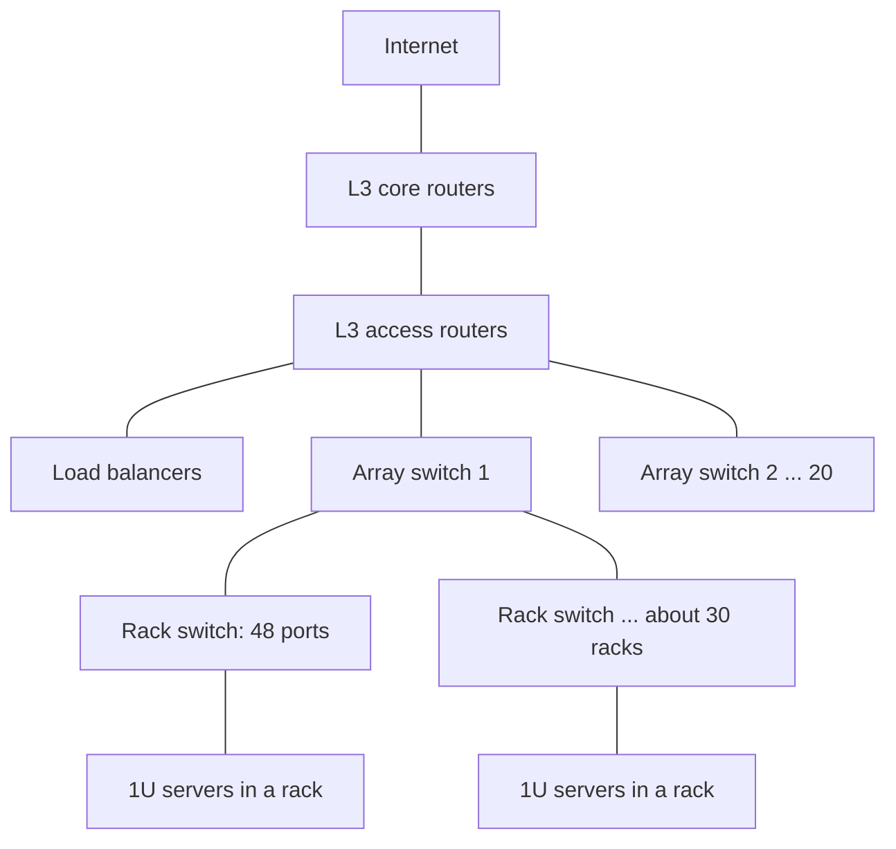

# بخش ۱۰، جلسه‌ی ۱۶ از ۱۸: معماری و زیرساخت فیزیکی WSC

این جلسه بخشی از **بخش ۱۰: موازی‌سازی سطح نخ: چندپردازنده‌ها، انسجام کش، همگام‌سازی، سازگاری حافظه و WSC** است. زمان مطالعه: حدود نیم ساعت.

**فهرست این جلسه:**

- ۱. سلسله‌مراتب شبکه: رک، سوییچ رک، سوییچ آرایه
- ۲. بیش‌اشتراکی (oversubscription)
- ۳. ذخیره‌سازی
- ۴. سلسله‌مراتب حافظه‌ی WSC
- ۵. مثال‌های کتاب: تأخیر میانگین و انتقال داده
- ۶. مکان و توزیع برق
- ۷. سرمایش
- ۸. چند سرور در یک WSC
- ۹. معیار PUE
- ۱۰. تأخیر از دید کاربر و SLO
- ۱۱. تمرین‌ها

---

## ۱. سلسله‌مراتب شبکه: رک، سوییچ رک، سوییچ آرایه

**شبکه‌ها بافت پیوندی** ۵۰ هزار سرورند. مشابه سلسله‌مراتب حافظه (بخش ۶)، WSC از **سلسله‌مراتب شبکه** استفاده می‌کند. ایده‌آل: کارایی یک سوییچ سفارشی پیشرفته برای ۵۰ هزار سرور، با هزینه‌ی هر درگاه یک سوییچ معمولی ۵۰ درگاهی. راه‌حل‌های فعلی خیلی با این ایده‌آل فاصله دارند.

- **رک (rack):** استاندارد ۱۹ اینچی (۴۸.۲۶ سانتی‌متر) هنوز چارچوب نگهداری سرورهاست؛ استانداردی که به سخت‌افزار راه‌آهن دهه‌ی ۱۹۳۰ برمی‌گردد. سرورها بر حسب **واحد رک (U)** اندازه‌گیری می‌شوند: یک U برابر ۱.۷۵ اینچ (۴.۴۵ سانتی‌متر) است. رک ۷ فوتی (۲۱۳ سانتی‌متر) ۴۸ U جا دارد.
- **سوییچ رک (rack switch):** پس تصادفی نیست که محبوب‌ترین سوییچ رک یک سوییچ اترنت **۴۸ درگاهی** است؛ کالایی ارزان با حدود **۳۰ دلار برای هر درگاه** یک گیگابیتی در ۲۰۱۱. درون رک پهنای باند برای همه‌ی سرورها یکسان است، پس از دید نرم‌افزار مهم نیست فرستنده و گیرنده کجای رک باشند.
- **سوییچ آرایه (array switch):** رک‌ها را به هم وصل می‌کند. کتاب برای پرهیز از ابهام واژه‌ی «خوشه»، مجموعه‌ای از رک‌ها (حدود ۳۰ رک) را **آرایه (array)** می‌نامد.
- **مسیریاب‌های لایه‌ی ۳:** WSC برای رسیدن به ۵۰ هزار سرور حدود ۲۰ آرایه لازم دارد، پس یک سطح دیگر: مسیریاب‌های لایه‌ی ۳ آرایه‌ها را به هم و به اینترنت وصل می‌کنند، همراه با **متعادل‌کننده‌ی بار (load balancer)**.



## ۲. بیش‌اشتراکی (oversubscription)

سوییچ رک معمولاً **۲ تا ۸ پیوند بالادستی** به سوییچ سطح بالاتر دارد. پس پهنای باندی که از رک خارج می‌شود **۶ تا ۲۴ برابر** کمتر از پهنای باند درون رک است (48/8 تا 48/2). به این نسبت **بیش‌اشتراکی** می‌گویند (اسلاید: پیوند بالادستی 48/n برابر پهنای باند کمتری دارد که n تعداد درگاه‌های بالادستی است).

پیامد: برنامه‌نویس باید وقتی فرستنده و گیرنده در رک‌های متفاوت‌اند، از اثر کارایی آگاه باشد. **هدف: بیشینه کردن محلی بودن ارتباط نسبت به رک.** این بار اضافه‌ی زمان‌بندی نرم‌افزار دلیل دیگری برای سوییچ‌های ویژه‌ی مرکز داده است.

**گرانی سوییچ آرایه:**

- سوییچی با **۱۰ برابر پهنای باند دونیمه (bisection bandwidth)** (بدترین پهنای باند داخلی) سوییچ رک، حدود **۱۰۰ برابر** گران‌تر است. اسلاید: سوییچ آرایه باید ۱۰ برابر پهنای باند دونیمه‌ی سوییچ رک را داشته باشد.
- یک دلیل: هزینه‌ی پهنای باند سوییچ برای n درگاه می‌تواند با **n²** رشد کند.
- دلیل دیگر: حاشیه‌ی سود بالا و قابلیت‌هایی مثل بازرسی بسته که با نرخ خیلی بالا گران‌اند. این سوییچ‌ها مصرف‌کننده‌ی بزرگ **حافظه‌ی محتواآدرس‌پذیر (CAM)** و **FPGA** هستند، اما این قابلیت‌ها درون مرکز داده معمولاً بی‌استفاده‌اند.

## ۳. ذخیره‌سازی

دو گزینه:

- **دیسک‌های محلی درون هر سرور** و دسترسی به دیسک سرورهای دیگر از طریق اترنت.
- **ذخیره‌ساز متصل به شبکه (NAS)**، شاید روی شبکه‌ای مثل Infiniband؛ گران‌تر برای هر ترابایت، اما با قابلیت‌هایی مثل RAID.

با همان فلسفه‌ی جلسه‌ی قبل، WSC معمولاً به **دیسک‌های محلی** تکیه می‌کند و نرم‌افزار ذخیره‌سازی ارتباط و اتکاپذیری را مدیریت می‌کند. سیستم GFS دست‌کم **سه نسخه** نگه می‌دارد. این افزونگی نه فقط خرابی دیسک محلی، بلکه **قطع برق یک رک یا کل آرایه** را هم پوشش می‌دهد. سازگاری نهایی GFS هزینه‌ی سازگار نگه داشتن نسخه‌ها و پهنای باند شبکه‌ی لازم را کم می‌کند.

## ۴. سلسله‌مراتب حافظه‌ی WSC

فرض‌های کتاب (Barroso و Hölzle):

- **هر سرور:** ۱۶ گیگابایت حافظه با دسترسی ۱۰۰ نانوثانیه و ۲۰ گیگابایت بر ثانیه، و ۲ ترابایت دیسک با دسترسی ۱۰ میلی‌ثانیه و ۲۰۰ مگابایت بر ثانیه. دو سوکت روی برد که یک درگاه اترنت یک گیگابیتی را شریک‌اند.
- **هر جفت رک:** یک سوییچ رک و ۸۰ سرور ۲U. نرم‌افزار شبکه و سربار سوییچ تأخیر DRAM را به ۱۰۰ میکروثانیه و دیسک را به ۱۱ میلی‌ثانیه می‌رساند. اترنت یک گیگابیتی پهنای باند دور را به ۱۰۰ مگابایت بر ثانیه محدود می‌کند.
- **آرایه:** ۳۰ رک. تأخیر DRAM درون آرایه ۳۰۰ میکروثانیه (کتاب در متن ۵۰۰ هم نوشته) و دیسک ۱۲ میلی‌ثانیه. پهنای باند به ۱۰ مگابایت بر ثانیه محدود.

| مقدار | محلی | رک | آرایه |
|---|---|---|---|
| تأخیر DRAM (میکروثانیه) | ۰.۱ | ۱۰۰ | ۳۰۰ |
| تأخیر دیسک (میکروثانیه) | ۱۰۰۰۰ | ۱۱۰۰۰ | ۱۲۰۰۰ |
| پهنای باند DRAM (مگابایت بر ثانیه) | ۲۰۰۰۰ | ۱۰۰ | ۱۰ |
| پهنای باند دیسک (مگابایت بر ثانیه) | ۲۰۰ | ۱۰۰ | ۱۰ |
| ظرفیت DRAM (گیگابایت) | ۱۶ | ۱۰۴۰ | ۳۱۲۰۰ |
| ظرفیت دیسک (گیگابایت) | ۲۰۰۰ | ۱۶۰۰۰۰ | ۴۸۰۰۰۰۰ |

> **اختلاف در خود کتاب:** جدول تأخیر DRAM آرایه را ۳۰۰ میکروثانیه می‌دهد اما متن فرض‌ها ۵۰۰ میکروثانیه می‌گوید. مثال بعدی کتاب از ۳۰۰ استفاده می‌کند؛ ما هم همان را به کار می‌بریم.

مشاهده‌ها:

- **سربار شبکه** تأخیر DRAM رک و آرایه را خیلی بالا می‌برد، اما هر دو هنوز بیش از **۱۰ برابر** تأخیر بهتری از دیسک محلی دارند.
- **شبکه تفاوت پهنای باند** بین DRAM و دیسک رک (و آرایه) را **از بین می‌برد.**
- **پهنای باند DRAM** درون سرور ۲۰۰ برابر درون رک است که خودش ۱۰ برابر درون آرایه است؛ پس نوع دیگری از محلی بودن در جای‌گذاری داده و برنامه مهم است.
- **تقسیم داده (sharding):** بیشتر برنامه‌ها در یک آرایه جا می‌شوند؛ آن‌هایی که بیشتر لازم دارند داده را به تکه‌های مستقل تقسیم و در آرایه‌های مختلف پخش می‌کنند. عمل‌ها روی کل داده به سرورهای تکه‌ها فرستاده می‌شوند و کلاینت نتیجه‌ها را ترکیب می‌کند.

اسلاید درس این را این‌طور خلاصه می‌کند: سرورها می‌توانند با یک رابط شبیه NUMA به DRAM و دیسک سرورهای دیگر دسترسی داشته باشند. این را با DSM جلسه‌ی ۱ مقایسه کن: همان ایده‌ی دسترسی غیریکسان، اما با نرم‌افزار به جای سخت‌افزار انسجام.

## ۵. مثال‌های کتاب: تأخیر میانگین و انتقال داده

**مثال ۱:** اگر ۹۰٪ دسترسی‌ها محلی، ۹٪ بیرون سرور اما درون رک، و ۱٪ بیرون رک اما درون آرایه باشد، تأخیر میانگین حافظه چقدر است؟

```math
(0.90 \times 0.1) + (0.09 \times 100) + (0.01 \times 300) = 0.09 + 9 + 3 = 12.09 \ \mu s
```

یعنی بیش از **۱۲۰ برابر** کندتر از حالت کاملاً محلی. محلی بودن دسترسی درون سرور برای کارایی WSC حیاتی است.

**مثال ۲:** انتقال ۱۰۰۰ مگابایت بین دیسک‌ها و بین DRAM ها، درون سرور، درون رک و درون آرایه:

| مسیر | دیسک به دیسک | حافظه به حافظه |
|---|---|---|
| درون سرور | 1000/200 = 5 ثانیه | 1000/20000 = 0.05 ثانیه |
| درون رک | 1000/100 = 10 ثانیه | 1000/100 = 10 ثانیه |
| درون آرایه | 1000/10 = 100 ثانیه | 1000/10 = 100 ثانیه |

برای انتقال بلوکی بیرون از یک سرور، **حتی مهم نیست داده در حافظه باشد یا دیسک**، چون سوییچ رک و آرایه گلوگاه‌اند. این محدودیت‌ها طراحی نرم‌افزار WSC را شکل می‌دهند و نیاز به سوییچ‌های پرکاراتر را نشان می‌دهند.

## ۶. مکان و توزیع برق

**مکان WSC:** نزدیکی به فیبرهای اصلی اینترنت، برق ارزان، خطر کم بلایای طبیعی (زلزله، سیل، طوفان)، نزدیکی به جمعیت کاربران برای تأخیر کمتر، و نرخ مالیات.

هزینه‌ی زیرساخت **توزیع برق و سرمایش** خیلی بیشتر از هزینه‌ی ساخت ساختمان است. در آمریکای شمالی برق حدود **پنج قدم و چهار تغییر ولتاژ** را از خط ۱۱۵ هزار ولتی تا سرور طی می‌کند:

| قدم | کار | بازده |
|---|---|---|
| قدم ۱: پست برق | تبدیل ۱۱۵ کیلوولت به ولتاژ متوسط ۱۳.۲ کیلوولت | ۹۹.۷٪ |
| قدم ۲: منبع تغذیه‌ی بدون وقفه (UPS) | ژنراتورهای دیزل بزرگ، باتری یا چرخ طیار برای فاصله‌ی قطع برق تا آماده شدن دیزل | ۹۴٪ |
| قدم ۳: واحد توزیع برق (PDU) | تبدیل به سه‌فاز ۴۸۰ ولت؛ هر PDU حدود ۷۵ تا ۲۲۵ کیلووات یا حدود ۱۰ رک | ۹۸٪ |
| قدم ۴: ترانسفورماتور | تبدیل به ۲۰۸ ولت قابل استفاده برای سرور | ۹۸٪ |
| قدم ۵: اتصال‌ها، کلیدها و سیم‌کشی تا سرور | | ۹۹٪ |

```math
0.997 \times 0.94 \times 0.98 \times 0.98 \times 0.99 \approx 0.89
```

پس بازده کل **۸۹٪** است و فقط کمی بیش از ۱۰٪ جا برای بهبود هست (اسلاید: بهترین بهبود ۱۱٪).

سه نقش UPS: **تنظیم توان** (حفظ سطح ولتاژ و ویژگی‌های دیگر)، **نگه داشتن بار** تا ژنراتورها روشن شوند، و **نگه داشتن بار** هنگام برگشت از ژنراتور به شبکه‌ی برق. این UPS بزرگ ۶٪ توان را هدر می‌دهد و ۷ تا ۱۲٪ هزینه‌ی همه‌ی تجهیزات IT را دارد.

## ۷. سرمایش

فرصت بهبود در سرمایش خیلی بیشتر است.

- **واحد تهویه‌ی اتاق کامپیوتر (CRAC):** هوای اتاق سرور را با آب سرد خنک می‌کند، مثل یخچال. فن‌ها هوای گرم را از روی لوله‌های آب سرد عبور می‌دهند و پمپ آب گرم را به **چیلر (chiller)** بیرونی می‌برد. هوای سرد معمولاً **۱۸ تا ۲۲ درجه‌ی سانتی‌گراد** (۶۴ تا ۷۱ فارنهایت) است.
- **دمای بالاتر:** یکی از ساده‌ترین راه‌های بهبود بازده، کار کردن تجهیزات در دمای بالاتر است تا هوا کمتر خنک شود. اسلاید: دما را بالاتر (نزدیک ۲۲ درجه) نگه دار. بعضی WSC ها خیلی بالاتر از ۲۲ درجه کار می‌کنند.
- **برج خنک‌کننده:** از هوای سرد بیرون برای خنک کردن آب قبل از چیلر استفاده می‌کند. آب گرم روی سطح بزرگی جریان پیدا می‌کند و با تبخیر خنک می‌شود. دمای مهم، **دمای حباب‌تر (wet-bulb temperature)** است: کمترین دمایی که با تبخیر آب به دست می‌آید. مرکز گوگل در بلژیک از آب سرد یک کانال صنعتی برای خنک کردن آب گرم استفاده می‌کند.
- **راهروهای سرد و گرم:** رک‌ها در ردیف‌های متناوب در جهت مخالف چیده می‌شوند تا هوای سرد با هوای گرم مخلوط نشود.
- **مصرف آب:** یک مرکز ۸ مگاواتی ممکن است روزانه **۷۰ هزار تا ۲۰۰ هزار گالن** آب مصرف کند (تبخیر و ریزش).

توان نسبی تجهیزات سرمایش به تجهیزات IT در یک مرکز داده‌ی معمولی:

| تجهیز | درصد توان IT |
|---|---|
| چیلرها | ۳۰ تا ۵۰٪ |
| واحدهای CRAC (عمدتاً فن‌ها) | ۱۰ تا ۲۰٪ |

## ۸. چند سرور در یک WSC

**توان نام‌پلاک (nameplate power):** بیشینه‌ی توانی که سرور می‌تواند بکشد؛ همیشه محافظه‌کارانه است. قدم اول: اندازه‌گیری یک سرور زیر بارهای واقعی. شبکه حدود ۵٪ توان است و در شروع قابل چشم‌پوشی است.

تقسیم ساده‌ی توان موجود IT بر توان اندازه‌گیری‌شده‌ی سرور هم محافظه‌کارانه است: هیچ بار واقعی هزاران سرور را **همزمان** در اوج نگه نمی‌دارد. پژوهشگران گوگل، Fan، Weber و Barroso (۲۰۰۷) دریافتند می‌شود تعداد سرورها را تا **۴۰٪ بیش‌اشتراک** کرد، به شرط نرم‌افزار پایش گسترده و سازوکار ایمنی که در صورت تغییر بار، کارهای کم‌اولویت را متوقف کند.

تقسیم توان درون تجهیزات IT در یک WSC گوگل (۲۰۰۷):

| جزء | سهم توان |
|---|---|
| پردازنده‌ها | ۳۳٪ |
| حافظه‌ی DRAM | ۳۰٪ |
| دیسک‌ها | ۱۰٪ |
| شبکه | ۵٪ |
| موارد دیگر درون سرور | ۲۲٪ |

## ۹. معیار PUE

معیار ساده و رایج بازده مرکز داده، **اثربخشی مصرف توان (Power Utilization Effectiveness یا PUE)** است:

```math
\text{PUE} = \frac{\text{Total facility power}}{\text{IT equipment power}}
```

پس PUE همیشه دست‌کم ۱ است و هر چه بزرگ‌تر، WSC ناکاراتر. مطالعه‌ی ۱۹ مرکز داده در ۲۰۰۶: **میانه‌ی PUE برابر ۱.۶۹**، و زیرساخت سرمایش بیش از نصف توان خود سرورها را مصرف می‌کرد (به طور میانگین ۰.۵۵ از ۱.۶۹ برای سرمایش). مقدارهای PUE از ۱.۳۳ تا ۳.۰۳ بودند. این‌ها میانگین‌اند و PUE روزانه با بار و حتی دمای هوای بیرون تغییر می‌کند.

> **اختلاف اسلاید:** اسلاید درس نام معیار را «PEU» نوشته که غلط تایپی است؛ درستش PUE است. همچنین کتاب آن را «power utilization effectiveness» می‌نامد، در حالی که نام رایج‌تر «power usage effectiveness» است؛ هر دو یک معیارند.

## ۱۰. تأخیر از دید کاربر و SLO

طراحان WSC اغلب روی **پهنای باند** تمرکز می‌کنند، اما برنامه‌نویسان نگران **تأخیر** هم هستند، چون تأخیر برای کاربر دیده می‌شود. مطالعه‌های دوره‌ی اشتراک زمانی: بهره‌وری کاربر با زمان تعامل نسبت عکس دارد؛ کاهش ۳۰٪ زمان پاسخ سیستم، زمان تعامل را ۷۰٪ کم کرد، چون با پاسخ سریع‌تر کاربر حواسش پرت نمی‌شود.

آزمایش موتور جستجوی Bing با تأخیر مصنوعی در سرور:

| تأخیر سرور (میلی‌ثانیه) | افزایش زمان تا کلیک بعدی (میلی‌ثانیه) | کلیک به ازای کاربر | رضایت کاربر | درآمد به ازای کاربر |
|---|---|---|---|---|
| تأخیر ۵۰ | ناچیز | ناچیز | ناچیز | ناچیز |
| تأخیر ۲۰۰ | ۵۰۰ | ۰.۳٪ کمتر | ۰.۴٪ کمتر | ناچیز |
| تأخیر ۵۰۰ | ۱۲۰۰ | ۱.۰٪ کمتر | ۰.۹٪ کمتر | ۱.۲٪ کمتر |
| تأخیر ۱۰۰۰ | ۱۹۰۰ | ۱.۹٪ کمتر | ۱.۶٪ کمتر | ۲.۸٪ کمتر |
| تأخیر ۲۰۰۰ | ۳۱۰۰ | ۴.۴٪ کمتر | ۳.۸٪ کمتر | ۴.۳٪ کمتر |

زمان تا کلیک بعدی تقریباً **دو برابر** تأخیر زیاد می‌شود. درآمد و رضایت خطی با تأخیر کم می‌شوند. مطالعه‌ی گوگل: اثر تا پنج هفته بعد از پایان آزمایش ماند (۰.۱٪ و ۰.۲٪ جستجوی کمتر برای ۲۰۰ و ۴۰۰ میلی‌ثانیه)، و نتایج آن‌قدر منفی بود که آزمایش زودتر متوقف شد.

به همین دلیل هدف‌های کارایی به جای میانگین، به شکل **درصد بالایی از درخواست‌ها زیر یک آستانه** تعریف می‌شوند: **هدف سطح خدمت (Service Level Objective یا SLO)** یا **توافق سطح خدمت (SLA)**. مثلاً «۹۹٪ درخواست‌ها زیر ۱۰۰ میلی‌ثانیه». طراحان Dynamo در Amazon هدف تأخیر را برای **۹۹.۹٪** درخواست‌ها گذاشتند و یکی از بهبودهای Dynamo صدک ۹۹.۹ را خیلی بیشتر از میانگین بهتر کرد.

## ۱۱. تمرین‌ها

<details><summary>تمرین ۱: بیش‌اشتراکی</summary>

**صورت:** سوییچ رک ۴۸ درگاه دارد که ۴۰ تا به سرور و ۸ تا بالادستی‌اند (همه یک گیگابیتی). نسبت بیش‌اشتراکی چقدر است؟ اگر فقط ۲ درگاه بالادستی باشد چطور؟

**جواب:** با ۸ بالادستی: 40 / 8 = 5، یعنی ۵ به ۱. با ۲ بالادستی (و ۴۰ سرور): 40 / 2 = 20، یعنی ۲۰ به ۱. این دقیقاً دو پیکربندی WSC گوگل است (جلسه‌ی ۱۸).
</details>

<details><summary>تمرین ۲: تأخیر میانگین با محلی بودن بهتر</summary>

**صورت:** در مثال ۱ بخش ۵، اگر ۹۹٪ دسترسی‌ها محلی و ۱٪ درون رک باشد، تأخیر میانگین چقدر است؟

**جواب:** 0.99 × 0.1 + 0.01 × 100 = 0.099 + 1 = 1.1 میکروثانیه. هنوز ۱۱ برابر کندتر از کاملاً محلی؛ حتی ۱٪ دسترسی دور غالب است (مثل جلسه‌ی ۲ که ۰.۲٪ ارجاع دور CPI را تقریباً چهار برابر کرد).
</details>

<details><summary>تمرین ۳: بازده توزیع برق</summary>

**صورت:** اگر UPS متمرکز (۹۴٪) با باتری‌های کنار هر سرور با بازده ۹۹.۹۹٪ جایگزین شود و یک قدم ترانسفورماتور (۹۸٪) هم حذف شود، بازده کل چقدر می‌شود؟

**جواب:** 0.997 × 0.9999 × 0.98 × 0.99 ≈ 0.967، یعنی حدود ۹۷٪ به جای ۸۹٪. این همان کاری است که گوگل و فیسبوک کردند (جلسه‌ی ۱۸).
</details>

<details><summary>تمرین ۴: معیار PUE</summary>

**صورت:** مرکزی ۱۰ مگاوات توان کل مصرف می‌کند که ۶ مگاوات آن به تجهیزات IT می‌رسد. مقدار PUE چقدر است؟ اگر سرمایش ۲.۸ مگاوات از ۴ مگاوات سربار باشد، سهم سرمایش در PUE چقدر است؟

**جواب:** PUE = 10 / 6 ≈ 1.67. سهم سرمایش 2.8 / 6 ≈ 0.47 و سهم بقیه‌ی سربار 1.2 / 6 = 0.2.
</details>

---

جلسه‌ی قبلی: [کامپیوتر در مقیاس انبار: مقدمه و مدل برنامه‌نویسی](10-15-wsc-intro-and-mapreduce.md)  
جلسه‌ی بعدی: [هزینه‌ی WSC و محاسبات ابری](10-17-wsc-costs-and-cloud.md)
