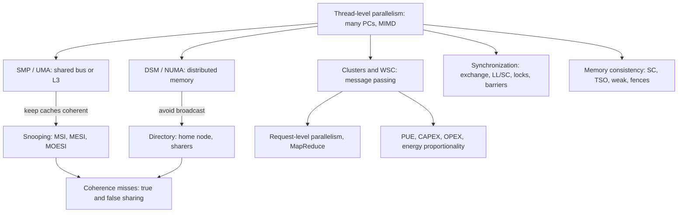

# بخش ۱۰، جلسه‌ی ۱۸ از ۱۸: بهره‌وری انرژی سرور، WSC گوگل، باورهای غلط و جمع‌بندی

این جلسه بخشی از **بخش ۱۰: موازی‌سازی سطح نخ: چندپردازنده‌ها، انسجام کش، همگام‌سازی، سازگاری حافظه و WSC** است. زمان مطالعه: حدود نیم ساعت.

**فهرست این جلسه:**

- ۱. اتلاف انرژی درون سرور
- ۲. تناسب انرژی
- ۳. مرکز WSC گوگل: کانتینر
- ۴. سرمایش و برق در WSC گوگل
- ۵. سرورها، شبکه و تعمیر
- ۶. باورهای غلط و دام‌های WSC
- ۷. سخن پایانی فصل ۶
- ۸. جمع‌بندی بخش
- ۹. واژه‌نامه
- ۱۰. تمرین‌های مروری

---

## ۱. اتلاف انرژی درون سرور

معیار PUE (جلسه‌ی ۱۶) فقط بازده **مرکز** را می‌سنجد و درباره‌ی آنچه درون تجهیزات IT می‌گذرد چیزی نمی‌گوید. یک منبع مهم اتلاف، **منبع تغذیه‌ی درون سرور** است که ۲۰۸ یا ۱۱۰ ولت را به ۳.۳، ۵ و ۱۲ ولت برای تراشه‌ها و دیسک‌ها تبدیل می‌کند؛ ۱۲ ولت روی برد دوباره به ۱.۲ تا ۱.۸ ولت پردازنده و حافظه می‌رسد.

- **در ۲۰۰۷** بسیاری از منابع تغذیه بازده ۶۰ تا ۸۰٪ داشتند؛ یعنی اتلاف درون سرور **بیشتر** از اتلاف کل مسیر از دکل برق تا سرور بود.
- **دلیل‌ها:** منبع تغذیه باید چند ولتاژ مختلف بدهد چون نمی‌داند روی برد چه هست؛ اغلب بزرگ‌تر از نیاز است؛ و معمولاً در **بار ۲۵٪ یا کمتر** بدترین بازده را دارد، در حالی که بیشتر سرورهای WSC در همین محدوده کار می‌کنند. ماژول‌های تنظیم ولتاژ روی برد هم بازده کمی دارند.

استاندارد Climate Savers برای منابع تغذیه‌ی چندخروجی:

| بار | پایه | برنز (ژوئن ۲۰۰۸) | نقره (ژوئن ۲۰۰۹) | طلا (ژوئن ۲۰۱۰) |
|---|---|---|---|---|
| بار ۲۰٪ | ۸۰٪ | ۸۲٪ | ۸۵٪ | ۸۷٪ |
| بار ۵۰٪ | ۸۰٪ | ۸۵٪ | ۸۸٪ | ۹۰٪ |
| بار ۱۰۰٪ | ۸۰٪ | ۸۲٪ | ۸۵٪ | ۸۷٪ |

## ۲. تناسب انرژی

پژوهشگران گوگل، Barroso و Hölzle (۲۰۰۷): هدف کل سرور باید **تناسب انرژی (energy proportionality)** باشد: سرور به نسبت کاری که انجام می‌دهد انرژی مصرف کند. بهترین نتیجه‌ی SPECpower تا ژوئیه‌ی ۲۰۱۰ (HP ProLiant SL2x170z G6، که ۲.۵ برابر بهتر از بقیه‌ی سیستم‌های آن سال بود و حتی SSD کوچک‌تر از حافظه‌اش داشت!) هنوز:

- **در حالت بیکار** تقریباً **۳۰٪** توان کامل را مصرف می‌کرد.
- **در بار ۱۰٪** تقریباً **۵۰٪** توان کامل را مصرف می‌کرد.

پس تناسب انرژی هنوز یک آرمان است نه یک دستاورد. نرم‌افزار سیستمی هم برای استفاده از همه‌ی منابع طراحی شده، بدون توجه به انرژی (مثلاً سیستم‌عامل همه‌ی حافظه را برای کش فایل استفاده می‌کند).

```text
power (W)
 662 |                                              * actual
     |                                     *
     |                          *
 451 |                 *  (50% load)
     |        *
 308 |   *  (10% load)                        . . . ideal energy proportional
 181 |*  (idle)                      . . .
     |                    . . .
   0 +. . . . . . . . . . . . . . . . . . . . . . . . -> load
     0%                  50%                       100%
```

**مثال کتاب:** با داده‌های جلسه‌ی ۱۵، صرفه‌جویی رفتن از پنج سرور با بهره‌برداری ۱۰٪ به یک سرور با بهره‌برداری ۵۰٪ چقدر است؟ یک سرور در بار ۱۰٪ برابر ۳۰۸ وات و در بار ۵۰٪ برابر ۴۵۱ وات است:

```math
\frac{5 \times 308}{451} = \frac{1540}{451} \approx 3.4
```

حدود **۳.۴ برابر**. پس باید وقتی بهره‌برداری کم است سرورها را **تجمیع** کرد، سرورهای با تناسب انرژی بیشتر خرید، یا در دوره‌های کم‌کاری کار مفید دیگری اجرا کرد.

## ۳. مرکز WSC گوگل: کانتینر

گوگل در ۲۰۰۹ یک WSC پیشرفته‌ی ۲۰۰۵ را توصیف کرد و کتاب وضعیت ۲۰۰۷ آن را می‌آورد. گوگل و مایکروسافت WSC را با **کانتینرهای حمل‌ونقل** ساختند تا طراحی **ماژولار** شود: هر کانتینر مستقل است و تنها اتصال‌های بیرونی‌اش شبکه، برق و آب است.

| ویژگی | مقدار |
|---|---|
| تعداد کانتینر | ۴۵ کانتینر ۴۰ فوتی، ۳۰ تا روی هم (۱۵ جفت) |
| فضا | ۷۵ هزار فوت مربع (حدود ۷۰۰۰ متر مربع) |
| توان | ۱۰ مگاوات |
| مقدار PUE در ۱۲ ماه | ۱.۲۳: سربار ۰.۲۳ که ۸۵٪ آن سرمایش (۰.۱۹۵) و ۱۵٪ اتلاف برق (۰.۰۳۵) است |
| ظرفیت هر کانتینر | تا ۲۵۰ کیلووات (میانگین واقعی ۲۲۲) و تا ۱۱۶۰ سرور |
| تعداد سرور | جا برای ۵۲۲۰۰، اما حدود ۴۰ هزار سرور |
| چیدمان | سرورها تا ۲۰ عدد روی هم در دو ردیف بلند ۲۹ رکی در دو طرف کانتینر؛ سوییچ رک ۴۸ درگاهی یک گیگابیتی در هر رک دوم |
| شروع کار | نوامبر ۲۰۰۵ |

## ۴. سرمایش و برق در WSC گوگل

- **جریان هوا:** رک‌ها به سقف کانتینر آویزان‌اند؛ سرمایش زیر کف کاذب است و در راهروی وسط دمیده می‌شود؛ هوای گرم از پشت رک‌ها برمی‌گردد. فضای محدود کانتینر از مخلوط شدن هوای سرد و گرم جلوگیری می‌کند. فن‌ها با سرعت متغیر و کمترین سرعت لازم کار می‌کنند.
- **دمای بالا:** هوای «سرد» **۲۷ درجه‌ی سانتی‌گراد** (۸۱ فارنهایت) نگه داشته می‌شود. دلیل اصلی سرد بودن مراکز داده‌ی سنتی، تجهیزات نیست بلکه جلوگیری از **نقطه‌های داغ** است؛ با کنترل دقیق جریان هوا، کانتینر می‌تواند خیلی گرم‌تر کار کند.
- **برج خنک‌کننده:** چیلرهای بیرونی میان‌بر دارند تا اگر هوا مناسب باشد فقط برج خنک‌کننده آب را خنک کند؛ با دمای داخلی ۲۷ درجه، طبیعت خیلی بیشتر می‌تواند کار را انجام دهد.
- **منبع تغذیه‌ی فقط ۱۲ ولتی:** منبع تغذیه فقط ۱۲ ولت به برد می‌دهد و برد خودش ولتاژهای لازم را (به اندازه‌ی دیسک‌هایش) می‌سازد. بازده منبع تغذیه‌ی ۲۰۰۷ به **۹۲٪** رسید، بالاتر از رده‌ی طلای ۲۰۱۰.
- **منبع بدون وقفه‌ی توزیع‌شده (UPS):** چون فقط ۱۲ ولت لازم است، UPS می‌تواند یک **باتری سرب‌اسیدی استاندارد روی هر سرور** باشد با بازده **۹۹.۹۹٪**، به جای اتاق باتری با ۹۴٪. این UPS همراه با هر ماشین افزوده می‌شود، پس پولی برای ظرفیت اضافه خرج نمی‌شود.
- **بدون DVFS:** تغییر پویای ولتاژ و فرکانس به کار نرفت، چون اثرش روی تأخیر فقط در بارهای خیلی کم قابل قبول بود و صرفه‌جویی کل سیستم خیلی کم بود.
- **اندازه‌گیری:** ترانسفورماتورهای جریان در همه‌ی مدارها برای اندازه‌گیری مصرف واقعی، که تنظیم طراحی را در طول زمان ممکن کرد.

گوگل PUE مراکزش را هر فصل منتشر می‌کند: Google A (همین WSC) ۱.۲۳، Google E با ۱.۱۶ (سرمایش فقط ۰.۱۰۵ و توزیع برق ۰.۰۳۹)، بهترین ۱.۱۲، و میانگین وزنی ۱۲ ماهه تا آوریل ۲۰۰۹ برابر ۱.۱۹. فیسبوک در ۲۰۱۱ مرکزی با PUE **۱.۰۷** اعلام کرد: بدون تهویه و آب سرد، فقط هوای بیرون که فیلتر و با مه‌پاش خنک می‌شود، و منبع تغذیه‌ی سفارشی که یک قدم تبدیل ولتاژ را حذف می‌کند.

## ۵. سرورها، شبکه و تعمیر

**سرور پایه:**

- دو سوکت، هر کدام یک AMD Opteron دوهسته‌ای ۲.۲ گیگاهرتزی؛ ۸ گیگابایت DDR2.
- گذرگاه حافظه عمداً از ۶۶۶ به ۵۳۳ مگاهرتز **کندتر** شده، چون اثر کمی روی کارایی و اثر زیادی روی توان دارد.
- یک کارت شبکه‌ی یک گیگابیتی و یک دیسک؛ توان اوج حدود ۱۶۰ وات و بیکار ۸۵ وات.

**گره ذخیره‌سازی:** یک سینی دوم با ۱۰ دیسک SATA و یک دیسک دیگر روی برد، یعنی ۱۲ دیسک، و یک کارت شبکه‌ی دوم. توان اوج حدود ۳۰۰ وات و بیکار ۱۹۸ وات؛ دو جای رک را می‌گیرد. نسبت تقریباً دو گره محاسبه برای هر گره ذخیره‌سازی؛ Google A در ۲۰۰۷ حدود ۱۹۰ هزار دیسک داشت (تقریباً ۵ دیسک برای هر سرور).

**شبکه:**

- ۴۰ هزار سرور در **سه آرایه** با بیش از ۱۰ هزار سرور (که گوگل آن را cluster می‌نامد).
- سوییچ رک ۴۸ درگاهی: ۴۰ درگاه برای سرورها و ۸ درگاه برای پیوند بالادستی به سوییچ‌های آرایه.
- سوییچ آرایه: تا ۴۸۰ پیوند یک گیگابیتی و چند درگاه ۱۰ گیگابیتی به دو مسیریاب مرکز داده (برای اتکاپذیری).
- تعداد پیوند بالادستی هر سوییچ رک بین ۲ تا ۸: با ۲ پیوند بیش‌اشتراکی **۲۰ به ۱** و برنامه‌های پرترافیک بیرون رک کارایی ضعیف داشتند؛ برای آرایه‌های پرتقاضا طراحی ۸ پیوندی با بیش‌اشتراکی **۵ به ۱** به کار رفت.

**پایش و تعمیر:** برای اینکه یک اپراتور مسئول بیش از ۱۰۰۰ سرور باشد:

- ۱. نرم‌افزار پایش سلامت همه‌ی سرورها و شبکه را دنبال می‌کند و تشخیص‌ها همیشه در حال اجراست.
- ۲. در خرابی، اول راه‌حل‌های خودکار: ری‌استارت و نصب دوباره‌ی نرم‌افزار؛ بیشتر خرابی‌ها همین‌جا حل می‌شوند.
- ۳. ماشین‌های باقیمانده با تشخیص در صف تعمیر قرار می‌گیرند و تکنسین‌ها **دسته‌ای** تعمیر می‌کنند. اگر تشخیص مطمئن باشد (مثلاً دیسک ۳ خراب است)، قطعه بدون بررسی دستی عوض می‌شود.
- ۴. هدف: کمتر از **۱٪** گره‌ها در صف تعمیر دستی. میانگین ماندن در صف یک هفته است، که اهمیت **توان عملیاتی تعمیر** را نشان می‌دهد.

## ۶. باورهای غلط و دام‌های WSC

**باور غلط: فراهم‌کنندگان ابر ضرر می‌کنند.** با قیمت ۰.۶۸ دلار در ساعت برای یک سرور (High-CPU Extra Large) و فروش ۵۰٪ ساعت‌ها: ۰.۳۴ دلار درآمد. با نمونه‌های رزروی: ۰.۴۵ دلار. اگر ۷۵۰ گیگابایت ذخیره‌سازی هم برای هر سرور فروخته شود: ۰.۱۰ دلار دیگر. پس درآمد ۰.۴۴ تا ۰.۵۵ دلار در ساعت در برابر هزینه‌ی ۰.۱۱ دلار، یعنی **حاشیه‌ی سود ناخالص ۷۵ تا ۸۰٪** (با فرض‌های مثالی).

**باور غلط: هزینه‌ی سرمایه‌ای مرکز بیشتر از سرورهایی است که در آن هستند.** نگاه سریع به جدول جلسه‌ی ۱۷ (۸۸ در برابر ۶۷ میلیون دلار) همین را می‌گوید. اما مرکز ۱۰ تا ۱۵ سال عمر دارد و سرورها هر ۳ یا ۴ سال تعویض می‌شوند. در یک دهه: **۷۲ میلیون دلار** برای مرکز و 3.3 × 67 ≈ **۲۲۱ میلیون دلار** برای سرورها، یعنی سه برابر.

**دام: صرفه‌جویی با حالت کم‌توان غیرفعال به جای حالت کم‌توان فعال.** در حالت **غیرفعال** نمی‌شود به DRAM یا دیسک دسترسی داشت و باید به حالت کاملاً فعال برگشت، که زمان و انرژی دارد. سرورها تقریباً همه دست‌کم ۱۰٪ بهره‌برداری دارند: دوره‌های طولانی **کم‌کاری** هست، اما دوره‌های طولانی **بیکاری** نه. در حالت کم‌توان **فعال**، پردازنده با چند برابر کندتر کار می‌کند و برگشت به حالت کامل فقط چند میکروثانیه است.

**دام: پردازنده‌ی خیلی ضعیف برای بهبود هزینه بر کارایی.** قانون امدال در WSC هم صدق می‌کند: هر درخواست بخش ترتیبی دارد که روی سرور کند تأخیر را زیاد می‌کند. نخ‌های بیشتر روی سرورهای کند سخت‌تر زمان‌بندی و متعادل می‌شوند؛ احتمال ۱ در ۱۰۰۰ زمان‌بندی بد با ۱۰ وظیفه مهم نیست اما با ۱۰۰۰ وظیفه که منتظر کندترین هستی مهم است. مطالعه‌ی Reddi و همکاران (۲۰۱۰) روی جستجوی Bing: تأخیر پرس‌وجو روی **Atom حدود سه برابر Xeon** بود؛ Xeon با افزایش بار آرام افت کرد اما Atom به سرعت هدف کیفیت را نقض کرد. چون Bing تا قبل از رسیدن به سقف تأخیر نتایج را بهتر می‌کند، Atom حتی بدون بار در ۱٪ پرس‌وجوها جواب بدتری داد (۲٪ در بار عادی). قاعده‌ی گوگل: **پایین‌رده‌ی سرورهای کلاس سرور.**

**باور غلط: با DRAM بهتر و تحمل خطای نرم‌افزار، به حافظه‌ی ECC نیاز نیست.** ECC هشت بیت به هر ۶۴ بیت اضافه می‌کند (یک نهم هزینه‌ی DRAM). مطالعه‌ی Schroeder، Pinheiro و Weber روی صدها هزار سرور گوگل در ۲.۵ سال: نرخ خرابی **۱۵ تا ۲۵ برابر** عددهای منتشرشده (۲۵ هزار تا ۷۰ هزار خرابی در میلیارد ساعت به ازای هر مگابیت). بیش از ۸٪ DIMM ها خطا داشتند؛ میانگین هر DIMM ۴۰۰۰ خطای قابل تصحیح و ۰.۲ خطای تصحیح‌ناپذیر در سال. حدود یک سوم سرورها هر سال خطای DRAM داشتند، با میانگین ۲۲ هزار خطای قابل تصحیح و یک خطای تصحیح‌ناپذیر؛ یعنی برای آن یک سوم، **هر ۲.۵ ساعت یک خطای حافظه** تصحیح می‌شد (با کدهای قوی chipkill؛ با SECDED ساده خطای تصحیح‌ناپذیر ۴ تا ۱۰ برابر بیشتر می‌شد). با فقط بیت توازن، اگر هر خطا یک ری‌استارت ۵ دقیقه‌ای داشت، یک سوم ماشین‌ها **۲۰٪** وقتشان در ری‌استارت بود و کارایی یک مرکز ۱۵۰ میلیون دلاری حدود ۶٪ کم می‌شد. گوگل در سال‌های اول DRAM بدون توازن داشت و در ۲۰۰۰ یک خطای «گیر کرده در صفر» نمایه‌ی جدید جستجو را خراب کرد و سندهای تصادفی پیشنهاد داد. همین داده‌ها توضیح می‌دهد چرا Fermi (بخش ۹) ECC اضافه کرد.

**باور غلط: خاموش کردن سخت‌افزار در دوره‌های کم‌کاری هزینه بر کارایی را بهتر می‌کند.** طبق جدول OPEX، استهلاک زیرساخت برق و سرمایش ۵۰٪ بیشتر از کل قبض برق ماهانه است. حتی اگر نصف برق صرفه‌جویی شود، OPEX فقط **۷٪** کم می‌شود. پایش هم به پاسخ دادن تجهیزات وابسته است. حکمت رایج: در دوره‌های کم‌کاری کار مفید دیگری اجرا کن (مثل MapReduce برای ساخت نمایه، یا نمونه‌های لحظه‌ای AWS که ۲.۷ تا ۳ برابر ارزان‌ترند).

**باور غلط: جایگزینی همه‌ی دیسک‌ها با Flash هزینه بر کارایی را بهتر می‌کند.** Flash برای خواندن و نوشتن تصادفی زیاد خیلی سریع‌تر است (فیسبوک از SSD به عنوان کش نوشتن با تأخیر به نام Flashcache استفاده کرد). اما در WSC همه‌چیز بر اساس **هزینه بر کارایی** سنجیده می‌شود: Flash دست‌کم ۲۰ برابر گران‌تر برای هر گیگابایت بود (۲ دلار در برابر ۰.۰۹ دلار). پژوهش Narayanan و همکاران دریافتند SSD برای هیچ‌کدام از بارهایشان مقرون‌به‌صرفه نبود؛ Flash باید ظرفیت به ازای دلار را ۳ تا ۳۰۰۰ برابر بهتر کند. حتی با انرژی: یک دیسک یک ترابایتی حدود ۱۰ وات مصرف می‌کند، پس با قاعده‌ی دو دلار برای هر وات‌سال حداکثر **۲۰ دلار در سال** صرفه‌جویی، در حالی که یک ترابایت Flash در ۲۰۱۱ حدود ۲۰۰۰ دلار و دیسک ۹۰ دلار بود.

## ۷. سخن پایانی فصل ۶

- **معماران WSC** ساختن بزرگ‌ترین کامپیوترهای جهان را به ارث برده‌اند و بخش بزرگ فناوری اطلاعات آینده را طراحی می‌کنند که مکمل دستگاه همراه است.
- **محاسبه به عنوان خدمت عمومی:** اقتصاد مقیاس WSC رؤیای قدیمی را محقق کرد؛ هر کسی با ایده‌ی خوب می‌تواند فوراً از هزاران سرور استفاده کند. موانع: استانداردها، حریم خصوصی و رشد پهنای باند اینترنت.
- **انگیزه‌ی اقتصادی برای صرفه‌جویی:** کاربران ابر برای نمونه‌های بیکار پول می‌دهند، پس آن‌ها را رها می‌کنند؛ قیمت‌گذاری بر اساس مصرف استفاده‌ی کارا را تشویق می‌کند، و پژوهشگران می‌توانند هزینه بر کارایی را واقعاً بسنجند و ایده‌ها را در مقیاس هزاران کامپیوتر آزمایش کنند.
- **کارایی بر دلار و کارایی بر ژول** هم سخت‌افزار دستگاه همراه و هم WSC را هدایت می‌کنند، و **موازی‌سازی** کلید رسیدن به هر دو است.

## ۸. جمع‌بندی بخش



| موضوع | پیام اصلی |
|---|---|
| چالش‌ها | قانون امدال (۰.۲۵٪ ترتیبی برای سرعت‌افزایی ۸۰ با ۱۰۰ پردازنده) و تأخیر ارتباط دور (۰.۲٪ ارجاع دور، CPI تقریباً ۴ برابر) |
| انسجام | سه شرط؛ ابطال به جای به‌روزرسانی؛ جاسوسی برای چند هسته، دایرکتوری برای مقیاس بزرگ |
| پروتکل‌ها | پروتکل MSI؛ حالت E در MESI برای داده‌ی خصوصی؛ حالت O در MOESI برای حذف نوشتن در حافظه |
| کارایی | کش بزرگ‌تر عدم اصابت انسجام را کم نمی‌کند؛ اشتراک کاذب با چیدمان داده حذف می‌شود |
| همگام‌سازی | دستور اتمی یا LL و SC؛ قفل آزمون و آزمون و تنظیم؛ رقابت مجذوری؛ قفل صف‌دار، عقب‌نشینی، سد با برگرداندن جهت |
| سازگاری | سازگاری ترتیبی ساده اما کند؛ مدل‌های آزاد با حصار؛ برنامه‌ی همگام‌شده روی هر مدل درست رفتار می‌کند |
| کامپیوتر در مقیاس انبار | موازی‌سازی سطح درخواست؛ خرابی عادی است؛ نرم‌افزار افزونگی می‌سازد؛ برق یک سوم هزینه است |

## ۹. واژه‌نامه

| اصطلاح فارسی | اصطلاح انگلیسی | توضیح کوتاه |
|---|---|---|
| موازی‌سازی سطح نخ | thread-level parallelism | چند جریان دستور با PC جدا |
| چندپردازنده‌ی متقارن | symmetric multiprocessor (SMP) | حافظه‌ی متمرکز با دسترسی یکسان (UMA) |
| حافظه‌ی مشترک توزیع‌شده | distributed shared memory (DSM) | حافظه‌ی فیزیکی پخش و فضای آدرس مشترک (NUMA) |
| ارسال پیام | message passing | ارتباط صریح بین فضاهای آدرس جدا |
| اندازه‌ی دانه | grain size | مقدار کار هر نخ |
| انسجام کش | cache coherence | چه مقدارهایی خواندن یک خانه می‌تواند برگرداند |
| سازگاری حافظه | memory consistency | ترتیب دیده شدن دسترسی‌ها به خانه‌های مختلف |
| ترتیب‌دهی نوشتن‌ها | write serialization | همه نوشتن‌های یک خانه را با یک ترتیب ببینند |
| جاسوسی | snooping | هر کش رسانه‌ی همه‌پخشی را می‌پاید |
| دایرکتوری | directory | وضعیت اشتراک هر بلوک در یک مکان معلوم |
| ابطال در نوشتن | write invalidate | باطل کردن کپی‌های دیگر قبل از نوشتن |
| به‌روزرسانی در نوشتن | write update | پخش هر نوشتن به همه‌ی کپی‌ها |
| عدم اصابت ارتقا | upgrade miss | نوشتن در بلوک مشترک؛ فقط تغییر حالت |
| حالت انحصاری | exclusive state | تنها کپی و تمیز (MESI) |
| حالت مالک | owned state | مالک بلوک کثیف مشترک (MOESI) |
| شمول | inclusion | هر سطح کش زیرمجموعه‌ی سطح بیرونی |
| اشتراک واقعی | true sharing | عدم اصابت ناشی از ارتباط واقعی داده |
| اشتراک کاذب | false sharing | عدم اصابت ناشی از کلمه‌ی دیگر همان بلوک |
| گره خانه | home node | گره‌ای که حافظه و دایرکتوری آدرس را دارد |
| مجموعه‌ی اشتراک‌کننده‌ها | sharers | بردار بیتی گره‌های دارای کپی |
| تبادل اتمی | atomic exchange | جابه‌جایی تقسیم‌ناپذیر ثبات و حافظه |
| بارگذاری پیوندی و ذخیره‌ی شرطی | load linked and store conditional | جفت دستوری که اتمی بودن را تشخیص می‌دهد |
| قفل چرخشی | spin lock | قفلی که در حلقه برای گرفتنش می‌چرخیم |
| قفل صف‌دار | queuing lock | قفل که صریحاً به منتظر بعدی داده می‌شود |
| سد | barrier | انتظار همه تا رسیدن آخرین نخ |
| سازگاری ترتیبی | sequential consistency | ترتیب برنامه برای هر پردازنده و درهم‌آمیختگی دلخواه |
| ترتیب ذخیره‌ی کامل | total store ordering | آزاد بودن ترتیب نوشتن به خواندن |
| مسابقه‌ی داده | data race | دسترسی همزمان بدون ترتیب همگام‌سازی |
| حصار حافظه | fence | دستوری که ترتیب دسترسی‌ها را اعمال می‌کند |
| موازی‌سازی سطح درخواست | request-level parallelism | درخواست‌های مستقل فراوان کاربران |
| کامپیوتر در مقیاس انبار | warehouse-scale computer | ده‌ها هزار سرور مثل یک کامپیوتر |
| بیش‌اشتراکی | oversubscription | پهنای باند بالادستی کمتر از درون رک |
| اثربخشی مصرف توان | PUE | توان کل مرکز تقسیم بر توان IT |
| تناسب انرژی | energy proportionality | مصرف انرژی متناسب با کار |
| هدف سطح خدمت | service level objective (SLO) | درصدی از درخواست‌ها زیر یک آستانه‌ی تأخیر |
| سازگاری نهایی | eventual consistency | نسخه‌ها سرانجام یکی می‌شوند |

## ۱۰. تمرین‌های مروری

<details><summary>تمرین ۱: سؤال جامع انسجام</summary>

**صورت:** سه پردازنده با MESI و کش‌های خالی. دنباله: P0 خواندن X، P0 نوشتن X، P1 خواندن X، P2 نوشتن X، P0 خواندن X. تعداد تراکنش گذرگاه و حالت نهایی را بنویس.

**جواب:** قدم ۱: read miss، P0 در E. قدم ۲: بی‌صدا E به M (بدون تراکنش). قدم ۳: read miss، P0 بلوک را می‌دهد و می‌نویسد؛ P0 و P1 در S. قدم ۴: write miss از P2 (در I است)؛ P0 و P1 باطل؛ P2 در M. قدم ۵: read miss، P2 می‌دهد و می‌نویسد؛ P0 و P2 در S، P1 در I. جمع ۴ تراکنش.
</details>

<details><summary>تمرین ۲: قفل و سازگاری</summary>

**صورت:** چرا آزاد کردن قفل در یک ماشین با سازگاری ضعیف نیاز به حصار یا دستور release دارد، در حالی که روی x86 یک ذخیره‌ی معمولی کافی است؟

**جواب:** آزاد کردن قفل باید بعد از همه‌ی نوشتن‌های بخش بحرانی دیده شود (W → W) و خواندن‌های بخش بحرانی هم باید قبل از آن کامل شده باشند (R → W). روی x86 (شبیه TSO) هر دو ترتیب حفظ می‌شوند، پس ذخیره‌ی معمولی کافی است. در مدل ضعیف این ترتیب‌ها آزادند و باید با release یا حصار اعمال شوند.
</details>

<details><summary>تمرین ۳: هزینه‌ی ابر</summary>

**صورت:** یک شرکت نوپا برای ۲ ساعت در روز ۲۰۰ سرور لازم دارد و بقیه‌ی روز ۱۰ سرور. با قیمت ۰.۱۱ دلار در ساعت برای سرور خودش (که باید ۲۰۰ سرور بخرد و همیشه روشن نگه دارد) و ۰.۶۸ دلار در ابر، هزینه‌ی روزانه را مقایسه کن.

**جواب:** خودش: 200 × 24 × 0.11 = 528 دلار در روز. ابر: (200 × 2 + 10 × 22) × 0.68 = (400 + 220) × 0.68 ≈ 422 دلار در روز. با وجود قیمت ساعتی ۶ برابر، ابر ارزان‌تر است چون فقط برای مصرف پول می‌دهی.
</details>

<details><summary>تمرین ۴: انتخاب محل داده</summary>

**صورت:** یک برنامه ۹۵٪ دسترسی محلی، ۴٪ درون رک و ۱٪ درون آرایه دارد. با تأخیرهای جدول جلسه‌ی ۱۶، تأخیر میانگین را حساب کن. کدام بهبود بیشترین اثر را دارد: نصف کردن دسترسی‌های رک یا نصف کردن دسترسی‌های آرایه؟

**جواب:** میانگین 0.95 × 0.1 + 0.04 × 100 + 0.01 × 300 = 0.095 + 4 + 3 = 7.1 میکروثانیه. نصف کردن رک (۲٪ از رک به محلی): 0.097 + 2 + 3 ≈ 5.1. نصف کردن آرایه (۰.۵٪ به محلی): 0.0955 + 4 + 1.5 ≈ 5.6. نصف کردن دسترسی‌های رک کمی بهتر است.
</details>

<details><summary>تمرین ۵: سؤال تشریحی کوتاه</summary>

**صورت:** در حداکثر سه خط توضیح بده چرا با بزرگ‌تر کردن کش L3 در یک چندپردازنده‌ی تجاری، کارایی بعد از حدی بهتر نمی‌شود.

**جواب:** کش بزرگ‌تر عدم اصابت‌های ظرفیت و تداخل را حذف می‌کند، اما عدم اصابت‌های انسجام (اشتراک واقعی و کاذب) و اجباری را تغییر نمی‌دهد. وقتی این‌ها غالب شوند (در OLTP بعد از ۲ مگابایت)، بزرگ‌تر کردن کش سودی ندارد.
</details>

---

جلسه‌ی قبلی: [هزینه‌ی WSC و محاسبات ابری](10-17-wsc-costs-and-cloud.md)

این آخرین جلسه‌ی آخرین بخش جزوه است. برای مرور کل درس به [فهرست بخش‌ها](../../README.md) برگرد.
