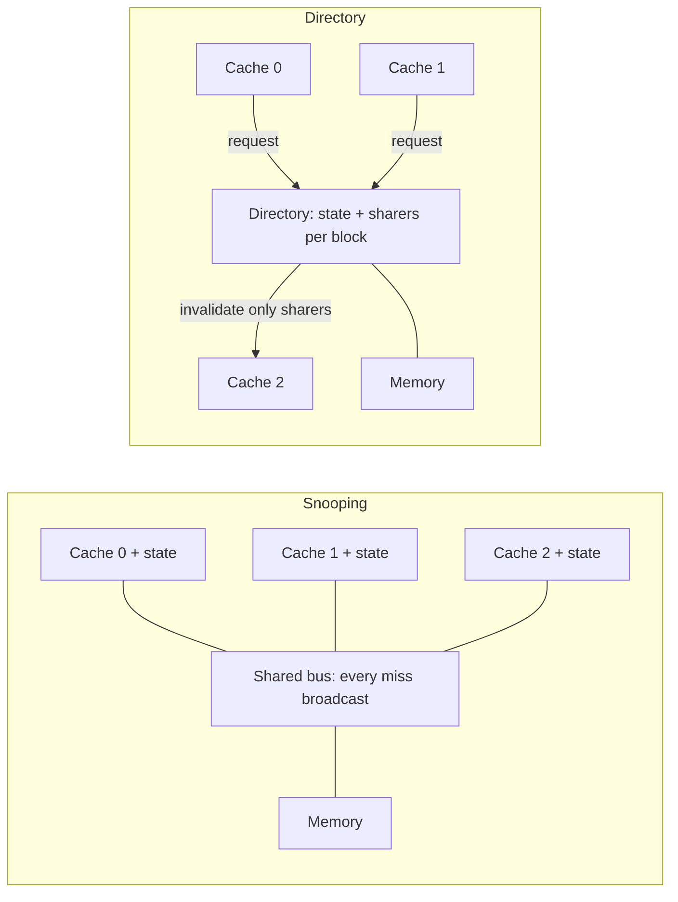

# بخش ۱۰، جلسه‌ی ۳ از ۱۸: مسئله‌ی انسجام کش

این جلسه بخشی از **بخش ۱۰: موازی‌سازی سطح نخ: چندپردازنده‌ها، انسجام کش، همگام‌سازی، سازگاری حافظه و WSC** است. زمان مطالعه: حدود نیم ساعت.

**فهرست این جلسه:**

- ۱. داده‌ی خصوصی و داده‌ی مشترک در کش
- ۲. مسئله‌ی انسجام کش
- ۳. تعریف دقیق انسجام
- ۴. انسجام در برابر سازگاری
- ۵. مهاجرت و تکثیر
- ۶. دو خانواده‌ی پروتکل: دایرکتوری و جاسوسی
- ۷. ابطال در نوشتن در برابر به‌روزرسانی در نوشتن
- ۸. مثال پروتکل ابطال
- ۹. تمرین‌ها

---

## ۱. داده‌ی خصوصی و داده‌ی مشترک در کش

ایده‌ی کلیدی چندپردازنده‌ی حافظه‌متمرکز: **کش‌های بزرگ و چندسطحی** تقاضای پهنای باند حافظه‌ی هر پردازنده را خیلی کم می‌کنند، پس چند پردازنده می‌توانند یک حافظه را به اشتراک بگذارند.

ماشین‌های حافظه‌مشترک معمولاً هر دو نوع داده را کش می‌کنند:

- **داده‌ی خصوصی (private):** فقط یک پردازنده از آن استفاده می‌کند. وقتی کش می‌شود، محلش به کش **مهاجرت** می‌کند. رفتار برنامه دقیقاً مثل تک‌پردازنده است.
- **داده‌ی مشترک (shared):** چند پردازنده از آن استفاده می‌کنند و ارتباط بین پردازنده‌ها از طریق خواندن و نوشتن همین داده است. وقتی کش می‌شود، ممکن است در چند کش **تکثیر** شود. این تکثیر علاوه بر کم کردن تأخیر و پهنای باند، رقابت برای خواندن همزمان را هم کم می‌کند.

اما کش کردن داده‌ی مشترک یک مسئله‌ی جدید می‌سازد: **انسجام کش (cache coherence)**.

## ۲. مسئله‌ی انسجام کش

دید هر پردازنده از حافظه از طریق کش خودش است. بدون احتیاط اضافی، دو پردازنده می‌توانند برای یک خانه **دو مقدار متفاوت** ببینند. مثال کتاب با کش **نوشتن مستقیم (write-through)**:

| زمان | رویداد | کش پردازنده‌ی A | کش پردازنده‌ی B | حافظه برای X |
|---|---|---|---|---|
| زمان ۰ | شروع | خالی | خالی | ۱ |
| زمان ۱ | پردازنده‌ی A خانه‌ی X را می‌خواند | ۱ | خالی | ۱ |
| زمان ۲ | پردازنده‌ی B خانه‌ی X را می‌خواند | ۱ | ۱ | ۱ |
| زمان ۳ | پردازنده‌ی A مقدار ۰ را در X می‌نویسد | ۰ | ۱ | ۰ |

بعد از زمان ۳، اگر B خانه‌ی X را بخواند، از کش خودش مقدار **۱** را می‌گیرد، در حالی که مقدار درست ۰ است! با کش نوشتن با تأخیر (write-back) وضع بدتر است، چون حافظه هم مقدار قدیمی را دارد.

ریشه‌ی مشکل: یک **حالت سراسری** (عمدتاً حافظه‌ی اصلی) و یک **حالت محلی** (کش‌های خصوصی هر هسته) داریم. حتی در چندهسته‌ای که L3 مشترک است، چون L1 و L2 خصوصی‌اند، مسئله وجود دارد و باید حل شود.

## ۳. تعریف دقیق انسجام

تعریف غیررسمی: سیستم حافظه منسجم است اگر هر خواندن یک داده، **آخرین مقدار نوشته‌شده** را برگرداند. این تعریف مبهم است. تعریف دقیق کتاب: سیستم حافظه **منسجم (coherent)** است اگر سه شرط برقرار باشد:

- ۱. **حفظ ترتیب برنامه:** خواندن پردازنده‌ی P از خانه‌ی X که بعد از نوشتن P در X آمده، اگر بین آن‌ها پردازنده‌ی دیگری در X ننوشته باشد، همیشه مقدار نوشته‌شده توسط P را برمی‌گرداند.
- ۲. **دید منسجم:** خواندن یک پردازنده از X که بعد از نوشتن پردازنده‌ی **دیگری** در X آمده، مقدار نوشته‌شده را برمی‌گرداند، **اگر** خواندن و نوشتن به اندازه‌ی کافی از هم فاصله‌ی زمانی داشته باشند و نوشتن دیگری در X بین آن‌ها نباشد.
- ۳. **ترتیب‌دهی نوشتن‌ها (write serialization):** نوشتن‌ها در یک خانه سریال می‌شوند؛ یعنی دو نوشتن در یک خانه توسط هر دو پردازنده‌ای، توسط **همه‌ی پردازنده‌ها با یک ترتیب** دیده می‌شوند. اگر اول ۱ و بعد ۲ در یک خانه نوشته شود، هیچ پردازنده‌ای نباید اول ۲ و بعد ۱ ببیند.

توضیح شرط‌ها:

- **شرط اول** حتی در تک‌پردازنده هم برقرار است.
- **شرط دوم** معنی «دید منسجم» را تعریف می‌کند: اگر پردازنده‌ای بتواند **برای همیشه** مقدار قدیمی را بخواند، حافظه نامنسجم است.
- **شرط سوم** ظریف‌تر است. فرض کن P1 در X بنویسد و بعد P2 در X بنویسد. اگر نوشتن‌ها سریال نشوند، ممکن است پردازنده‌ای اول نوشتن P2 و بعد نوشتن P1 را ببیند و برای همیشه مقدار P1 را نگه دارد، در حالی که مقدار نهایی باید مقدار P2 باشد.

## ۴. انسجام در برابر سازگاری

شرط دوم می‌گوید «اگر به اندازه‌ی کافی فاصله داشته باشند». چرا؟ نمی‌توانیم بخواهیم که خواندن X **بلافاصله** نوشتن پردازنده‌ی دیگر را ببیند: اگر نوشتن فقط کمی قبل از خواندن رخ داده باشد، داده‌ی نوشته‌شده شاید هنوز از پردازنده بیرون نرفته باشد.

| مفهوم | سؤال | قلمرو |
|---|---|---|
| انسجام (coherence) | خواندن **چه مقدارهایی** می‌تواند برگرداند؟ | خواندن و نوشتن در **یک خانه** |
| سازگاری (consistency) | مقدار نوشته‌شده **چه وقت** توسط خواندن دیده می‌شود؟ | ترتیب دسترسی‌ها به **خانه‌های متفاوت** |

اسلاید درس سازگاری را با این مثال توضیح می‌دهد: اگر پردازنده‌ای اول در A و بعد در B بنویسد، هر پردازنده‌ای که مقدار جدید B را ببیند باید مقدار جدید A را هم ببیند.

تا جلسه‌ی ۱۳ دو فرض ساده‌کننده می‌گذاریم:

- **فرض اول:** یک نوشتن تا وقتی همه‌ی پردازنده‌ها اثرش را ندیده‌اند کامل نمی‌شود (و نوشتن بعدی شروع نمی‌شود).
- **فرض دوم:** پردازنده ترتیب هیچ نوشتنی را نسبت به هیچ دسترسی دیگری به حافظه عوض نمی‌کند.

این دو فرض به پردازنده اجازه می‌دهند خواندن‌ها را جابه‌جا کند، اما نوشتن‌ها را مجبور می‌کند به ترتیب برنامه کامل شوند. در جلسه‌ی ۱۳ دقیقاً می‌بینیم این فرض‌ها چه معنی دارند و چه جایگزین‌هایی هست.

## ۵. مهاجرت و تکثیر

مسئله‌ی انسجام در ورودی و خروجی (I/O) هم هست (مثلاً DMA)، اما آنجا کپی‌های متعدد نادر است و می‌شود از آن اجتناب کرد. در چندپردازنده، کپی‌های متعدد **حالت عادی** است. کش‌های منسجم دو خدمت می‌دهند:

- **مهاجرت (migration):** داده به کش محلی منتقل می‌شود و به طور شفاف همان‌جا استفاده می‌شود. تأخیر دسترسی و تقاضای پهنای باند حافظه‌ی مشترک کم می‌شود.
- **تکثیر (replication):** برای داده‌ای که همزمان خوانده می‌شود، هر کش کپی خودش را دارد. تأخیر و رقابت کم می‌شود.

این دو برای کارایی حیاتی‌اند. پس چندپردازنده‌ها به جای حل مسئله در نرم‌افزار (مثلاً کش نکردن داده‌ی مشترک)، یک راه‌حل سخت‌افزاری به کار می‌برند: **پروتکل انسجام کش (cache coherence protocol)**.

## ۶. دو خانواده‌ی پروتکل: دایرکتوری و جاسوسی

کلید پیاده‌سازی پروتکل، **ردیابی وضعیت اشتراک** هر بلوک داده است. دو خانواده:

- **مبتنی بر دایرکتوری (directory based):** وضعیت اشتراک هر بلوک حافظه‌ی فیزیکی در **یک جا** به نام دایرکتوری نگه داشته می‌شود.
  - **در SMP:** یک دایرکتوری متمرکز کنار حافظه یا کنار یک نقطه‌ی سریال‌سازی دیگر، مثل بیرونی‌ترین کش در چندهسته‌ای.
  - **در DSM:** یک دایرکتوری واحد گلوگاه می‌شود، پس دایرکتوری **توزیع‌شده** لازم است (جلسه‌های ۸ و ۹).
- **جاسوسی (snooping):** به جای یک دایرکتوری، **هر کشی** که کپی یک بلوک را دارد وضعیت اشتراک آن را دنبال می‌کند. کش‌ها معمولاً از طریق یک رسانه‌ی همه‌پخشی (مثل گذرگاه) قابل دسترسی‌اند و همه‌ی کنترل‌کننده‌های کش این رسانه را **می‌پایند (snoop)** تا ببینند کپی بلوکی را که درخواست شده دارند یا نه.

پروتکل‌های جاسوسی با چندپردازنده‌های تک‌هسته‌ای که با گذرگاه به یک حافظه وصل بودند محبوب شدند، چون گذرگاه یک رسانه‌ی همه‌پخشی راحت بود. چندهسته‌ای تصویر را عوض کرد: همه‌ی هسته‌ها یک سطح کش مشترک روی تراشه دارند و بعضی طراحی‌ها به دایرکتوری روی آوردند چون سربارش کم بود. ترکیب هم ممکن است: جاسوسی درون تراشه و دایرکتوری بین تراشه‌ها، یا برعکس. این جلسه و سه جلسه‌ی بعد درباره‌ی جاسوسی است و جلسه‌های ۸ و ۹ درباره‌ی دایرکتوری.

## ۷. ابطال در نوشتن در برابر به‌روزرسانی در نوشتن

برای حفظ انسجام دو راه هست:

- **ابطال در نوشتن (write invalidate):** پردازنده قبل از نوشتن، **دسترسی انحصاری** می‌گیرد و همه‌ی کپی‌های دیگر را **باطل** می‌کند. رایج‌ترین روش است.
- **به‌روزرسانی در نوشتن (write update یا write broadcast):** هنگام نوشتن، **همه‌ی کپی‌ها به‌روز می‌شوند.**

| ویژگی | ابطال | به‌روزرسانی |
|---|---|---|
| نوشتن‌های پشت سر هم یک پردازنده در یک بلوک | فقط اولین نوشتن ترافیک دارد | هر نوشتن روی گذرگاه پخش می‌شود |
| خواندن بعدی توسط پردازنده‌ی دیگر | عدم اصابت و انتقال بلوک | اصابت؛ مقدار آماده است |
| پهنای باند | کمتر | خیلی بیشتر |
| استفاده‌ی امروز | تقریباً همه | به ندرت |

چون به‌روزرسانی باید همه‌ی نوشتن‌ها در بلوک‌های مشترک را پخش کند، پهنای باند خیلی بیشتری مصرف می‌کند. پس چندپردازنده‌های جدید ابطال را انتخاب کرده‌اند و بقیه‌ی فصل فقط درباره‌ی ابطال است.

**چرا ابطال ترتیب‌دهی نوشتن‌ها را تضمین می‌کند؟** اگر دو پردازنده همزمان بخواهند در یک داده بنویسند، یکی مسابقه را می‌برد (مثلاً زودتر گذرگاه را می‌گیرد) و کپی دیگری را باطل می‌کند. برای اینکه دومی نوشتنش را کامل کند، باید یک کپی جدید بگیرد که حالا مقدار به‌روز را دارد. پس نوشتن‌ها سریال می‌شوند.

## ۸. مثال پروتکل ابطال

ابطال روی گذرگاه جاسوسی با کش **نوشتن با تأخیر**. فرض: هیچ کشی X را ندارد و مقدار X در حافظه ۰ است. خانه‌ی خالی یعنی کپی ندارد:

| فعالیت پردازنده | فعالیت گذرگاه | کش A | کش B | حافظه برای X |
|---|---|---|---|---|
| شروع | بدون فعالیت | خالی | خالی | ۰ |
| پردازنده‌ی A خانه‌ی X را می‌خواند | عدم اصابت کش برای X | ۰ | خالی | ۰ |
| پردازنده‌ی B خانه‌ی X را می‌خواند | عدم اصابت کش برای X | ۰ | ۰ | ۰ |
| پردازنده‌ی A مقدار ۱ را در X می‌نویسد | ابطال برای X | ۱ | خالی | ۰ |
| پردازنده‌ی B خانه‌ی X را می‌خواند | عدم اصابت کش برای X | ۱ | ۱ | ۱ |

در عدم اصابت دوم B، پردازنده‌ی A که نسخه‌ی تغییریافته را دارد **جواب می‌دهد** و پاسخ حافظه را لغو می‌کند. همزمان کش B و حافظه هر دو به‌روز می‌شوند. این به‌روزرسانی حافظه هنگام اشتراکی شدن بلوک پروتکل را ساده می‌کند. راه دیگر این است که مالکیت را دنبال کنیم و نوشتن در حافظه را فقط هنگام جایگزینی بلوک انجام دهیم؛ این کار حالت اضافه‌ای به نام **مالک (Owned)** می‌خواهد که در جلسه‌ی ۶ می‌بینیم.

در چندهسته‌ای با L3 مشترک، همه‌ی حافظه از دید هسته‌ها از طریق L3 دیده می‌شود: L3 نقش «حافظه» را در این مثال دارد و انسجام باید برای L1 و L2 خصوصی هر هسته رعایت شود.

## ۹. تمرین‌ها

تمرین ۱: کدام شرط نقض شده

**صورت:** در یک سیستم، P1 مقدار ۵ را در X می‌نویسد و بعد P2 مقدار ۷ را در X می‌نویسد. پردازنده‌ی P3 اول ۷ و بعد ۵ را می‌خواند، و P4 اول ۵ و بعد ۷ را. کدام شرط انسجام نقض شده است؟

**جواب:** شرط سوم (ترتیب‌دهی نوشتن‌ها). دو پردازنده دو نوشتن یک خانه را با دو ترتیب متفاوت دیده‌اند.

تمرین ۲: انسجام یا سازگاری

**صورت:** P1 می‌نویسد `A = 1; flag = 1;` و P2 منتظر می‌ماند تا `flag == 1` شود و بعد A را می‌خواند و ۰ می‌بیند. این مشکل انسجام است یا سازگاری؟

**جواب:** سازگاری. هر کدام از A و flag به تنهایی ممکن است منسجم باشند؛ مشکل در ترتیب دیده شدن نوشتن‌ها در **دو خانه‌ی متفاوت** است. این دقیقاً موضوع جلسه‌ی ۱۳ است.

تمرین ۳: ترافیک ابطال و به‌روزرسانی

**صورت:** P1 ده بار پشت سر هم در کلمه‌ی X می‌نویسد و بعد P2 یک بار X را می‌خواند. فرض کن قبلاً هر دو X را در حالت اشتراکی داشتند. تعداد تراکنش گذرگاه در ابطال و به‌روزرسانی چقدر است؟

**جواب:** ابطال: یک ابطال برای اولین نوشتن، بعد ۹ نوشتن محلی بدون ترافیک، و یک عدم اصابت برای خواندن P2؛ جمعاً ۲ تراکنش. به‌روزرسانی: هر ۱۰ نوشتن پخش می‌شوند و خواندن P2 اصابت است؛ جمعاً ۱۰ تراکنش.

تمرین ۴: الگویی که به‌روزرسانی را ترجیح می‌دهد

**صورت:** یک الگوی تولیدکننده و مصرف‌کننده مثال بزن که در آن به‌روزرسانی بهتر از ابطال است.

**جواب:** P1 در هر دور یک بار X را می‌نویسد و سه پردازنده‌ی دیگر هر کدام یک بار X را می‌خوانند. با ابطال: یک ابطال و سه عدم اصابت (۴ تراکنش و سه تأخیر عدم اصابت). با به‌روزرسانی: یک پخش و سه اصابت. وقتی هر نوشتن توسط چند خواننده مصرف شود، به‌روزرسانی بهتر است.

---

جلسه‌ی قبلی: [چالش‌های پردازش موازی](10-2-parallel-processing-challenges.md)  
جلسه‌ی بعدی: [پروتکل جاسوسی MSI](10-4-snooping-msi-protocol.md)
