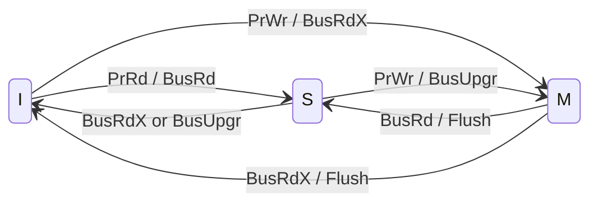

# بخش ۱۰، جلسه‌ی ۴ از ۱۸: پروتکل جاسوسی MSI

این جلسه بخشی از **بخش ۱۰: موازی‌سازی سطح نخ: چندپردازنده‌ها، انسجام کش، همگام‌سازی، سازگاری حافظه و WSC** است. زمان مطالعه: حدود نیم ساعت.

**فهرست این جلسه:**

- ۱. پیاده‌سازی پایه: گذرگاه به عنوان نقطه‌ی سریال‌سازی
- ۲. پیدا کردن آخرین مقدار در عدم اصابت
- ۳. بیت اشتراک و مالک بلوک
- ۴. تداخل جاسوسی با پردازنده
- ۵. سه حالت MSI
- ۶. جدول درخواست‌ها و پاسخ‌ها
- ۷. نمودار حالت
- ۸. چرا این پروتکل درست است
- ۹. تمرین‌ها

---

## ۱. پیاده‌سازی پایه: گذرگاه به عنوان نقطه‌ی سریال‌سازی

کلید پیاده‌سازی پروتکل ابطال در چندهسته‌ای، استفاده از **گذرگاه** یا یک رسانه‌ی همه‌پخشی دیگر است. در چندپردازنده‌های چندتراشه‌ای قدیمی، گذرگاه همان گذرگاه دسترسی به حافظه بود. در چندهسته‌ای، گذرگاه می‌تواند اتصال بین کش‌های خصوصی (L1 و L2 در Core i7) و کش مشترک بیرونی (L3) باشد.

ابطال این‌طور انجام می‌شود:

- ۱. پردازنده **دسترسی به گذرگاه** را می‌گیرد.
- ۲. **آدرس** بلوکی را که باید باطل شود روی گذرگاه پخش می‌کند.
- ۳. همه‌ی پردازنده‌ها پیوسته گذرگاه را **می‌پایند** و بررسی می‌کنند آیا آن آدرس در کششان هست. اگر هست، کپی را باطل می‌کنند.

اگر دو پردازنده همزمان بخواهند در بلوک‌های مشترک بنویسند، تلاششان برای پخش ابطال هنگام **داوری (arbitration)** گذرگاه سریال می‌شود. اولین پردازنده‌ای که گذرگاه را بگیرد کپی‌های دیگر را باطل می‌کند. یک نتیجه‌ی مهم:

> نوشتن در یک داده‌ی مشترک تا وقتی گذرگاه را نگرفته **کامل نمی‌شود.**

همه‌ی روش‌های انسجام به یک راه برای سریال کردن دسترسی‌ها به یک بلوک نیاز دارند: یا سریال کردن دسترسی به رسانه‌ی ارتباطی، یا یک ساختار مشترک دیگر.

## ۲. پیدا کردن آخرین مقدار در عدم اصابت

علاوه بر ابطال، باید در عدم اصابت **آخرین مقدار** داده را پیدا کنیم:

- **کش نوشتن مستقیم:** ساده است؛ همه‌ی داده‌های نوشته‌شده همیشه به حافظه می‌روند، پس آخرین مقدار همیشه در حافظه است. بافر نوشتن کمی پیچیدگی اضافه می‌کند و باید مثل مدخل‌های اضافه‌ی کش با آن رفتار کرد.
- **کش نوشتن با تأخیر:** سخت‌تر است، چون آخرین مقدار ممکن است در کش خصوصی یک پردازنده باشد، نه در کش مشترک یا حافظه.

خوشبختانه کش نوشتن با تأخیر می‌تواند از **همان جاسوسی** برای عدم اصابت هم استفاده کند: هر پردازنده همه‌ی آدرس‌های روی گذرگاه را می‌پاید. اگر پردازنده‌ای ببیند کپی **کثیف (dirty)** بلوک درخواستی را دارد، آن بلوک را در پاسخ به درخواست خواندن فراهم می‌کند و دسترسی به حافظه (یا L3) را **لغو** می‌کند. پیچیدگی اضافه این است که گرفتن بلوک از کش خصوصی پردازنده‌ی دیگر ممکن است از گرفتن از L3 کندتر باشد.

چون کش نوشتن با تأخیر تقاضای پهنای باند کمتری دارد، می‌تواند پردازنده‌های بیشتر و سریع‌تری را پشتیبانی کند. پس **همه‌ی چندهسته‌ای‌ها در بیرونی‌ترین سطح‌های کش از نوشتن با تأخیر استفاده می‌کنند** و ما هم انسجام را برای این نوع کش بررسی می‌کنیم.

## ۳. بیت اشتراک و مالک بلوک

برچسب‌های عادی کش برای جاسوسی کافی‌اند و بیت معتبر ابطال را ساده می‌کند. برای نوشتن، می‌خواهیم بدانیم آیا کپی دیگری از بلوک در کش‌های دیگر هست؛ اگر نیست، در کش نوشتن با تأخیر **لازم نیست نوشتن روی گذرگاه برود**. این هم زمان نوشتن و هم پهنای باند را کم می‌کند.

راه‌حل: یک **بیت حالت اضافه** برای هر بلوک، مثل بیت معتبر و بیت کثیف، که نشان می‌دهد بلوک **مشترک** است یا نه:

- **نوشتن در بلوک مشترک:** کش یک ابطال روی گذرگاه می‌فرستد و بلوک را **انحصاری** علامت می‌زند. آن هسته برای این بلوک دیگر ابطالی نمی‌فرستد.
- **مالک (owner):** هسته‌ای که تنها کپی بلوک را دارد، معمولاً مالک بلوک نامیده می‌شود.
- **برگشت به حالت مشترک:** اگر پردازنده‌ی دیگری بعداً این بلوک را درخواست کند، حالت باید دوباره مشترک شود. چون کش جاسوس همه‌ی عدم اصابت‌ها را می‌بیند، می‌فهمد چه وقت بلوک انحصاری‌اش درخواست شده است.

## ۴. تداخل جاسوسی با پردازنده

هر تراکنش گذرگاه باید برچسب‌های آدرس کش را بررسی کند، و این ممکن است با دسترسی‌های خود پردازنده به کش تداخل کند. دو راه‌حل:

- **تکثیر برچسب‌ها (duplicate tags):** یک کپی از برچسب‌ها فقط برای جاسوسی.
- **دایرکتوری در L3 مشترک:** دایرکتوری نشان می‌دهد آیا بلوکی مشترک است و احتمالاً کدام هسته‌ها کپی دارند. پس ابطال فقط به کش‌هایی فرستاده می‌شود که کپی دارند. این روش لازم دارد L3 همیشه کپی هر داده‌ی موجود در L1 و L2 را داشته باشد؛ این خاصیت **شمول (inclusion)** نام دارد (جلسه‌ی ۱۴).

## ۵. سه حالت MSI

پروتکل جاسوسی معمولاً با یک **کنترل‌کننده‌ی حالت‌محدود (finite-state controller)** در هر هسته پیاده می‌شود. این کنترل‌کننده به درخواست‌های پردازنده‌ی خودش و به درخواست‌های گذرگاه پاسخ می‌دهد، حالت بلوک انتخاب‌شده را عوض می‌کند و از گذرگاه برای گرفتن داده یا ابطال استفاده می‌کند. منطقاً می‌شود یک کنترل‌کننده‌ی جدا برای هر بلوک تصور کرد؛ در عمل یک کنترل‌کننده عمل‌ها روی بلوک‌های متفاوت را درهم اجرا می‌کند.

پروتکل ساده سه حالت دارد:

| حالت | معنی | دسترسی محلی بدون تراکنش |
|---|---|---|
| حالت نامعتبر (Invalid یا I) | کپی معتبری نیست | هیچ |
| حالت مشترک (Shared یا S) | بلوک ممکن است در کش‌های دیگر هم باشد؛ فقط خواندنی؛ حافظه به‌روز است | خواندن |
| حالت تغییریافته (Modified یا M) | بلوک در این کش به‌روز شده؛ انحصاری است؛ حافظه کهنه است | خواندن و نوشتن |

به حرف اول حالت‌ها این پروتکل را **MSI** می‌گویند. این همه حالت‌ها در کش تک‌پردازنده هم لازم بودند: نامعتبر، معتبر و تمیز، و کثیف. تفاوت در **انتقال‌ها**ست.

## ۶. جدول درخواست‌ها و پاسخ‌ها

این جدول (شکل ۵.۵ کتاب) نیمه‌ی بالایی آن درخواست‌های **پردازنده** و نیمه‌ی پایینی درخواست‌های **گذرگاه** است:

| درخواست | منبع | حالت بلوک | نوع عمل | کار انجام‌شده |
|---|---|---|---|---|
| اصابت خواندن | پردازنده | حالت S یا M | اصابت عادی | خواندن داده از کش محلی |
| عدم اصابت خواندن | پردازنده | حالت I | عدم اصابت عادی | گذاشتن read miss روی گذرگاه |
| عدم اصابت خواندن | پردازنده | حالت S | جایگزینی | عدم اصابت تداخل آدرس؛ گذاشتن read miss روی گذرگاه |
| عدم اصابت خواندن | پردازنده | حالت M | جایگزینی | عدم اصابت تداخل آدرس؛ نوشتن بلوک در حافظه، بعد read miss روی گذرگاه |
| اصابت نوشتن | پردازنده | حالت M | اصابت عادی | نوشتن داده در کش محلی |
| اصابت نوشتن | پردازنده | حالت S | انسجام | گذاشتن invalidate روی گذرگاه (عدم اصابت ارتقا یا مالکیت) |
| عدم اصابت نوشتن | پردازنده | حالت I | عدم اصابت عادی | گذاشتن write miss روی گذرگاه |
| عدم اصابت نوشتن | پردازنده | حالت S | جایگزینی | گذاشتن write miss روی گذرگاه |
| عدم اصابت نوشتن | پردازنده | حالت M | جایگزینی | نوشتن بلوک در حافظه، بعد write miss روی گذرگاه |
| عدم اصابت خواندن | گذرگاه | حالت S | بدون عمل | کش مشترک یا حافظه جواب می‌دهد |
| عدم اصابت خواندن | گذرگاه | حالت M | انسجام | گذاشتن بلوک روی گذرگاه و تغییر حالت به S |
| ابطال | گذرگاه | حالت S | انسجام | باطل کردن بلوک |
| عدم اصابت نوشتن | گذرگاه | حالت S | انسجام | باطل کردن بلوک |
| عدم اصابت نوشتن | گذرگاه | حالت M | انسجام | نوشتن بلوک در حافظه و تغییر حالت به I |

نکته‌ها:

- **عدم اصابت جایگزینی:** «عدم اصابت خواندن در حالت S یا M» یعنی بلوک فعلی این مدخل کش مال **آدرس دیگری** است که به همین مدخل نگاشت می‌شود؛ این همان عدم اصابت معمولی تک‌پردازنده است.
- **عدم اصابت ارتقا (upgrade miss):** نوشتن در بلوک S داده نمی‌آورد، فقط حالت را عوض می‌کند. به آن عدم اصابت ارتقا یا مالکیت هم می‌گویند.
- **شرط عمل روی درخواست گذرگاه:** فقط اگر آدرس با بلوکی در کش محلی بخواند و بلوک معتبر باشد.

## ۷. نمودار حالت

نمودار زیر انتقال‌های یک بلوک در کش خصوصی را نشان می‌دهد. برچسب هر یال «محرک / عمل روی گذرگاه» است. برای خوانایی، از نام‌های کوتاه رایج در کتاب‌های دیگر استفاده می‌کنیم:

| علامت | معنی |
|---|---|
| علامت PrRd و PrWr | خواندن و نوشتن پردازنده‌ی خودِ این کش |
| علامت BusRd | عدم اصابت خواندن (read miss) روی گذرگاه |
| علامت BusRdX | عدم اصابت نوشتن (write miss) روی گذرگاه |
| علامت BusUpgr | ابطال (invalidate) روی گذرگاه، بدون آوردن داده |
| علامت Flush | گذاشتن بلوک روی گذرگاه و نوشتن آن در حافظه |

اصابت‌ها (خواندن در S و M، نوشتن در M) بدون تراکنش‌اند و برای سادگی رسم نشده‌اند. عدم اصابت‌های جایگزینی (مثلاً عدم اصابت خواندن آدرس دیگری در بلوک M که اول Flush و بعد BusRd می‌فرستد) هم رسم نشده‌اند و در جدول بخش قبل آمده‌اند. یال‌هایی که محرکشان BusRd، BusRdX یا BusUpgr است، **فقط برای انسجام** لازم‌اند و در کنترل‌کننده‌ی کش تک‌پردازنده وجود ندارند. بیشتر یال‌های پردازنده در کش نوشتن با تأخیر تک‌پردازنده هم لازم‌اند، جز یک استثنا: **ابطال هنگام اصابت نوشتن در بلوک مشترک.**

پروتکل فرض می‌کند در عدم اصابت خواندن برای بلوکی که در همه‌ی کش‌های محلی تمیز است، حافظه (یا کش مشترک) داده را می‌دهد.

## ۸. چرا این پروتکل درست است

استدلال کتاب:

- **دو حالت معتبر ممکن:** هر بلوک معتبر یا در حالت S در یک یا چند کش است، یا در حالت انحصاری (M) در **دقیقاً یک** کش.
- **ورود به حالت انحصاری:** هر انتقال به M (که برای نوشتن لازم است) یک invalidate یا write miss روی گذرگاه می‌گذارد و همه‌ی کش‌های محلی بلوک را باطل می‌کنند.
- **تأمین داده:** اگر کش دیگری بلوک را در حالت M داشته باشد، آن را می‌نویسد و بلوک حاوی آخرین مقدار تأمین می‌شود.
- **خواندن بلوک انحصاری:** اگر read miss روی گذرگاه برای بلوکی در حالت M بیاید، کش صاحب آن به حالت S می‌رود.
- **یک خاصیت ساده‌کننده:** هر بلوک در حالت S همیشه در کش مشترک بیرونی (L2 یا L3) یا حافظه به‌روز است.

در چندهسته‌ای فرقی نمی‌کند سطح بیرون از کش‌های خصوصی کش مشترک باشد یا حافظه؛ مهم این است که همه‌ی دسترسی‌های هسته‌ها از آن سطح عبور کنند.

در جلسه‌ی بعد این پروتکل را روی دنباله‌های دسترسی قدم به قدم اجرا می‌کنیم.

## ۹. تمرین‌ها

تمرین ۱: حالت‌ها بعد از یک دنباله

**صورت:** دو پردازنده و کش‌های خالی. دنباله: P0 خواندن X، P1 خواندن X، P1 نوشتن X. حالت X در دو کش بعد از هر قدم چیست؟

**جواب:** بعد از قدم ۱: P0 در S و P1 در I. بعد از قدم ۲: هر دو S. بعد از قدم ۳: P1 یک invalidate می‌فرستد؛ P0 در I و P1 در M.

تمرین ۲: چه کسی داده را می‌دهد

**صورت:** بلوک X در کش P2 در حالت M است. پردازنده‌ی P0 یک عدم اصابت خواندن برای X دارد. چه اتفاقی می‌افتد و حالت‌ها چه می‌شوند؟

**جواب:** P0 روی گذرگاه read miss می‌گذارد. پردازنده‌ی P2 با جاسوسی می‌بیند بلوک را در M دارد، بلوک را روی گذرگاه می‌گذارد (و دسترسی به حافظه لغو می‌شود) و حافظه هم به‌روز می‌شود. حالت P2 به S و حالت P0 به S می‌رود.

تمرین ۳: کش نوشتن مستقیم

**صورت:** چطور MSI را برای کش نوشتن مستقیم تغییر می‌دهیم؟

**جواب:** طبق کتاب، حالت M به عنوان حالت «انحصاری» تعبیر می‌شود و هر نوشتن، مثل کش نوشتن مستقیم عادی، حافظه را هم به‌روز می‌کند. چون حافظه همیشه به‌روز است، هیچ کشی لازم نیست در عدم اصابت پردازنده‌ی دیگر داده بدهد.

تمرین ۴: یال‌های فقط انسجامی

**صورت:** کدام انتقال‌های نمودار MSI در کش نوشتن با تأخیر تک‌پردازنده وجود ندارند؟

**جواب:** همه‌ی انتقال‌هایی که محرکشان گذرگاه است (S به I با ابطال یا write miss، M به S با read miss، M به I با write miss)، و انتقال S به M با گذاشتن invalidate در اصابت نوشتن.

---

جلسه‌ی قبلی: [مسئله‌ی انسجام کش](10-3-cache-coherence-problem.md)  
جلسه‌ی بعدی: [اجرای قدم به قدم MSI و MESI](10-5-msi-mesi-traces.md)
