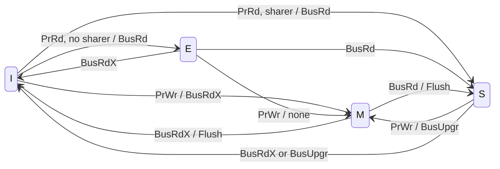

# بخش ۱۰، جلسه‌ی ۵ از ۱۸: اجرای قدم به قدم MSI و پروتکل MESI

این جلسه بخشی از **بخش ۱۰: موازی‌سازی سطح نخ: چندپردازنده‌ها، انسجام کش، همگام‌سازی، سازگاری حافظه و WSC** است. زمان مطالعه: حدود نیم ساعت.

**فهرست این جلسه:**

- ۱. روش حل سؤال‌های ردیابی
- ۲. مثال ۱: سه پردازنده و یک بلوک
- ۳. مثال ۲: عدم اصابت جایگزینی
- ۴. یک شبیه‌ساز کوچک
- ۵. ضعف MSI: خواندن و بعد نوشتن
- ۶. پروتکل MESI
- ۷. نمودار حالت MESI
- ۸. مقایسه‌ی MSI و MESI با شبیه‌ساز
- ۹. تمرین‌ها

---

## ۱. روش حل سؤال‌های ردیابی

در سؤال‌های امتحانی انسجام (مثل تمرین‌های فصل ۵ کتاب) معمولاً یک دنباله‌ی دسترسی داده می‌شود و باید برای هر قدم بنویسی:

- ۱. **اصابت یا عدم اصابت** در کش پردازنده‌ی درخواست‌کننده (با توجه به حالت فعلی، نه فقط وجود برچسب).
- ۲. **تراکنش گذرگاه:** read miss، write miss، invalidate، یا هیچ.
- ۳. **چه کسی داده را می‌دهد:** حافظه (یا L3) یا کشی که بلوک را در M دارد. اگر کشی در M جواب بدهد، بلوک را در حافظه هم می‌نویسد.
- ۴. **حالت جدید بلوک** در **همه‌ی** کش‌ها.

قاعده‌ی طلایی: نوشتن فقط در حالت M (یا E در MESI) بدون تراکنش ممکن است؛ خواندن در هر حالت معتبر.

## ۲. مثال ۱: سه پردازنده و یک بلوک

کش‌ها اول خالی‌اند. دنباله را با MSI ردیابی می‌کنیم:

| قدم | دسترسی | تراکنش گذرگاه | منبع داده | حالت P0 | حالت P1 | حالت P2 |
|---|---|---|---|---|---|---|
| قدم ۱ | پردازنده‌ی P0 خواندن X | خواندن ناموفق (read miss) | حافظه | S | I | I |
| قدم ۲ | پردازنده‌ی P1 خواندن X | خواندن ناموفق | حافظه | S | S | I |
| قدم ۳ | پردازنده‌ی P2 خواندن X | خواندن ناموفق | حافظه | S | S | S |
| قدم ۴ | پردازنده‌ی P1 نوشتن X | ابطال (invalidate) | ندارد (ارتقا) | I | M | I |
| قدم ۵ | پردازنده‌ی P0 خواندن X | خواندن ناموفق؛ P1 بلوک را می‌نویسد | کش P1 | S | S | I |
| قدم ۶ | پردازنده‌ی P2 نوشتن X | نوشتن ناموفق (write miss) | حافظه | I | I | M |
| قدم ۷ | پردازنده‌ی P2 خواندن X | هیچ (اصابت) | ندارد | I | I | M |
| قدم ۸ | پردازنده‌ی P1 خواندن X | خواندن ناموفق؛ P2 بلوک را می‌نویسد | کش P2 | I | S | S |

جمع: **۷ تراکنش گذرگاه**، که دو تای آن همراه با نوشتن یک بلوک کثیف در حافظه است.

توجه به قدم ۶: P2 در قدم ۴ کپی‌اش باطل شده بود، پس حالا در I است و باید write miss بفرستد (نه ابطال). در قدم ۵ حافظه به‌روز شد و بلوک در P0 و P1 تمیز است، پس داده‌ی قدم ۶ از حافظه می‌آید.

## ۳. مثال ۲: عدم اصابت جایگزینی

فرض کن کش P0 نگاشت مستقیم است و X و Y به **یک مدخل** نگاشت می‌شوند. دنباله: P0 نوشتن X، P0 خواندن Y، P1 خواندن X.

| قدم | دسترسی | آنچه رخ می‌دهد | حالت مدخل P0 | حالت X در P1 |
|---|---|---|---|---|
| قدم ۱ | پردازنده‌ی P0 نوشتن X | نوشتن ناموفق روی گذرگاه | حالت M برای X | I |
| قدم ۲ | پردازنده‌ی P0 خواندن Y | عدم اصابت جایگزینی: اول X در حافظه نوشته می‌شود، بعد read miss برای Y | حالت S برای Y | I |
| قدم ۳ | پردازنده‌ی P1 خواندن X | خواندن ناموفق؛ هیچ کشی X را در M ندارد، پس حافظه جواب می‌دهد | حالت S برای Y | S |

این همان سطر «عدم اصابت خواندن در حالت M، نوع جایگزینی» جدول جلسه‌ی قبل است. اگر قدم ۲ نبود، در قدم ۳ کش P0 جواب می‌داد.

## ۴. یک شبیه‌ساز کوچک

برای بررسی جواب‌ها یک شبیه‌ساز ساده نوشتم (کش‌های بی‌نهایت بزرگ، یک بلوک برای هر آدرس، نوشتن با تأخیر، ابطال):

```python
def snoop(trace, n, proto="MSI"):
    st = {}            # (proc, addr) -> state letter
    bus = 0
    rows = []
    for p, op, a in trace:
        s = st.get((p, a), "I")
        others = [q for q in range(n) if q != p and st.get((q, a), "I") != "I"]
        act = "-"
        if op == "R":
            if s == "I":
                bus += 1
                act = "read miss"
                for q in [q for q in others if st[(q, a)] in "ME"]:
                    if st[(q, a)] == "M": act += f"; P{q} writes back"
                    st[(q, a)] = "S"
                st[(p, a)] = "E" if proto == "MESI" and not others else "S"
        else:
            if s in "ME":
                act = "-" if s == "M" else "silent E->M"
                st[(p, a)] = "M"
            else:
                bus += 1
                act = "invalidate" if s == "S" else "write miss"
                for q in others:
                    if st[(q, a)] == "M": act += f"; P{q} writes back"
                    st[(q, a)] = "I"
                st[(p, a)] = "M"
        rows.append((p, op, a, act, " ".join(st.get((q, a), "I") for q in range(n))))
    return rows, bus
```

اجرای مثال ۱ با این شبیه‌ساز دقیقاً همان جدول بخش ۲ و ۷ تراکنش را می‌دهد.

## ۵. ضعف MSI: خواندن و بعد نوشتن

یک الگوی بسیار رایج: یک پردازنده داده‌ای را **می‌خواند و بعد می‌نویسد**، و هیچ پردازنده‌ی دیگری آن داده را ندارد (مثلاً داده‌ی خصوصی، یا `x = x + 1`). در MSI:

- **خواندن:** read miss و بلوک در S قرار می‌گیرد، چون MSI نمی‌داند کس دیگری کپی ندارد.
- **نوشتن:** چون بلوک در S است، باید یک **ابطال** روی گذرگاه بفرستد، با اینکه هیچ کپی دیگری نیست.

پس برای داده‌ای که اصلاً مشترک نیست، دو تراکنش گذرگاه داریم. این برای داده‌ی خصوصی، که بیشتر داده‌ها هستند، هدررفت است.

## ۶. پروتکل MESI

پروتکل **MESI** یک حالت به MSI اضافه می‌کند:

> **حالت انحصاری (Exclusive یا E):** بلوک **فقط در این کش** است و **تمیز** است (با حافظه یکی است).

قاعده‌ها:

- **ورود به E:** در عدم اصابت خواندن، اگر هیچ کش دیگری بلوک را نداشته باشد، بلوک در E قرار می‌گیرد. گذرگاه باید یک سیگنال «مشترک است» داشته باشد که کش‌های دیگر هنگام جاسوسی آن را فعال کنند.
- **نوشتن در E:** بدون هیچ تراکنش گذرگاه و بدون ابطال، حالت به M می‌رود (**انتقال بی‌صدا**).
- **خروج از E با جاسوسی:** اگر پردازنده‌ی دیگری read miss بفرستد، E به S می‌رود. چون همه‌ی دسترسی‌های بعدی جاسوسی می‌شوند، دقت این حالت حفظ می‌شود.
- **پیاده‌سازی ارزان:** بیتی که حالت انسجام را رمز می‌کند به عنوان «انحصاری» تعبیر می‌شود و بیت کثیف نشان می‌دهد بلوک تغییریافته است.

| حالت | معتبر | تعداد کپی | با حافظه یکی است | نوشتن بدون تراکنش |
|---|---|---|---|---|
| حالت M | بله | دقیقاً یکی | نه | بله |
| حالت E | بله | دقیقاً یکی | بله | بله (و به M می‌رود) |
| حالت S | بله | یکی یا بیشتر | بله | نه |
| حالت I | نه | ندارد | ندارد | نه |

**پردازنده‌ی Intel i7 از گونه‌ای از MESI به نام MESIF** استفاده می‌کند که حالت **Forward** را اضافه می‌کند تا مشخص شود از بین کپی‌های مشترک، کدام کش به درخواست جواب بدهد. این برای سازمان‌های حافظه‌ی توزیع‌شده طراحی شده است.

## ۷. نمودار حالت MESI

برای سادگی فقط یال‌های اصلی را نشان می‌دهیم و اصابت‌ها را رسم نمی‌کنیم. علامت‌ها همان جلسه‌ی قبل‌اند؛ «no sharer» یعنی هنگام BusRd هیچ کش دیگری سیگنال اشتراک نداد:



## ۸. مقایسه‌ی MSI و MESI با شبیه‌ساز

**دنباله‌ی داده‌ی خصوصی:** P0 خواندن A، P0 نوشتن A، P1 خواندن B، P1 نوشتن B، P0 خواندن A، P1 نوشتن B (A فقط مال P0 و B فقط مال P1):

| پروتکل | تراکنش گذرگاه | توضیح |
|---|---|---|
| پروتکل MSI | ۴ | برای هر بلوک یک read miss و یک ابطال |
| پروتکل MESI | ۲ | برای هر بلوک فقط یک read miss؛ نوشتن بی‌صدا از E به M |

**دنباله‌ی مثال ۱ (داده‌ی واقعاً مشترک):** هر دو پروتکل ۷ تراکنش دارند. تنها تفاوت: در قدم ۱ بلوک P0 در MESI به E می‌رود، اما چون P1 در قدم ۲ آن را می‌خواند، E به S تبدیل می‌شود و سودی ندارد.

نتیجه: MESI برای داده‌ی خصوصی یا داده‌ای که یک پردازنده اول می‌خواند و بعد می‌نویسد ترافیک را نصف می‌کند، و برای داده‌ی واقعاً مشترک ضرری ندارد.

## ۹. تمرین‌ها

<details><summary>تمرین ۱: ردیابی MSI</summary>

**صورت:** دو پردازنده با کش‌های خالی. دنباله: P0 نوشتن X، P1 نوشتن X، P0 خواندن X، P1 خواندن X. برای هر قدم تراکنش و حالت‌ها را بنویس. جمع تراکنش‌ها؟

**جواب:** قدم ۱: write miss از حافظه؛ P0 در M و P1 در I. قدم ۲: write miss؛ P0 بلوک را می‌نویسد و باطل می‌شود؛ P0 در I و P1 در M. قدم ۳: read miss؛ P1 بلوک را تأمین و در حافظه می‌نویسد؛ هر دو در S. قدم ۴: اصابت. جمع: ۳ تراکنش.
</details>

<details><summary>تمرین ۲: همان دنباله با MESI</summary>

**صورت:** تمرین ۱ را با MESI حل کن. تفاوتی هست؟

**جواب:** نه. هیچ قدمی read miss بدون اشتراک‌کننده ندارد که به E برود (قدم ۱ و ۲ نوشتن‌اند و مستقیم به M می‌روند). پس همان ۳ تراکنش.
</details>

<details><summary>تمرین ۳: حلقه‌ی شمارنده</summary>

**صورت:** P0 در یک حلقه ۱۰۰ بار `c = c + 1` را روی متغیر خصوصی c اجرا می‌کند (c اول در هیچ کشی نیست و در کش جا می‌ماند). تعداد تراکنش گذرگاه در MSI و MESI؟

**جواب:** MSI: خواندن اول read miss (S) و نوشتن اول ابطال (M)؛ بقیه اصابت. جمع ۲. پروتکل MESI: خواندن اول read miss (E) و نوشتن بی‌صدا؛ جمع ۱.
</details>

<details><summary>تمرین ۴: دو پردازنده که نوبتی می‌نویسند</summary>

**صورت:** P0 و P1 به نوبت در X می‌نویسند: P0، P1، P0، P1 (هر کدام دو بار). با کش‌های خالی، تعداد تراکنش در MSI چقدر است و هر تراکنش چه نوع است؟

**جواب:** هر نوشتن عدم اصابت است چون بلوک در کش دیگری در M است: ۴ write miss، و از دومی به بعد کش قبلی بلوک را تأمین می‌کند و باطل می‌شود. این الگوی «بلوک پینگ‌پنگ» است که در جلسه‌ی ۷ (اشتراک کاذب) و ۱۱ (قفل) دوباره می‌بینیم.
</details>

---

جلسه‌ی قبلی: [پروتکل جاسوسی MSI](10-4-snooping-msi-protocol.md)  
جلسه‌ی بعدی: [گسترش‌ها، محدودیت‌ها و پیاده‌سازی جاسوسی](10-6-protocol-extensions-and-limits.md)
