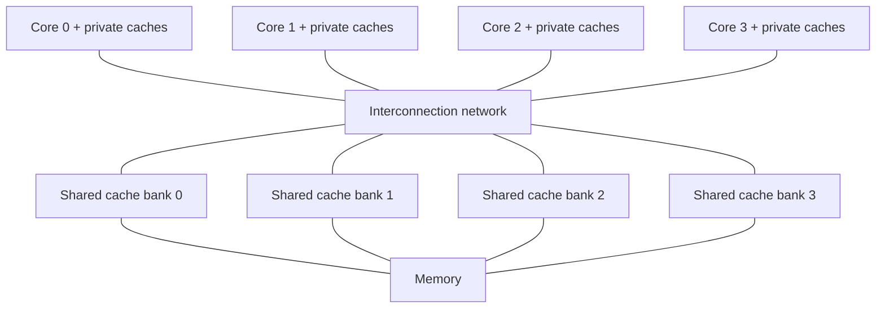
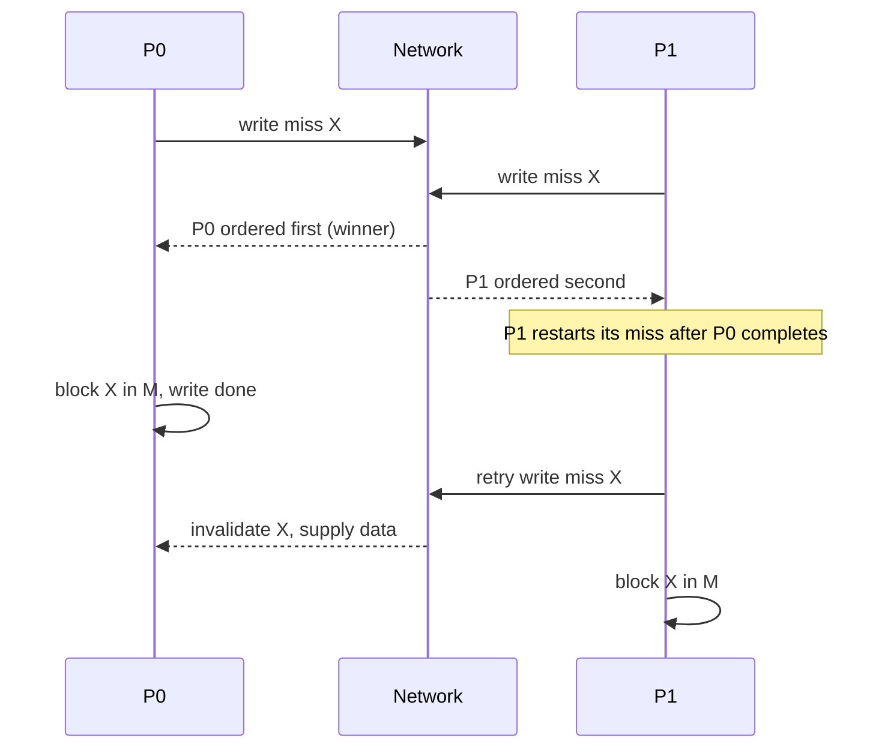

# بخش ۱۰، جلسه‌ی ۶ از ۱۸: گسترش‌ها، محدودیت‌ها و پیاده‌سازی جاسوسی

این جلسه بخشی از **بخش ۱۰: موازی‌سازی سطح نخ: چندپردازنده‌ها، انسجام کش، همگام‌سازی، سازگاری حافظه و WSC** است. زمان مطالعه: حدود نیم ساعت.

**فهرست این جلسه:**

- ۱. پروتکل MOESI
- ۲. مثال: صرفه‌جویی MOESI در نوشتن در حافظه
- ۳. خانواده‌ی پروتکل‌ها در پردازنده‌های واقعی
- ۴. محدودیت‌های SMP و جاسوسی
- ۵. راه‌های افزایش پهنای باند
- ۶. نمونه‌ی AMD Opteron: بین جاسوسی و دایرکتوری
- ۷. پیاده‌سازی واقعی: عمل‌های غیراتمی
- ۸. مسابقه و بن‌بست
- ۹. تمرین‌ها

---

## ۱. پروتکل MOESI

در MSI و MESI، وقتی بلوکی در حالت M است و پردازنده‌ی دیگری آن را می‌خواند، حالت در **هر دو** کش S می‌شود و بلوک **باید در حافظه نوشته شود**. پروتکل **MOESI** حالت **مالک (Owned یا O)** را به MESI اضافه می‌کند تا این نوشتن حذف شود:

- **رفتن به O به جای S:** وقتی بلوک M توسط دیگری خوانده می‌شود، کش اصلی از M به **O** می‌رود و بلوک را در حافظه **نمی‌نویسد**.
- **کش‌های تازه:** کش‌هایی که تازه شریک شده‌اند بلوک را در **S** نگه می‌دارند.
- **معنی O:** فقط کش اصلی آن را دارد و نشان می‌دهد حافظه **کهنه** است و این کش **مالک** است.
- **وظایف مالک:** مالک باید در عدم اصابت‌های بعدی داده را تأمین کند (چون حافظه به‌روز نیست) و اگر بلوک جایگزین شد، آن را در حافظه بنویسد.

| حالت | تعداد کپی | با حافظه یکی است | چه کسی در عدم اصابت داده می‌دهد |
|---|---|---|---|
| حالت M | یکی | نه | همین کش |
| حالت O | یکی در O و صفر یا چند در S | نه | همین کش (مالک) |
| حالت E | یکی | بله | حافظه (یا این کش) |
| حالت S | یک یا چند | بله در MESI؛ در MOESI ممکن است مالک داشته باشد | حافظه یا مالک |
| حالت I | ندارد | ندارد | ندارد |

پردازنده‌ی **AMD Opteron از MOESI** استفاده می‌کند.

## ۲. مثال: صرفه‌جویی MOESI در نوشتن در حافظه

دنباله: P0 نوشتن X، P1 خواندن X، P2 خواندن X، P0 نوشتن X، P1 خواندن X.

| قدم | دسترسی | پروتکل MESI | پروتکل MOESI |
|---|---|---|---|
| قدم ۱ | پردازنده‌ی P0 نوشتن X | write miss؛ P0 در M | write miss؛ P0 در M |
| قدم ۲ | پردازنده‌ی P1 خواندن X | read miss؛ P0 بلوک را می‌دهد و **در حافظه می‌نویسد**؛ P0 و P1 در S | read miss؛ P0 بلوک را می‌دهد، **بدون نوشتن در حافظه**؛ P0 در O و P1 در S |
| قدم ۳ | پردازنده‌ی P2 خواندن X | read miss؛ حافظه جواب می‌دهد | read miss؛ مالک P0 جواب می‌دهد |
| قدم ۴ | پردازنده‌ی P0 نوشتن X | ابطال؛ P0 در M | ابطال؛ P0 از O به M |
| قدم ۵ | پردازنده‌ی P1 خواندن X | read miss؛ P0 می‌دهد و **در حافظه می‌نویسد** | read miss؛ P0 می‌دهد و به O می‌رود |

تعداد تراکنش‌های گذرگاه یکی است (۵)، اما MESI **دو بار** بلوک را در حافظه می‌نویسد و MOESI هیچ‌بار. در الگوی «یک نویسنده، چند خواننده» این صرفه‌جویی در پهنای باند حافظه مهم است.

## ۳. خانواده‌ی پروتکل‌ها در پردازنده‌های واقعی

جدول زیر از شکل ۵.۲۷ کتاب است (پردازنده‌های سرور ۲۰۱۰):

| ویژگی | پردازنده‌ی AMD Opteron 8439 | پردازنده‌ی IBM Power7 | پردازنده‌ی Intel Xeon 7560 | پردازنده‌ی Sun T2 |
|---|---|---|---|---|
| هسته در هر تراشه | ۶ | ۸ | ۸ | ۸ |
| چندنخنگی | ندارد | دستورهای SMT با ۴ نخ | دستورهای SMT با ۲ نخ | ریزدانه با ۸ نخ |
| بیرونی‌ترین کش | کش L3 شش مگابایتی مشترک | کش L3 سی‌ودو مگابایتی (eDRAM) | کش L3 بیست‌وچهار مگابایتی مشترک | کش L2 چهار مگابایتی مشترک |
| شمول | ندارد (L2 شامل L1 است) | دارد | دارد | دارد |
| پروتکل انسجام درون تراشه | پروتکل MOESI | پروتکل MESI گسترش‌یافته (۱۳ حالت) | پروتکل MESIF | پروتکل MOESI |
| پیاده‌سازی درون تراشه | جاسوسی | دایرکتوری در L3 | دایرکتوری در L3 | دایرکتوری در L2 |

این جدول نشان می‌دهد که حتی درون یک تراشه، بیشتر طراحان **دایرکتوری در بیرونی‌ترین کش مشترک** را انتخاب کرده‌اند، که به شمول نیاز دارد.

## ۴. محدودیت‌های SMP و جاسوسی

با زیاد شدن تعداد پردازنده یا تقاضای حافظه‌ی هر پردازنده، **هر منبع متمرکزی گلوگاه می‌شود**:

- **گذرگاه و حافظه‌ی مشترک:** با پهنای باند روی تراشه و L3 مشترک (که از حافظه سریع‌تر است)، طراحان توانسته‌اند ۴ تا ۸ هسته‌ی پرقدرت را به صورت متقارن پشتیبانی کنند. این روش بعید است از حدود ۸ هسته فراتر برود، و وقتی چند تراشه ترکیب شوند کار نمی‌کند.
- **پهنای باند جاسوسی در کش‌ها:** هر کش باید **هر** عدم اصابتی را که روی گذرگاه می‌آید بررسی کند. راه‌حل‌ها: تکثیر برچسب‌ها، یا یک دایرکتوری در بیرونی‌ترین کش که دقیقاً می‌گوید کش‌های کدام پردازنده‌ها کپی هر بلوک را دارند (روش Intel در i7 و Xeon 7000). این دایرکتوری گلوگاه گذرگاه و L3 مشترک را حذف نمی‌کند، اما پیاده‌سازی‌اش خیلی ساده‌تر از دایرکتوری توزیع‌شده است.
- **ترافیک انسجام با کش بزرگ‌تر کم نمی‌شود:** حتی بدون گذرگاه متمرکز، جاسوسی هنوز لازم دارد هر عدم اصابت روی یک بلوک بالقوه مشترک **به همه پخش شود**. پردازنده‌های سریع‌تر سرانجام شبکه و توانایی هر کش برای پاسخ به جاسوسی‌ها را اشباع می‌کنند.

اسلاید درس این‌ها را خلاصه می‌کند: پهنای باند گذرگاه و جاسوسی گلوگاه مقیاس‌پذیری SMP است؛ راه‌حل‌ها: تکثیر برچسب‌ها، دایرکتوری در بیرونی‌ترین کش، و سوییچ متقاطع یا شبکه‌ی نقطه‌به‌نقطه با حافظه‌ی بانک‌بندی‌شده.

## ۵. راه‌های افزایش پهنای باند

برای افزایش پهنای باند بین پردازنده‌ها و حافظه، طراحان از **چند گذرگاه** و **شبکه‌های ارتباطی** مثل سوییچ متقاطع (crossbar) یا شبکه‌های کوچک نقطه‌به‌نقطه استفاده کرده‌اند. سیستم حافظه (حافظه‌ی اصلی یا کش مشترک) به چند **بانک فیزیکی** تقسیم می‌شود تا پهنای باند مؤثر بالا رود و زمان دسترسی همچنان یکسان بماند:



این روش برای بیش از چهار هسته روی یک تراشه مفید است، اما برای چندپردازنده‌ی چندتراشه‌ای خوب مقیاس نمی‌پذیرد، چون حافظه به خود تراشه‌ها وصل است، نه متمرکز.

## ۶. نمونه‌ی AMD Opteron: بین جاسوسی و دایرکتوری

پردازنده‌ی Opteron یک نقطه‌ی میانی بین جاسوسی و دایرکتوری است:

- **حافظه مستقیم به هر تراشه وصل است** و تا چهار تراشه می‌توانند به هم وصل شوند؛ سیستم NUMA است.
- **پخش روی پیوندهای نقطه‌به‌نقطه:** پروتکل انسجام با پیوندهای نقطه‌به‌نقطه به حداکثر سه تراشه‌ی دیگر پخش می‌شود (مثل جاسوسی، برای پیدا کردن کپی‌ها).
- **تأیید صریح:** چون پیوندها مشترک نیستند (مثل گذرگاه نیست که همه همزمان ببینند)، پردازنده فقط با **تأیید (acknowledgment) صریح** می‌فهمد که ابطال کامل شده است (مثل دایرکتوری، برای ترتیب‌دهی).
- **تقریباً یکسان:** چون حافظه‌ی محلی فقط کمی سریع‌تر از دور است، بعضی نرم‌افزارها با Opteron مثل UMA رفتار می‌کنند.

## ۷. پیاده‌سازی واقعی: عمل‌های غیراتمی

پروتکل ساده‌ی جلسه‌ی ۴ فرض می‌کرد عمل‌ها **اتمی** هستند، یعنی بدون مداخله‌ی عمل دیگر انجام می‌شوند: مثلاً تشخیص عدم اصابت نوشتن، گرفتن گذرگاه و گرفتن پاسخ، همه در یک عمل اتمی. در واقعیت این‌طور نیست؛ حتی عدم اصابت خواندن هم ممکن است اتمی نباشد: بعد از تشخیص عدم اصابت در L2، هسته باید برای گذرگاه به L3 داوری کند.

```text
write miss steps (not atomic in reality):
  1. detect write or upgrade miss
  2. arbitrate for the bus / network
  3. send request, collect invalidation acknowledgments
  4. get latest value (from memory or owner cache)
  5. update cache state and data
```

**در یک تراشه‌ی چندهسته‌ای با گذرگاه:** این قدم‌ها با این روش عملاً اتمی می‌شوند:

- ۱. **اول** برای گذرگاه به کش مشترک یا حافظه داوری کن (قبل از تغییر حالت کش).
- ۲. گذرگاه را تا پایان همه‌ی عمل‌ها **آزاد نکن**.
- ۳. پردازنده چطور بفهمد همه‌ی ابطال‌ها کامل شده؟ در بعضی چندهسته‌ای‌ها یک خط سیگنال وقتی همه‌ی ابطال‌های لازم دریافت شدند و در حال پردازش‌اند فعال می‌شود. بعد از آن، پردازنده گذرگاه را آزاد می‌کند و مطمئن است همه‌ی عمل‌های لازم قبل از عدم اصابت بعدی کامل می‌شوند.

اسلاید درس همین را می‌گوید: «یک راه‌حل: پردازنده‌ای که ابطال می‌فرستد گذرگاه را تا دریافت ابطال توسط بقیه نگه دارد.»

کتاب یک نکته‌ی تاریخی هم دارد: در ویرایش اول (۱۹۹۰)، گذرگاه یک چندپردازنده‌ی ۳۰ پردازنده‌ای کمی بیش از ۵۰ مگابایت بر ثانیه پهنای باند داشت، که در ۲۰۱۱ برای حتی یک هسته‌ی i7 هم کافی نبود. امروز هر سیستم با ۱۶ هسته یا بیشتر از شبکه‌ای غیر از یک گذرگاه استفاده می‌کند.

## ۸. مسابقه و بن‌بست

**بدون گذرگاه**، باید روش دیگری برای اتمی کردن قدم‌های عدم اصابت پیدا کنیم:

- **مسابقه (race):** دو پردازنده همزمان بخواهند در یک بلوک بنویسند. باید **دقیقاً یک برنده** باشد و عمل‌های انسجام او اول کامل شوند. مهم نیست کدام ببرد.
- **راه‌حل در جاسوسی بدون گذرگاه:** پخش همه‌ی عدم اصابت‌ها، چند خاصیت پایه‌ی شبکه‌ی ارتباطی، و توانایی **شروع دوباره‌ی** رسیدگی به عدم اصابت بازنده. جزئیات در پیوست I کتاب است.
- **بن‌بست (deadlock):** عمل‌های غیراتمی امکان رسیدن به حالتی را ایجاد می‌کنند که پروتکل نتواند ادامه دهد؛ مثلاً هر دو کنترل‌کننده منتظر پاسخ دیگری بمانند در حالی که صف‌هایشان پر است.



ترکیب جاسوسی و دایرکتوری هم ممکن است: بعضی طراحی‌ها درون تراشه جاسوسی و بین تراشه‌ها دایرکتوری دارند، یا برعکس. در جلسه‌ی ۹ می‌بینیم که هر چهار ترکیب در محصولات واقعی وجود دارد.

## ۹. تمرین‌ها

<details><summary>تمرین ۱: شمارش نوشتن در حافظه</summary>

**صورت:** P0 یک بار در X می‌نویسد و بعد P1، P2 و P3 هر کدام یک بار X را می‌خوانند. سپس بلوک X در P0 جایگزین می‌شود. در MESI و MOESI چند بار X در حافظه نوشته می‌شود؟

**جواب:** MESI: در اولین read miss (P1) بلوک در حافظه نوشته می‌شود؛ بعد بلوک تمیز است و جایگزینی نوشتن ندارد. جمع: ۱. پروتکل MOESI: هیچ نوشتنی تا جایگزینی نیست؛ هنگام جایگزینی بلوک O در حافظه نوشته می‌شود. جمع: ۱. اما در MOESI سه read miss از کش P0 تأمین می‌شوند، نه از حافظه.
</details>

<details><summary>تمرین ۲: چرا E و O با هم</summary>

**صورت:** در MOESI حالت E چه سودی دارد و حالت O چه سودی؟ آیا می‌توانند همزمان برای یک بلوک در دو کش وجود داشته باشند؟

**جواب:** E نوشتن بی‌صدا برای داده‌ی خصوصی را ممکن می‌کند؛ O نوشتن در حافظه هنگام اشتراک داده‌ی کثیف را حذف می‌کند. نمی‌توانند همزمان باشند: E یعنی فقط یک کپی وجود دارد، در حالی که O یعنی کپی‌های S دیگری هم ممکن است باشند.
</details>

<details><summary>تمرین ۳: بار جاسوسی</summary>

**صورت:** در یک SMP با ۸ هسته، هر هسته در هر میکروثانیه ۲۰ عدم اصابت روی گذرگاه می‌فرستد. هر کش در هر میکروثانیه چند درخواست جاسوسی را باید بررسی کند؟ با ۳۲ هسته چطور؟

**جواب:** هر کش عدم اصابت‌های ۷ هسته‌ی دیگر را می‌بیند: 7 × 20 = 140 جاسوسی در هر میکروثانیه. با ۳۲ هسته: 31 × 20 = 620. بار جاسوسی هر کش خطی با تعداد هسته رشد می‌کند و کل ترافیک همه‌پخشی تقریباً با مجذور تعداد هسته. این همان دلیل حرکت به سمت دایرکتوری است.
</details>

<details><summary>تمرین ۴: نگه داشتن گذرگاه</summary>

**صورت:** چرا پردازنده باید قبل از تغییر حالت کش برای گذرگاه داوری کند، نه بعد از آن؟

**جواب:** اگر پردازنده اول حالت بلوک را به M تغییر دهد و بعد برای گذرگاه منتظر بماند، ممکن است در این فاصله پردازنده‌ی دیگری هم همین کار را بکند و هر دو فکر کنند بلوک انحصاری دارند. داوری اول، نقطه‌ی سریال‌سازی را قبل از هر تغییر حالت قرار می‌دهد.
</details>

---

جلسه‌ی قبلی: [اجرای قدم به قدم MSI و پروتکل MESI](10-5-msi-mesi-traces.md)  
جلسه‌ی بعدی: [کارایی SMP: اشتراک واقعی و کاذب](10-7-smp-performance-sharing-misses.md)
