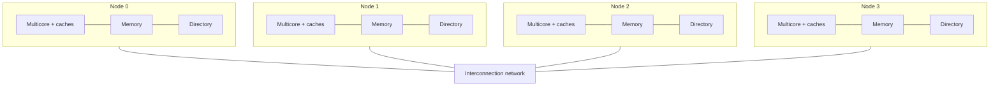

# بخش ۱۰، جلسه‌ی ۸ از ۱۸: حافظه‌ی توزیع‌شده و انسجام مبتنی بر دایرکتوری

این جلسه بخشی از **بخش ۱۰: موازی‌سازی سطح نخ: چندپردازنده‌ها، انسجام کش، همگام‌سازی، سازگاری حافظه و WSC** است. زمان مطالعه: حدود نیم ساعت.

**فهرست این جلسه:**

- ۱. پاشنه‌ی آشیل جاسوسی
- ۲. ایده‌ی دایرکتوری
- ۳. دایرکتوری درون یک چندهسته‌ای
- ۴. دایرکتوری توزیع‌شده
- ۵. سربار ذخیره‌سازی
- ۶. حالت‌های دایرکتوری و مجموعه‌ی اشتراک‌کننده‌ها
- ۷. گره محلی، خانه و دور
- ۸. انواع پیام
- ۹. فرض‌های ساده‌کننده
- ۱۰. تمرین‌ها

---

## ۱. پاشنه‌ی آشیل جاسوسی

پروتکل جاسوسی در **هر** عدم اصابت، از جمله نوشتن در داده‌ی بالقوه مشترک، با **همه‌ی** کش‌ها ارتباط برقرار می‌کند. نبود هر ساختار متمرکز برای ردیابی حالت کش‌ها هم **مزیت بنیادی** جاسوسی است (ارزان است) و هم **پاشنه‌ی آشیل** آن در مقیاس‌پذیری.

**مثال کتاب:** چندپردازنده‌ای از چهار چندهسته‌ای ۴ هسته‌ای که هر هسته در هر سیکل یک ارجاع داده دارد و فرکانس ۴ گیگاهرتز است. طبق داده‌های پیوست I، برنامه‌ها ممکن است **۴ تا ۱۷۰ گیگابایت بر ثانیه** پهنای باند گذرگاه بخواهند. بیشتر این ترافیک، ترافیک انسجام است که با اندازه‌ی کش تغییر نمی‌کند. یک گذرگاه مدرن ممکن است ۴ گیگابایت بر ثانیه را پشتیبانی کند، اما ۱۷۰ گیگابایت بر ثانیه خیلی فراتر از هر سیستم مبتنی بر گذرگاه است.

می‌توانیم با **توزیع حافظه** پهنای باند حافظه و شبکه را بالا ببریم: ترافیک حافظه‌ی محلی از ترافیک دور جدا می‌شود. اما **تا وقتی پروتکل انسجام در هر عدم اصابت به همه پخش کند، توزیع حافظه سود کمی دارد.**

## ۲. ایده‌ی دایرکتوری

جایگزین جاسوسی، **پروتکل دایرکتوری (directory protocol)** است. دایرکتوری حالت **هر بلوکی** را که ممکن است کش شده باشد نگه می‌دارد: کدام کش‌ها (یا مجموعه‌ای از کش‌ها) کپی بلوک را دارند، آیا کثیف است، و غیره.

ویژگی کلیدی: **وضعیت اشتراک هر بلوک همیشه در یک مکان معلوم** است. همراه با دانستن اینکه کدام گره‌ها ممکن است بلوک را داشته باشند، این خاصیت به پروتکل اجازه می‌دهد **همه‌پخشی را حذف کند** و پیام‌ها را فقط به کش‌های لازم بفرستد.

## ۳. دایرکتوری درون یک چندهسته‌ای

درون یک چندهسته‌ای با بیرونی‌ترین کش مشترک (مثلاً L3)، پیاده‌سازی دایرکتوری آسان است:

- **برای هر بلوک L3** یک **بردار بیتی** به اندازه‌ی تعداد هسته‌ها نگه دار.
- **هر بیت** نشان می‌دهد آیا کش خصوصی آن هسته ممکن است کپی این بلوک را داشته باشد.
- **ابطال** فقط به کش‌هایی فرستاده می‌شود که بیتشان یک است.

این روش برای یک چندهسته‌ای **کاملاً کار می‌کند اگر L3 شامل (inclusive)** باشد؛ و Intel i7 همین را به کار می‌برد. اما این دایرکتوری واحد، با اینکه همه‌پخشی را حذف می‌کند، **مقیاس‌پذیر نیست:** فراتر از L3 مشترک یک تراشه کار نمی‌کند.

## ۴. دایرکتوری توزیع‌شده

دایرکتوری باید **توزیع** شود، اما طوری که پروتکل بداند اطلاعات هر بلوک را کجا پیدا کند. راه‌حل بدیهی: **دایرکتوری را همراه با حافظه توزیع کن.** هر گره بخشی از حافظه و دایرکتوری همان بخش را دارد. درخواست‌های انسجام مختلف به دایرکتوری‌های مختلف می‌روند، درست همان‌طور که درخواست‌های حافظه‌ی مختلف به حافظه‌های مختلف می‌روند.



هر دایرکتوری مسئول ردیابی کش‌هایی است که آدرس‌های حافظه‌ی همان گره را به اشتراک گذاشته‌اند. «گره» می‌تواند یک تراشه‌ی چندهسته‌ای باشد که درون خودش انسجام را با جاسوسی یا دایرکتوری داخلی حفظ می‌کند.

## ۵. سربار ذخیره‌سازی

ساده‌ترین پیاده‌سازی برای **هر بلوک حافظه** یک مدخل دایرکتوری دارد. پس حجم اطلاعات متناسب است با:

```math
\text{directory bits} \propto (\text{number of memory blocks}) \times (\text{number of nodes})
```

اندازه‌ی بلوک همان اندازه‌ی بلوک L2 یا L3 است. **مثال:** حافظه‌ی ۶۴ گیگابایتی با بلوک ۶۴ بایتی و ۶۴ گره:

```math
\text{blocks} = \frac{64 \text{ GB}}{64 \text{ B}} = 2^{30},\quad
\text{bits per entry} \approx 64 + 2,\quad
\text{overhead} = \frac{66}{64 \times 8} \approx 12.9\%
```

مقدار ۶۴ بیت برای بردار اشتراک و حدود ۲ بیت برای حالت است. این سربار برای چندپردازنده‌هایی با کمتر از چند صد پردازنده (که هر کدام ممکن است چندهسته‌ای باشد) قابل تحمل است. برای سیستم‌های بزرگ‌تر روش‌هایی برای کم کردن اندازه‌ی دایرکتوری لازم است، اما فقط ابررایانه‌ها به آن نیاز دارند.

## ۶. حالت‌های دایرکتوری و مجموعه‌ی اشتراک‌کننده‌ها

مثل جاسوسی، دایرکتوری دو عمل اصلی دارد: **رسیدگی به عدم اصابت خواندن** و **رسیدگی به نوشتن در بلوک مشترک و تمیز**. نوشتن ناموفق در بلوکی که اکنون مشترک است ترکیبی از این دو است. برای این کار دایرکتوری حالت هر بلوک را نگه می‌دارد:

| حالت دایرکتوری | معنی |
|---|---|
| حالت مشترک (Shared) | یک یا چند گره بلوک را کش کرده‌اند و مقدار حافظه (و همه‌ی کش‌ها) به‌روز است |
| حالت کش‌نشده (Uncached) | هیچ گره‌ای کپی بلوک را ندارد |
| حالت تغییریافته (Modified یا Exclusive) | دقیقاً یک گره کپی دارد و در آن نوشته است، پس حافظه کهنه است؛ این گره **مالک** است |

علاوه بر حالت، دایرکتوری باید بداند **کدام گره‌ها** کپی دارند، چون هنگام نوشتن باید باطل شوند. ساده‌ترین روش: یک **بردار بیتی** برای هر بلوک حافظه که کتاب آن را مجموعه‌ی **Sharers** می‌نامد. وقتی بلوک انحصاری است، همین بردار مالک را مشخص می‌کند. در چندپردازنده‌های کمتر از ۶۴ گره، Sharers معمولاً بردار بیتی است.

حالت هر بلوک در **هر کش** هم برای کارایی نگه داشته می‌شود. حالت‌ها و انتقال‌های ماشین حالت کش **دقیقاً همان MSI جاسوسی** است؛ فقط عمل‌ها روی انتقال‌ها فرق دارند: به جای پخش روی گذرگاه، پیام به دایرکتوری فرستاده می‌شود.

## ۷. گره محلی، خانه و دور

سه نقش در هر تراکنش:

- **گره محلی (local node):** گره‌ای که درخواست از آن شروع می‌شود.
- **گره خانه (home node):** گره‌ای که خانه‌ی حافظه و مدخل دایرکتوری آن آدرس را دارد. فضای آدرس فیزیکی **ایستا** توزیع شده است، پس خانه‌ی هر آدرس معلوم است؛ مثلاً بیت‌های پرارزش شماره‌ی گره و بیت‌های کم‌ارزش آفست درون حافظه‌ی آن گره‌اند.
- **گره دور (remote node):** گره‌ای که کپی بلوک کش را دارد، انحصاری (تنها کپی) یا مشترک.

گره محلی می‌تواند خودش خانه باشد، اما باز هم باید به دایرکتوری مراجعه کند، چون ممکن است کپی‌ها در گره سومی (دور) باشند. گره دور هم ممکن است همان گره محلی یا خانه باشد؛ در این صورت پروتکل عوض نمی‌شود و فقط پیام‌های بین‌پردازنده‌ای به پیام‌های درون‌پردازنده‌ای تبدیل می‌شوند.

## ۸. انواع پیام

شکل ۵.۲۱ کتاب (P شماره‌ی گره درخواست‌کننده، A آدرس، D داده):

| نوع پیام | مبدأ | مقصد | محتوا | کار |
|---|---|---|---|---|
| پیام read miss | کش محلی | دایرکتوری خانه | مقدار P و A | گره P در آدرس A عدم اصابت خواندن دارد؛ داده بفرست و P را خواننده‌ی مشترک کن |
| پیام write miss | کش محلی | دایرکتوری خانه | مقدار P و A | گره P در A عدم اصابت نوشتن دارد؛ داده بفرست و P را مالک انحصاری کن |
| پیام invalidate | کش محلی | دایرکتوری خانه | مقدار A | درخواست فرستادن ابطال به همه‌ی کش‌های دوری که A را دارند |
| پیام invalidate | دایرکتوری خانه | کش دور | مقدار A | باطل کردن کپی مشترک A |
| پیام fetch | دایرکتوری خانه | کش دور | مقدار A | بلوک A را بگیر و به خانه بفرست؛ حالت A در کش دور را به مشترک تغییر بده |
| پیام fetch/invalidate | دایرکتوری خانه | کش دور | مقدار A | بلوک A را بگیر و به خانه بفرست؛ بلوک را در کش باطل کن |
| پیام data value reply | دایرکتوری خانه | کش محلی | مقدار D | برگرداندن داده از حافظه‌ی خانه |
| پیام data write-back | کش دور | دایرکتوری خانه | مقدار A و D | نوشتن مقدار داده برای آدرس A |

- **سه پیام اول** درخواست‌هایی‌اند که گره محلی به خانه می‌فرستد.
- **پیام‌های چهارم تا ششم** را خانه به گره دور می‌فرستد وقتی برای پاسخ به درخواست به داده یا ابطال نیاز دارد.
- **پاسخ داده** مقدار را از خانه به درخواست‌کننده برمی‌گرداند.
- **نوشتن داده** به دو دلیل رخ می‌دهد: جایگزینی بلوک در کش، و پاسخ به fetch یا fetch/invalidate.

نوشتن داده در حافظه هر وقت بلوک مشترک می‌شود، تعداد حالت‌ها را کم می‌کند: هر بلوک کثیف حتماً انحصاری است و هر بلوک مشترک همیشه در حافظه‌ی خانه به‌روز است.

## ۹. فرض‌های ساده‌کننده

برای ساده نگه داشتن پروتکل، کتاب فرض می‌کند:

- **ترتیب پیام‌ها حفظ می‌شود:** پیام‌ها به همان ترتیبی که فرستاده شده‌اند دریافت و اجرا می‌شوند. این فرض تضمین می‌کند ابطال‌هایی که یک گره فرستاده قبل از پیام‌های جدید اعمال شوند (مثل فرض پیاده‌سازی جاسوسی). در عمل ممکن است درست نباشد.
- **بعضی عمل‌ها اتمی‌اند:** مثلاً درخواست یک مقدار و فرستادن آن به گره دیگر.

در واقعیت، **ترتیب‌دهی نوشتن‌ها** و فهمیدن اینکه **ابطال‌ها کامل شده‌اند** به سادگی همه‌پخشی نیست: **تأیید (acknowledgment) صریح** برای عدم اصابت‌های نوشتن و درخواست‌های ابطال لازم است. این جزئیات در پیوست I کتاب آمده است.

در جلسه‌ی بعد ماشین‌های حالت کش و دایرکتوری را با جزئیات می‌بینیم و چند دنباله را با پیام‌ها ردیابی می‌کنیم.

## ۱۰. تمرین‌ها

<details><summary>تمرین ۱: پیدا کردن خانه</summary>

**صورت:** سیستمی با ۱۶ گره و فضای آدرس فیزیکی ۴۰ بیتی داریم که حافظه به طور مساوی بین گره‌ها تقسیم شده و چهار بیت پرارزش آدرس شماره‌ی گره خانه است. خانه‌ی آدرس شانزده‌شانزدهی `0x93_0000_1000` کدام گره است؟

**جواب:** آدرس ۴۰ بیتی ۱۰ رقم شانزده‌شانزدهی است و چهار بیت پرارزش همان رقم اول است: ۹. پس گره خانه گره ۹ است.
</details>

<details><summary>تمرین ۲: سربار دایرکتوری</summary>

**صورت:** حافظه‌ی ۱۲۸ گیگابایتی با بلوک ۱۲۸ بایتی و ۲۵۶ گره. با بردار بیتی کامل و ۲ بیت حالت، سربار دایرکتوری چند درصد حافظه است؟ با بلوک ۶۴ بایتی چطور؟

**جواب:** هر مدخل 256 + 2 = 258 بیت است. برای بلوک ۱۲۸ بایتی (۱۰۲۴ بیت) سربار 258 / 1024 ≈ 25٪. برای بلوک ۶۴ بایتی (۵۱۲ بیت) 258 / 512 ≈ 50٪. این نشان می‌دهد چرا برای سیستم‌های بزرگ بردار بیتی کامل مقیاس‌پذیر نیست.
</details>

<details><summary>تمرین ۳: چرا دایرکتوری i7 کافی است</summary>

**صورت:** چرا Intel i7 با یک بردار بیتی در هر بلوک L3 کار می‌کند، اما یک سرور ۸ سوکتی به دایرکتوری توزیع‌شده نیاز دارد؟

**جواب:** در i7 همه‌ی دسترسی‌های هسته‌ها از L3 مشترک و شامل عبور می‌کنند؛ L3 یک نقطه‌ی سریال‌سازی طبیعی است و تعداد هسته کم است. در سرور ۸ سوکتی هر سوکت حافظه‌ی خودش را دارد و یک دایرکتوری متمرکز گلوگاه و نقطه‌ی رقابت می‌شود؛ پس هر سوکت دایرکتوری حافظه‌ی خودش را نگه می‌دارد.
</details>

<details><summary>تمرین ۴: نقش‌ها</summary>

**صورت:** گره ۲ عدم اصابت خواندن برای آدرسی دارد که خانه‌اش گره ۵ است و بلوک در کش گره ۷ در حالت تغییریافته است. گره محلی، خانه و دور را مشخص کن و بگو کدام پیام‌ها رد و بدل می‌شوند.

**جواب:** محلی گره ۲، خانه گره ۵، دور گره ۷. پیام‌ها: read miss از ۲ به ۵؛ fetch از ۵ به ۷؛ data write-back از ۷ به ۵؛ data value reply از ۵ به ۲. حالت دایرکتوری مشترک و Sharers برابر {۲، ۷} می‌شود.
</details>

---

جلسه‌ی قبلی: [کارایی SMP: اشتراک واقعی و کاذب](10-7-smp-performance-sharing-misses.md)  
جلسه‌ی بعدی: [ماشین‌های حالت دایرکتوری و ردیابی پیام‌ها](10-9-directory-protocol-examples.md)
