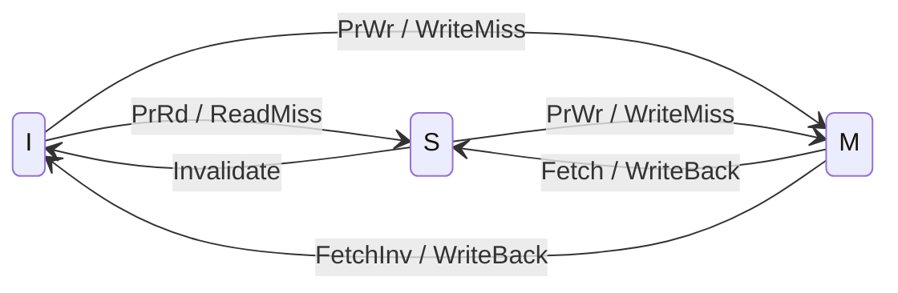
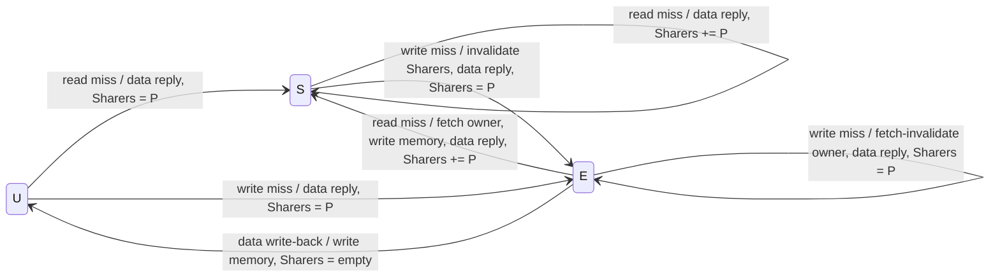
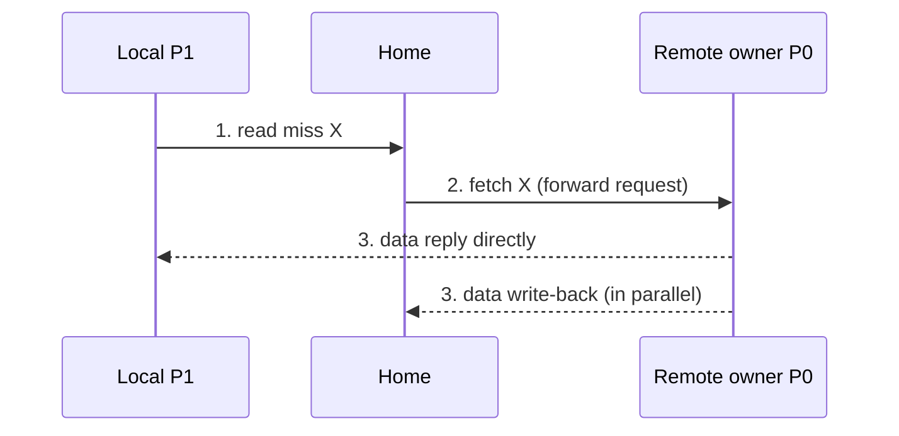

# بخش ۱۰، جلسه‌ی ۹ از ۱۸: ماشین‌های حالت دایرکتوری و ردیابی پیام‌ها

این جلسه بخشی از **بخش ۱۰: موازی‌سازی سطح نخ: چندپردازنده‌ها، انسجام کش، همگام‌سازی، سازگاری حافظه و WSC** است. زمان مطالعه: حدود نیم ساعت.

**فهرست این جلسه:**

- ۱. ماشین حالت هر بلوک در کش
- ۲. ماشین حالت هر مدخل دایرکتوری
- ۳. عمل‌های دایرکتوری در حالت کش‌نشده
- ۴. عمل‌های دایرکتوری در حالت مشترک
- ۵. عمل‌های دایرکتوری در حالت انحصاری
- ۶. ردیابی یک دنباله با پیام‌ها
- ۷. بهینه‌سازی: فرستادن مستقیم از مالک
- ۸. جاسوسی یا دایرکتوری: مقایسه
- ۹. تمرین‌ها

---

## ۱. ماشین حالت هر بلوک در کش

حالت‌ها همان I، S و M (اینجا Exclusive هم نامیده می‌شود) هستند. تفاوت با جاسوسی: write miss که در جاسوسی روی گذرگاه پخش می‌شد، اینجا با پیام‌های **fetch** و **invalidate** جایگزین می‌شود که دایرکتوری **انتخابی** می‌فرستد. مثل جاسوسی، نوشتن در بلوک مشترک به عنوان عدم اصابت رفتار می‌شود (در عمل می‌تواند درخواست ارتقا باشد که بلوک را نمی‌آورد).

| علامت | معنی |
|---|---|
| علامت ReadMiss و WriteMiss | پیام read miss و write miss از کش محلی به خانه |
| علامت Invalidate | پیام ابطال از خانه |
| علامت Fetch و FetchInv | پیام fetch و fetch/invalidate از خانه |
| علامت WriteBack | پیام data write-back به خانه |

اصابت‌ها و عدم اصابت‌های جایگزینی (که در M اول WriteBack و بعد ReadMiss یا WriteMiss می‌فرستند) برای سادگی رسم نشده‌اند.

عدم اصابت‌های خواندن و نوشتن منتظر **پاسخ داده** می‌مانند و بعد حالت را عوض می‌کنند. فهمیدن اینکه ابطال‌ها کامل شده‌اند یک مسئله‌ی جدا است.

## ۲. ماشین حالت هر مدخل دایرکتوری

دایرکتوری نیمه‌ی دیگر پروتکل است. پیامی که به دایرکتوری می‌رسد دو نوع عمل ایجاد می‌کند: **به‌روزرسانی حالت دایرکتوری** و **فرستادن پیام‌های اضافه** برای پاسخ به درخواست. حالت دایرکتوری وضعیت **همه‌ی** کپی‌های یک بلوک حافظه را نشان می‌دهد، نه یک بلوک کش.

دایرکتوری سه درخواست دریافت می‌کند: read miss، write miss و data write-back. همه‌ی محرک‌ها خارجی‌اند:

حرف U یعنی کش‌نشده، S یعنی مشترک و E یعنی انحصاری، و P گره درخواست‌کننده است.

## ۳. عمل‌های دایرکتوری در حالت کش‌نشده

وقتی بلوک کش‌نشده است، مقدار حافظه همان مقدار جاری است. دو درخواست ممکن است:

- **عدم اصابت خواندن:** داده از حافظه به درخواست‌کننده فرستاده می‌شود و درخواست‌کننده **تنها** اشتراک‌کننده می‌شود. حالت بلوک **مشترک** می‌شود.
- **عدم اصابت نوشتن:** مقدار به درخواست‌کننده فرستاده می‌شود و او اشتراک‌کننده می‌شود. حالت **انحصاری** می‌شود تا نشان دهد تنها کپی معتبر کش شده است. مجموعه‌ی Sharers هویت مالک را نشان می‌دهد.

## ۴. عمل‌های دایرکتوری در حالت مشترک

مقدار حافظه به‌روز است:

- **عدم اصابت خواندن:** داده از حافظه فرستاده می‌شود و درخواست‌کننده به Sharers **اضافه** می‌شود.
- **عدم اصابت نوشتن:** مقدار به درخواست‌کننده فرستاده می‌شود؛ به **همه‌ی گره‌های Sharers** پیام ابطال فرستاده می‌شود؛ Sharers فقط هویت درخواست‌کننده را خواهد داشت؛ حالت **انحصاری** می‌شود.

## ۵. عمل‌های دایرکتوری در حالت انحصاری

مقدار جاری در کش گره‌ای است که Sharers نشان می‌دهد (مالک). سه درخواست ممکن است:

- **عدم اصابت خواندن:** به مالک پیام **fetch** فرستاده می‌شود؛ حالت بلوک در کش مالک **مشترک** می‌شود و مالک داده را به دایرکتوری می‌فرستد؛ داده در حافظه نوشته و به درخواست‌کننده فرستاده می‌شود. درخواست‌کننده به Sharers اضافه می‌شود و مالک قبلی هم در Sharers می‌ماند (چون هنوز کپی خواندنی دارد).
- **نوشتن داده (write-back):** مالک بلوک را جایگزین می‌کند و باید آن را بنویسد. حافظه به‌روز می‌شود (خانه در واقع مالک می‌شود)، بلوک **کش‌نشده** و Sharers **خالی** می‌شود.
- **عدم اصابت نوشتن:** بلوک مالک جدید دارد. به مالک قبلی پیام **fetch/invalidate** فرستاده می‌شود تا بلوک را باطل کند و مقدار را به دایرکتوری بفرستد؛ از آنجا به درخواست‌کننده فرستاده می‌شود که مالک جدید است. مجموعه‌ی Sharers هویت مالک جدید است و حالت **انحصاری** می‌ماند.

## ۶. ردیابی یک دنباله با پیام‌ها

سه پردازنده P0، P1 و P2 و خانه‌ی H برای بلوک X. کش‌ها خالی‌اند. با یک شبیه‌ساز ساده‌ی پروتکل کتاب (همه‌ی درخواست‌ها از طریق خانه):

| قدم | دسترسی | پیام‌ها | حالت دایرکتوری و Sharers |
|---|---|---|---|
| قدم ۱ | پردازنده‌ی P0 خواندن X | پیام read miss از P0 به H؛ data value reply از H به P0 | مشترک، {P0} |
| قدم ۲ | پردازنده‌ی P1 خواندن X | پیام read miss از P1 به H؛ data value reply از H به P1 | مشترک، {P0، P1} |
| قدم ۳ | پردازنده‌ی P2 خواندن X | پیام read miss از P2 به H؛ data value reply از H به P2 | مشترک، {P0، P1، P2} |
| قدم ۴ | پردازنده‌ی P0 نوشتن X | پیام invalidate (ارتقا) از P0 به H؛ invalidate از H به P1 و P2 | انحصاری، {P0} |
| قدم ۵ | پردازنده‌ی P1 خواندن X | پیام read miss از P1 به H؛ fetch از H به P0؛ data write-back از P0 به H؛ data value reply از H به P1 | مشترک، {P0، P1} |
| قدم ۶ | پردازنده‌ی P1 نوشتن X | پیام invalidate (ارتقا) از P1 به H؛ invalidate از H به P0 | انحصاری، {P1} |
| قدم ۷ | پردازنده‌ی P0 خواندن X | پیام read miss از P0 به H؛ fetch از H به P1؛ data write-back از P1 به H؛ data value reply از H به P0 | مشترک، {P0، P1} |

جمع: **۱۹ پیام**. در جاسوسی همین دنباله ۷ تراکنش گذرگاه بود، اما هر تراکنش به **همه‌ی** کش‌ها می‌رسید؛ اینجا هر پیام فقط به یک گره می‌رود.

نکته‌ها:

- **قدم ۴:** کتاب نوشتن در بلوک مشترک را «write miss» حساب می‌کند که داده هم برمی‌گرداند؛ اینجا از پیام invalidate جدول جلسه‌ی قبل (درخواست ارتقا) استفاده شده که داده نمی‌آورد. در عمل تأییدهای ابطال هم لازم‌اند که در شمارش نیامده‌اند.
- **قدم‌های ۵ و ۷:** «عدم اصابت سه‌گامی»: محلی به خانه، خانه به دور، دور به خانه، خانه به محلی. این بدترین حالت تأخیر است.

## ۷. بهینه‌سازی: فرستادن مستقیم از مالک

در پروتکل کتاب، وقتی عدم اصابت برای بلوک انحصاری رخ می‌دهد، بلوک **اول به خانه** فرستاده می‌شود، در حافظه ذخیره می‌شود و بعد به درخواست‌کننده فرستاده می‌شود. خیلی از پروتکل‌های تجاری داده را **مستقیم از مالک به درخواست‌کننده** می‌فرستند (همراه با نوشتن در خانه):

این کار یک گام از مسیر بحرانی را حذف می‌کند (سه گام به جای چهار)، اما با زیاد کردن انواع پیام و احتمال **بن‌بست**، پیچیدگی را بالا می‌برد.

## ۸. جاسوسی یا دایرکتوری: مقایسه

| ویژگی | جاسوسی | دایرکتوری |
|---|---|---|
| محل وضعیت اشتراک | پخش‌شده در همه‌ی کش‌ها | یک مکان معلوم برای هر بلوک (خانه) |
| عدم اصابت | به همه پخش می‌شود | فقط به خانه، و از خانه فقط به اشتراک‌کننده‌ها |
| سریال‌سازی | گذرگاه یا شبکه‌ی همه‌پخشی | مدخل دایرکتوری در خانه |
| تأخیر عدم اصابت روی بلوک کثیف | دو گام (درخواست و پاسخ) | سه یا چهار گام |
| هزینه‌ی ذخیره‌سازی | برچسب‌های عادی (شاید تکثیرشده) | یک مدخل برای هر بلوک حافظه |
| مقیاس‌پذیری | حدود ۸ هسته یا چند تراشه | صدها گره |

ترکیب‌های واقعی (کتاب): **هر چهار حالت** جاسوسی و جاسوسی (AMD Opteron)، جاسوسی و دایرکتوری، دایرکتوری و جاسوسی، دایرکتوری و دایرکتوری در محصولات وجود دارد. در بسیاری از چندهسته‌ای‌ها، بیرونی‌ترین سطح کش (L3 در Intel i7، AMD Opteron و IBM Power7) بین هسته‌ها مشترک است و سخت‌افزار همان سطح، انسجام بین کش‌های خصوصی هسته‌های تراشه را حفظ می‌کند. پس سازوکار انسجام درون تراشه با یک رابط در L3 به مجموعه‌ی بزرگ‌تری از پردازنده‌ها گسترش می‌یابد. چون این رابط در L3 است، رقابت بین پردازنده و درخواست‌های انسجام کمتر مسئله است و تکثیر برچسب‌ها لازم نیست.

## ۹. تمرین‌ها

تمرین ۱: شمارش پیام

**صورت:** چهار پردازنده و کش‌های خالی. دنباله: P0 نوشتن X، P1 خواندن X، P2 خواندن X، P3 نوشتن X. پیام‌ها و حالت نهایی دایرکتوری را بنویس.

**جواب:** قدم ۱: write miss و data value reply؛ انحصاری {P0}. قدم ۲: read miss، fetch به P0، write-back از P0، data value reply؛ مشترک {P0، P1}. قدم ۳: read miss و data value reply؛ مشترک {P0، P1، P2}. قدم ۴: write miss از P3، سه invalidate به P0، P1 و P2، data value reply؛ انحصاری {P3}. جمع: 2 + 4 + 2 + 5 = 13 پیام.

تمرین ۲: نوشتن داده هنگام جایگزینی

**صورت:** بلوک X در P2 انحصاری است و P2 آن را جایگزین می‌کند. بعد P0 X را می‌خواند. پیام‌ها چیست؟

**جواب:** جایگزینی: data write-back از P2 به H؛ دایرکتوری کش‌نشده و Sharers خالی. خواندن P0: read miss و data value reply از حافظه؛ مشترک {P0}. دیگر لازم نیست به P2 مراجعه شود.

تمرین ۳: تأخیر

**صورت:** هر پیام بین دو گره ۵۰ نانوثانیه و دسترسی به حافظه یا دایرکتوری ۴۰ نانوثانیه طول می‌کشد. تأخیر عدم اصابت خواندن را برای بلوک کش‌نشده و برای بلوک انحصاری در گره دور (روش کتاب و روش فرستادن مستقیم) حساب کن. پردازش در کش دور را ناچیز بگیر.

**جواب:** کش‌نشده: 50 + 40 + 50 = 140 نانوثانیه. انحصاری با روش کتاب: 50 (درخواست) + 40 (دایرکتوری) + 50 (fetch) + 50 (برگشت داده) + 50 (پاسخ به محلی) = 240 نانوثانیه (نوشتن در حافظه را موازی فرض کرده‌ایم). با فرستادن مستقیم: 50 + 40 + 50 + 50 = 190 نانوثانیه.

تمرین ۴: چرا Sharers مالک قبلی را نگه می‌دارد

**صورت:** در عدم اصابت خواندن روی بلوک انحصاری، چرا مالک قبلی از Sharers حذف نمی‌شود؟

**جواب:** پیام fetch حالت بلوک در کش مالک را به مشترک تغییر می‌دهد، نه نامعتبر. پس مالک قبلی هنوز یک کپی خواندنی دارد و اگر بعداً کسی بنویسد، باید به او هم ابطال فرستاده شود.

---

جلسه‌ی قبلی: [حافظه‌ی توزیع‌شده و انسجام مبتنی بر دایرکتوری](10-8-directory-coherence.md)  
جلسه‌ی بعدی: [همگام‌سازی: دستورهای اتمی](10-10-synchronization-primitives.md)
